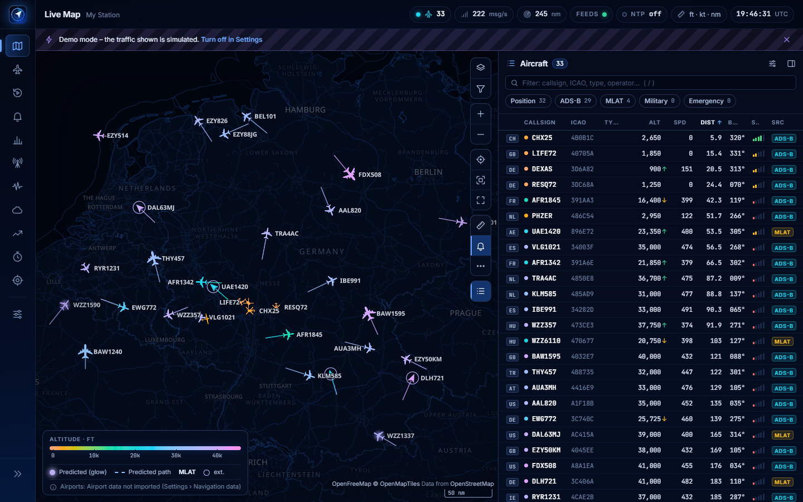

# 1. Introduction and installation

This chapter explains what AirView is made of, which download you need, and how to install each part:

| Section | What you install | On |
|---|---|---|
| [1.1](#11-what-airview-is) | Concepts: station, aggregator, feeder | – |
| [1.2](01-install-01-windows-station.md) | The AirView **station** with `AirView-Setup-<version>.exe`, or portable | Windows PC |
| [1.3](01-install-02-pi-station.md) | The AirView **station** from the SD-card image or the Pi app bundle and its install script | Raspberry Pi |
| [1.4](01-install-03-linux-server.md) | The **aggregator** (network server): server kit, Docker, reverse proxy, firewall | Linux VPS or home server |
| [1.5](01-install-04-pi-feeder.md) | The **feeder** from the SD-card image or the one-line installer | Raspberry Pi / Debian / Ubuntu |
| [1.6](01-install-05-windows-feeder.md) | The **feeder** with `AirView-Feeder-Setup-<version>.exe`, or the portable ZIP | Windows PC |
| [1.7](01-install-06-first-run.md) | First-run setup of a station and of an aggregator | – |
| [1.8](01-install-07-updates.md) | Updating each of the above | – |

The rest of the manual covers the station pages ([chapter 2](02-station-00-overview.md)), running a network
([chapter 3](03-network.md)) and the reference material ([chapter 4](04-reference-1-configuration.md)).

## 1.1 What AirView is

AirView receives the 1090 MHz Mode S / ADS-B messages that aircraft transmit, decodes them, stores them in
its own database and shows them in a web interface: a live map, long-term statistics, antenna and terrain
analysis, an RF lab, alerts, flight reports and replay, weather, forecasts and timing diagnostics.

AirView is one program, `airview`, that runs in one of two **modes**, plus a small separate program,
`airview-feeder`:

| Part | What it does | Typical host |
|---|---|---|
| **Station** (`airview`, mode `standalone`, the default) | Connects to *your* receiver (a Radarcape, any Beast, AVR, SBS or JSON source, readsb/dump1090, or an RTL-SDR through `rtl_tcp`), decodes, stores and serves the full web interface. | A Windows PC or a Raspberry Pi next to the receiver |
| **Aggregator** (`airview`, mode `aggregator`) | The server of an *AirView Network*: many feeders connect to it; it merges their data into one live map, runs AirView's own multilateration (MLAT) and keeps statistics per station, with owner and admin accounts. | A headless Linux VPS (designed for 1,000+ feeders and 10,000+ aircraft) |
| **Feeder** (`airview-feeder`) | A small headless program that reads a receiver (normally readsb/dump1090 on port 30005, or a Radarcape) and sends its data, encrypted and time-stamped, to one or more aggregators. It has a local status page on port 8099. | A Raspberry Pi or a Windows PC next to the receiver |

A station can also feed a network itself (**Settings → Network uplinks**), so you do not need the separate
feeder program on a computer that already runs the AirView station.



*The station's Live Map, here in demo mode (built-in traffic simulator).*

### How the parts fit together

```
  receiver ──Beast──> AirView station (Windows / Pi) ──web UI──> browsers on your network
                            │  (optional uplink)
  receiver ──Beast──> airview-feeder (Pi / Windows) ──AVF/1, TLS, TCP 30160──┐
  readsb  ──beast_reduce_plus_out, TCP 30004────────────────────────────────┤
  mlat-client ──TCP 31090───────────────────────────────────────────────────┤
                                                                            v
                                      AirView aggregator (Linux VPS) ──HTTPS via reverse proxy──> public map,
                                                                                                  owners, admins
```

Ports you will meet in this chapter:

| Port | Used by |
|---|---|
| 80 (TCP) | The station web interface (default; falls back to 8080-8089, then any free port, when 80 is taken). The aggregator listens on 127.0.0.1:8080 behind a reverse proxy. |
| 30154 (TCP) | Station *data port* (hub): another AirView logs in to receive this station's live stream (remote-data mode). |
| 30160 (TCP) | Aggregator: AVF/1, the encrypted protocol of `airview-feeder` and station uplinks. |
| 30004 (TCP) | Aggregator: Beast compatibility input for readsb / Ultrafeeder (map and statistics only). |
| 31090 (TCP, optional UDP) | Aggregator: mlat-client input. |
| 8099 (TCP) | Feeder status page (loopback only unless you allow your network). |
| 30105 (TCP) | Feeder: MLAT results from the network as a local Beast output (loopback). |

### The three connection modes of the Windows app

The Windows desktop app can also use another AirView instead of its own receiver (**Settings → Connection /
remote**): **Standalone** (default), **Remote data** (log in to another station's data port and run the
statistics locally) and **Remote website** (show the other station's web interface in the window). A headless
station (Raspberry Pi, Linux) always runs standalone or as an aggregator; it follows another station's data
port only when started with the environment variable `AIRVIEW_REMOTE=1`. See
[1.7](01-install-06-first-run.md#172-connecting-the-windows-app-to-a-pi-station).

## Choosing what to download

Every release is published as one set of files with a `SHA256SUMS` list (and its signature
`SHA256SUMS.sig`). For release 1.0.1:

| File | Install it when you want ... | Section |
|---|---|---|
| `AirView-Setup-1.0.1.exe` | the station on a Windows PC (installer, Start menu, uninstaller) | [1.2](01-install-01-windows-station.md) |
| `airview.exe` | the station on Windows without installing (portable) | [1.2](01-install-01-windows-station.md#portable-airviewexe) |
| `AirView-Station-Pi-1.0.1.img.zip` | a ready SD card for a Raspberry Pi station | [1.3](01-install-02-pi-station.md) |
| `airview-pi-1.0.1.tar.gz` + `airview-pi-install.sh` | the station on an existing Raspberry Pi OS (arm64 or armv7) | [1.3](01-install-02-pi-station.md#install-from-the-app-bundle) |
| `airview-server-linux-{amd64,arm64}.tar.gz` + `airview-server-install.sh` | an aggregator (or a headless station) on a Linux server with systemd | [1.4](01-install-03-linux-server.md) |
| `airview-docker-1.0.1.tar.gz` | an aggregator in Docker (build context with the prebuilt binaries) | [1.4](01-install-03-linux-server.md#145-docker) |
| `AirView-Feeder-Pi-1.0.1.img.zip` | a ready SD card for a Raspberry Pi feeder | [1.5](01-install-04-pi-feeder.md) |
| `airview-feeder-pi-1.0.1.tar.gz` + `airview-feeder-install.sh` | the feeder on Raspberry Pi OS / Debian / Ubuntu | [1.5](01-install-04-pi-feeder.md) |
| `AirView-Feeder-Setup-1.0.1.exe` (`-arm64.exe` for Windows on Arm) | the feeder on Windows (service + tray icon) | [1.6](01-install-05-windows-feeder.md) |
| `AirView-Feeder-1.0.1-windows-{amd64,arm64}.zip` | the feeder on Windows without installing (portable) | [1.6](01-install-05-windows-feeder.md#162-portable-zip) |
| `airview-linux-*`, `airview-feeder-linux-*`, `airview-feeder-windows-*.exe` | plain binaries (also the self-update payloads) | – |
| `release/airview/`, `release/feeder/` | signed update manifests, published for self-update | [1.8](01-install-07-updates.md) |

### Checking a download

Compare the SHA-256 of every file you download with its line in `SHA256SUMS`:

```sh
sha256sum -c SHA256SUMS --ignore-missing          # Linux / macOS
```

```powershell
Get-FileHash .\AirView-Setup-1.0.1.exe            # Windows: compare the hash with SHA256SUMS
```

`SHA256SUMS.sig` is an Ed25519 signature of `SHA256SUMS`, made with the release key. The Pi station installer
checks it for you when you give it the release public key (`--key`, [1.3](01-install-02-pi-station.md)).

### System requirements

| Part | Requirement |
|---|---|
| Windows station | Windows 11 x64 (or Windows 10 with the Microsoft Edge WebView2 runtime). Without WebView2 AirView still runs and opens in your default browser instead of its own window. |
| Pi station | Raspberry Pi 3, 4, 5, 400, 500 or Zero 2 W. The SD-card image is 64-bit Raspberry Pi OS Lite (Trixie); the app bundle also runs on 32-bit Raspberry Pi OS (armv7). For long histories use an SSD rather than an SD card. |
| Aggregator | 64-bit Linux with systemd, amd64 or arm64; about 2-4 vCPU and 4-8 GB RAM for 100 feeders, 8+ vCPU, 16-32 GB RAM and 250 GB SSD for 1,000+ feeders (see [1.4](01-install-03-linux-server.md#141-before-you-start)). Or Docker (BuildKit). |
| Pi / Linux feeder | Raspberry Pi OS, Debian or Ubuntu with systemd on arm64, armhf (armv7) or amd64. ARMv6 (Pi 1, Zero, Zero W) is not supported. A decoder (readsb, dump1090) or a networked receiver such as a Radarcape. |
| Windows feeder | Windows 10 or 11, x64 or Arm64. A receiver reachable over the network (Radarcape, Beast, AVR or SBS output). |

All AirView programs are single static binaries: no runtime, no external database, no other packages.

> **Release 1.0.1 notes.** The Windows installers are not code-signed, so SmartScreen warns the first time
> (see [1.2](01-install-01-windows-station.md#smartscreen)). The Raspberry Pi images and installers, Docker
> and the systemd units were built and checked offline but not run on real hardware for this release; see
> `docs/RELEASE-NOTES.md`.
