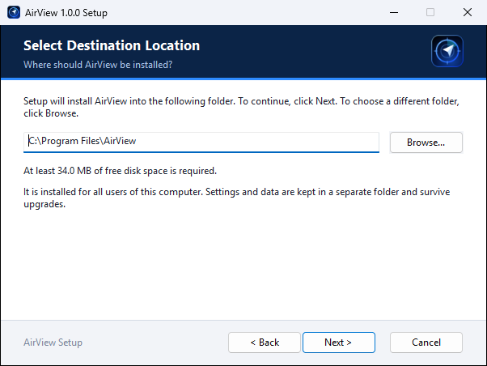
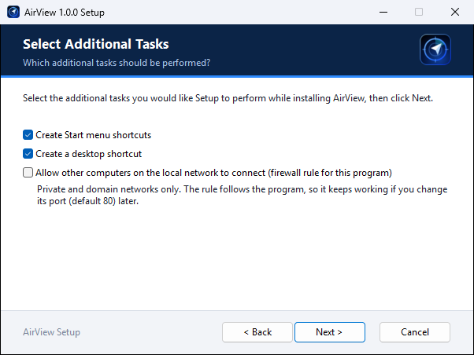
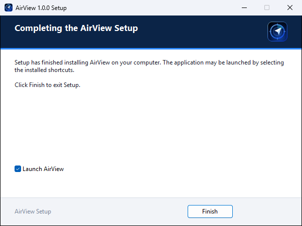

# 1.2 Windows station

On Windows AirView is a desktop app: `airview.exe` opens its own window (Microsoft Edge WebView2) and at the
same time serves the same web interface to every browser on your network. You can install it with
`AirView-Setup-<version>.exe` or run the portable `airview.exe` from any folder you can write to.

## SmartScreen

The installer and `airview.exe` are not Authenticode-signed. The first time you run a downloaded copy,
Windows SmartScreen may show **"Windows protected your PC"**. Before you continue:

1. Check that the file came from the place your AirView releases are published.
2. Compare its SHA-256 with the line in `SHA256SUMS`:

   ```powershell
   Get-FileHash .\AirView-Setup-1.0.0.exe
   ```

3. Click **More info**. The publisher shows as *Unknown publisher*. Check the file name, then click **Run anyway**.

## 1.2.1 Install with AirView-Setup

`AirView-Setup-1.0.0.exe` is AirView's own installer (nothing is downloaded during the installation). Double-click it:

| Page | What to do |
|---|---|
| **Welcome** | Next. |
| **Licence** | Accept the licence agreement. |
| **Select Destination Location** | Default `C:\Program Files\AirView`. It shows the free space needed (about 34 MB). |
| **Select Additional Tasks** | *Create Start menu shortcuts* (on), *Create a desktop shortcut* (on), *Allow other computers on the local network to connect* (off, see below). |
| **Ready to Install** | Check the summary, then Install. |
| **Installing** | Progress. |
| **Completing** | *Launch AirView* starts the app (never with administrator rights). |





**Administrator rights.** Setup itself starts without elevation. A per-machine installation into
`Program Files` (the default) makes it restart itself, and Windows asks once for administrator rights. To
install without any UAC prompt, also as a standard user, run it with `/CURRENTUSER`: AirView then goes to
`%LOCALAPPDATA%\Programs\AirView` and setup adds no firewall rule.

**Firewall.** *Allow other computers on the local network to connect* adds an inbound Windows Firewall rule
named *AirView web interface* for `airview.exe`, for private and domain networks only. The rule follows the
program, so it keeps working if you change the HTTP port later (default 80). Without the rule, Windows
Firewall asks the first time AirView listens on the network.

**Start menu.** The *AirView* folder holds *AirView* and *AirView documentation* (the `docs` folder of the
installation: operator guide, feeder guide, privacy notice). Settings → Apps lists AirView with its version and
an uninstaller.



### Silent installation

```text
AirView-Setup-1.0.0.exe /S [/NODESKTOP] [/FIREWALL [/PORT=8080]] [/D=D:\Apps\AirView]
AirView-Setup-1.0.0.exe /S /CURRENTUSER
"C:\Program Files\AirView\uninstall.exe" /S [/REMOVEDATA]
```

| Switch | Meaning |
|---|---|
| `/S` (also `/SILENT`, `/VERYSILENT`) | No user interface. A per-machine install still asks for administrator rights once. |
| `/D=<dir>` | Destination; must be the last switch; may contain spaces, no quotes. |
| `/ALLUSERS` / `/CURRENTUSER` | Per-machine (default) or per-user installation. |
| `/DESKTOP` / `/NODESKTOP`, `/STARTMENU` / `/NOSTARTMENU` | Shortcuts. |
| `/FIREWALL` / `/NOFIREWALL`, `/PORT=<n>` | Inbound firewall rule and its port. |
| `/NOLAUNCH` | Do not offer to start AirView at the end. |
| `/LOG=<file>` | Setup log (default `%TEMP%\AirView-setup.log`). |
| `/REMOVEDATA` / `/KEEPDATA` | Uninstall only: delete or keep the configuration and data (default keep). |
| `/?` | Lists every switch and the exit codes. |

Switches are case-insensitive and may start with `-` instead of `/`. Exit codes: 0 done, 1 failed,
2 cancelled, 3 needs administrator rights, 4 bad command line, 3010 restart needed.

## Portable airview.exe

The portable `airview.exe` needs no installation:

1. Create a folder you can write to, for example `C:\AirView\`, and copy `airview.exe` into it.
2. Double-click `airview.exe`. A window opens on the Live Map.

The data folder is then `C:\AirView\data\`, next to the program, so the whole folder can be moved or copied to
another PC.

## 1.2.2 Where things are

AirView keeps everything in one **data folder**:

- `data\` next to `airview.exe` when that folder is writable (portable use, or a `/CURRENTUSER` installation);
- otherwise `%APPDATA%\AirView` (a normal installation in `Program Files`), created at the first start;
- or the folder given with `-data <folder>`.

| File | Contents |
|---|---|
| `airview.db` (+ `-wal`, `-shm`) | All history and statistics (SQLite) |
| `config.json` | All settings, edited from **Settings** |
| `airview.log`, `airview.log.1` | Log, rotated at 4 MB |
| `tilecache\`, `terrain\` | Cached map tiles and elevation tiles |
| `webview2\`, `window.json` | The window's browser profile and position |

Only one AirView can run per data folder. Starting it a second time brings the running window to the front.

## 1.2.3 Starting AirView

Start menu → *AirView* (or the desktop shortcut). The window opens on the Live Map; continue with the
[first-run setup](01-install-06-first-run.md).

- **Port.** The web server listens on port 80 by default, so other devices open `http://<pc-name>/`. If port
  80 is taken (IIS, another web server), AirView tries 8080, 8081 ... 8089 and then any free port. The window
  always opens on the right port; other devices need the actual port, shown in the log and in **Settings → Web
  server**.
- **Without WebView2** (rare on Windows 11), a message explains that AirView keeps running in the background
  and opens in your default browser instead; end `airview.exe` in Task Manager to stop it. Install Microsoft's
  *Evergreen WebView2 Runtime* to get the window.
- **No receiver yet?** Start `airview.exe -demo`, or switch on **Settings → Demo mode**: a simulator flies up
  to 60 aircraft around the station. While demo mode is on, it replaces your receiver feeds.

### Command-line options

| Option | Meaning |
|---|---|
| `-data <dir>` | Data folder. |
| `-port <n>` | Use this HTTP port instead of the configured one. |
| `-headless` | No window; logs go to the console. |
| `-demo` | Force the built-in traffic simulator. |
| `-open` | With `-headless`: open the default browser on the web interface. |
| `-config <file>` | Operator configuration file (JSONC); see [4.1](04-reference-1-configuration.md). |
| `-set path=value` | Override one setting for this run, e.g. `-set http.port=8080` (repeatable). |
| `-version` | Print the version and exit. |

`airview -help` lists the commands as well, for example `airview backup -o file.zip` and
`airview restore file.zip` (see [4.2](04-reference-2-cli.md)). The environment variable `AIRVIEW_DEBUG=1` turns on
debug logging.

## 1.2.4 Uninstall

Settings → Apps → AirView → Uninstall (or `uninstall.exe` in the installation folder). The program files,
shortcuts and uninstall entry are removed. Your configuration and data are kept unless you tick **Also delete
the configuration and data**; a later reinstall continues where you left off. A portable copy is removed by
closing AirView and deleting its folder.
