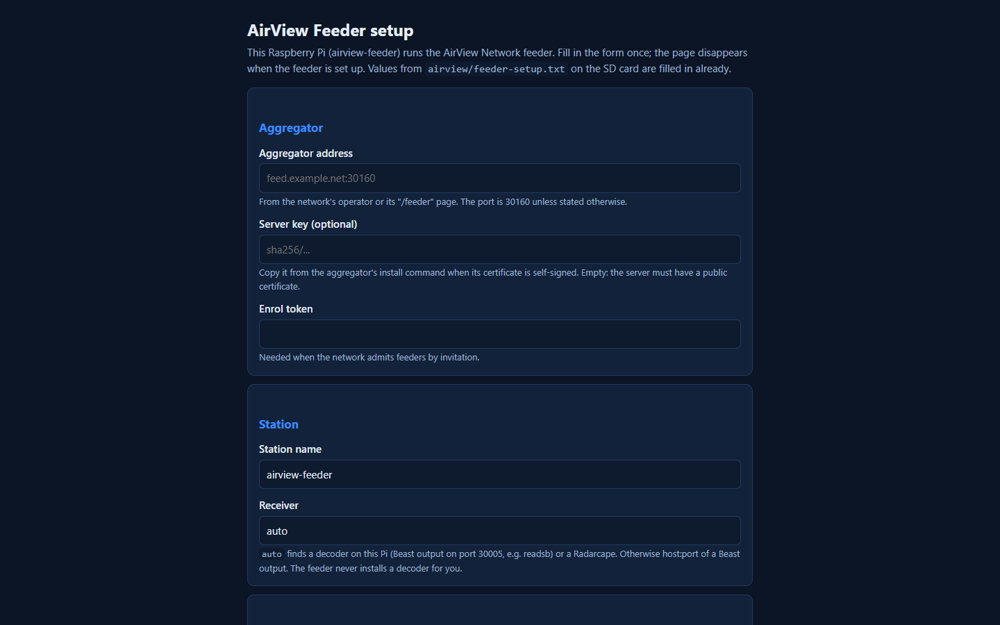
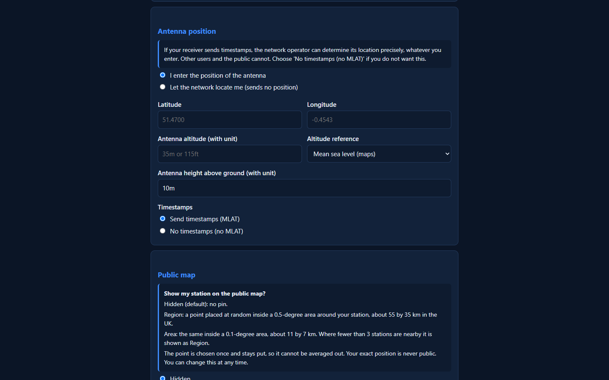
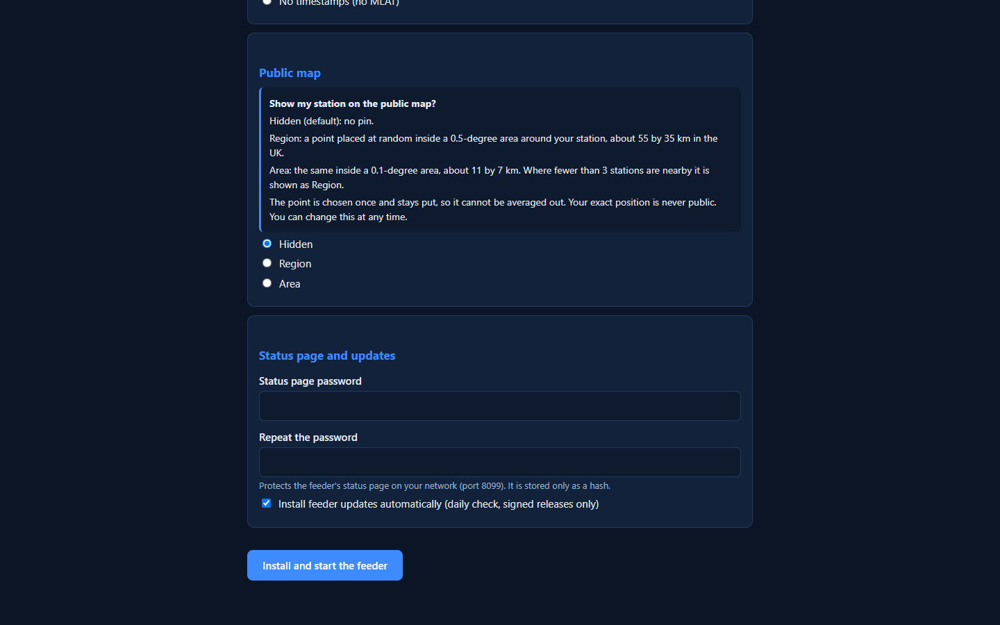

# 1.5 Raspberry Pi and Linux feeder

`airview-feeder` sends your receiver's data to one or more AirView aggregators. On a Raspberry Pi (or any
Debian / Ubuntu machine with systemd) it runs as the hardened service `airview-feeder.service`. It reuses the
receiver software you already have and never removes, stops or reconfigures readsb, dump1090, a Radarcape or
other feeders. It does not bundle a decoder: readsb and dump1090 are separate GPL programs that you install
yourself if you use an RTL-SDR dongle (or point the feeder at `rtl_tcp`, see [chapter 3](03-network.md)).

| Way | File | Best for |
|---|---|---|
| [SD-card image](#151-sd-card-image) | `AirView-Feeder-Pi-<version>.img.zip` | A new Pi that will read a receiver on the network (or where you install a decoder yourself). |
| [One-line installer](#152-one-line-installer) | `https://<aggregator>/feeder/install.sh` | A Pi that already runs readsb / dump1090, feeding one network. |
| [Feeder bundle](#153-from-the-feeder-bundle) | `airview-feeder-pi-<version>.tar.gz` | Offline installs, or a network that does not serve the installer. |

**What you need from the network operator:** the aggregator address (for example `feed.example.org:30160`),
the server key pin when the server's certificate is self-signed (`sha256/...`), and usually an **enrol
token** (networks admit feeders by invitation by default). The network's **Feed this network** page
(`https://<aggregator>/#/feeder`) shows the install command with the address and pin filled in.

**Your antenna position.** For MLAT the position matters to within about 10-20 m: latitude and longitude in
decimal degrees, and the antenna altitude **with a unit** (`35m` or `115ft`), above mean sea level (what maps
show) or the GPS ellipsoid. You may also send no position and let the network locate the station.

> **Consent.** If your receiver sends timestamps, the network operator can determine its location precisely,
> whatever you enter. Other users and the public cannot. Choose *No timestamps (no MLAT)* if you do not want
> this. Your station is hidden on the public map unless you choose *Region* or *Area*.

## 1.5.1 SD-card image

`AirView-Feeder-Pi-<version>.img.zip` is Raspberry Pi OS Lite (64-bit, Trixie) plus the feeder files on the
boot partition. Write it exactly like the station image ([1.3.1](01-install-02-pi-station.md#131-sd-card-image)):
Raspberry Pi Imager → **Use custom** → the `.img.zip`, with OS customisation for user, Wi-Fi and SSH as you
need. Leave the host name at the default to get `airview-feeder`.

On the first boot the Pi checks the files, sets the host name (only while it is still `raspberrypi`) and starts
a **setup page on port 8099**. Open `http://airview-feeder.local:8099/` (or `http://<the Pi's IP>:8099/`)
from a computer on the same network:



| Field | Enter |
|---|---|
| **Aggregator address** | From the operator or the network's *Feed this network* page; port 30160 unless stated otherwise. |
| **Server key (optional)** | The `sha256/...` pin from the network's install command when its certificate is self-signed. Empty: the server must have a public certificate. |
| **Enrol token** | Needed when the network admits feeders by invitation. |
| **Station name** | Letters, digits, `-` and `_`, at most 32 (default: the host name). |
| **Receiver** | `auto` finds a decoder on this Pi (Beast output on port 30005, e.g. readsb) or a Radarcape; otherwise `host:port` of a Beast output. |



| Field | Enter |
|---|---|
| **Antenna position** | *I enter the position of the antenna* (latitude, longitude, altitude with unit, reference MSL or GPS ellipsoid, height above ground with unit, default `10m`), or *Let the network locate me (sends no position)*. |
| **Timestamps** | *Send timestamps (MLAT)* or *No timestamps (no MLAT)*. |



| Field | Enter |
|---|---|
| **Public map** | *Hidden* (default, no pin), *Region* (a point inside a 0.5° area, about 55 × 35 km in the UK) or *Area* (0.1°, about 11 × 7 km; shown as Region where fewer than 3 stations are nearby). |
| **Status page password** | Protects the feeder's status page on your network (port 8099); at least 8 characters, stored only as a hash. |
| **Install feeder updates automatically** | Daily check, signed releases only. Shown as *not available* on an image without a release key. |

**Install and start the feeder** runs the standard feeder installer, sets the status page to listen on your
network with your password, switches the setup page off and starts `airview-feeder.service`. Its status page
then takes over port 8099: open it as `http://<the Pi's IP address>:8099/` (it refuses host names, to defeat DNS
rebinding).

While the setup page exists it answers only clients on private, link-local or CGNAT addresses and checks the
Host header and a per-boot form token. Anyone on your LAN could still fill it in first; if that matters, use the
unattended file below.

### Unattended feeder setup

Before the first boot, open the card's boot partition on your PC and edit `airview/feeder-setup.txt` (a
commented template). Remove the `#` in front of the lines you use; at least `SERVER=` is needed:

```ini
SERVER=feed.example.net:30160
PIN=sha256/...
TOKEN=ABCD-1234
NAME=my-station
LAT=51.4700
LON=-0.4543
ALT=35m
ALT_REF=msl
AGL=10m
TIMESTAMPS=yes
PRIVACY=hidden
INPUT=auto
UI_PASSWORD=choose-a-long-one
```

Other keys: `NO_LOCATION=yes`, `AUTO_UPDATE=yes|no`, `MANIFEST_KEY=` and `UPDATE_URL=` (release images carry the
key already). The feeder is then configured without the page and the file is deleted from the card after use.
Errors fall back to the setup page with the values filled in. Without `UI_PASSWORD` the status page answers only
on the Pi itself.

**Problems:** log in and read `/var/log/airview-firstboot.log` and `journalctl -u airview-pisetup -u airview-feeder`.

## 1.5.2 One-line installer

The aggregator serves the installer with its own address, pin and release key already filled in. Download it,
read it if you like, run it:

```sh
curl -fsSL https://feed.example.org/feeder/install.sh -o /tmp/avf.sh
sudo bash /tmp/avf.sh
```

or in one line (the questions still work, because the script reads them from the terminal):

```sh
curl -fsSL https://feed.example.org/feeder/install.sh | sudo bash
```

The installer:

1. checks root, systemd, the CPU (`arm64`, `armhf` including a 64-bit kernel with a 32-bit userland, `amd64`),
   50 MB of free disk and the clock synchronisation; it offers to install chrony when the clock is not
   NTP-synchronised;
2. looks for your receiver: a Beast output on 30005 (readsb, dump1090-fa ...) is reused as it is; a Radarcape is
   found by its `rcd` process, a `radarcape*` host name or port 10003; for an RTL-SDR without a decoder it explains
   how to install readsb yourself; Airspy, SDRplay and an FTDI Mode-S Beast get their own hints;
3. asks (with `whiptail` dialogs where available) for the aggregator and enrol token, the station name, the
   antenna position or "let the network locate me", the altitude with unit and its reference, the height above
   ground, the receiver input, the public pin and whether to send timestamps, showing the consent text with the
   location and timestamp questions;
4. downloads `airview-feeder` for this CPU from the network and verifies it: the release manifest's Ed25519
   signature (with the network's release key, OpenSSL 3.0 or newer), then the binary's SHA-256 and size;
5. installs it as a service under its own user `airview-feeder`, with a daily update timer;
6. prints the status page address, a **claim code** and the commands for logs, updates and uninstalling, and
   waits up to 30 s to confirm the link to the aggregator (it reports refusals such as `enrol_required`).

### Unattended installation

All questions have options; `--non-interactive` (or `-y`) never asks:

```sh
curl -fsSL https://feed.example.org/feeder/install.sh | sudo bash -s -- \
  --token ABCD-1234 --name my-pi --lat 51.47 --lon -0.45 --alt 30m --agl 8m \
  --input auto --privacy hidden --non-interactive
```

| Option | Meaning |
|---|---|
| `--server HOST[:PORT]` | Aggregator AVF/1 address; port 30160 by default; IPv6 as `[2001:db8::1]:30160`. |
| `--pin sha256/BASE64` | Expected server key; empty = system CA roots. |
| `--token TOKEN` (`--enrol`) | Enrol token from the operator. |
| `--url https://HOST` | Download base URL (default `https://` + the server host). |
| `--manifest-key BASE64` | Ed25519 public key that signs the release manifest. |
| `--binary FILE` | Install a local `airview-feeder` binary instead of downloading one. |
| `--name NAME` | Station name, `[A-Za-z0-9_-]{1,32}` (default: the host name). |
| `--lat DEG --lon DEG` | Antenna position in decimal degrees. |
| `--alt 120m` / `--alt 400ft` | Antenna altitude; the unit is mandatory. |
| `--alt-ref msl\|hae` | Altitude reference: mean sea level (default) or GPS ellipsoid. |
| `--agl 8m` | Antenna height above ground (default 10 m). |
| `--no-location` | Send no position; the network locates the station. |
| `--input SPEC` | `auto` (default), `HOST:PORT` (Beast), `beast:`/`avr:`/`sbs:HOST:PORT`, `radarcape:HOST`. |
| `--privacy hidden\|region\|cell01` | Public map pin (default hidden). |
| `--no-timestamps` | No timestamps: no MLAT and no timing-based self-location. |
| `--readsb-results` | Also push returned MLAT results into readsb's Beast input `127.0.0.1:30104`. |
| `--no-auto-update` | Do not enable the daily update timer. |
| `--channel stable\|beta` | Release channel for updates. |
| `--install-chrony` | Install chrony when the clock is not synchronised. |
| `--no-start` | Install and enable, but do not start. |
| `--dry-run` | Change nothing; print every command. |

Values come from, lowest priority first: the network's presets in the script, the answers saved by the previous
run (`/etc/airview-feeder/install.env`), then the options; interactive answers override all of them. Running the
installer again **reconfigures** the feeder with the current values as defaults (`sudo airview-feeder-setup`).

## 1.5.3 From the feeder bundle

`airview-feeder-pi-<version>.tar.gz` contains the same `install.sh` and the feeder binaries for arm64, armv7 and
amd64. Run from the unpacked bundle, the installer uses the bundled binary for this CPU instead of downloading one:

```sh
tar xzf airview-feeder-pi-1.0.0.tar.gz
cd airview-feeder-pi-1.0.0
sudo bash install.sh --server feed.example.org:30160 --pin sha256/... --token ABCD-1234
```

It warns that the local binary's signature is not checked: compare the bundle with `SHA256SUMS` first. Give
`--manifest-key` (and `--url` when the releases are not on the aggregator itself) so that later updates are
verified. `airview-feeder-install.sh` in the release folder is the same script without network presets.

## 1.5.4 After installation

| What | Where |
|---|---|
| Program | `/opt/airview-feeder/airview-feeder`; scripts `install.sh`, `update.sh`, `uninstall.sh`, `status.sh` |
| Settings | `/etc/airview-feeder/feeder.json` (`root:airview-feeder`, 0640) |
| Saved installer answers (includes the enrol token) | `/etc/airview-feeder/install.env` (root only) |
| Identity key and UUID, spool | `/var/lib/airview-feeder/` (keep `identity.key` private) |
| Service and update timer | `airview-feeder.service`, `airview-feeder-update.timer` |
| Logs | `journalctl -u airview-feeder -f` |

```sh
sudo airview-feeder-setup --status       # service, settings (token hidden), link state
sudo airview-feeder-setup --claim        # a new claim code for the aggregator
sudo airview-feeder-setup                # reconfigure
```

**Status page.** After a one-line or bundle install the status page listens on `http://127.0.0.1:8099/` on the
Pi only. From another computer use an SSH tunnel:

```sh
ssh -L 8099:127.0.0.1:8099 pi@<pi-address>      # then open http://127.0.0.1:8099/
```

or let it listen on your network with a password:

```sh
sudo /opt/airview-feeder/airview-feeder config set -config /etc/airview-feeder/feeder.json \
     ui.addr=0.0.0.0:8099 ui.passwordHash='<password>'
sudo systemctl restart airview-feeder
```

(A plain password given to `ui.passwordHash` is stored hashed.) The status page is described in
[1.6.3](01-install-05-windows-feeder.md#163-the-feeder-status-page); it is the same on every platform.

**Claim the station:** sign in to the network, open **Claim a feeder** and enter the claim code (valid 24 hours,
works once). See [chapter 3](03-network.md).

**Cloned SD card?** Two feeders with the same identity are refused (`cloned_feeder`). Run
`sudo /opt/airview-feeder/airview-feeder new-identity` on the copy.

## 1.5.5 Uninstall

```sh
sudo /opt/airview-feeder/uninstall.sh            # keeps /etc/airview-feeder and /var/lib/airview-feeder
sudo /opt/airview-feeder/uninstall.sh --purge    # also deletes configuration, identity key and the user
```

Without `--purge` a reinstall continues as the same station. The uninstaller never touches readsb, dump1090 or
other feeders. Uninstalling does not delete your data at the network.
