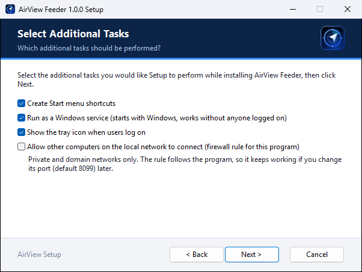
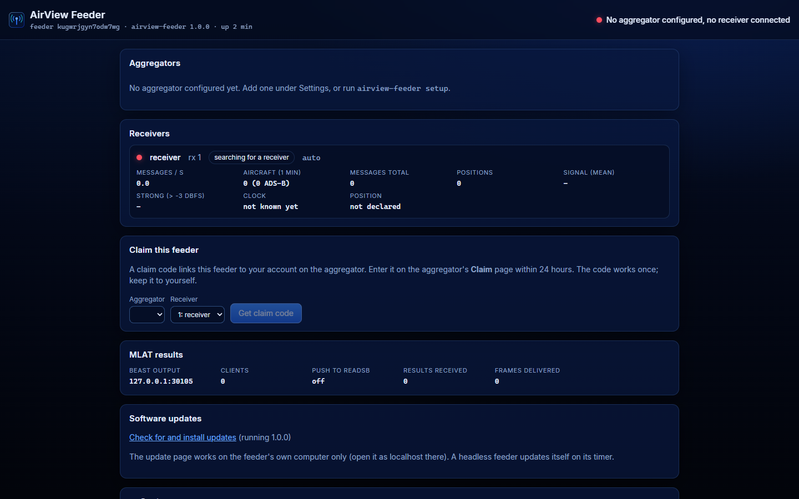
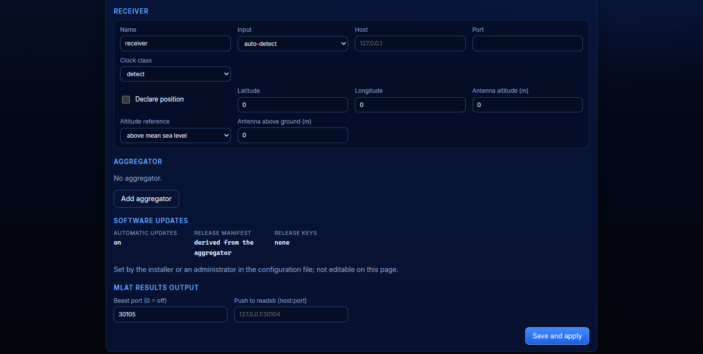

# 1.6 Windows feeder

AirView Feeder for Windows sends a receiver's data to AirView aggregators from a Windows 10 or 11 PC (x64 or
Arm64). It reads a receiver over the network: a Radarcape, a Beast, AVR or SBS output (for example
dump1090-win, airspy_adsb, ModeSMixer2 or a Virtual Radar Server rebroadcast). SBS and rebroadcast inputs carry
no usable timing: map only, no MLAT.

Two programs do the work: `airview-feeder.exe` (the feeder; also the Windows service and the command line) and
`airview-feeder-tray.exe` (the same program without a console window: the notification-area icon).

| Download | What you get |
|---|---|
| `AirView-Feeder-Setup-<version>.exe` (x64) or `AirView-Feeder-Setup-<version>-arm64.exe` | Installer: Windows service *AirView Feeder*, tray icon at log-on, Start menu, uninstaller. Recommended. |
| `AirView-Feeder-<version>-windows-{amd64,arm64}.zip` | Portable: unzip and run, no administrator rights needed. |

If you already run the AirView station on that PC, you do not need the feeder: use the station's **Settings →
Network uplinks** instead ([1.7](01-install-06-first-run.md#feeding-a-network-from-the-station)).

**SmartScreen.** The installer and programs are not code-signed. Check that the file came from your network's
page or the release site, compare its SHA-256 with `SHA256SUMS` (`Get-FileHash <file>`), then click **More
info → Run anyway**. For the ZIP, right-click it → **Properties** → tick **Unblock** before unzipping.

## 1.6.1 Install with AirView-Feeder-Setup

The wizard has the same pages as the station installer ([1.2.1](01-install-01-windows-station.md#121-install-with-airview-setup)):
welcome, licence, destination (default `C:\Program Files\AirView Feeder`), additional tasks, ready, progress,
finished. Windows asks once for administrator rights (the service needs them).



| Task | Default | What it does |
|---|---|---|
| Create Start menu shortcuts | on | *AirView Feeder* (tray), *Status page*, *Read me*. |
| Run as a Windows service | on | Service `AirViewFeeder` (account `NT SERVICE\AirViewFeeder`), automatic start, restarted on failure; feeds while nobody is logged on. |
| Show the tray icon when users log on | on | Starts `airview-feeder-tray.exe` at log-on for every user. |
| Allow other computers on the local network to connect | off | Firewall rule *AirView Feeder status page* (TCP 8099, private and domain networks, this program only). |

The interactive wizard does not ask for the aggregator. On the last page, **Start the tray icon now** starts the
tray; the first time it opens the status page's **Settings** in your browser (and shows the notification
*"Finish the setup: add your aggregator on the settings page."*). Continue with [1.6.3](#163-the-feeder-status-page).

### Silent installation (many feeders)

With `/SERVER=` the installer also configures the feeder, so it starts feeding at once:

```text
AirView-Feeder-Setup-1.0.1.exe /S /SERVER=feed.example.org /PIN=sha256/... /ENROL=TOKEN /NAME=home1
    /LAT=51.4775 /LON=-0.4614 /ALT=35m /AGL=8m /PRIVACY=hidden
```

| Switch | Meaning |
|---|---|
| `/SERVER=host[:port]` | Aggregator (port 30160 by default). Without it the feeder is installed unconfigured. |
| `/PIN=sha256/...` | Server key pin. |
| `/ENROL=TOKEN` | Enrol token. |
| `/NAME=name` | Station name. |
| `/LAT=` `/LON=` `/ALT=` `/AGL=` | Antenna position; altitude and height need a unit (`35m`, `115ft`). |
| `/NOLOCATION` | Send no position; the network locates the station. |
| `/PRIVACY=hidden\|region\|cell01` | Public map pin. |
| `/NOTIMESTAMPS` (or `/TIMESTAMPS`) | No timestamps: no MLAT. |
| `/NOSERVICE`, `/NOTRAY`, `/FIREWALL` | Tasks. |
| `/CURRENTUSER` | Per-user install without UAC (no service, no firewall rule). |
| `/D=<dir>`, `/LOG=<file>`, `/?` | Destination, setup log (default `%TEMP%\AirViewFeeder-setup.log`), help. |

The values are passed to `airview-feeder setup -non-interactive`, which validates them. Exit codes as for the
station installer: 0 done, 1 failed, 2 cancelled, 3 needs administrator rights, 4 bad command line, 3010 restart
needed.

### Where things are

| What | Where |
|---|---|
| Programs | `C:\Program Files\AirView Feeder` |
| Configuration | `%ProgramData%\AirView Feeder\feeder.json` |
| Identity (keep private) | `%ProgramData%\AirView Feeder\identity.key` |
| Logs | `%ProgramData%\AirView Feeder\logs\feeder.log`; start, stop and failures also go to the Windows Event Log (source *AirViewFeeder*) |

The data folder is readable only by SYSTEM, Administrators and the service.

### The tray icon

Right-click the icon (click the **^** next to the clock if it is hidden):

| Menu item | Does |
|---|---|
| **Open status page** (also a double-click) | `http://127.0.0.1:8099/` |
| **Settings…** | The status page's settings. |
| **Get claim code…** | A claim code, copied to the clipboard. |
| **Pause feeding** / **Resume feeding** | Stops feeding until you resume (or Windows restarts). |
| **Restart feeder** | |
| **Install as Windows service…** | Only when no service is installed (portable use). |
| **Open logs folder**, **Check for updates…** | |
| **Start with Windows** | The tray icon at log-on (set by the installer for every user). |
| **Quit tray** | The service keeps feeding. |

The icon is green while feeding, amber while starting or connecting, when the receiver is missing or no
aggregator is configured, red when the aggregator refuses the station or the service failed (with a
notification), and grey when paused or stopped.

### Uninstall

Settings → Apps → AirView Feeder → Uninstall. It closes the tray, removes the service, the firewall rule and the
autostart. Configuration and identity are kept unless you tick **Also delete the configuration and data**; a
reinstall then continues as the same station.

## 1.6.2 Portable ZIP

1. Unzip `AirView-Feeder-1.0.1-windows-amd64.zip` anywhere, for example to `Documents\AirView Feeder`. It
   contains `airview-feeder.exe`, `airview-feeder-tray.exe`, `Install service.cmd`, `Remove service.cmd` and
   `README.txt`.
2. Double-click `airview-feeder-tray.exe`. Without a service, the tray runs the feeder itself while you are
   logged on (data in `%ProgramData%\AirView Feeder`, made private to you).
3. The status page opens in your browser the first time. Under **Settings** enter the aggregator, your antenna
   position and the privacy choices, then **Save and apply**.
4. Right-click the icon → **Get claim code…** and claim the station on the network.
5. Right-click → **Start with Windows** to start the tray when you log on.

To feed while nobody is logged on, install the service: right-click → **Install as Windows service…** (or run
`Install service.cmd`; Windows asks for administrator rights). The service takes over the same configuration and
identity. Other locations: `airview-feeder-tray.exe -config <file> -data <dir>`.

**Removing:** quit the tray, run `Remove service.cmd` if you installed the service, run
`airview-feeder uninstall-helper -purge -yes` if you also want the configuration and identity gone, then delete
the folder.

## 1.6.3 The feeder status page

Every feeder (Windows and Linux) has a local status page, by default at `http://127.0.0.1:8099/` on the
feeder's own computer:



- **Aggregators:** each configured network with its link state.
- **Receivers:** messages per second, aircraft, positions, signal, the clock class and the declared position.
- **Claim this feeder:** **Get claim code** for the selected aggregator. Enter the code on the aggregator's Claim
  page within 24 hours; it works once.
- **MLAT results:** the local Beast output with positions computed by the network (`127.0.0.1:30105`), and the
  optional push into readsb.
- **Software updates:** *Check for and install updates* (only when the page is opened on the feeder's own
  computer).
- **Settings** (folded): the form below.



| Part | Fields |
|---|---|
| **Receiver** | Name; Input (*auto-detect*, `beast`, `avr`, `sbs`, *RTL-SDR (rtl_tcp)*), host and port; clock class (*detect* unless you know better); **Declare position** with latitude, longitude, antenna altitude (m), altitude reference and antenna height above ground (m). |
| **Aggregator** | **Add aggregator**: type (*AirView network (encrypted)* or *Other aggregator (Beast, e.g. readsb on port 30004)*), aggregator host and port, server pin, enrol token, public map pin (hidden / region / area), and switches for *Send my declared position*, *Send timestamps (MLAT)*, *Receive MLAT results*, *Public statistics*, *Show name publicly* and *Paused*. |
| **Software updates** | Read-only: automatic updates, release manifest and release keys are set by the installer or an administrator. |
| **MLAT results output** | Beast port (0 = off) and *Push to readsb* (`host:port`, e.g. `127.0.0.1:30104`). |

**Save and apply** writes `feeder.json` and applies it.

**From another computer:** the page listens on loopback only. Either tick the firewall task in the installer and
let the feeder listen on your network with a password (in an administrator console in the program folder):

```bat
airview-feeder config set ui.addr=0.0.0.0:8099 ui.passwordHash=<password>
airview-feeder service restart
```

or use `airview-feeder setup` in a console instead of the page (`airview-feeder help` lists every command).
