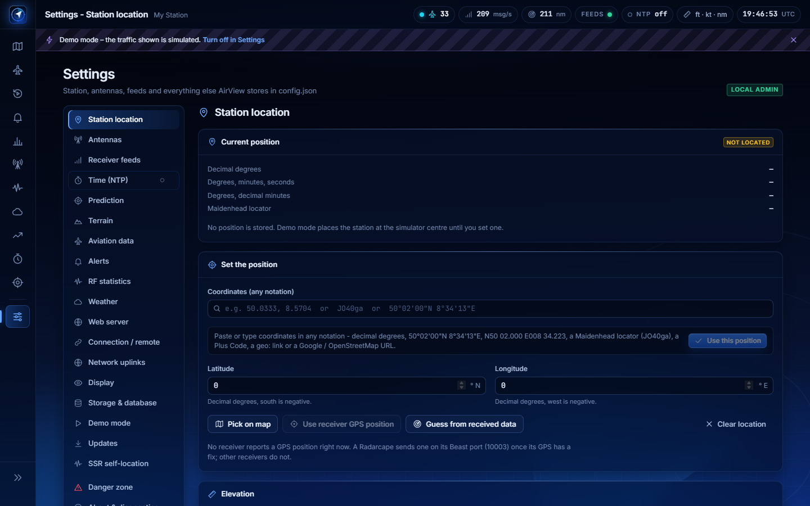
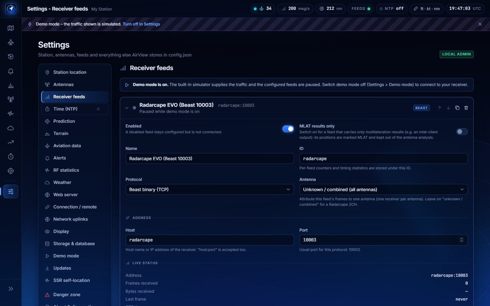
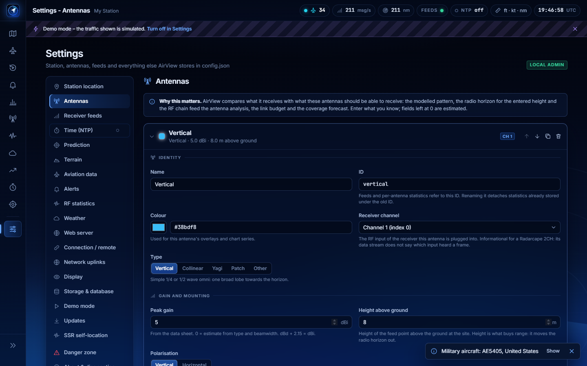
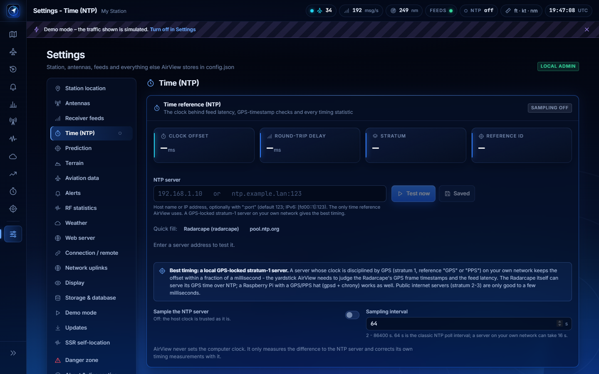
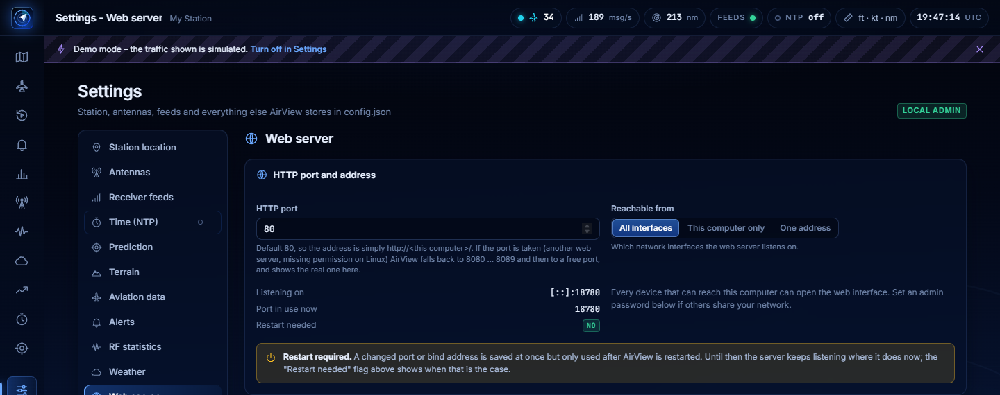
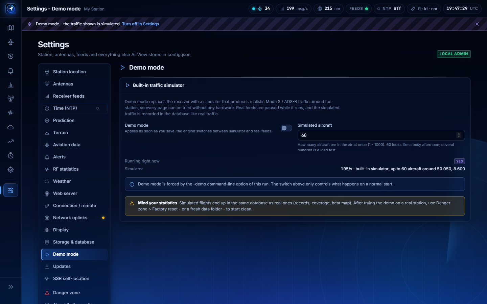
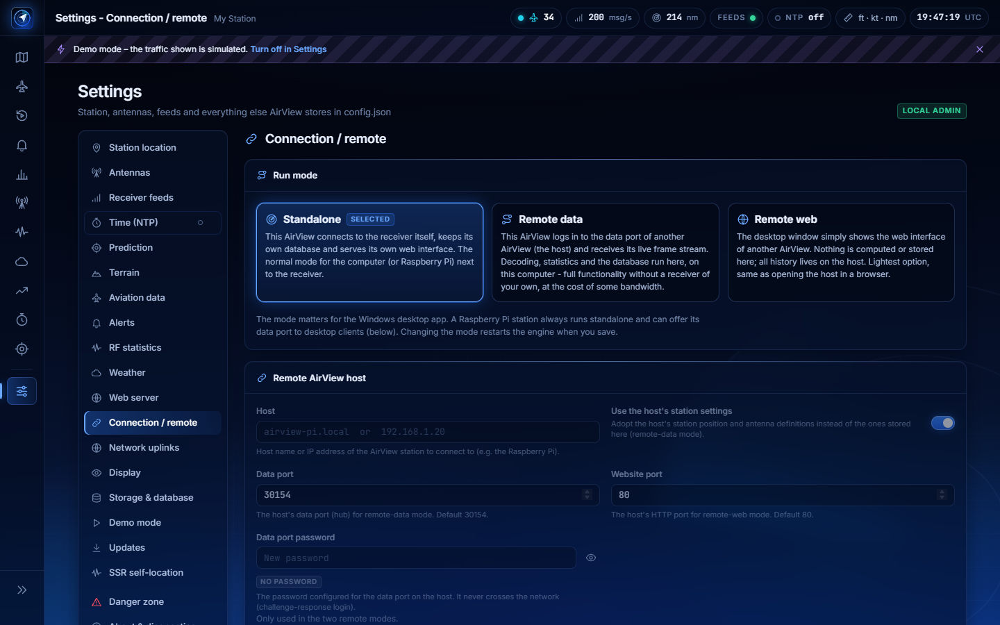
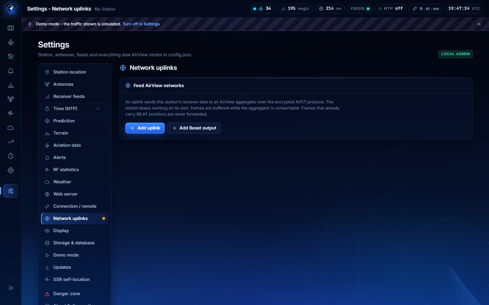
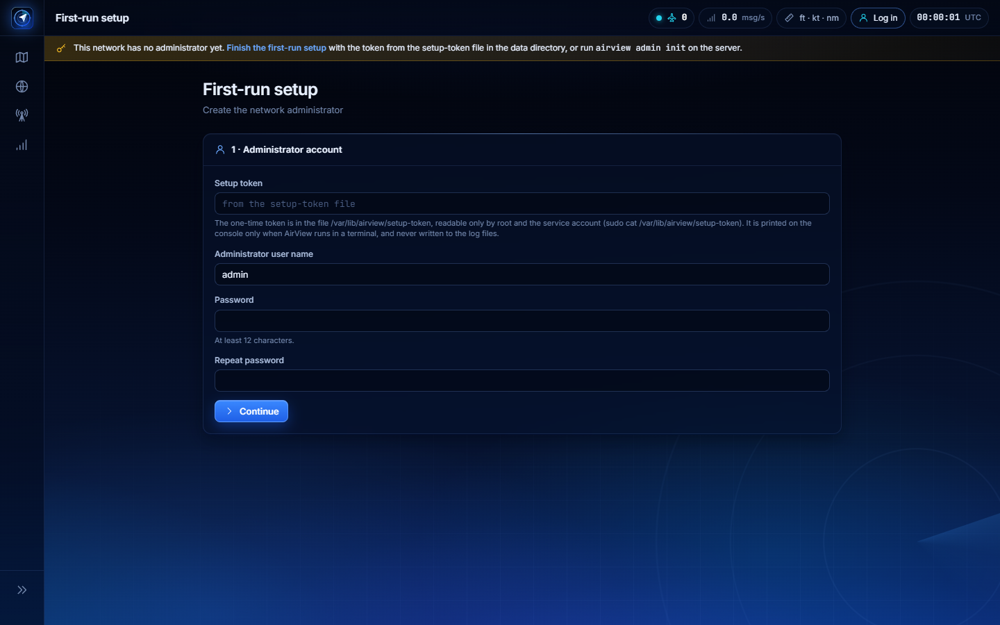
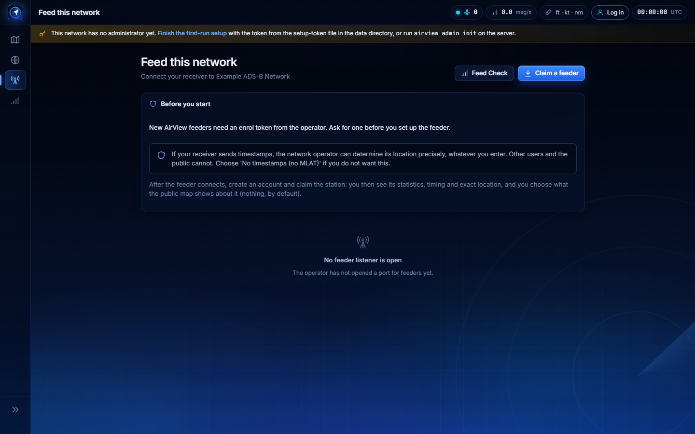

# 1.7 First-run setup

## 1.7.1 First run of a station

A fresh station (Windows or Raspberry Pi) opens on the Live Map with no position and the default receiver feed.
Work through **Settings** (the slider icon at the bottom of the left bar, or `#/settings`) in this order. Every
section applies its changes live when you save.

The badge at the top right shows your rights: **LOCAL ADMIN** on the AirView computer itself, which is always
admin.

### 1. Receiver feeds

**Settings → Receiver feeds.** The default feed is a Radarcape on host `radarcape`, Beast port 10003. Enter your
receiver's host name or IP address and port, or start from a preset:

| Preset | Use for |
|---|---|
| Radarcape EVO - Beast 10003 | GPS-timestamped Beast: the best input, with signal levels and MLAT timing |
| Radarcape SBS 30003 | BaseStation text: decoded positions only |
| Radarcape JSON aircraft list | Polls the Radarcape web server once per second |
| dump1090/readsb Beast 30005 | Any RTL-SDR based decoder |

Protocols: Beast binary, AVR / raw hex, SBS BaseStation, JSON aircraft list (HTTP polling), AirView data port
(hub) and RTL-SDR dongle (`rtl_tcp`). Up to 32 feeds. The **Live status** of each feed shows frames received and
whether the receiver sends GPS time; a healthy Radarcape feed shows a steady message rate and *GPS time: yes*.

While demo mode is on, the configured feeds are paused (*"Paused while demo mode is on"*).

### 2. Station location

**Settings → Station location.** Paste the coordinates in any common notation (decimal, degrees-minutes-seconds,
a Maidenhead locator, a Plus Code, a `geo:` link or a Google / OpenStreetMap URL) and click **Use this position**,
or type latitude and longitude, or **Pick on map**. **Use receiver GPS position** takes the position a Radarcape
reports on its Beast port once its GPS has a fix; **Guess from received data** estimates it from the traffic
(see the Locate Me page, [2.11](02-station-11-locate.md)). The ground elevation is filled in from a terrain
model. Range, coverage, horizon, antenna, terrain and weather analyses all need the location.

### 3. Antennas

**Settings → Antennas.** Two antennas are defined to start with, a vertical and a Yagi. For each: name, receiver
channel, type (vertical, collinear, Yagi, patch, other), peak gain (dBi), height above ground, polarisation, the
vertical beamwidth, and for directional antennas the azimuth and horizontal beamwidth; then cable loss, filter
loss and LNA gain and noise figure. A live preview draws the modelled pattern and the radio horizon.

### 4. Time (NTP)

**Settings → Time (NTP)** is off by default. Enter an NTP server (`pool.ntp.org`, your router, or best a
GPS-locked stratum-1 server on your network such as the Radarcape's own) so the Timing page can measure the
computer's clock error and the true feed latency. **Test now** queries the typed server once without saving;
**Save** makes it the reference. AirView only measures the clock; it never sets it.

### 5. Web server and admin password

**Settings → Web server.** The HTTP port (default 80) and the interfaces it listens on (*All interfaces*, *This
computer only*, *One address*). A changed port or address takes effect after AirView restarts (*Restart needed*
shows when).

**Set an admin password** further down in the same section if others share your network. Without one, every
device that can reach the web interface can change settings, prune the database or factory-reset the station.
With one, other devices can still read everything (maps, statistics) but must log in to change anything; a
browser on the AirView computer itself is always admin, so you cannot lock yourself out.

### 6. Demo mode off

If you tried the demo, switch **Settings → Demo mode** off. A run started with `-demo` stays in demo mode until
the next normal start. Simulated flights are stored like real ones: after trying the demo on a real station,
use **Settings → Danger zone → Factory reset**, or a fresh data folder, to start clean.

### 7. Optional

- **Weather** (on by default once the location is set; Open-Meteo) and the rain-radar overlay (off).
- **Aviation data:** import airports, runways, navaids and callsign routes (about 25 MB, once).
- **Terrain:** elevation tiles (about 35-40 MB for the default 450 km radius) are downloaded by themselves once
  the station is located (`terrain.autoPrefetch`); turn this off on a metered connection.
- An aircraft database for registrations and types (**Aircraft → Aircraft database**).
- Retention periods, units and map style (**Storage & database**, **Display**).

Every section is described in [2.12](02-station-12-settings.md). The same settings can be fixed in the operator
file or with `AIRVIEW_*` variables ([4.1](04-reference-1-configuration.md)); fixed settings show as locked.

## 1.7.2 Connecting the Windows app to a Pi station

1. On the Pi's web interface: **Settings → Connection / remote → Data port (hub) of this station**: enable it
   and set a password (TCP port 30154).
2. In the Windows app: **Settings → Connection / remote**, choose
   - **Remote data**: the app logs in to the Pi's data port (challenge-response, the password never crosses the
     network), receives its live frame stream and runs its own decoder, statistics and database; or
   - **Remote web**: the window simply shows the Pi's web interface; nothing is stored on the PC.
3. Enter the Pi's host name or address, the data port (30154) or website port (80) and the data port password.

Changing the mode restarts the engine when you save. Switching an existing station to remote-data mixes both
stations' statistics in one database unless you factory-reset first.

## Feeding a network from the station

A station can feed an AirView Network itself, without the separate feeder program: **Settings → Network
uplinks → Add uplink**. Enter the **Aggregator host**, **Port** (30160), the **Server pin (optional)** from the
network's *Feed this network* page (empty when the network uses a public CA certificate) and the **Enrol
token**, then choose the map pin, whether to send the station position and timestamps, receive MLAT results,
public statistics and showing the station name. The uplink shows its link state and a **Claim code** once it is
connected. **Add Beast output** feeds other aggregators in Beast format instead. Your station keeps working as
before; frames are buffered while the aggregator is unreachable.

## 1.7.3 First run of a feeder

A feeder installed with an aggregator address starts feeding by itself. Otherwise:

- **Pi image:** fill in the setup page ([1.5.1](01-install-04-pi-feeder.md#151-sd-card-image)).
- **Windows:** the tray opens the status page's **Settings**; add the aggregator ([1.6.3](01-install-05-windows-feeder.md#163-the-feeder-status-page)).
- **Console:** `airview-feeder setup` asks for everything (`sudo airview-feeder-setup` on a Pi).

Then claim the station: get a **claim code** (status page, tray menu, `airview-feeder claim`, or printed by the
Pi installer), sign in to the network and enter it under **Claim a feeder** within 24 hours.

## 1.7.4 First run of an aggregator

Until an admin account exists, the aggregator keeps its feeder ports closed and every page shows the banner
*"This network has no administrator yet."* Create the admin either with `sudo airview admin init` on the server
([1.4.2](01-install-03-linux-server.md#create-the-first-admin)) or in the browser:

1. Open `https://<your host>/#/setup` **over HTTPS through the reverse proxy** (plain-HTTP logins from the
   network are refused; a browser on the server itself also works).
2. Read the one-time **setup token** on the server: `sudo cat /var/lib/airview/setup-token`. It is readable only
   by root and the service account, never written to the logs, valid for 24 hours and renewed while no admin
   exists.
3. **1 · Administrator account:** the token, the user name (default `admin`) and a password of at least 12
   characters, twice. **Continue**.
4. **2 · Authenticator:** scan the QR code with an authenticator app (any RFC 6238 app) and enter the code it
   shows. **Confirm**.
5. **3 · Recovery codes:** save them (shown once; each works once instead of an authenticator code), then **Log
   in now**.

*First-run setup of a fresh aggregator (the token hint as shown on a Linux server).*

Then:

1. **Mint enrol tokens** for your feeders (admin pages, **Enrol tokens** tab, `#/admin/tokens`; the default
   admission policy is `invite`).
2. **Open the firewall** ([1.4.4](01-install-03-linux-server.md#144-firewall)).
3. **Publish the feeder release** so `/feeder/install.sh` can install feeders ([1.4.6](01-install-03-linux-server.md#146-serving-the-feeder-installer-and-feeder-updates)).
4. Check the **Feed this network** page (`#/feeder`): it shows the install command with your network's address
   and pin, and the readsb / mlat-client lines for existing feeder stacks. Before the admin exists it says *"No
   feeder listener is open"*:

   
5. Check `curl -fsS http://127.0.0.1:8080/healthz` on the server (`"adminReady": true` once the admin exists).

Running the network from here on (tokens, claims, approvals, MLAT, federation) is [chapter 3](03-network.md).
