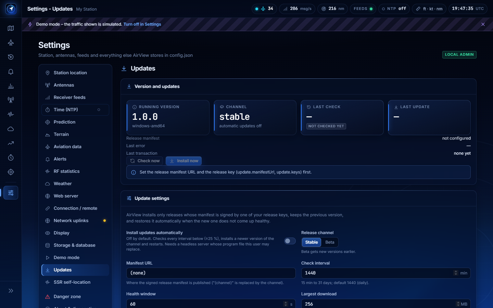

# 1.8 Updates

Every update keeps your settings and data. Before a major update take a backup (`airview backup`, see
[4.2](04-reference-2-cli.md)).

| What | How to update | Automatic? |
|---|---|---|
| Windows station | Run the newer `AirView-Setup-<version>.exe` (or replace the portable `airview.exe`). | No |
| Pi station | `sudo /opt/airview/update.sh`, or `install.sh` of a newer bundle. | No |
| Linux server (aggregator) | `sudo airview upgrade`, or `upgrade.sh` of a newer bundle. | No |
| Docker | Rebuild the image from the newer build context and `docker compose up -d`. | No |
| Pi / Linux feeder | Daily update timer, or `sudo /opt/airview-feeder/update.sh`. | Yes (signed releases) |
| Windows feeder | Tray → **Check for updates…**, or run the newer installer. | No |

All self-updates install only releases whose manifest is signed with one of the trusted release keys, keep the
previous version and go back to it by themselves when the new one does not come up healthy.

## 1.8.1 Windows station

Close AirView (a program file in use stops the setup with *"in use (close the program and try again)"*), then run
the newer `AirView-Setup-<version>.exe`. It finds the existing installation, replaces the program files and
keeps every setting; your data folder is not touched. The desktop app never updates itself. For a portable copy,
close AirView and replace `airview.exe`.

**Settings → Updates** shows the running version and the update state. On a headless server whose program file
the service account may replace, AirView can also check and install signed releases itself (`update.enabled`,
`update.manifestUrl`, `update.keys`; off by default, and the release keys can be set only in the operator file or
with `AIRVIEW_UPDATE_*` variables, never from the web interface). The installed station packages for Windows,
the Pi and the server kit use the methods in this section instead.



## 1.8.2 Raspberry Pi station

```sh
sudo /opt/airview/update.sh                                    # from the remembered release site
sudo /opt/airview/update.sh --base-url https://<release-site>  # from another site (add --key <release key>)
tar xzf airview-pi-1.0.1.tar.gz && sudo ./airview-pi-1.0.1/update.sh   # from a newer bundle
```

`update.sh` downloads the newest `airview-pi-<version>.tar.gz` listed in the site's `SHA256SUMS`, verifies it
(and `SHA256SUMS.sig` with the pinned release key) and upgrades in place. Nothing happens when that version is
already installed (`--force` reinstalls it). The site and key are remembered by a download install in
`/etc/airview/update.env`; a station installed from the SD-card image or a copied bundle has no remembered site,
so pass `--base-url` (and `--key`) the first time.

The previous binary stays as `/opt/airview/airview.prev`; when the new version does not stay running, the
installer restores it automatically. The data in `/var/lib/airview` is not copied first: take a backup
(`sudo -u airview /opt/airview/airview backup -data /var/lib/airview -o /tmp/airview-backup.zip`) if you want to be
able to return to the old data.

## 1.8.3 Linux server

```sh
sudo airview upgrade --base-url https://<release-site>
# or from a newly unpacked bundle:
tar xzf airview-server-linux-amd64.tar.gz && cd airview-server-linux-amd64 && sudo ./upgrade.sh
```

The upgrade:

1. lets the **new** binary validate your configuration first; if it rejects it, nothing changes (fix the file, or
   pass `--force`);
2. stops the service and takes a cold backup to `/var/backups/airview` (`--no-backup` skips it);
3. replaces the binary, unit and scripts (the previous binary stays as `/opt/airview/airview.prev`; configuration
   and data are untouched, `airview.example.jsonc` is refreshed);
4. starts the service and waits up to 90 s for `/healthz`;
5. if the new version does not become healthy, **rolls the binary back** and starts the old one (`--no-rollback`
   disables this). If the old binary then fails as well (a newer version may already have migrated the
   database), the script prints the restore command for the pre-upgrade backup.

Running `install.sh` of a newer bundle does the same. Feeders reconnect by themselves.

### Docker

Take a backup of the data volume (the commands are at the top of `docker-compose.example.yml`), then build the
image from the newer `airview-docker-<version>.tar.gz` and restart:

```sh
docker build -t airview:1.0.1 --build-arg VERSION=1.0.1 .
docker compose up -d
```

The data volume is kept.

### Publishing a new feeder release

To let your feeders update, replace the contents of `aggregator.feederReleaseDir` with the new release's
`release/feeder/` folder ([1.4.6](01-install-03-linux-server.md#146-serving-the-feeder-installer-and-feeder-updates)).
Feeders only accept it when `manifest.json.sig` verifies against the release key they were installed with.

## 1.8.4 Pi and Linux feeder

The installer enables `airview-feeder-update.timer`: once a day, at a random time (up to 6 hours' delay), it runs
`update.sh --quiet`. It downloads `<url>/feeder/manifest.json` and its signature, verifies the signature with
the release key, checks the binary's SHA-256 and size, keeps the old binary as `airview-feeder.old`, swaps it and
restarts the service. If the service stops or restarts within 60 s, it **rolls back**.

```sh
sudo /opt/airview-feeder/update.sh                  # update now (--force reinstalls)
sudo airview-feeder-setup --update --check          # only check (exit 10 when a newer version exists)
sudo airview-feeder-setup --update --channel beta   # switch to the beta channel and update
```

The timer does nothing when `autoUpdate` is `false` in `feeder.json` (installer option `--no-auto-update`). A
feeder installed without a release key cannot verify updates and does not update itself: give the key later with
`sudo airview-feeder-setup --update --manifest-key <key>`. To refresh the installer scripts themselves, run the
installer from the aggregator again.

## 1.8.5 Windows feeder

- **Tray → Check for updates…** asks for administrator rights, checks the signed release from the aggregator
  (`https://<aggregator host>/feeder/manifest.json` unless `update.manifestUrl` says otherwise), installs it,
  restarts the service and reports the result. A version that does not work is replaced by the previous one
  automatically. Without a release key the tray explains that signed updates are not set up.
- From an administrator console: `airview-feeder update` (`-check` only checks).
- Or run the newer `AirView-Feeder-Setup-<version>.exe`: it closes the trays, stops the service, replaces the
  files and starts the service again; configuration, identity and logs are kept. For the portable ZIP, quit the
  tray (and stop the service) and replace the files.

Release builds of the installer write the release key and manifest URL into `feeder.json` (`update.keys`,
`update.manifestUrl`) and, for a per-machine installation, seal them for administrators, so that only releases
signed by your network's key are installed.
