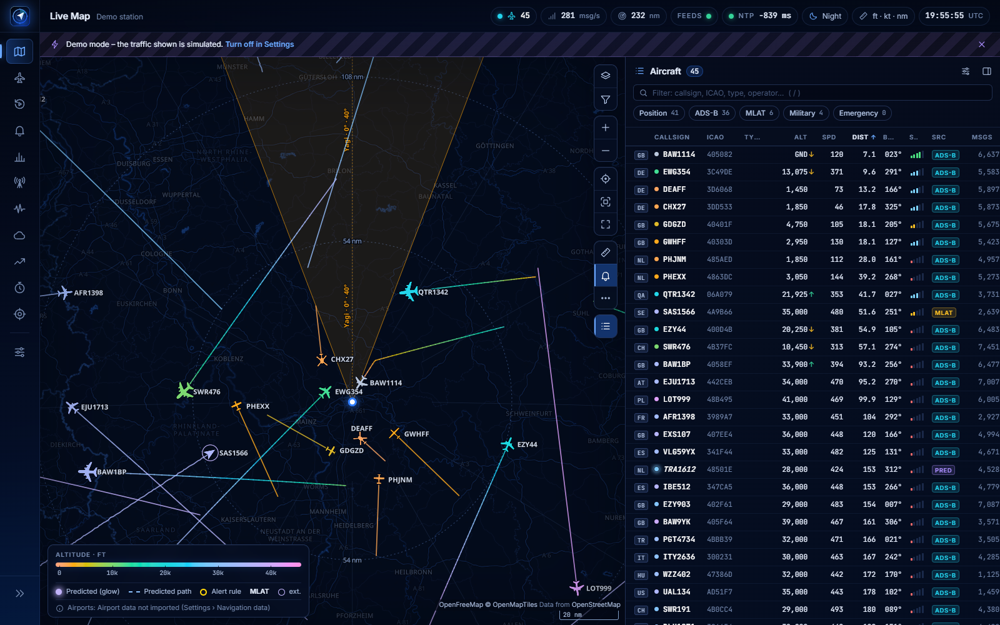

# 2. The station interface

This chapter covers every page of a single AirView station, whether it runs on a Windows PC or a Raspberry
Pi. On the PC the desktop window shows these pages. On both, any browser on your network can open them at
`http://<station-address>/` (port 80 unless you changed it, see [Settings → Web server](02-station-12-settings.md#web-server)).

The pages in this chapter:

| Page | Route | What it is for | Section |
|---|---|---|---|
| Live Map | `#/map` | Live traffic, trails, prediction, overlays, aircraft details | [2.1](02-station-01-map.md) |
| Aircraft | `#/aircraft` | Every airframe and flight logged, events, aircraft database | [2.2](02-station-02-aircraft.md) |
| Reports & Replay | `#/reports` | Flight search, flight pages, daily summary, replay of stored traffic | [2.10](02-station-10-reports.md) |
| Alerts | `#/alerts` | Alert rules, watch-lists, geofences, webhooks, recent alerts | [2.9](02-station-09-alerts.md) |
| Statistics | `#/stats` | Message rates, range, traffic patterns, fleet, records, health | [2.3](02-station-03-stats.md) |
| Antenna Lab | `#/antenna` | Coverage, antenna patterns, link budget, terrain and line of sight | [2.4](02-station-04-antenna.md) |
| RF Lab | `#/rf` | Signal levels, noise floor, detection probability, channel load, interrogators | [2.5](02-station-05-rf.md) |
| Weather | `#/weather` | Conditions, refractivity and ducting, winds aloft, weather impact | [2.6](02-station-06-weather.md) |
| Forecast | `#/forecast` | Reception and traffic forecast, local weather outlook, verification | [2.7](02-station-07-forecast.md) |
| Timing | `#/timing` | NTP reference, receiver GPS time, feed latency, time difference of arrival | [2.8](02-station-08-timing.md) |
| Locate Me | `#/guess` | Estimate the station position from the traffic alone | [2.11](02-station-11-locate.md) |
| Settings | `#/settings` | All configuration | [2.12](02-station-12-settings.md) |

The screenshots in this chapter come from a station running the built-in traffic simulator (demo mode), so
they show simulated traffic around a pretend station in central Germany. Your pages fill with your own
traffic in the same way. Some panels need hours or days of history before they show anything: each such
panel says so ("Not enough data yet") and explains what it is waiting for.

## 2.0.1 The window

Every page shares the same frame:

- **Sidebar** (left). One icon per page in the order of the table above, with Settings at the bottom. The
  chevron at the foot of the sidebar expands it to show the page names, or collapses it again; the version
  and platform (for example `v1.0.1 · windows/amd64`) are shown there when it is expanded. When the sidebar is
  collapsed, hover over an icon to see the page name.
- **Top bar**. The page title and the station name (set in **Settings → Station location**), then a row of
  status chips. On narrow windows the less important chips are hidden first.
- **Banners** under the top bar for conditions that need attention (see below).
- **The page** itself.

### Status chips

| Chip | Shows | Click |
|---|---|---|
| Aircraft | Dot for the live link (green = live stream connected, amber = stream unavailable and the page is polling, red = server unreachable) and the number of aircraft tracked. The tooltip breaks the number down: with position, ADS-B, MLAT, TIS-B, Mode S. | Opens the Live Map |
| msg/s | Messages decoded per second, all feeds together. | – |
| Range | Distance of the farthest aircraft tracked right now. Shows "—" while the station location is not set. | – |
| Feeds | One dot per enabled feed: green connected, red disconnected. The tooltip lists each feed with its message rate, "GPS time" when the feed delivers GPS time stamps, or its last error. The chip turns red when every enabled feed is down (not in demo mode). | Opens Settings |
| NTP | Off, "no sync", or the measured clock offset of this computer (for example `+1.25 ms`). The tooltip shows server, stratum, offset, delay and jitter. | Opens the Timing page |
| Day / night | Day, Civil twilight, Nautical twilight, Astro twilight or Night at the receiver, from the sun's elevation (shown in the tooltip). Only when the station location is set. | – |
| Units | The unit system of this browser: `ft · kt · nm` (aviation), `m · km/h · km` (metric) or `ft · mph · mi` (imperial). | Switches to the next system |
| UTC clock | The server's clock in UTC. | – |

The unit system you pick with the chip is remembered by this browser only. Browsers that have never chosen
use the default from **Settings → Display**. Temperatures are shown in °C in the aviation and metric systems
and in °F in the imperial system; antenna and terrain heights are always in metres except in imperial (feet).

### Banners

| Banner | When | What to do |
|---|---|---|
| Connection to the AirView server lost – retrying… | The browser cannot reach the station. | Wait; the page reconnects by itself. Check that AirView is still running. |
| Demo mode – the traffic shown is simulated | Demo mode is on (`-demo` flag or **Settings → Demo mode**). | "Turn off in Settings". |
| Receiver location not set | The station has no coordinates. | "Set location", or let AirView "estimate it" on the Locate Me page. |
| No receiver feed is connected | Feeds are enabled but none has been connected for 15 s after start. While only the factory feed exists it reads "No receiver feed is connected yet. Tell AirView where your receiver delivers its data (RTL-SDR with readsb or dump1090, Beast, SBS or a Radarcape)." | "Check feeds" opens Settings > Receiver feeds. |
| No feeds are enabled | No feed is enabled and demo mode is off. | "Add a receiver" or enable demo mode. |

All banners except the connection-lost banner can be dismissed with the × on the right. A dismissed banner
stays hidden until the page is reloaded.

### Notifications and the alert sound

Small notifications ("toasts") appear at the bottom right. Alerts whose rule has **Show a notice** switched
on appear as a toast on every page, once per alert, with a **Show** button that opens the aircraft on the Live
Map. When a rule also has **Play a sound**, the browser plays a short chime, provided that

- sounds are allowed in **Settings → Alerts**,
- the AirView tab is visible, and
- this browser is not muted (the **Sound** switch on the Alerts page or the bell button on the Live Map; the
  mute choice is stored in this browser only).

Browsers only play sound after you have clicked somewhere on the page once.

## 2.0.2 Who may change settings

Everyone who can open the web interface can look at every page. Changing anything (settings, alert rules,
database maintenance, starting a terrain download, running Locate Me and so on) needs admin rights:

- A browser on the AirView computer itself (`localhost`) is always admin, so you cannot lock yourself out.
- Without an admin password, browsers on your private network (RFC 1918 addresses such as 192.168.x.x,
  IPv6 ULA and link-local addresses) are admin as well. Requests that arrive through a reverse proxy or from
  a public address are not, unless the configuration file sets `http.allowOpenAdmin` to `true`.
- With an admin password (**Settings → Web server → Admin password**) every other device has to log in first.

When a locked browser tries to change something, AirView asks for the password ("This action needs the admin
password") and then repeats the action. Settings shows a **Read-only** badge and a **Log in** button while you
are not logged in.

## 2.0.3 Links and keyboard

Every page and many views have their own address after `#/`, so you can bookmark them or send them to
someone on your network. Examples:

- `#/map/4CA1FA` opens the Live Map with that aircraft selected;
- `#/aircraft/4CA1FA` opens the airframe's history;
- `#/antenna/terrain` opens the Terrain & line of sight tab;
- `#/rf/signal` opens the Signal tab of the RF Lab;
- `#/reports/replay` opens the replay;
- `#/settings/time` opens the Time (NTP) section of Settings.

The Live Map and the replay have keyboard shortcuts; they are listed in their sections.

## 2.0.4 Kiosk mode

The Live Map can hide the sidebar, top bar and banners so that the map fills the whole window, for example on a
wall display. Press **K** on the map, use **More → Kiosk mode**, or open `#/map?kiosk=1`. **Esc** or the
× button at the top leaves kiosk mode.
