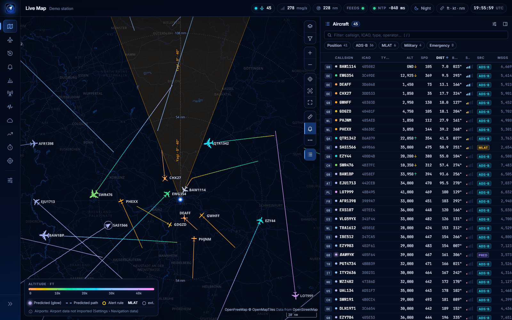
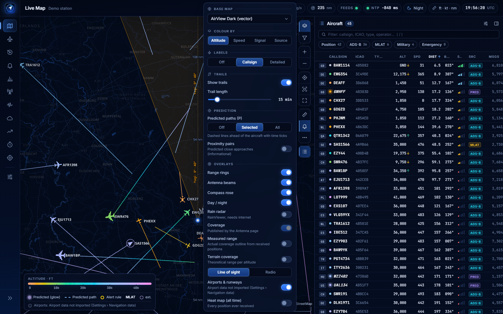
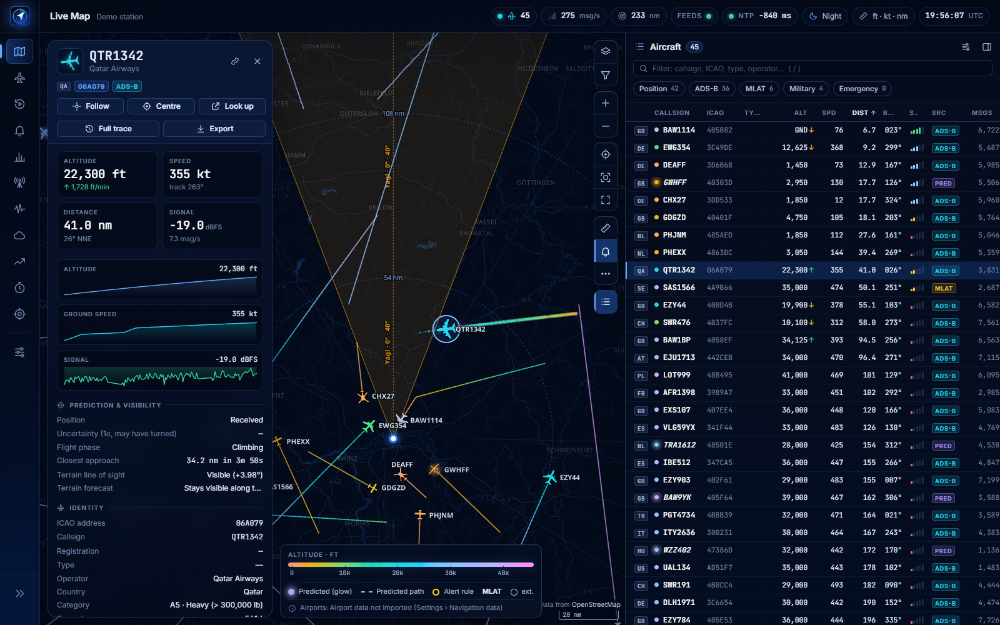

# 2.1 Live Map

Route: `#/map` (sidebar: map icon). The Live Map is the start page. It shows every aircraft the station is
tracking, refreshed once per second, on a map of the area around the receiver, with the aircraft list on the
right.

## 2.1.1 What you see

- **Aircraft symbols.** The shape follows the aircraft category (airliner, light aircraft, helicopter and so
  on); the colour encodes the altitude by default (legend at the bottom left). Labels show the callsign.
- **Trails** behind each aircraft, coloured like the aircraft. The default length is 15 minutes (**Settings
  → Display → Trail length**), and each browser can change it in the Layers panel.
- **The receiver** as a blue dot, with **range rings** (100, 200, 300 and 400 km by default, labelled in your
  distance unit), a **compass rose** and the **antenna beams** of directional antennas (an amber wedge for each
  directional antenna, for example a Yagi). They need the station location.
- **Predicted aircraft.** When an aircraft's positions stop arriving, it keeps moving along the tracking
  filter's prediction for up to 60 seconds (**Settings → Prediction**). It glows, the glow fading as the
  prediction ages, carries a circle for the 1σ position uncertainty and a dotted line to its last real position,
  and the list marks it **PRED**. Predicted positions are only drawn: they never enter trails, the database or
  any statistic.
- **Alert highlights.** An aircraft that an alert rule highlights gets a coloured ring (the rule's colour).
- **MLAT positions** carry a ring whose colour is the quality grade when the positions come from an AirView
  network; MLAT from an external server is marked "ext.".

The legend at the bottom left explains the colour scale and the symbols in use, and shows notes about
overlays that are loading or not available (for example "Airports: Airport data not imported").

## 2.1.2 Map controls

The column of buttons at the right edge of the map, from top to bottom:

| Button | Function |
|---|---|
| Layers | The **Layers & display** panel (below). |
| Filter | The **filter** panel (below). |
| + / − | Zoom in and out. |
| Locate | Centre on the receiver. |
| Fit | Fit the map to all traffic. |
| Fullscreen | Browser full screen. |
| Ruler | Measuring tool (**M**). |
| Bell | Alert sound for this browser on / off. The tooltip says "Alert sounds are switched off in Settings › Alerts" when sounds are disabled for the whole station. |
| More (…) | Export the current picture as KML or GeoJSON, open **Replay history**, **Kiosk mode (K)**, **Copy link to this view**, **Keyboard shortcuts (?)**. |
| List | Show or hide the aircraft list. |

### Layers & display

| Group | Settings |
|---|---|
| Base map | AirView Dark (vector, default), OpenStreetMap night (raster), OpenStreetMap (raster), OpenFreeMap Liberty (vector, light). |
| Colour by | Altitude, Speed, Signal or Source (ADS-B, MLAT, TIS-B, Mode S). |
| Labels | Off, Callsign, Detailed. |
| Trails | Show trails; Trail length 1–120 min. |
| Prediction | **Predicted paths (P)**: Off, Selected, All – dashed lines ahead of the aircraft with time ticks. **Proximity pairs**: predicted close approaches between aircraft (informational only). |
| Overlays | Range rings, Antenna beams, Compass rose, Day / night (terminator), Rain radar (RainViewer, needs internet and **Settings → Weather → Precipitation radar on the map**), Coverage (the outlines published from the Antenna Lab with **Show on live map**), Measured range (outline of the positions actually received), Terrain coverage (theoretical range per altitude, as **Line of sight** or **Radio**), Airports & runways (from zoom 5, runways and centrelines from zoom 8; needs the airport data from **Settings → Aviation data**), Heat map (all time; every position ever received). |
| Motion | Smooth motion: glide between the 1-second updates. |

**Reset map settings** at the bottom returns all of these to the defaults (the filter stays). These choices are
stored in the browser, so every device keeps its own map setup.

### Filter

The filter panel narrows the map and the list down:

- altitude range and speed range (sliders);
- text fields for **Callsign**, **Type** and **Operator** (for example `DLH`, `A32`, `Lufthansa`);
- **Category** (A1 Light … A7 Rotorcraft, B Glider / balloon / UAV, C Surface vehicle / obstacle);
- **Position source** (Any, ADS-B, MLAT, TIS-B, Mode S);
- switches **Military only**, **Hide aircraft on the ground**, **Hide surface vehicles**, **Alerting only**
  (alert-rule highlight or emergency) and **Predicted only** (aircraft coasting on a predicted position).

Active filters appear as chips at the top of the map; click a chip's × to remove that filter, or use
**Clear all filters**.

### Measuring tool

Press **M** or the ruler button. **Two points** measures the great-circle distance and initial bearing
between two clicks. **From receiver** measures from the antenna to one click and also draws the terrain
line-of-sight profile to that point for a chosen **Target altitude** (needs the terrain data, see
[Antenna Lab](02-station-04-antenna.md#243-terrain--line-of-sight)). **Esc** closes the tool.

## 2.1.3 The aircraft list

The list on the right shows the aircraft that match the filter. The search box (press **/**) searches callsign,
ICAO address, type, operator and more. The quick filters under it (**Position**, **ADS-B**, **MLAT**,
**Military**, **Emergency**) show their counts; Emergency means squawk 7500 / 7600 / 7700 or an ADS-B
emergency state.

Click a column header to sort. The columns button at the top right chooses the columns: Callsign, ICAO,
Reg, Type, Operator, Route (amber when the published route does not fit the position), Sqk, Alt, V/S, Spd,
Dist, Brg, Elev (angle above the receiver horizon), Sig (signal bars), dBFS, Src, LOS (elevation above the
terrain skyline, negative = hidden by terrain), CPA (predicted closest approach to the station), Msgs and
Age. **Default columns** restores the standard set. The other two buttons make the list wider or hide it.

- **Click** a row (or an aircraft on the map) to select it.
- **Shift-click** or **Ctrl-click** adds or removes aircraft from a multi-selection. A bar at the top of the
  map shows how many are selected, with **Fit** and **Clear** (Esc).

## 2.1.4 Aircraft details

Selecting an aircraft opens the detail panel on the left of the map and highlights its trail. At the top:
callsign, operator, country flag, ICAO address and source, and the buttons

- **Follow** (**F**): keep the map centred on the aircraft;
- **Centre**: centre the map once;
- **Look up**: open the aircraft on ADS-B Exchange, Planespotters, OpenSky Network or FlightAware;
- **Full trace**: show every stored position of today from the history database;
- **Export**: download the flight as Google Earth (KML), GeoJSON or CSV, or **Open in Reports**;
- the link button copies a link to this aircraft; × (Esc) closes the panel.

Below are tiles for altitude (with vertical rate), speed (with track), distance (with bearing) and signal
(with message rate), small history charts for altitude, ground speed and signal, and these groups:

| Group | Contents |
|---|---|
| Prediction & visibility | Position (Received or Predicted), uncertainty, Flight phase (Climbing, Cruise, Descending, Approach, Holding, Turning, On the ground), Closest approach (distance and time), Terrain line of sight (Visible or Hidden by terrain, with the margin in degrees) and Terrain forecast along the predicted path. |
| Route (box above the groups) | With imported route data (**Settings → Aviation data**) or the optional online look-up: origin and destination airports, stops, and a badge **Route fits**, **Doubtful route** or **Unchecked** (plausibility needs a position and both airports). |
| Identity | ICAO address, callsign, registration, type, operator, country, category, squawk (with its meaning for special codes), address type, alert rule. |
| Position & geometry | Position, distance, bearing from the receiver, elevation angle, slant range, position age, on ground, source. |
| Altitude & speed | Barometric and geometric altitude, vertical rate, ground speed, track, indicated and true airspeed, Mach, magnetic heading, roll, turn rate. |
| Autopilot / selected | Selected altitude, selected heading, QNH (Comm-B / ADS-B target state). |
| Integrity | ADS-B version, NIC, containment radius, NACp, NACv, SIL, alert / SPI, emergency. |
| Reception | RSSI now and average, message rate, messages, antennas and feeds that heard it, first and last seen. |
| Derived weather aloft | Wind and outside air temperature computed from the aircraft's Comm-B replies. |

Values the aircraft has not sent are shown as "—". With **Settings → Aviation data → Aircraft photos** on, a
thumbnail from planespotters.net is shown with the photographer credit.

## 2.1.5 Links to a map view

**More → Copy link to this view** copies an address of the form
`#/map/<ICAO>?zoom=<z>&lat=<lat>&lon=<lon>&filter=<filter>` that opens the map at the same place, with the
same filter and aircraft. `?kiosk=1` opens it in kiosk mode.

## 2.1.6 Keyboard shortcuts

| Key | Action |
|---|---|
| L | Cycle labels (off / callsign / detailed) |
| T | Trails on / off |
| P | Predicted paths: off / selected / all |
| F | Follow the selected aircraft |
| R | Reset the view (receiver, else all traffic) |
| M | Measuring tool |
| K | Kiosk mode (hide all chrome) |
| / | Search the aircraft list |
| Esc | Close tool / clear multi-selection / deselect / leave kiosk |
| Shift / Ctrl + click | Add or remove an aircraft from the multi-selection |
| ? | This list, in a window |
