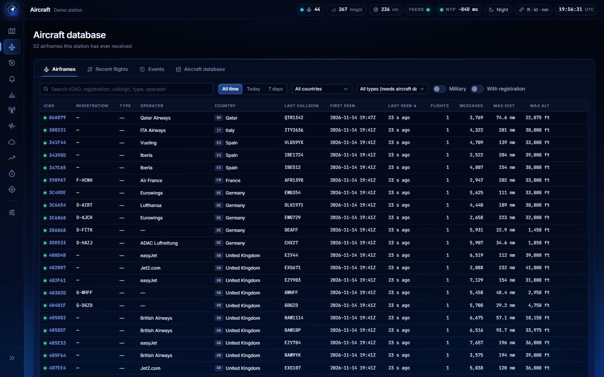
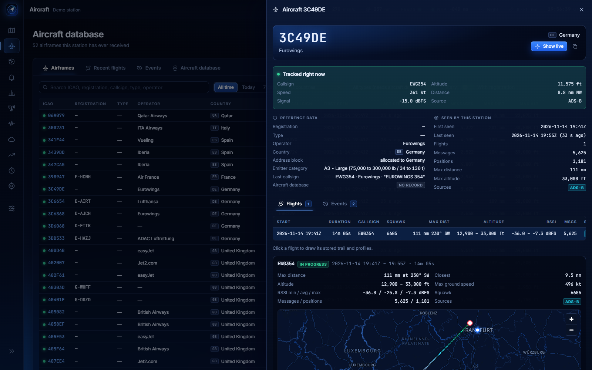
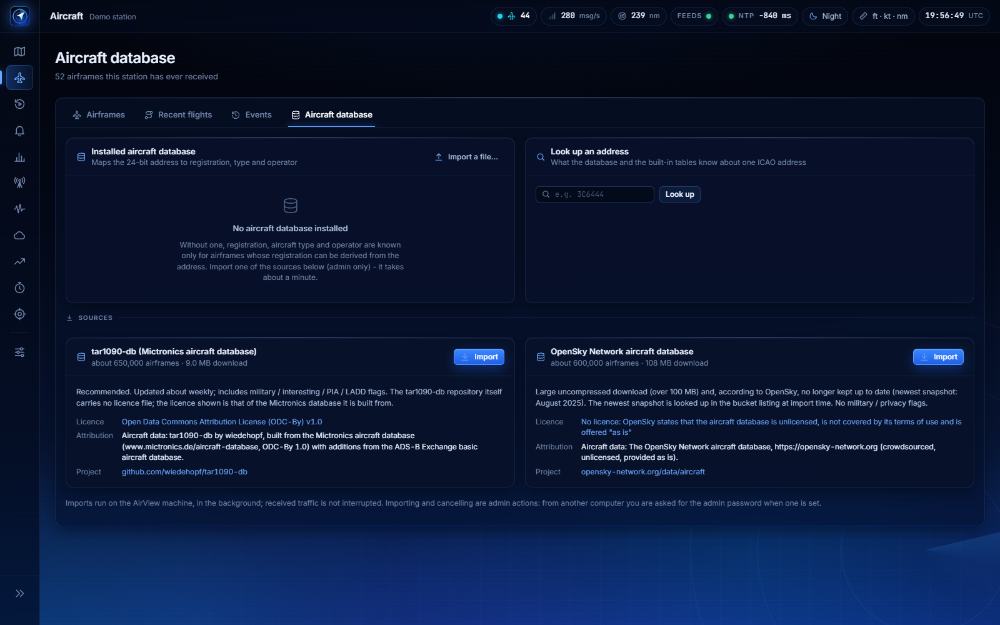

# 2.2 Aircraft

Route: `#/aircraft` (sidebar: plane icon). The page heading reads **Aircraft database**: it is the station's
logbook of every airframe it has ever received, the flights it tracked, notable events and the reference data
that turns a 24-bit address into a registration, type and operator. It has four tabs.

## 2.2.1 Airframes

One row per airframe (24-bit ICAO address) ever received: ICAO, registration, type, operator, country, last
callsign, first and last seen, number of flights and messages, farthest distance and highest altitude. A green
dot in front of the address means the aircraft is being tracked right now. Badges mark **Military**,
**Interesting** (flagged in the aircraft database), **PIA** (Privacy ICAO Address, a temporary address that hides
the real airframe) and **LADD** (the owner asked for the data not to be shown publicly).

Controls above the table:

- search box (ICAO, registration, callsign, type, operator);
- period: **All time**, **Today**, **7 days**;
- **Military** and **With registration** switches;
- **All countries** and **All types** drop-downs;
- **Clear filters**; previous / next page and the page size (25, 50, 100 or 250 per page).

Click a column header to sort. Links from the Statistics page (a top operator, country or type) open this tab
already filtered (`#/aircraft?q=…`, `?country=…`, `?type=…`).

Registration, type and operator need the aircraft database (tab 4). Without it they are known only where the
registration can be derived from the address itself.

## 2.2.2 Airframe history

Click a row to open the airframe's history (also `#/aircraft/<ICAO>`). It shows

- the identity with the country flag, badges and **Show live** (opens the Live Map on the aircraft when it is
  in the air right now); the copy button copies the ICAO address;
- while the aircraft is in the air, a **Tracked right now** strip with its live callsign, altitude, speed,
  distance, signal and source;
- **Reference data** (registration, type, operator, country, address block, emitter category, last callsign and
  whether the aircraft database has a record) and **Seen by this station** (first and last seen, flights,
  messages, positions, maximum distance and altitude, sources);
- the tabs **Flights** (every stored flight of this airframe) and **Events** (emergencies, records it set,
  military or notable sightings);
- for the flight selected in the Flights tab (marked **In progress** while it lasts): its key figures, a trail map
  coloured by **Altitude** or **Signal**, and two charts over the flight, altitude with ground speed and signal
  level (RSSI) with distance.

A newly heard aircraft may show "Not stored yet" for a few seconds: rows are written to the database in batches.

## 2.2.3 Recent flights

All flights of all aircraft, newest first: start, duration, ICAO, registration, type, callsign, squawk,
operator, farthest distance with bearing, altitude range, RSSI range (weakest to strongest), messages and
sources. A flight is one contact session: a gap of more than 30 minutes starts a new flight. Choose **All**,
**24 h** or **7 days**, or type an ICAO address to list the flights of one airframe. **Newer** / **Older**
page through the list.

For searches by callsign, registration, airport, distance and so on, use the flight report on
[Reports & Replay](02-station-10-reports.md).

## 2.2.4 Events

Two parts:

- **All-time station records**: farthest position, highest altitude, fastest ground speed, weakest decoded
  position, most aircraft at once, highest message rate, longest contact, each with the aircraft and the time.
- **Event log**: emergencies, military and interesting airframes, new records, feeds going down and up, and
  alerts that a rule writes to the event log. Filter by **All**, **Emergencies**, **Military**, **Notable**,
  **Records** or **Feeds**; **Load older events** pages back.

## 2.2.5 Aircraft database

- **Installed aircraft database**: number of records, source, import time, licence and attribution of the
  installed database, or "No aircraft database installed".
- **Look up an address**: type an ICAO address (for example `3C6444`) to see what the database and the built-in
  tables know about it.
- **Sources**: one card per supported source, with its size, licence, attribution and project page, and an
  **Import** (or **Update**) button:
  - **tar1090-db (Mictronics aircraft database)**;
  - **OpenSky Network aircraft database**.
- **Import a file…** loads a tar1090-db or OpenSky CSV file you already have, optionally gzip-compressed, at most
  600 MB.

An import downloads and parses the file on the AirView computer in the background; reception is not interrupted.
Progress (bytes, records parsed and stored, malformed lines skipped) is shown with a **Cancel** button. Importing
and cancelling are admin actions. Mind the licence of the source you choose; it is shown on the card and stored
with the installed database. The same import is also available under
[Settings → Storage & database](02-station-12-settings.md#storage--database).

The page refreshes itself every 30 seconds while it is visible.
