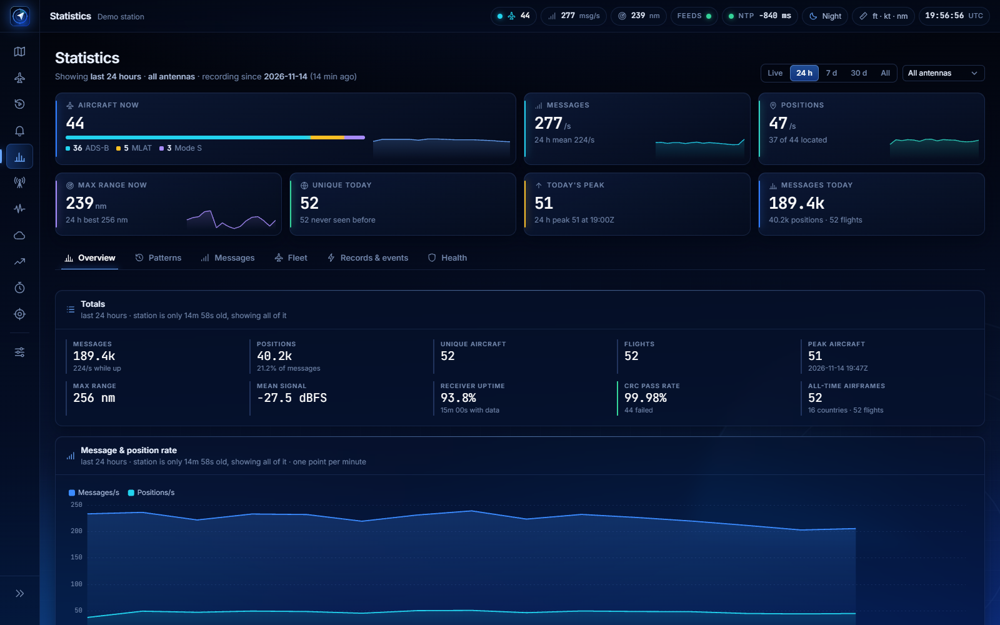
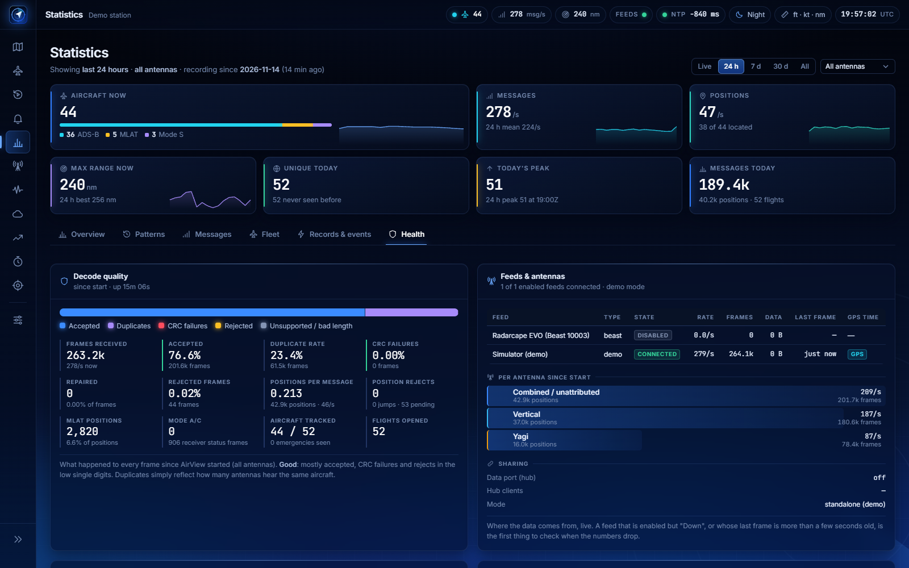

# 2.3 Statistics

Route: `#/stats` (sidebar: bar-chart icon). Long-term figures of the station: how busy it is, how far it hears,
when the traffic is there, who flies past and whether the station itself is healthy.

## 2.3.1 Period, antenna and live tiles

At the top right choose the period: **Live** (last 60 minutes), **24 h**, **7 d**, **30 d** or **All** (all
recorded data), and **All antennas** or one antenna. The line under the page title repeats the choice and says
since when the station has been recording. When the station is younger than the period, the panels say so
("station is only 48 s old, showing all of it").

The tiles always show the present: **Aircraft now** (split into ADS-B, MLAT and Mode S), **Messages** per second
(with the 24 h mean), **Positions** per second (and how many aircraft are located), **Max range now** (with the
24 h best), **Unique today** (with how many were never seen before), **Today's peak** and **Messages today**
(with positions and flights). The small curves are the recent trend.

Every chart has a short explanation under it. Times on the charts are UTC unless the caption says "station
local time".

## 2.3.2 Tabs

| Tab | Panels |
|---|---|
| **Overview** | **Totals** (messages, positions, unique aircraft, flights, peak aircraft, max range, mean signal, receiver uptime, CRC pass rate, all-time airframes). **Message & position rate**. **Aircraft in view by source** (stacked ADS-B / MLAT / Mode S, dashed: aircraft with a position). **Range & signal** (farthest aircraft per step and mean signal level). |
| **Patterns** | **Traffic by weekday and hour** (heat map, aircraft or messages/s, station local time). **Average day**. **Daily totals** (messages per local day and peak aircraft). **Unique & new airframes per day**. **Positions by altitude band**. **Flight peak altitudes**. **Distance distribution** (with median and 95 % distance). |
| **Messages** | **Downlink formats** (donut and list explaining each DF). **Downlink formats over time**. **ADS-B vs MLAT vs Mode S share**. **Comm-B registers decoded**. |
| **Fleet** | **Top operators**, **Top countries**, **Top aircraft types** (ranked by flights) and **Most-seen airframes** (ranked by messages). Click an entry to list its aircraft on the [Aircraft](02-station-02-aircraft.md) page. Types and operators need the aircraft database. |
| **Records & events** | **All-time records** (farthest contact, highest aircraft, fastest ground speed, weakest signal decoded, longest tracked flight, busiest moment, peak message rate, busiest day and hour) and **Recent events** (filter All, Emergency, Military, Interesting, Records; **Load older**). |
| **Health** | **Decode quality** (what happened to every frame since start: accepted, CRC failures, rejects, duplicates, positions per message, position rejects, MLAT positions, Mode A/C, aircraft tracked, flights opened). **Feeds & antennas** (state, rate, frames, data, last frame and GPS time per feed; per-antenna counters; data port and hub clients). **AirView process** (uptime, memory, goroutines, garbage collection, live clients, CPU cores, version, platform, host, time zone, listening address, data directory). **Database** (size, write-ahead log, write queue, last flush, write errors, reclaimable space, rows per table, retention). |

## 2.3.3 Reading the figures

- **Messages and positions.** Expect a daily wave following air traffic. A sudden drop to zero means the receiver
  or the feed stopped; check the **Feeds & antennas** panel on the Health tab first.
- **CRC pass rate.** Healthy receivers stay above 95 %.
- **Receiver uptime.** The share of the period with data. A low value means the receiver or its feed was down.
- **Range.** A flat, high range line means good coverage whenever traffic is there; night-time dips are
  usually missing traffic, not a fault. The [Antenna Lab](02-station-04-antenna.md) analyses range in depth.
- **Database.** The write queue should hover near zero and write errors should stay at zero. "Reclaimable" space
  is returned to the disk with **Compact** in [Settings → Storage & database](02-station-12-settings.md#storage--database).

The statistics are built from the per-minute rows in the database. Per-minute rows are kept for 90 days by
default; the hourly roll-ups are kept forever, so the 30 d and All views stay available after the minute rows
are pruned.
