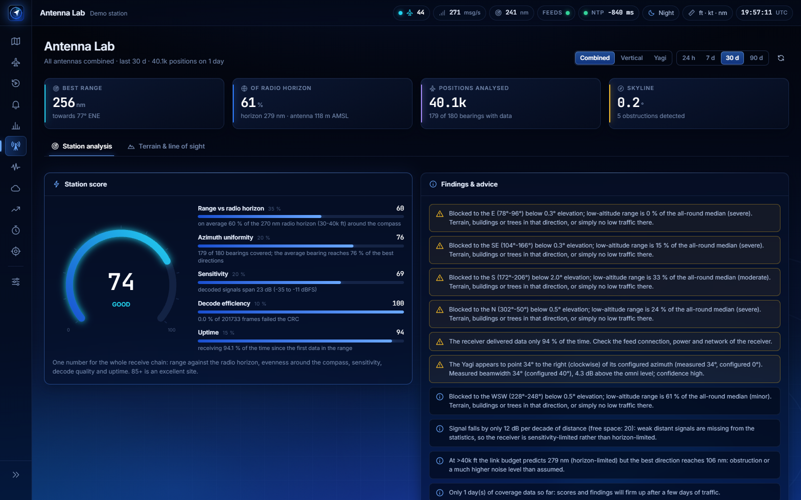
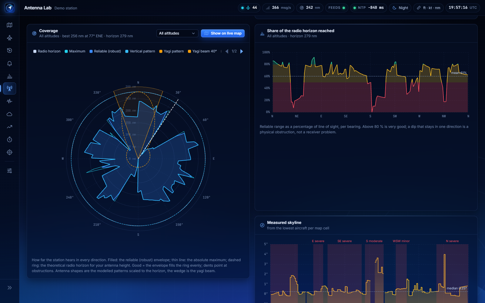
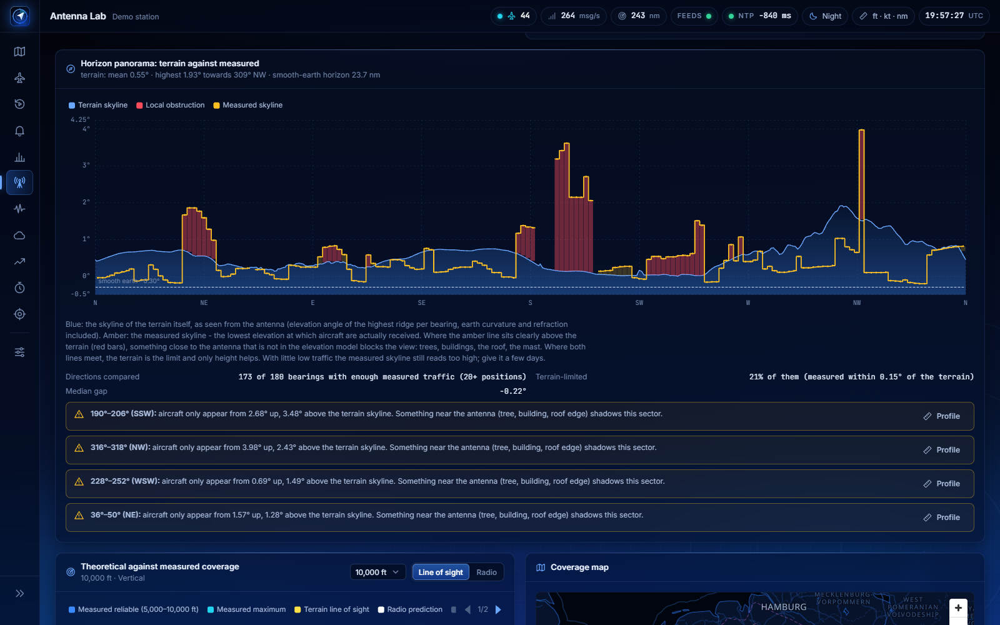
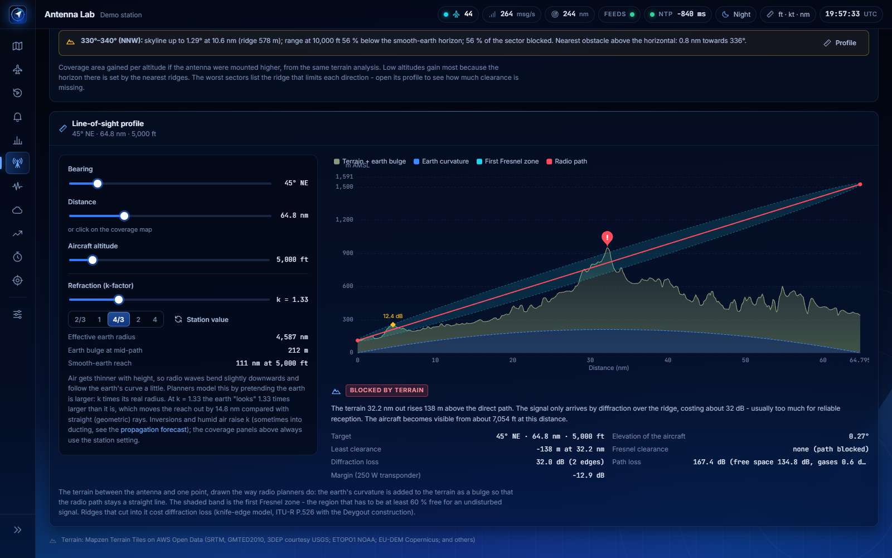

# 2.4 Antenna Lab

Route: `#/antenna` (sidebar: antenna icon). The Antenna Lab compares what the station actually receives with
what its antennas and the terrain around it should allow. It needs the station location and works best with
correct antenna data (**Settings → Antennas**: type, gain, height above ground, cable and LNA figures, azimuth
for directional antennas).

The page has two tabs: **Station analysis** (`#/antenna`) and **Terrain & line of sight** (`#/antenna/terrain`).

## 2.4.1 Header and tiles

- **Antenna selector**: **Combined** (all antennas together) or one antenna (only data attributed to it). It
  appears when more than one antenna is configured and their data can be told apart (separate feeds per antenna,
  measured attribution, or demo mode).
- **Period**: **24 h**, **7 d**, **30 d** (default) or **90 d**; the refresh button reloads the analysis.
- Tiles: **Best range** (farthest position in the period and its bearing), **Of radio horizon** (reliable range
  as a share of the theoretical line of sight, averaged around the compass), **Positions analysed** (and how many
  of the 180 two-degree bearings have data) and **Skyline** (median of the lowest elevation angle at which
  aircraft are still received, and the number of obstructions detected).

A first picture forms within minutes of traffic; a trustworthy one needs a few days of traffic from all
directions. Until then the panels say "Not enough data yet".

## 2.4.2 Station analysis

| Panel | What it shows | Good result |
|---|---|---|
| **Station score** | One number 0–100 for the whole receive chain, made of **Range vs radio horizon** (35 %), **Azimuth uniformity** (20 %), **Sensitivity** (20 %), **Decode efficiency** (10 %) and **Uptime** (15 %), each with its own score and explanation. | 85 or more is an excellent site. |
| **Findings & advice** | Plain-language findings: short range, blocked sectors with their bearings and elevation, uptime gaps, a Yagi that points elsewhere than configured, weak far signals, and so on. | Few warnings. |
| **Coverage** | Polar plot of range around the compass. Filled: the reliable (robust) envelope; thin line: the absolute maximum; dashed ring: the theoretical radio horizon for your antenna height; plus the modelled antenna patterns. Choose an altitude band; **Show on live map** draws the outlines on the Live Map (Layers → Coverage). | The envelope fills the ring evenly; dents point at obstructions. |
| **Share of the radio horizon reached** | Reliable range as a percentage of line of sight, per bearing. | Above 80 % is very good. A dip that stays in one direction is a physical obstruction. |
| **Measured skyline** | The lowest elevation angle at which aircraft are still received, around the compass; detected obstructions are marked. | Flat and close to 0°. |
| **Signal level against distance** | Every received position by distance and level, with the free-space slope (20 dB per tenfold distance, dashed) and a fitted line. | Fitted line close to free space. Much flatter: weak far signals are lost. Points crowding the top edge: overload, reduce gain. |
| **Azimuth gain pattern** | Measured relative signal strength per bearing with the effect of distance removed (0 dB = best direction), against the modelled pattern of each antenna (dashed). | A circle for an omni; the lobe where a directional antenna points. |
| **Elevation pattern** | Relative signal by elevation angle, measured against the model. | Gain kept right down to the horizon (most traffic is below 5°). |
| **Inferred yagi beam** | For a directional antenna: the measured beam direction, width and gain above the omni, compared with the configured values, with a confidence. | Matches the configuration. |
| **Link budget: predicted against achieved** | Per altitude band: radio horizon, predicted range, what limits it (horizon or signal power), margin, best antenna, and the achieved maximum, reliable and typical range. | 85 % or more of the prediction. |
| **What-if calculator** | Change transponder power (for example 250 W airliner), antenna height above ground, antenna gain, cable and filter loss before the first amplifier, a preamplifier (LNA gain and noise figure) and the aircraft altitude, and see the predicted range. **Start from** picks a configured antenna or a generic one; **Reset** restores the values. Smooth-earth model with free-space loss: real terrain only ever reduces these numbers. | Use it before buying anything. |
| **Day against night** | Typical far range (95th percentile) by hour of day, raw and traffic-normalised. | A flat line: the station performs the same around the clock. |
| **Position heat-map & coverage floor** | All-time map of **Positions** (where traffic was received), **Signal** (mean level per cell) or **Coverage floor** (lowest altitude ever heard per cell). | Low floor values far out mean a clear view; a floor that rises quickly in one direction means something blocks the horizon there. |

## 2.4.3 Terrain & line of sight

AirView downloads elevation tiles around the station (by default within 450 km, about 30–40 MB the first time,
cached in the `terrain` folder of the data directory) and computes what the terrain allows each antenna to see.
This happens on its own once the station is located, and again after the position, antenna heights, k-factor or
radius change (**Settings → Terrain**). The antenna selector at the top right chooses which antenna's height is
analysed.

| Panel | What it shows |
|---|---|
| **Terrain data** | State of the analysis (Up to date, Running with progress, Failed, Location needed, Switched off), time of the analysis, elevation tiles, cache size, radius and k-factor. **Download & analyse** (again) fetches the tiles and runs the analysis; **Recompute** re-runs it ignoring caches; **Cancel** stops a running job. All three are admin actions. |
| **RF chain & noise** | The RF health score from the RF Lab with noise floor, decode floor, median level, SNR margin, channel occupancy, frame rate, position reception and advice. **RF Lab** opens the full analysis. |
| **Horizon panorama: terrain against measured** | Blue: the skyline of the terrain seen from the antenna (highest ridge per bearing, earth curvature and refraction included). Amber: the measured skyline. Red bars: sectors where the measured skyline sits clearly above the terrain, so something close to the antenna that is not in the elevation model (a building, trees, the roof) blocks the view. |
| **Theoretical against measured coverage** | Polar plot for a chosen altitude. Dashed: what the terrain allows, as **Line of sight** (geometric, with refraction) or **Radio** (link budget with diffraction over ridges and the receiver sensitivity). Filled: the reliable range achieved in the matching altitude band. |
| **Coverage map** | Rings of theoretical coverage per altitude (the chosen one bold) and the measured reliable outline in white. Click anywhere to draw the line-of-sight profile to that point. |
| **Site advice: what a higher mast would bring** | Coverage area gained per altitude if the antenna were mounted higher (the table compares the current height with +2, +5 and +10 m), and the **Worst sectors**: the ridge that limits each direction, with a **Profile** button. |
| **Line-of-sight profile** | The terrain between the antenna and one point, drawn the way radio planners do: the earth's curvature is added to the terrain as a bulge so that the radio path is a straight line. The shaded band is the first Fresnel zone, which should be at least 60 % clear; ridges that cut into it cost diffraction loss (knife-edge model). Set **Bearing**, **Distance** (or click on the coverage map), **Aircraft altitude** and **Refraction (k-factor)** with a slider or the presets 2/3 (sub-refraction), 1 (no refraction), 4/3 (standard atmosphere), 2 (super-refraction) and 4 (close to ducting); **Station value** returns to the configured k-factor. The result says whether the path is clear or **blocked by terrain**, with the least clearance and where it occurs, the Fresnel clearance, the diffraction loss, the path loss, the elevation of the aircraft and the link margin for a 250 W transponder. |

The elevation data source and its attribution (Mapzen Terrain Tiles on AWS Open Data, built from SRTM, GMTED2010,
3DEP, ETOPO1, EU-DEM and others) are shown at the bottom of the tab. Terrain results also feed the Live
Map (Terrain coverage layer, the LOS column, the terrain line of sight and terrain forecast of each aircraft) and
the measuring tool.

## 2.4.4 Improving a station: a short checklist

1. Check the **Findings & advice** and the **RF chain & noise** panel. Fix gain and cable problems first.
2. Compare the **Horizon panorama**: red bars are local obstructions that a higher or different mounting point
   can clear.
3. Use **Site advice** and the **What-if calculator** to see whether more height, less cable loss or an LNA at
   the antenna is worth it.
4. Change one thing at a time and give the statistics a day before you judge the result.
