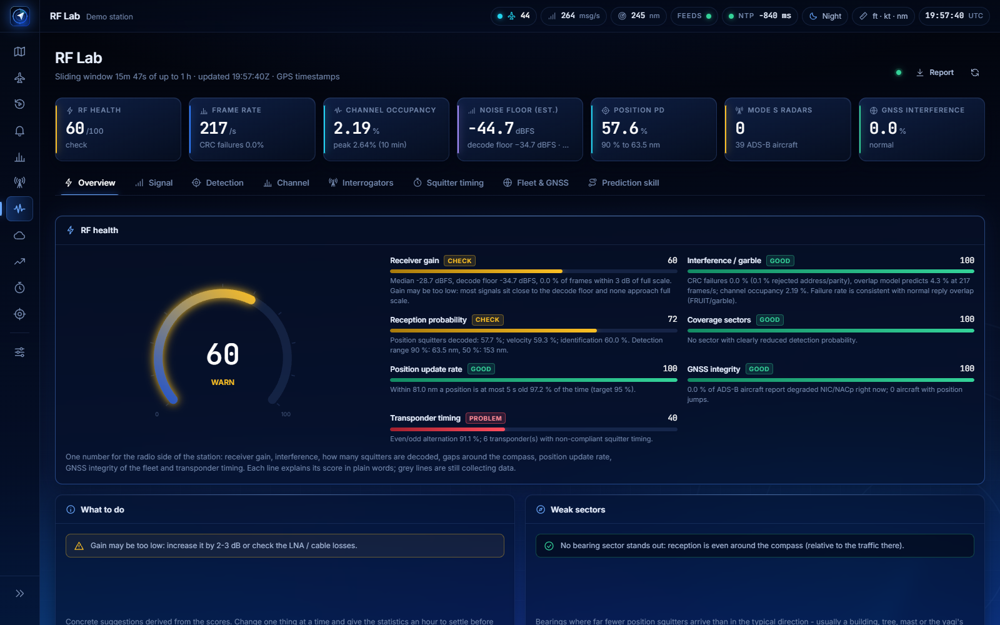
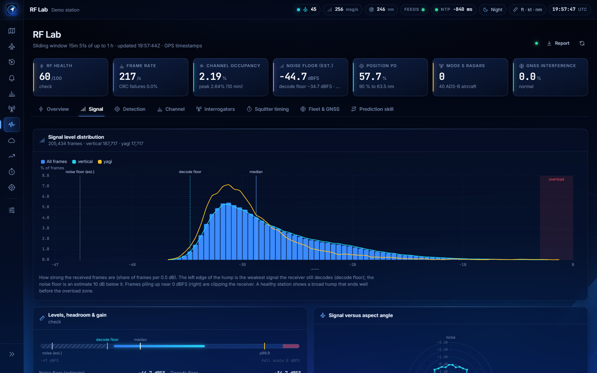

# 2.5 RF Lab

Route: `#/rf` (sidebar: wave icon). The RF Lab looks at the radio side of the station: how strong the received
signals are, how many of the transmitted messages are decoded, how busy 1090 MHz is, which radars interrogate the
aircraft you hear, how well the transponders keep their timing and how good the fleet's navigation data is.

It needs **Settings → RF statistics → Collect RF statistics** (on by default). Most panels need a feed with
signal levels (Beast, for example a Radarcape); a feed with GPS time stamps adds the squitter timing analysis.

## 2.5.1 Header

- **Report** downloads the complete RF statistics as one JSON document (`/api/rf/report`).
- Tiles: **RF health** (score 0–100 of the receive chain), **Frame rate** (decoded Mode S frames per second),
  **Channel occupancy** (share of time 1090 MHz carries a decoded reply), **Noise floor (est.)** (decode floor
  minus an assumed decoder SNR, an estimate, not a measurement), **Position Pd** (share of transmitted position
  squitters that were decoded), **Mode S radars** (interrogator codes other than II 0 with at least 10 replies in
  10 minutes) and **GNSS interference** (share of ADS-B aircraft with collapsed navigation integrity right now).

Each tab has its own address, for example `#/rf/detection`. Data is fetched only for the visible tab and only
while the browser tab is visible.

## 2.5.2 Tabs

| Tab | Panels and what to look for |
|---|---|
| **Overview** (`health`) | **RF health**: one line per factor (receiver gain, interference, squitters decoded, gaps around the compass, position update rate, GNSS integrity of the fleet, transponder timing), each with a score and a plain explanation; grey lines are still collecting data. **What to do**: concrete suggestions from the scores. **Weak sectors**: bearings where far fewer position squitters arrive than in the typical direction. **Hourly history**: one point per closed hour; a sudden step that does not follow the traffic means something changed in the receive chain. |
| **Signal** | **Signal level distribution** (share of frames per 0.5 dB; the left edge of the hump is the decode floor, the noise floor is estimated 10 dB below it; frames piling up near 0 dBFS are clipping). **Levels, headroom & gain** (ladder from noise floor to full scale, dynamic range, SNR margin). **Signal level by distance** (and by elevation). **Signal versus aspect angle**. **Fading**. **Multipath (ground reflection)** (a regular ripple over elevation is the two-ray effect between the direct and the ground-reflected wave). |
| **Detection** | **Reception probability** (Pd = squitters decoded ÷ squitters transmitted, per aircraft over 10-second windows; 70–90 % close in is typical). **Pd versus distance** (with your practical 90 % "solid" and 50 % "usable" range). **Pd versus elevation**, **Pd versus bearing**, **Pd versus signal level**. **Position update intervals** (p50 ≈ 0.5 s means almost nothing is lost). **Aircraft now** (click a row to show it on the map). |
| **Channel** | **1090 MHz channel occupancy** with frame rate and failed frames. **Frames per second by format** (DF17 ADS-B, DF11 all-call, DF0/16 ACAS, DF4/5/20/21 radar replies). **Decode quality** (how frames passed the parity check). **Garble model versus observed**: the Poisson overlap model at your frame rate against the observed failure rate; far more failures than the model means interference, noise or gain problems. |
| **Interrogators** | **Interrogator codes** (II 1–15 and SI 1–63 echoed in all-call replies, so you can count the radars that reach your aircraft). **All-call replies over time**. **Surveillance replies** (and the most interrogated aircraft). **Comm-B register mix** (BDS 4,0 / 5,0 / 6,0 / 2,0 …). **ACAS / TCAS activity** (resolution advisories are rare and worth a look). **Who is under radar coverage** (ADS-B only, Mode S only, both). |
| **Squitter timing** | **Squitter interval histogram** (from the receiver's time stamps). **Even / odd alternation** of position squitters (both close to 100 %). **Non-compliant transponders**: intervals a compliant transmitter cannot produce or non-random jitter; usually an old or mis-configured transponder, occasionally a spoofed or simulated target. |
| **Fleet & GNSS** | **Equipage census** (ADS-B version, NIC / NACp / SIL; "Poor integrity" = NACp below 8, NIC below 7 or SIL below 3). **Emitter categories**. **GNSS interference index** per minute over 24 h (near 0 % is normal; sustained values show GPS jamming or spoofing affecting aircraft in your area). **Where integrity degrades** (polar cells of 10° × 50 km). **GNSS versus barometric altitude**. |
| **Prediction skill** | **Prediction error by horizon**: AirView predicts where each aircraft will be 5, 15, 30 and 60 s later and scores each prediction when the real position arrives, against two simple baselines. **Tracking filter**: counters of the filter that drives coasting on the Live Map, including rejected outlier positions. |

## 2.5.3 Practical advice

- Change one thing at a time (gain, cable, filter, LNA, antenna position) and give the statistics an hour to
  settle before you judge the result. The **Hourly history** shows the step.
- A hump of frames near 0 dBFS means the receiver is overloaded: reduce the gain.
- Little SNR margin and a short Pd-versus-distance curve mean the gain is too low or the losses before the first
  amplifier are too high.
- A notch in **Pd versus bearing** that stays in one direction is an obstruction or the null of a directional
  antenna; compare it with the Antenna Lab's measured skyline.
