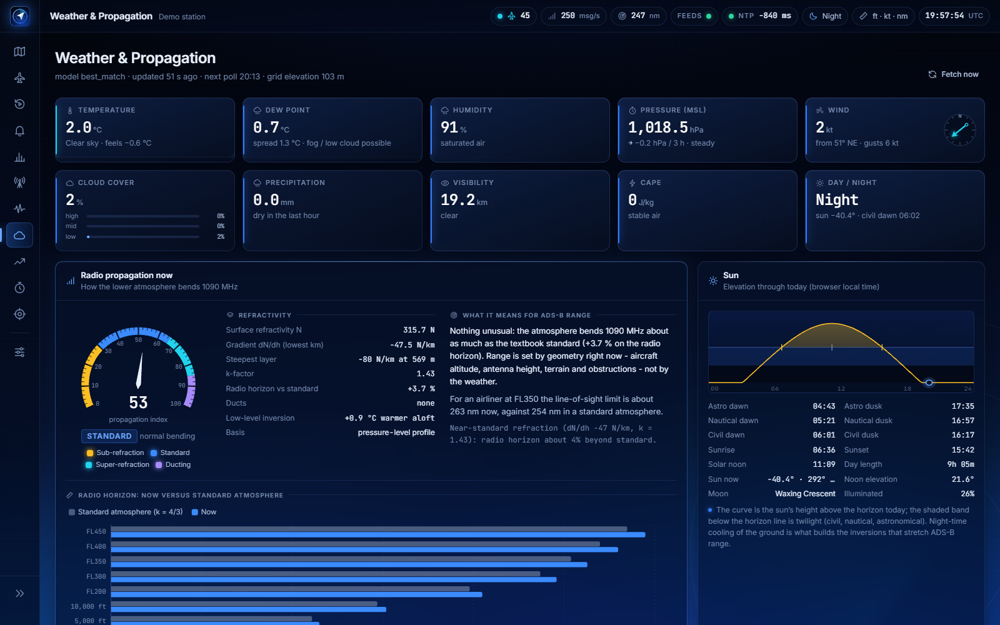

# 2.6 Weather

Route: `#/weather` (sidebar: cloud icon). Page title: **Weather & Propagation**. It combines the weather model
for the station location (Open-Meteo, free, no key), the weather that aircraft themselves report through their
Comm-B replies, and the refractivity of the lower atmosphere, which decides how far 1090 MHz signals travel.

Weather download is on by default (**Settings → Weather**, every 15 minutes) and starts as soon as the station
location is set. On the first download AirView also loads about 60 days of past weather, so the history panels
are not empty. **Fetch now** at the top right downloads the weather immediately (admin).

If the page shows "Weather download is switched off", "Receiver position unknown", "Waiting for the first
weather download" or "Weather download is failing", follow the hint in the banner; the error of the last
attempt is shown there.

## 2.6.1 Current conditions

Tiles for temperature, dew point, humidity, sea-level pressure, wind, cloud cover, precipitation, visibility,
CAPE (convective energy) and day / night, in your units.

## 2.6.2 Radio propagation now

How the lower atmosphere bends 1090 MHz right now:

- a **propagation index** gauge with its class: **Sub-refraction**, **Standard**, **Super-refraction** or
  **Ducting**, and the effect on range (Poor, Normal, Enhanced, Ducting likely);
- **Refractivity**: surface refractivity N, the gradient dN/dh over the lowest kilometre (standard atmosphere
  about −40 N/km; below −79 super-refraction, below −157 ducting, above 0 sub-refraction), the steepest layer,
  the k-factor (4/3 is the standard atmosphere), the radio horizon against the standard atmosphere and any ducts;
- **What it means for ADS-B range** in plain words;
- **Radio horizon: now versus standard atmosphere**: line-of-sight distance to an aircraft at each altitude, with
  today's k-factor against the standard one. Terrain and obstructions are not included here.

Next to it the **Sun** card shows the sun's elevation through today (browser local time) with the twilight bands,
and the times of astronomical, nautical and civil dawn and dusk, sunrise, sunset and solar noon, the day length,
the sun's position now, its noon elevation, and the moon phase and illumination. Night-time cooling of the ground builds the inversions
that stretch ADS-B range.

## 2.6.3 Duct diagram and refractivity time line

- **Duct diagram**: modified refractivity M against height from the model profile (**Lowest 3 km** or **Full
  profile**). M normally increases with height; where the line leans back to the left, there is a trapping layer
  and the duct reaches from its top down to where M has the same value again. The table **Ducts in the model
  profile** lists kind, base, top, thickness, ΔM, cut-off frequency and whether 1090 MHz is trapped; **Inversions
  measured by aircraft right now** lists inversions found in the aircraft reports.
- **Refractivity time line**: the propagation index per hour for the last 48 h (observed) and the next 72 h
  (forecast). 50 is a standard atmosphere, above 65 the horizon is noticeably extended, 85 and more means ducting
  is likely. Diamonds mark hours with a duct.

## 2.6.4 Measured by aircraft

These panels need Comm-B replies (Mode S Enhanced Surveillance, DF20 / DF21), from which AirView derives wind
and temperature. They fill within minutes when radars in your area request these registers; without them the
panels stay empty.

- **Vertical profile**: temperature and wind by height, weather model against what aircraft measure.
- **Winds aloft**: aircraft-derived wind at standard flight levels.
- **Time-height history**: wind, temperature, deviation from the standard atmosphere (ISA dev.) or the number of
  samples per hour and 1,000 ft layer, over 24 h, 3 d or 7 d.

## 2.6.5 Weather and reception

- **Weather history and range** (48 h, 7 d, 30 d): hourly weather aligned with what the receiver
  achieved, in panes on one time axis (range, temperature, pressure, wind and refractivity). Move the pointer to read one hour across all of
  them. Look for range peaks that line up with a steep negative dN/dh, calm wind and a small temperature – dew
  point gap.
- **Weather impact on reception**: does the weather explain your range? Statistics over the station's own record:
  **Data sufficiency**, **Conclusions**, a correlation matrix and table (**Partial r** with the traffic level held
  constant, **Pearson r**, **Spearman ρ**, **Best-lag r** with the weather shifted by up to ±6 h) for the p95
  range, max range, far positions or signal residual, a response curve, a regression of the p95 range and a list
  of ducting and long-range episodes. It needs days to weeks of history; until then it says what is missing.

The data sources and their attribution are shown at the bottom of the page.
