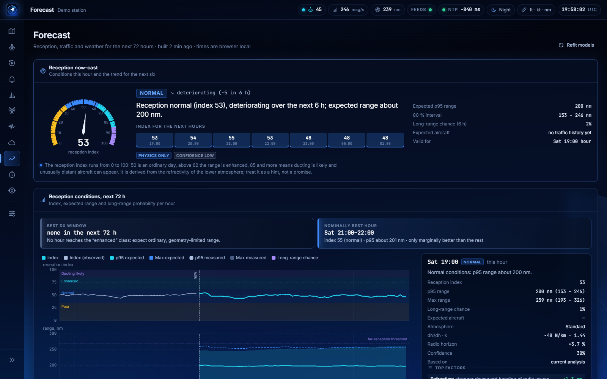

# 2.7 Forecast

Route: `#/forecast` (sidebar: trend icon). Reception, traffic and weather for the next 72 hours. The forecasts
start physics-only (refractivity from the weather model) and become data-driven as the station's own history
grows: each model learns from what this station measured. **Refit models** at the top right refits all models on
the newest data at once (admin); normally this happens every hour.

All forecasts need the station location and the weather download (**Settings → Weather**).

## 2.7.1 Panels

| Panel | Contents |
|---|---|
| **Reception now-cast** | Conditions this hour and the trend for the next six. The reception index runs from 0 to 100: 50 is an ordinary day, above 62 the range is enhanced, 85 and more means ducting is likely and unusually distant aircraft can appear. It is derived from the refractivity of the lower atmosphere: treat it as a hint, not a promise. |
| **Reception conditions, next 72 h** | Two boxes name the **Best DX window** (hours in the "enhanced" class or better, if any) and the **Nominally best hour**. A card on the right explains one hour in detail (index, p95 and max range with intervals, long-range chance, atmosphere, dN/dh and k, radio horizon, confidence and the top factors). The chart, top: the reception index with its class bands; highlighted columns are the best windows. Middle: expected p95 range with its 80 % interval, the expected maximum, and what was actually measured in the last two days. Bottom: probability of anomalous long-range reception. Below: **Radio horizon per altitude band (first forecast hour)**, standard atmosphere against now. |
| **Traffic forecast** | Aircraft in view and message rate for the next 72 h. Left of "now": what the receiver counted; right: the expected value with its 80 % interval. Traffic follows a daily and weekly rhythm, so the forecast sharpens after one day and again after eight days of data. |
| **Local weather outlook** | Open-Meteo forecast, corrected with the station's own verification where that helps: temperature and dew point (a closing gap means fog or low cloud), sea-level pressure, wind and gusts, cloud cover with precipitation, and derived risks. A high inversion risk on a calm, clear night is the classic recipe for extended ADS-B range. |
| **Barometer outlook (Zambretti)** | The 1915 rule of thumb: pressure, its trend, wind direction and season give one of 26 outlooks (A = settled fine … Z = stormy). It knows nothing about the model forecast, so agreement between the two is a useful confidence check. |
| **Detected patterns** | Fronts, fog, inversions, convection, recognised from the station's own pressure, wind and temperature record together with the forecast, with a rough probability and a severity (info, low, moderate, high). |
| **Analogue outlook** | Temperature that followed the K most similar past weather situations (line = their average, band = their spread) against "no change" persistence, with a table of the closest past states. A narrow band means the analogues agree. |
| **Verification** | How good the forecasts are and how much history each model has: **Models and data sufficiency** (each model trained, learning or waiting for data), **Forecast versus actual (backtest)** with the error (RMSE) by lead time against a baseline, **Issued forecasts against what happened** (MAE, RMSE, bias, 80 % interval hit rate of the forecasts that were really published), **Open-Meteo forecast against the station record** (bias and error, raw and corrected) and **Analogue method against persistence and Open-Meteo**. |

## 2.7.2 How much data is needed

- The reception index and the weather outlook work from the first weather download.
- The traffic forecast needs a day of history, and becomes much better after eight days (the weekly rhythm).
- The bias correction of the weather outlook is applied only where it lowers the error on the newest 30 % of the
  logged forecasts; otherwise the raw model value is shown unchanged.
- The analogue outlook and the verification tables need weeks of history.

Panels without enough data say "Not enough data yet" and what they are waiting for.
