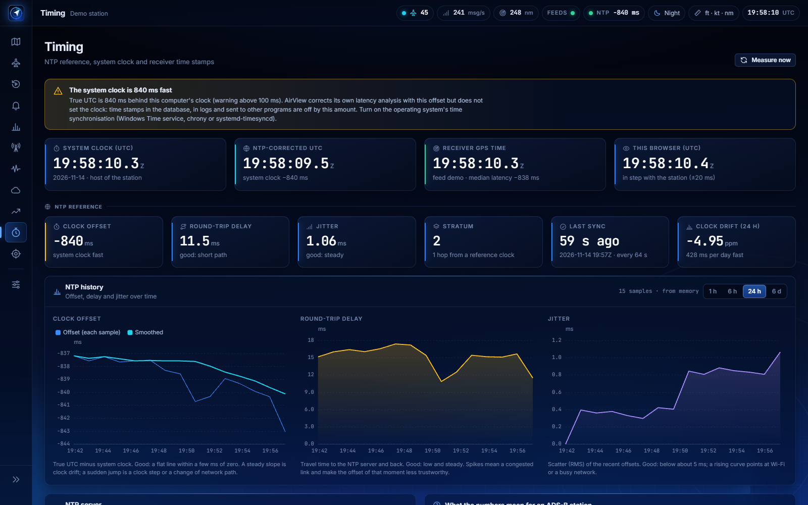
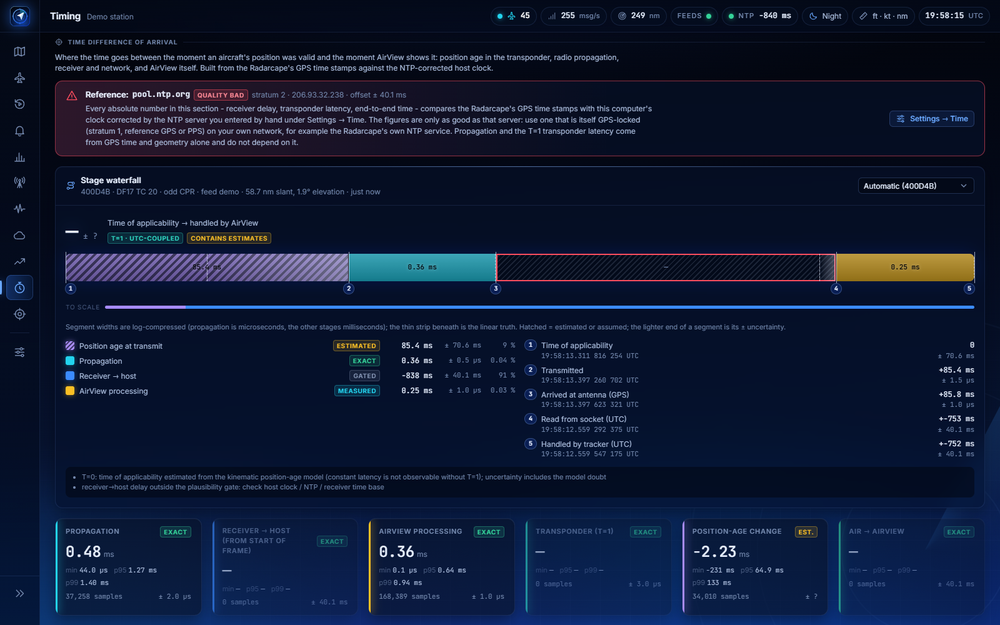

# 2.8 Timing

Route: `#/timing` (sidebar: timer icon). Everything about time: how far the computer's clock is from true UTC
(measured over NTP), the GPS time stamps of the receiver, how long frames take from the receiver to AirView, and a
breakdown of the delay of each position message from the aircraft to the screen (time difference of arrival).

AirView only **measures** the clock. It never sets it; keeping the system clock right is the job of the operating
system's time service (Windows Time, chrony or systemd-timesyncd).

## 2.8.1 Setting up the NTP reference

NTP is off by default. Open **Settings → Time (NTP)** (`#/settings/time`, or the **Settings → Time (NTP)** button
in the Timing page's banner):

1. Enter the **NTP server**: a host name or IP address, optionally with `:port` (default UDP 123; IPv6 as
   `[fd00::1]:123`). For example `pool.ntp.org`, your router, or best of all a GPS-locked stratum-1 server on
   your own network, such as the Radarcape's own NTP service. The **Quick fill** links enter `radarcape` (the
   Radarcape's own NTP service under its default host name) or `pool.ntp.org`.
2. **Test now** queries the server as typed, once, without saving anything. It shows whether the server answered,
   from which address, the stratum, reference ID, offset (true time minus host clock), round-trip delay, root
   dispersion and delay and the leap indicator, with a badge **GPS-locked stratum 1**, **Stratum 1 – reference
   "…"** or **Not GPS-locked · stratum n**, and a grade of how suitable the server is.
3. **Save** makes it the reference at once.

**Sample the NTP server** switches the sampling on or off (off: the host clock is trusted as it is), and the
**Sampling interval** sets how often it is asked (2–86 400 s; 64 s is the classic NTP interval, a server on your own
network can take 16 s). Every absolute latency figure on the Timing page is only as good as this server.

If the server does not answer, check the address, that outgoing UDP port 123 is allowed by the firewall, and that
the server actually serves time.

## 2.8.2 Clocks

Four live clocks at the top, each with a note underneath:

| Clock | Meaning |
|---|---|
| **System clock (UTC)** | The clock of the computer AirView runs on, as the server reports it. |
| **NTP-corrected UTC** | System clock plus the measured NTP offset: the best estimate of true UTC. |
| **Receiver GPS time** | The time stamp the receiver puts on frames arriving right now (NTP-corrected arrival time minus the median feed latency). |
| **This browser (UTC)** | The clock of the device you are looking at, for comparison. |

**Measure now** at the top right takes an NTP measurement immediately (admin).

## 2.8.3 NTP reference

Six tiles, each with a verdict:

| Tile | Meaning | Good |
|---|---|---|
| **Clock offset** | True UTC minus the system clock (smoothed). Positive: the system clock is slow. | Within ±50 ms. |
| **Round-trip delay** | Time for a query to reach the NTP server and come back. | Below 50 ms and steady. |
| **Jitter** | RMS scatter of the recent offsets. | Below 5 ms on a wired network. |
| **Stratum** | Distance of the server from a reference clock: 1 = GPS or atomic clock attached, 2 = synchronised to a stratum 1 server, and so on. | 1 to 4. |
| **Last sync** | Time of the last successful measurement and the interval. | A few intervals ago at most. |
| **Clock drift (24 h)** | How fast the system clock gains or loses against the server, in ppm (1 ppm = 86 ms per day). | A few ppm. |

Below them: **NTP history** (offset, delay and jitter over 1 h, 6 h, 24 h or 6 d), **NTP server** (newest
measurement, including the reference ID: a four-letter clock name such as GPS or PPS for stratum 1, otherwise the
address of the server's own time source), **Offset statistics** (samples, span, mean, min … max, standard
deviation, delay, drift for several windows) and **What the numbers mean for an ADS-B station**, a short glossary.

### Warnings at the top of the page

| Banner | Meaning |
|---|---|
| NTP is not configured | Without NTP AirView cannot tell how far the clock is from UTC; the feed latency includes the full clock error. |
| Waiting for the first NTP measurement | The first answer usually arrives within seconds. |
| The NTP server does not answer | With the server's error. Check name, network and UDP port 123. |
| The system clock is … fast / slow | Shown above 100 ms (red above 1 s). AirView corrects its own latency analysis with the offset, but time stamps in the database and logs, and data sent to other programs, are off by this amount. Turn on the operating system's time synchronisation. |
| The NTP reference is stale | No successful measurement for more than five intervals (at least 2 minutes). |
| The host clock limits the latency figures / Host clock not checked against NTP | The latency analysis found that the host clock, not the network, dominates its figures (for example frames that seem to arrive before they were sent). |
| Receiver GPS problem / Receiver GPS is still acquiring | The receiver reports an antenna fault, invalid time or fewer than three satellites. GPS time stamps (and MLAT) are not reliable until this is fixed. |

The screenshot above was taken on a PC whose clock ran 0.84 s fast, which the page reports in exactly this way.

## 2.8.4 Receiver

**Receiver timing** lists every feed with its type, link state, **Time stamps** (GPS: each frame carries the GPS
second of the day and nanoseconds, absolute time usable for latency analysis and MLAT; otherwise a free-running
counter or none, relative time only), **GPS status** and what the receiver says in its status frames, and the last
frame. GPS status values:

| Status | Meaning |
|---|---|
| GPS locked | Antenna fine, at least three satellites, time stamps valid. |
| acquiring | Fewer than three satellites: the GPS antenna needs a better view of the sky. |
| no satellites | No satellite tracked: check the GPS antenna. |
| antenna fault | The receiver reports a GPS antenna problem: check cable and antenna. |
| time not valid | The receiver flags its time stamps as unusable. |
| not reported | Old firmware: the status frame carries no GPS detail. |
| GPS timestamps | GPS time-stamp mode detected; no status frame seen yet. |
| simulated | The built-in simulator stamps its frames with the host clock. |

When the receiver reports its own GPS position, it is shown with the distance to the configured station location
(more than a few hundred metres means the location in Settings is wrong). The table of **stored receiver status
frames** shows GPS stamps, antenna, satellites, time base, validity and the 1PPS offset of recent status frames.

## 2.8.5 Feed latency

For every feed with GPS time stamps (a Radarcape Beast feed in GPS mode, or the demo simulator), **Feed latency**
compares the receiver's time stamp of each frame with the NTP-corrected moment the frame reached AirView: receiver
processing plus network transit plus whatever clock error is left. Shown are the **median (p50)**, **p95**, **p99**
and **mean ± standard deviation**, a histogram and a time series. A few ms to a few tens of ms with a narrow
distribution is good. Position decoding pairs messages within 10 s, so only latencies of seconds do harm, but a wide
or growing tail is an early sign of network trouble.

The Radarcape stamps the **end** of a frame; this card uses that raw stamp. The note under the card says which
reference is used.

## 2.8.6 Time difference of arrival

This section breaks down where the time goes between the moment an aircraft's position was valid and the moment
AirView shows it: position age in the transponder, radio propagation, receiver and network, and AirView itself.
It is built from the receiver's GPS time stamps against the NTP-corrected host clock. A box at the top says which
NTP reference the figures rely on, or "No NTP reference entered".

- **Stage waterfall**: the latest position message of one aircraft (**Automatic** picks the one with the most
  positions, or choose one), stage by stage, each with its ± uncertainty. The numbered time points are the time of
  applicability, transmitted, arrived at the antenna (GPS), read from the socket and handled by the tracker; the
  stages between them are position age at transmit, propagation, receiver → host and AirView processing. Badges say
  whether the message is T=1 (UTC-coupled) and whether it contains estimates. Hatched segments are model estimates or
  assumptions; a second bar draws the stages to scale, where the microsecond stages vanish next to the
  millisecond ones.
- **Stage cards**: median, minimum, p95 and p99 of each stage (propagation, receiver → host, processing,
  transponder latency for T=1, position-age change, totals) over a rolling 15-minute window. Each value carries a
  mark: exact (GPS time stamps and geometry), measured, derived, estimated, assumed, rejected by a plausibility
  check, or not available.
- **Findings**: what the numbers say, in plain language.
- **How the latency chain is measured**: the method in brief.
- **Distributions** of the stages.
- **Receiver delay, 24 h**: per feed, one point per minute (median, min…p95 band and the clock-filter floor).
- **NTP / GPS consistency**: is the NTP server good enough to judge the receiver's GPS time stamps? Server
  quality, offset uncertainty (half the round trip plus root dispersion and jitter), 10-second delay minima, drift
  and issues, with a quality badge.
- **Aircraft**: a table per aircraft (messages and positions, T bit, transponder latency or position age, age
  jitter, propagation, slant range, flags). Click a row to show its waterfall.

### What is exact and what is estimated

- **Propagation** comes from geometry alone (slant range divided by the speed of light).
- **T=1 positions.** An ADS-B position with the T bit set applies to an exact 0.2 s UTC epoch, so with the GPS time
  of arrival and the computed propagation the transponder's own delay is measured exactly. Only about 1 % of
  aircraft use it.
- **T=0 positions** (the usual case) do not say when the position was valid. Only the *variation* of the position
  age is observable; the mean age is a model estimate, marked "est." and hatched.
- **Receiver → host** is the GPS time stamp moved back to the start of the frame (64 µs for short, 120 µs for long
  frames) against the moment AirView read the frame, with the host clock corrected by NTP. It is therefore shorter
  than the per-feed latency above by that frame length, and only as accurate as the NTP server.
- **MLAT results are excluded**, because their time stamps are synthetic. Only feeds with GPS time stamps produce
  latency data.
- For context the page quotes the limits of 14 CFR 91.227 (total position latency at most 2.0 s, of which at most
  0.6 s uncompensated) and DO-260B (uncompensated latency −200 … +400 ms). A ground station sees only part of these.

In demo mode about 10 % of the simulated ADS-B aircraft are UTC-coupled (T=1), so the transponder-latency cards and
the whole section fill within a few minutes.
