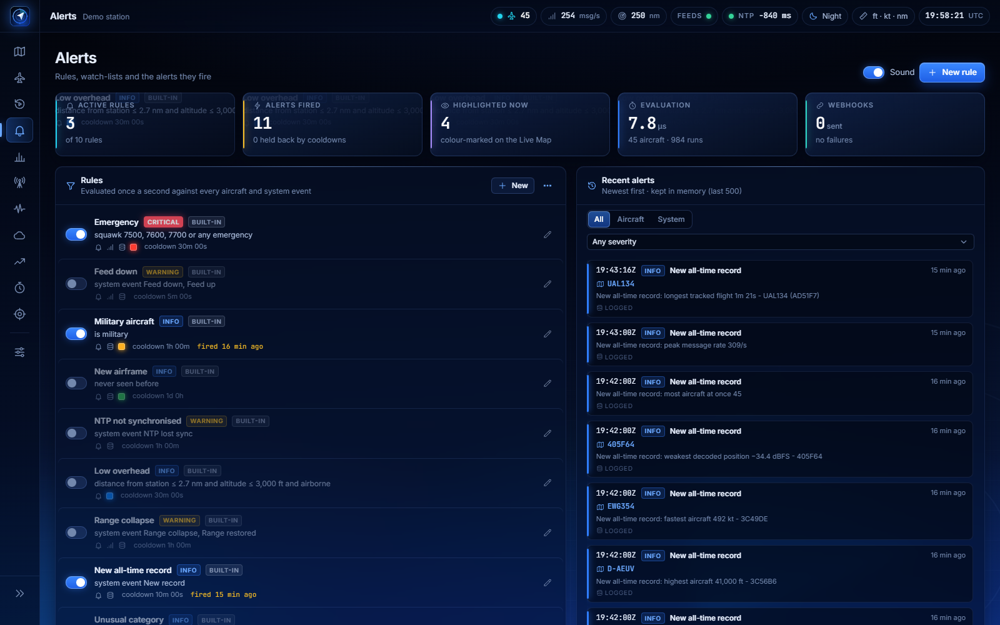
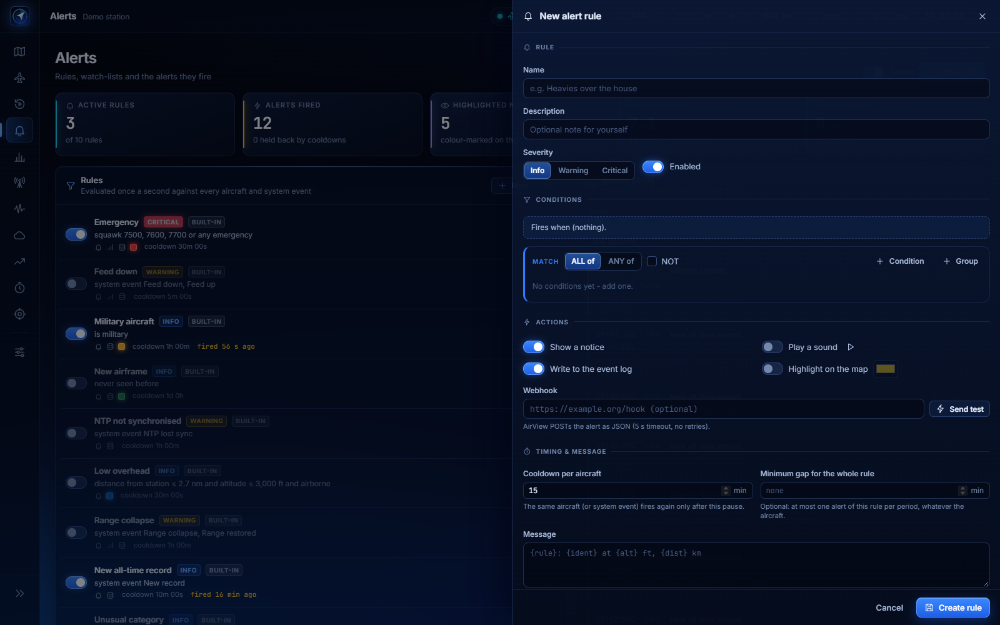

# 2.9 Alerts

Route: `#/alerts` (sidebar: bell icon). Alert rules watch the live picture and the station itself. A rule fires
when an aircraft (or a system event such as a feed going down) matches its conditions, and then shows a notice,
plays a sound, writes to the event log, highlights the aircraft on the map and/or calls a webhook.



## 2.9.1 Page overview

- **Header**: **Sound** switches the alert chime for this browser on or off (on every page; **Settings →
  Alerts** switches sounds off for all browsers). **New rule** opens the editor. A **Read-only** badge with
  **Log in** appears while changes need the admin password.
- **Tiles**: **Active rules**, **Alerts fired** (since AirView started), **Highlighted now** (aircraft a rule
  highlights on the map), **Evaluation** (rules are evaluated once a second) and **Webhooks**.
- **Rules**: every rule with its severity, its actions as small icons (notice, sound, log, webhook, map highlight
  colour) and an on/off switch. Click a rule to edit it. The **…** menu offers **Import rules (JSON)…**, **Export
  all rules** and **Reset built-in rules…**.
- **Watch-lists** (below the rules).
- **Recent alerts** (right): newest first, kept in memory (the last 500), filtered by **All / Aircraft /
  System** and minimum severity. The map button shows the aircraft on the Live Map.

Banners say when the alert engine is switched off in Settings or when sounds are off for the station.

## 2.9.2 Built-in rules

AirView ships with ten rules. Three are on by default; the others are templates that you switch on when you want
them.

| Rule | On by default | Fires on | Actions |
|---|---|---|---|
| Emergency | yes | Squawk 7500 / 7600 / 7700 or an ADS-B emergency state (critical) | notice, sound, log, red highlight |
| Military aircraft | yes | Military airframe | notice, log, amber highlight |
| New all-time record | yes | A new station record | notice, log |
| Feed down | no | A feed goes down (and up again) | notice, sound, log |
| NTP not synchronised | no | The NTP reference loses synchronisation | notice, log |
| Range collapse | no | Reception range far below normal (antenna, cable or receiver problem?), and its restoration | notice, sound, log |
| New airframe | no | An aircraft never seen before by this station | notice, log, green highlight |
| Watch-list aircraft | no | An aircraft on any watch-list | notice, sound, log, violet highlight |
| Low overhead | no | Below 3000 ft within 5 km of the receiver, airborne | notice, blue highlight |
| Unusual category | no | Gliders, balloons, parachutists, ultralights, UAVs, space vehicles (emitter category B1–B7) | notice, log |

Built-in rules can be edited and switched on or off but not deleted (the editor offers no **Delete** for them). **Reset built-in rules…** restores their
original settings; your own rules are not touched. **Restore built-ins** is offered when no rules exist at all.

## 2.9.3 The rule editor



- **Name**, **Enabled**, **Severity** (Info, Warning, Critical) and an optional **Description**.
- **Conditions** as a tree: the top group is **ALL of** (and) or **ANY of** (or); **+ Condition** adds a condition,
  **+ Group** a nested group, and **NOT** inverts a condition or a group.
- **Include predicted positions**: off by default, so altitude, distance, bearing and geofence conditions ignore
  aircraft whose position is only predicted (coasting).
- **Actions**: **Show a notice**, **Play a sound**, **Write to the event log**, **Highlight on the map** (with a
  colour) and **Webhook** (a URL with **Send test**; AirView POSTs the alert as JSON with a 5 s timeout and no
  retries).
- **Cooldown per aircraft** (15 min for a new rule): the same aircraft (or system event) fires again only after this pause. **Minimum gap for
  the whole rule** (optional): at most one alert of this rule per period, whatever the aircraft.
- **Message**: the notice text, with placeholders inserted from a menu: `{rule} {severity} {icao} {callsign}
  {reg} {type} {operator} {squawk} {alt} {dist} {ident} {event} {key} {value} {text} {watchlist} {note}`. Empty =
  the default text. Numbers in the message use the server units (ft, kt, km).
- **Test against the live picture**: a dry run that lists the aircraft the rule would match right now, without
  firing anything.
- **Create rule** (for a new rule) or **Save**, **Cancel**, **Duplicate**, **Delete**.

### Condition types

| Condition | Matches |
|---|---|
| ICAO address | Hex addresses, `*` / `?` patterns or ranges, for example `3C6444, 3C*, 3C0000-3CFFFF` |
| Callsign | Patterns with `*` and `?`, case-insensitive |
| Registration, Operator | Patterns |
| Aircraft type | ICAO type designators |
| Emitter category | A1 Light … A7 Rotorcraft, B1 Glider … B7 Space vehicle, C1 Emergency vehicle, C2 Service vehicle, C3 Obstacle; patterns such as `B*` |
| Country | ISO codes or country-name patterns |
| Military | Military airframe |
| On a watch-list | One or more lists (none selected = any watch-list) |
| New airframe | Never seen before by this station |
| Squawk | Codes |
| Emergency | General, Medical, Minimum fuel, No comms, Unlawful interference, Downed (none selected = any) |
| Position source | ADS-B, MLAT, TIS-B, ADS-R, Mode S, Other |
| ADS-B version, NIC | Ranges |
| Signal (RSSI) | Range in dBFS |
| Altitude, Ground speed, Vertical rate | Ranges |
| On the ground | Yes / no |
| Distance from station | Range |
| Bearing sector | From … to, degrees |
| Geofence | Circle or polygon drawn on a small map (**Station** centres it on the receiver; **Undo point**, **Clear**), **Inside** or **Outside** |
| System event | New record, Feed down, Feed up, NTP lost sync, NTP synced, Range collapse, Range restored, New airframe, Custom; extra entries as `kind:key` patterns, for example `record:max_dist*` |

## 2.9.4 Watch-lists

Watch-lists hold aircraft you want to know about; use them in rules with **On a watch-list** (the built-in
**Watch-list aircraft** rule matches any list). For each list you can add an address with a note, filter the
entries, show an aircraft on the Live Map, remove entries, download the list as TXT (one address per line) or CSV,
import into it, and delete it.

**Import** takes pasted text or a CSV / text file (up to 16 MB): one address per line, optionally followed by a
note after a comma, semicolon or space, for example

```text
# one address per line, note after a comma
3C6444, Lufthansa A319
4CA2D1 Ryanair
```

Choose **Add to the list** or **Replace the list**; a preview counts the recognised addresses and the lines that
will be skipped. A new list name creates a list.

## 2.9.5 Webhooks

A rule with a webhook URL sends an HTTP `POST` with a JSON body for every alert:

```json
{ "app": "AirView", "version": "1.0.1", "type": "alert", "alert": { "...": "the alert" } }
```

**Send test** sends the same shape with `"type": "test"`. Webhooks only leave the computer while **Settings →
Alerts → Allow webhooks** is on (default on). Typical targets are Discord, ntfy or Home Assistant; use a service
that accepts a generic JSON POST, or a small relay script.

## 2.9.6 Settings → Alerts

| Setting | Default | Meaning |
|---|---|---|
| Evaluate alert rules | on | Off: no rule is checked, nothing is highlighted, no notification is sent. |
| Sound | on | Open AirView pages may play a short tone for alerts whose rule asks for it. |
| Allow webhooks | on | Off: no webhook leaves this computer, whatever the rules say. |

The section also shows the **Engine status**.
