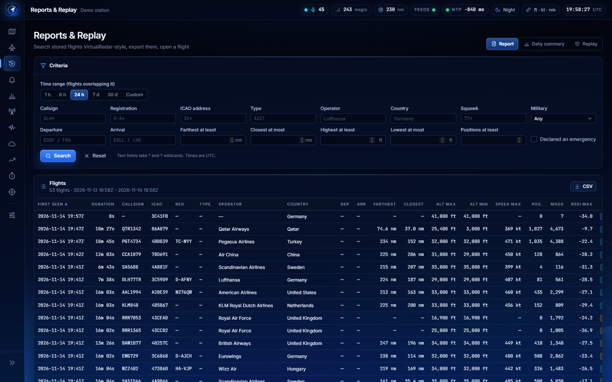
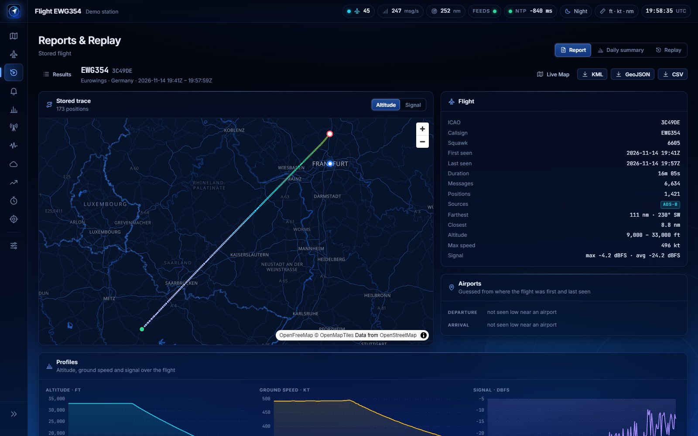
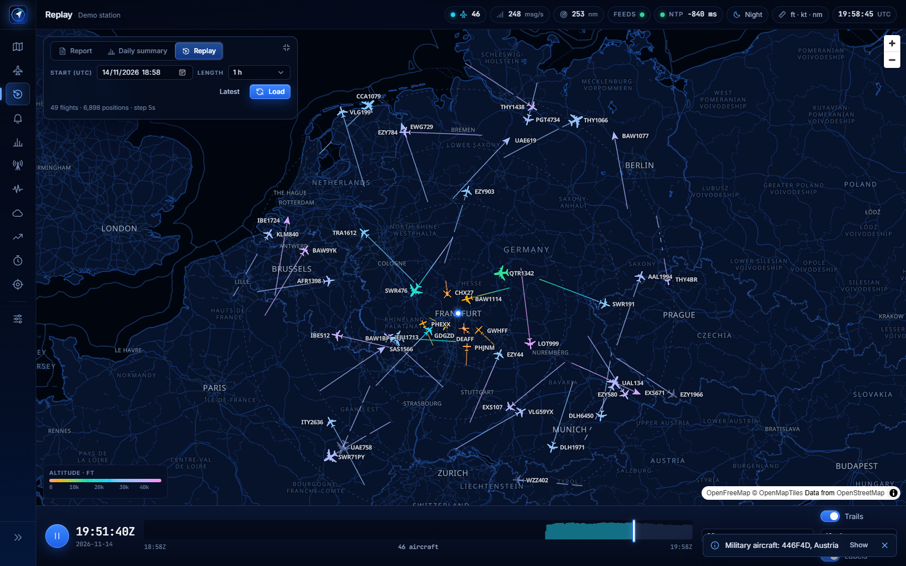

# 2.10 Reports & Replay

Route: `#/reports` (sidebar: replay icon). Everything about stored history: search flights, open one flight with
its trace and profiles, see per-day totals, and replay up to 24 hours of traffic on a map. The three views are
switched with the buttons at the top right: **Report**, **Daily summary** and **Replay**.

What is available depends on the retention periods in **Settings → Storage & database**: flights are kept for 730
days by default, stored position trails for 30 days.

## 2.10.1 Report

A flight search in the style of VirtualRadar Server. Fill in the **Criteria** and press **Search**:

| Criterion | Notes |
|---|---|
| Time range (flights overlapping it) | 1 h, 6 h, 24 h, 7 d, 30 d or Custom (**From (UTC)** / **To (UTC)**). |
| Callsign, Registration, ICAO address, Type, Operator, Country, Squawk | Text with `*` and `?` wildcards, for example `DLH*`, `D-A*`, `3C*`, `A32?`, `77*`. |
| Military | Any, Only military, No military. |
| Departure, Arrival | Exact ICAO or IATA airport code (for example `EDDF` or `FRA`). Known once the flight has ended near an airport. |
| Farthest at least, Closest at most | Distance from the station, in your unit. |
| Highest at least, Lowest at most | Altitude limits, in your unit. |
| Positions at least | Only flights with at least this many stored positions. |
| Declared an emergency | Only flights with an emergency. |

**Reset** clears the form. Times are UTC. The **Flights** table lists first seen, duration, callsign, ICAO,
registration, type, operator, country, departure and arrival, farthest and closest distance, highest and lowest
altitude, top speed, positions, messages and the strongest signal. Click a column header to sort, choose the page
size and page with **Prev** / **Next**. **CSV** downloads every matching flight (up to 100 000 rows). Click a
row to open the flight.

## 2.10.2 Flight page

Route `#/reports/flight/<id>`. **Results** goes back to the result list. The header shows callsign, ICAO address, operator, country and time span, with
**Live Map** (if the aircraft is still around) and downloads as **KML** (Google Earth), **GeoJSON** and **CSV**.
Below:

- **Flight**: the facts of the flight (identity, times, duration, distances, altitudes, speeds, signal, messages,
  sources);
- **Airports**: departure and arrival guessed from where the flight was first and last seen;
- **Stored trace**: the stored positions on a map, coloured by **Altitude** or **Signal**;
- **Profiles**: altitude, ground speed and signal over the flight.

The aircraft detail panel on the Live Map has the same exports (**Export**) and an **Open in Reports** link.

## 2.10.3 Daily summary

Route `#/reports/daily`. Per-day totals for the last **7**, **14**, **30** or **90 days**: tiles for flights,
busiest day, busiest hour and farthest flight, a **Traffic per day** chart and the **Daily summary** table. Click
a day to list its flights in the report. **CSV** downloads the summary.

### Daily briefing

The **Daily briefing** card at the top describes **Yesterday** (the default) or **Today so far** in a few
sentences: how much traffic there was and how that compares with comparable earlier days, the busiest hour, the
farthest position, the most frequent operator and type, and the day's emergencies, military and watch-list
catches, new records and feed outages (each links to the flight or the day's flights of that aircraft).
Below the text, chips show each figure with an arrow when it was unusually high or low; hover a chip for the
typical value.

How it is written:

- Everything is computed on this station from its own statistics. No data leaves the station and no language
  model is used: each sentence is a template filled with measured numbers.
- A day is compared with the earlier days of the last four weeks that had at least 20 hours of data: the same
  weekday when there are at least three of them, otherwise all of them (at least five). Until then the card says
  that there is no comparison yet.
- "Typical" is the median of those days. A figure is called unusual when it is more than two robust standard
  deviations (from the median absolute deviation) away from it, and very unusual beyond three.
- The card reasons about causes only from what it measured. A short day of data explains low totals (the card
  says how long the station had data). Low traffic with a normal range is most likely less traffic, not a
  receiver problem; low traffic **and** a short range with the station online all day looks like a receiver,
  antenna or cable fault; an unusually long range is often enhanced propagation (tropospheric ducting). These
  are hints, not diagnoses.
- **Today so far** is not compared with whole days and does not judge uptime, because the hourly roll-ups lag
  the clock.

The same text is available from `GET /api/briefing/daily` (see the API reference).

## 2.10.4 Replay

Route `#/reports/replay` (also **Replay history** in the Live Map's **More** menu). A time-lapse of stored
traffic on a full-size map with the same aircraft symbols, altitude colours, base map and range rings as the Live
Map.

1. In the panel at the top left choose **Start (UTC)** and **Length** (15 min to 24 h) and press **Load**.
   **Latest** loads the window that ends now. The panel shows how many flights and positions were loaded; the
   button at its corner hides the panel.
2. The bar at the bottom has the play / pause button, the replay clock, a timeline with a traffic sparkline that
   you can drag, the aircraft count, the speed (1×, 2×, 5×, 10×, 30×, 60×, 120×, 300×, 600×; 60× by default),
   **Trails** with their length (2, 5, 10, 30 min or Whole) and **Labels**.
3. Click an aircraft to see its altitude, speed, track, source and the time it was seen, with **Flight details**
   (the flight page) and **Live Map**.

Aircraft move smoothly between their stored points; gaps longer than the stale limit are not bridged. How fine the
motion is depends on **Settings → Storage & database → Trail point spacing** (5 s by default).

Keyboard: **Space** play / pause, **←** / **→** one step back / forward (with **Shift**: ten steps), **Esc**
deselects the aircraft.

## 2.10.5 Other exports

- Live Map **More → Export picture as KML / GeoJSON**: the current picture with trails.
- **Settings → Storage & database → CSV export**: every database table as CSV.
- The HTTP API (`docs/API.md`) offers the same data for scripts: `/api/reports`, `/api/reports.csv`,
  `/api/replay`, `/api/export/flight/{id}.kml|.geojson|.csv`, `/api/export/live.kml|.geojson`,
  `/api/export/aircraft.csv`.
