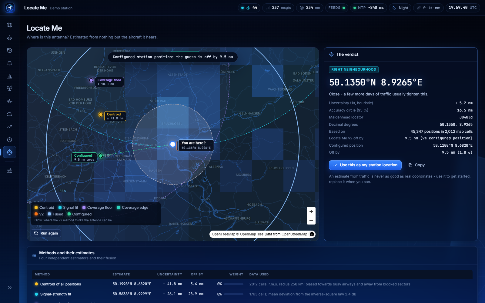

# 2.11 Locate Me

Route: `#/guess` (sidebar: target icon). Locate Me estimates where the antenna stands from nothing but the
aircraft it hears. Use it when you do not know the exact coordinates yet, or to check the configured ones: the
configured position is never used as an input, only to show how far off each estimate is.

An estimate from traffic is never as good as real coordinates. Enter the exact position in **Settings → Station
location** when you can, or use the receiver's own GPS position (see below).

## 2.11.1 Running it

1. Open the page. The line under the **Locate me** button says whether enough traffic has been collected
   ("Ready: 9,109 positions in 448 map cells collected so far"), or what is still missing. It is checked again every
   minute.
2. Press **Locate me**. The map reveals the estimate of each method one after another, then the best estimate with
   its uncertainty circle. **Run again** repeats the analysis on the newest data.
3. Read **The verdict** on the right.

Running a fresh analysis is an admin action. A browser without admin rights is shown the last cached result (up to a
minute old), marked **cached result**.

## 2.11.2 The verdict

- A headline. With a configured position it grades the distance to it: **Bullseye!** (under 2 km), **Very close**
  (under 10 km), **Right neighbourhood** (under 30 km), **Right region** (under 100 km), **Still guessing**. Without
  one it grades the uncertainty: **Pinned down** (under 5 km), **Fairly sure** (under 20 km), **Rough fix** (under
  60 km), **Very rough**.
- The coordinates, **Uncertainty (1σ, heuristic)**, the **Accuracy circle (95 %)** when Locate Me v2 produced the
  result, the **Maidenhead locator**, **Decimal degrees** and what the estimate is **Based on**.
- With a configured position: the configured position and **Off by** (also in σ), and for v2 **Locate Me v2 off
  by** against the reference it compared with.
- **Use this as my station location** asks for confirmation (new and current position and how far the station
  moves) and saves it (admin). Ground elevation and antenna heights are not changed. **Copy** copies the
  coordinates.
- When the receiver reports its own GPS position (a Radarcape with GPS), a box says "The receiver knows where it
  is" with **Use receiver GPS position**. That beats any guess.

In demo mode the traffic is simulated around a pretend station, so the result describes the simulation, not your
real antenna; the page says so.

## 2.11.3 The methods

**Methods and their estimates** lists each method with its estimate, uncertainty (heuristic 1σ, drawn as the circle
on the map), how far it is off the configured position, its weight in the result and the data it used. **How it
works** explains each method, how much data it had and how to make it better.

| Method | Idea | Needs |
|---|---|---|
| **Centroid** | Aircraft are heard in every direction around the antenna, so the centre of all received positions (weighted by how often each map cell was hit) lies close to it. Quickest, easiest to fool: a busy airway on one side pulls it away. | A few days so that traffic from all directions evens out. |
| **Signal fit** | Signals fade with the square of the distance. The estimator searches the point from which the average signal level of every map cell is best explained by that law. | A feed with signal levels (Beast / Radarcape). Overload and strongly directional antennas bend the law. |
| **Coverage floor** | The earth's curvature hides low aircraft far away, so the lowest altitude still heard forms a bowl whose lowest point sits above the antenna. | Low-flying traffic in several directions; nearby airports help. Sharpens over days. |
| **Coverage edge** | With a free view the outer edge of coverage is roughly a circle around the antenna. The estimator fits a circle through the farthest positions in every direction. | Coverage out to the horizon in most directions. |
| **Locate Me v2** | Scores every candidate position on a fine grid against where low aircraft appear and vanish at the radio horizon and behind the local skyline (per 10° sector, with a terrain panorama when elevation tiles are cached) and the signal levels, and gives a calibrated 95 % accuracy circle. | About an hour of traffic with signal levels; low traffic near airports and cached elevation tiles sharpen it. Feeds without signal levels (SBS) are much less precise. |

**How the result is chosen.** The four classic methods (centroid, signal fit, coverage floor, coverage edge) are
fused, each weighted by how sharply it pins the position down (inverse variance): when independent methods agree,
the result is tighter than any of them; when they disagree, the stated uncertainty grows. When Locate Me v2 succeeds
and is at least as sharp as that fusion, it becomes the answer ("Best estimate (Locate Me v2)") with its 95 %
accuracy circle, and the classic methods stay in the table for comparison only. With very little data v2 is listed
with weight 0 until its uncertainty is the smaller one.

**How wide the circle is (1.0.1).** Real sites add what no model knows: buildings, trees, errors in the elevation
data, the antenna mounting and many samples from the same airways. Since 1.0.1 Locate Me v2 therefore widens its
circle where the model is incomplete and never states less than about 2 km (1σ per axis), so the 95 % accuracy
circle has a radius of at least about 5 km. A station that 1.0.0 placed "±0.3 nm" while it was 2.6 nm off
now gets a circle that holds that error. The estimate itself is unchanged; only the stated uncertainty is more
honest. The signal-strength fit of the classic methods no longer drifts to a far-away position when the levels
hardly fall with distance (a receiver with gain compression or a flat level).

Locate Me v2 records its samples continuously in the background and keeps them for 7 days by default. There is no
page section for it; the configuration file's `locate` block switches it off (`enabled`) or changes the retention
(`retentionDays`, 1–30) and the row limits.
