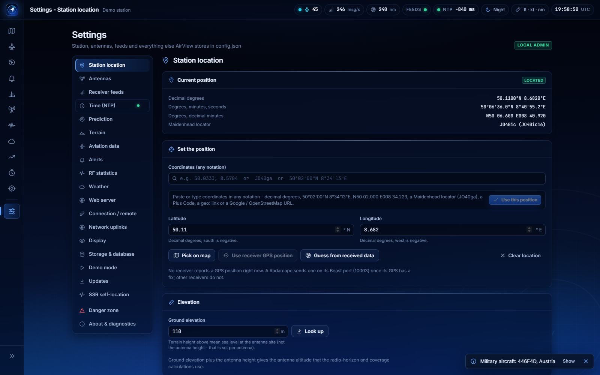
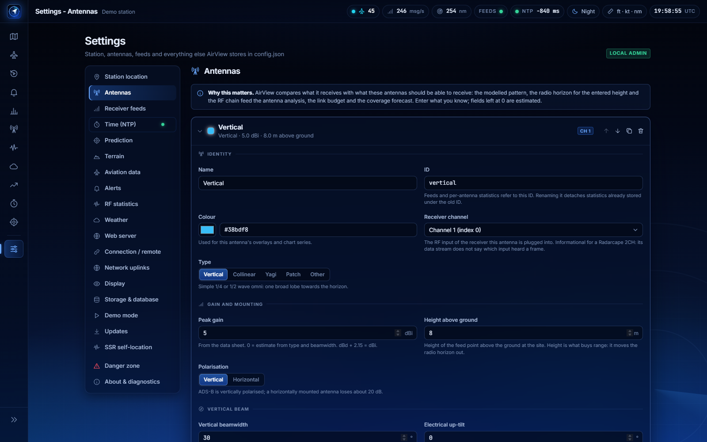
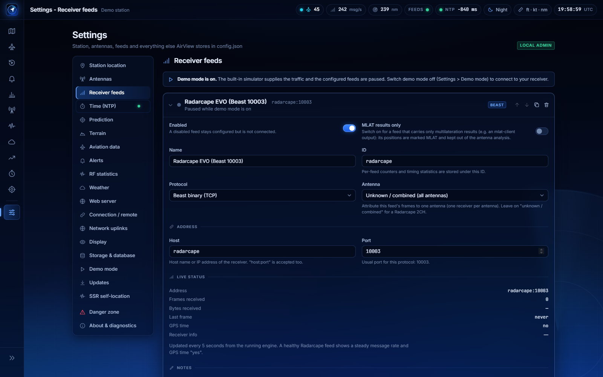
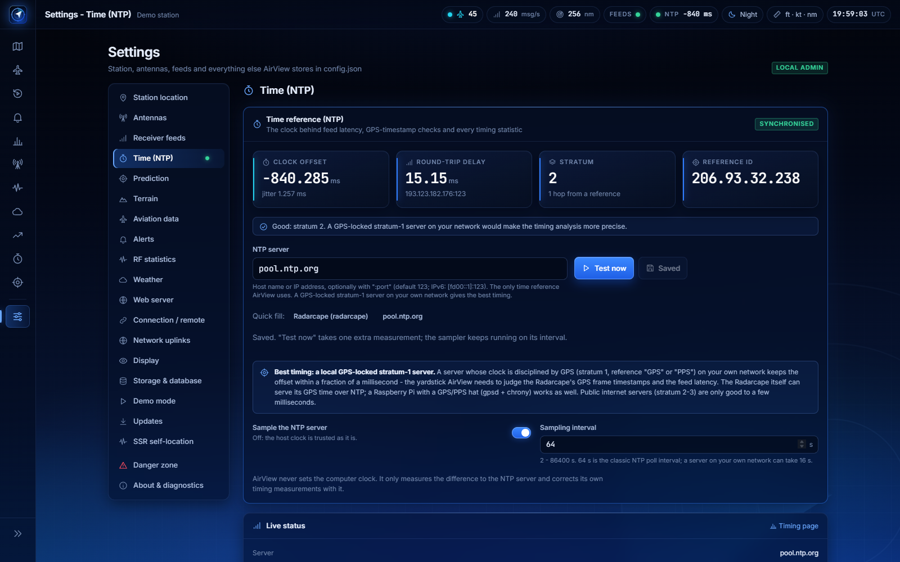
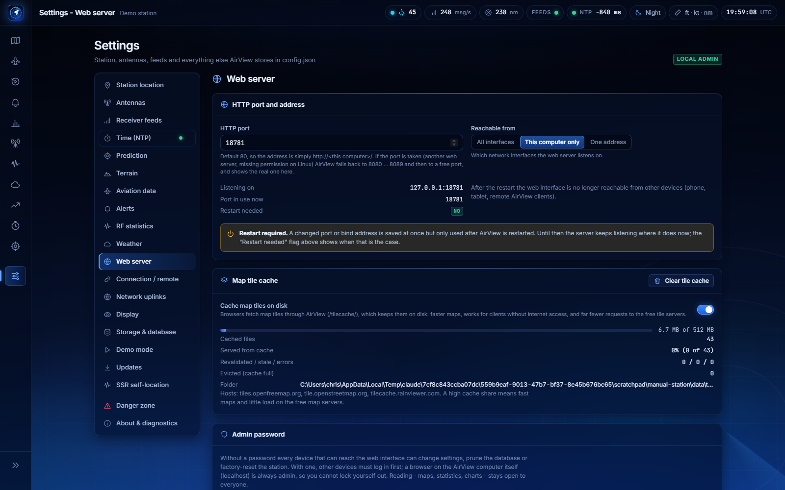

# 2.12 Settings

Route: `#/settings` (sidebar: sliders icon, at the bottom). All configuration of the station. Each section has its
own address, `#/settings/<section>`, for example `#/settings/feeds`.

Everything on these pages is stored in `config.json` in the data directory. On a headless server the same
settings can also be written in the configuration file and overridden by `AIRVIEW_*` environment variables; see
the configuration chapter of this manual and `docs/CONFIG.md`.

## 2.12.1 How saving works

- Pick a section in the list on the left. Fields are checked as you type; problems are marked at the field.
- As soon as something differs from the saved configuration, a **save bar** appears at the bottom: "Unsaved
  changes – In: <sections>", a link to the first problem if there is one, **Discard** and **Save**. You can change
  several sections and save them together.
- **Save** applies the changes at once; the engine reconnects feeds, restarts sampling and so on as needed. If the
  server adjusted a value (for example clamped it to its range), the bar lists the corrections ("The server adjusted
  some values").
- Unsaved changes survive switching to another page and back ("Your unsaved settings were restored").
- A change of the HTTP port or bind address needs a restart: a **Restart required** banner says so.
- Without admin rights the page is **Read-only**: a banner and the **Log in** button at the top (see
  [Who may change settings](02-station-00-overview.md#202-who-may-change-settings)). A browser on the AirView computer
  shows the **Local admin** badge.

## 2.12.2 The sections

### Station location

- **Current position** in decimal degrees, degrees-minutes-seconds, degrees and decimal minutes, and Maidenhead.
- **Set the position**: paste coordinates in any notation into **Coordinates (any notation)**: decimal degrees,
  `50°02'00"N 8°34'13"E`, `N50 02.000 E008 34.223`, a Maidenhead locator (`JO40ga`), a Plus Code, a `geo:` link or a
  Google / OpenStreetMap URL. The parsed result is shown with its distance from the stored position; **Use this
  position** takes it over. Or type **Latitude** / **Longitude** (decimal degrees, south and west negative), **Pick
  on map** (click or drag the marker), **Use receiver GPS position** (when the receiver reports one), or **Guess from
  received data** (opens [Locate Me](02-station-11-locate.md)). **Clear location** removes the position.
- **Elevation**: **Ground elevation** of the site above mean sea level (not the antenna height, which is set per
  antenna). **Look up** fills it in from the terrain model.
- **Station**: **Station name** (shown in the top bar and sent to remote AirView clients) and **Receiver model**
  (informational).

### Antennas

Up to 16 antennas. AirView compares what it receives with what these antennas should receive, so the values here
drive the antenna analysis, the link budget and the coverage predictions. Each antenna has:

| Field | Notes |
|---|---|
| ID, Name, Colour | Feeds and per-antenna statistics refer to the ID; renaming it detaches statistics stored under the old ID. |
| Type | **Vertical** (simple 1/4 or 1/2 wave omni), **Collinear** (stacked omni, flatter beam), **Yagi** (directional beam), **Patch** (directional panel), **Other** (directional when a horizontal beamwidth is entered). A live preview draws the modelled pattern. |
| Azimuth (boresight), Tilt, Horizontal and vertical beamwidth, Front-to-back ratio, Elements | Directional antennas. Azimuth in degrees true (0 = north). 0 for the beamwidths or front-to-back = estimate from the gain or use a typical value (15 dB Yagi, 20 dB patch). |
| Vertical beamwidth, Electrical up-tilt | Omni antennas. 0 = estimate from the gain. |
| Receiver channel | The RF input of the receiver; informational for a Radarcape 2CH, whose data stream does not say which input heard a frame. |
| Peak gain | dBi from the data sheet (dBd + 2.15 = dBi). 0 = estimate from type and beamwidth. |
| Height above ground | Height of the feed point above the ground. Height is what buys range. |
| Polarisation | Vertical (ADS-B) or horizontal (about 20 dB loss). |
| Cable loss, Filter loss, LNA gain, LNA noise figure | The RF chain before the first amplifier, used by the link budget. 0 = none. |

A new installation has one antenna: a vertical (omnidirectional) on channel 0, 8 m above ground (until 1.0.0 a
second, 9-element Yagi pointing north on channel 1 was added as well; existing configurations keep it).
**Add antenna** adds one; each card can be removed.

### Receiver feeds

Up to 32 feeds. Each feed has:

- **Enabled** (a disabled feed stays configured but is not connected) and **MLAT results only** (for a feed that
  carries only multilateration results, for example an mlat-client output: its positions are marked MLAT and kept
  out of the antenna analysis);
- **Name**, **ID** and **Protocol**:

  | Protocol | Usual port | Notes |
  |---|---|---|
  | Beast binary (TCP) | 10003 (Radarcape), 30005 (dump1090 / readsb) | Best input: signal levels, raw frames and, from a Radarcape, GPS time stamps. |
  | AVR / raw hex (TCP) | 10002 | Raw frames without signal levels. |
  | SBS BaseStation (TCP) | 30003 | Decoded positions only, no signal level, no raw frames. |
  | JSON aircraft list (HTTP polling) | – | **URL** of `aircraft.json` of readsb / dump1090 or the Radarcape `aircraftlist.json`, polled about once a second. |
  | AirView data port (hub) | 30154 | Another AirView's data port. |
  | RTL-SDR dongle (rtl_tcp) | 1234 | An RTL-SDR dongle served by your own `rtl_tcp`; AirView decodes the samples itself. Gain, frequency correction, bias-tee and sample rate are set in the configuration file (`feeds[].sdr`). AirView never ships or downloads `rtl_tcp`. |

- **Antenna**: attribute the feed's frames to one antenna (one receiver per antenna), or leave it on "unknown /
  combined" for a Radarcape 2CH;
- **Host** and **Port** (or **URL**);
- **Live status**, updated every 5 seconds: connection, message rate and whether GPS time stamps arrive;
- **Notes**.

**Add feed** offers presets: **Radarcape EVO – Beast 10003**, **Radarcape SBS 30003**, **Radarcape JSON aircraft
list**, **dump1090/readsb Beast 30005** and **Empty feed**. While demo mode is on, the configured feeds are paused and
the section says so.

### Time (NTP)

**NTP server**, **Sample the NTP server**, **Sampling interval**, **Test now** and **Save**, plus the live status
and offset statistics. Described in [Timing → Setting up the NTP reference](02-station-08-timing.md#281-setting-up-the-ntp-reference).

### Prediction

| Setting | Default | Meaning |
|---|---|---|
| Track and predict aircraft | on | Runs a tracking filter on every position. Off: no coasting, no predicted paths, no closest-approach figures. |
| Keep coasting aircraft for | 60 s | How long an aircraft without new positions stays on the map at its predicted position (5–120 s). |
| Predicted path length | 120 s | How far ahead the predicted path reaches (10 s – 15 min). |
| Show predicted paths | on | The Live Map draws the predicted path of the selected aircraft, with where it is expected to drop below or rise above the terrain horizon. |

### Terrain

| Setting | Default | Meaning |
|---|---|---|
| Terrain analysis | on | Off: no tiles are downloaded; terrain layers and figures disappear. |
| Download automatically | on | Fetch the tiles and run the analysis once the station is located, and again after the position, antenna heights, k-factor or radius change. Off: only with **Prefetch now**. |
| Analysis radius | 450 km | How far around the station terrain is analysed. |
| Elevation tile zoom | Automatic | Higher zoom = finer terrain and many more tiles (each step quadruples the download). |
| Refraction k-factor | 4/3 | Effective earth-radius factor (0.5–10). |

**Status and tile cache** shows the job and the cache, with **Prefetch now**, **Re-run**, **Cancel** and **Download
again even when unchanged**.

### Aviation data

- **Offline reference data**: import airports, runways and navaids (OurAirports) and callsign routes (Virtual Radar
  Server standing data), about 25 MB once, with progress. Each dataset shows its rows and import time.
- **Map**: **Airports layer on the Live Map** (needs the OurAirports import).
- **Online look-ups (opt-in)**: **Look up unknown routes online** (adsbdb.com, results cached; **Forget looked-up
  routes** clears the cache) and **Aircraft photos** (planespotters.net thumbnails with photographer credit).
  planespotters.net requires every client to identify itself: **Contact for planespotters.net** is sent in the
  User-Agent of photo requests. Everyone who can open this AirView can read that contact in the configuration.

### Alerts

**Evaluate alert rules**, **Sound**, **Allow webhooks** and the engine status. See
[Alerts → Settings](02-station-09-alerts.md#296-settings--alerts).

### RF statistics

**Collect RF statistics** (on by default; off: the RF Lab and the RF health figures are empty) and a live summary.

### Weather

| Setting | Default | Meaning |
|---|---|---|
| Fetch weather | on | Off: AirView makes no weather requests at all. |
| Refresh interval | 15 min | 5–1440 minutes. |
| Precipitation radar on the map | off | Offers the RainViewer radar layer on the Live Map (personal / educational use). |

With live status and **Fetch now**.

### Web server

- **HTTP port and address**: **HTTP port** (default 80; if it is taken AirView falls back to 8080 … 8089 and then to a
  free port, and shows the real one here) and **Reachable from**: **All interfaces**, **This computer only** or **One
  address** (**Bind address**). Changes take effect after a restart.
- **Map tile cache**: **Cache map tiles on disk** (browsers fetch tiles through AirView, which keeps them: faster
  maps, maps for clients without internet access, fewer requests to the free tile servers) and **Clear tile cache**.
- **Admin password**: only a salted hash is stored; changing or removing it logs every other device out.
- **This session**: whether this browser is on the AirView computer, whether a password is set, whether it may
  change settings, with **Log in** / **Log out**.

### Connection / remote

**Run mode**:

| Mode | What happens |
|---|---|
| **Standalone** | This AirView connects to the receiver, keeps its own database and serves its own web interface. The normal mode next to the receiver, and the only mode of a Raspberry Pi. |
| **Remote data** | This AirView logs in to the data port of another AirView (the host) and receives its live frame stream; decoding, statistics and database run here. |
| **Remote web** | The desktop window shows the web interface of another AirView. Nothing is computed or stored here. |

**Remote AirView host**: **Host**, **Data port** (30154), **Website port**, **Data port password** (never crosses the
network: challenge-response login) and **Use the host's station settings** (adopt the host's station position and
antenna definitions, remote-data mode). **Data port (hub) of this station**:
**Offer the data port**, **Port** (default 30154; open it in the firewall if clients cannot connect) and **Password**,
with the connected clients (sent data and backlog).

### Network uplinks

Feeds this station to AirView aggregators (AVF/1, port 30160) and to other aggregators in Beast format
(`beast_reduce_plus_out`, `beast_reduce_out`, `beast_out`), with the station position, MLAT time stamps and MLAT
results as opt-ins. Feeding networks is described in the network chapters of this manual.

### Display

| Setting | Default | Meaning |
|---|---|---|
| Range rings | 100, 200, 300, 400 km | Up to 12 rings, entered in your distance unit, stored in km. |
| Default unit system | Aviation | For browsers that have not chosen with the units chip. **Use in this browser now** applies it here. |
| Trail length | 15 min | 1–1440 minutes. |
| Aircraft timeout | 60 s | Seconds without any message before an aircraft leaves the live list and the map (5–3600). |
| Base map | AirView Dark | Default base map for new browsers. |
| Colour trails by | Altitude | Altitude, Speed, Signal or Source. |

### Storage & database

- **Retention**: **Keep position trails** (30 days, 1–3650; by far the largest table, roughly 10–40 MB per day on
  a busy station), **Trail point spacing** (5 s, 1–3600; 15 s cuts the size to a third), **Keep flights** (730 days,
  0 = forever), **Keep per-minute statistics** (90 days, 1–3650; the hourly roll-ups stay forever).
- **Database**: file, rows, reclaimable space, writer state, rows per table.
- **Maintenance**: **Prune now** (apply the retention periods immediately), **Compact (vacuum)** (shrink the file),
  **Flush to disk** (write the in-memory statistics and fold the write-ahead log into the file), **Roll up hours**
  (normally done 3 minutes past each hour). None of this is needed in normal operation.
- **CSV export**: every table as CSV with a header row, as stored (times in Unix seconds). "positions" can be
  hundreds of megabytes.
- **Aircraft database**: the same import as on the [Aircraft page](02-station-02-aircraft.md#225-aircraft-database).

### Demo mode

**Demo mode** switches the built-in traffic simulator on (it replaces the configured feeds as soon as you save)
and **Simulated aircraft** sets how many fly at once (1–1000; 60 by default, several hundred is a load test). The
`-demo` command-line flag forces demo mode regardless of this setting.

### Updates

Signed self-update, off by default: **Install updates automatically** (checks every interval ±25 %, installs a newer
version of the channel and restarts; needs a headless server whose program file this user may replace), **Release
channel** (Stable or Beta), **Manifest URL**, **Check interval** (default 1440 min), **Health window** (how long a
new version must stay healthy before it is kept, 10–900 s), **Largest download** and the **Release keys**. **Check
now** shows the running version, channel, last check and last update.

### SSR self-location

Experimental and advisory, off by default: estimates where the receiver is from the timing of secondary-radar replies
of aircraft with known positions, and shows the result with **Solve now**. AirView never uses it to set, confirm or
replace the station position. The detailed tunables are in the `ssr` block of the configuration file.

While it runs, each solve also locates the **radars** themselves (**Radars located from beam sweeps**). A rotating
Mode S radar makes aircraft answer its all-call interrogations (DF11 replies, tagged with its interrogator code
II 1-15 or SI 1-63) only while its beam points at them. From the times of those reply bursts and the aircraft
positions AirView fits the radar's site and its rotation period (↻ clockwise, ↺ anticlockwise); it needs no 1030 MHz
receiver and does not depend on the station position. The table shows, per code:

- **Formal error**: the 1σ error ellipse of the fit (semi-major / semi-minor axis). It is a statistical figure only:
  it does not contain beam squint, bursts cut short by lock-out, or ADS-B position latency, and the accuracy on real
  radars has not been measured yet. In simulation the sites came out within tens of metres; treat real results as
  "within a few hundred metres to a few kilometres" until they have been compared with known sites.
- **Fit**: how well the burst times follow one rotating beam (1 = perfectly).
- **No fix** with a reason: most often *too few repeat bursts*. Mode S radars usually **lock out** aircraft they have
  acquired, which then stop answering that radar's all-calls, so a code may never show the once-per-scan bursts
  the method needs.
- **Reference site**: the nearest entry of `ssr.sites` within 25 km. To compare with published radar sites (for
  example from Ofcom licence data where it covers the site, or a national AIP), copy them into `ssr.sites` yourself; AirView
  ships no radar list. Note that configured sites are also used by the self-location as known interrogators.

Interrogator codes are reused by radars far apart, so one code can list up to three radars. The method uses the
last hour of bursts and runs on the solve schedule (`ssr.solveEveryMin`, default 10 minutes) or with **Solve now**.

### ACARS / VDL2

Off by default. AirView does not demodulate VHF itself: run **acarsdec** (ACARS, 129-131 MHz) or **dumpvdl2**
(VDL Mode 2, 136 MHz) on a second SDR and send its JSON output to AirView, for example

    acarsdec --output json:udp:host=127.0.0.1,port=5550 -r 0 131.525 131.725 131.825
    dumpvdl2 --output decoded:json:udp:address=127.0.0.1,port=5550 136725000 136775000 136975000

(check your decoder version's help for the exact option syntax). The UDP input listens on `127.0.0.1:5550` (this
computer only) unless you set another address, e.g. `:5550` for a decoder on another computer; the optional TCP
input takes newline-separated JSON from decoders in TCP client mode. The card shows the listen addresses, how many
messages arrived from which decoder, how many were rejected and the most frequent labels. Messages are kept in
memory only (**Messages kept**, default 2000) and appear in the aircraft detail panel of the map. They are never
shown on public pages, because their free text can name crew or passengers. In demo mode synthetic messages
(marked **Demo**) are generated.

### Danger zone

- **Configuration file**: **Download config.json** (a backup, or to copy a setup to another station; passwords are
  never exported, the file only says "set") and **Import config.json…** (checked with the same rules as the forms and
  refused as a whole if anything is invalid; then saved and applied).
- **Factory reset**: erases the database (every aircraft, flight and trail), all statistics (rates, coverage,
  records, heat map, weather and timing history, forecast models, the imported aircraft database) and the
  configuration. Kept: the map tile cache and the display preferences stored in your browsers. All admin logins end.
  To confirm you type `RESET`. This cannot be undone: export `config.json` first if you want your settings back.

### About & diagnostics

**This station** (version, uptime, memory, database), **Copy diagnostics** (this information as JSON, for example for a bug report),
**Bundled software** with licences, and **Data sources and attribution**.
