# 3.3 Feeding a network

This part is for owners of an ADS-B receiver who want to share its data with an AirView network, for example their club's. It explains what you share and who can see it, how to install a feeder, and how to claim and look after your station.

Every network has a public **Feed this network** page (sidebar, antenna icon; `https://<network>/#/feeder`) with the exact commands for that network: its host name, the ports that are open, and whether you need an enrol token. Where this manual writes `adsb.example.org`, use your network's host name.

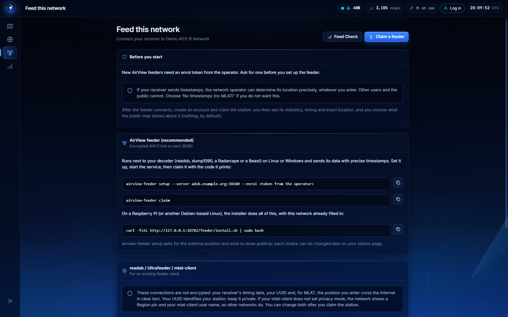

---

## 3.3.1 What you share and who sees it

Your feeder sends the aircraft messages your receiver hears, with the receiver's precise timestamps, plus your station's position if you enter one. The network merges everyone's data into one map and computes positions of aircraft that do not broadcast them (MLAT, section 3.4). MLAT needs precise receiver positions and timestamps.

**Please read this before you install:**

> "If your receiver sends timestamps, the network operator can determine its location precisely, whatever you enter. Other users and the public cannot. Choose 'No timestamps (no MLAT)' if you do not want this."

| Who | What they can see about your station |
|---|---|
| **The public** | Nothing that locates it. The map does not say which receivers heard an aircraft. Your pin is **hidden** unless you choose otherwise; your name and statistics are shown only if you switch them on, and then only figures that do not reveal where you are. |
| **Other feeders** | In the timing view, only an anonymous tag that changes weekly, a distance band (`< 50 km`, `50–150 km`, `> 150 km`) and timing quality. No name, position or bearing. |
| **You** (after claiming) | Everything about your own station: exact position, range and coverage, signal and heat maps, records, timing and MLAT state, connection history, and your current IP address. |
| **The network admins** | Everything, including your exact position and your IP address while connected. Every view of exact data is recorded in an audit log, which you can see in your data export. |

**Your choices:**

| Choice | Effect |
|---|---|
| Public pin `hidden` ("Hidden", default) | No pin on the public map. |
| Public pin `region` ("Region (0.5°)") | A point placed at random inside the 0.5° cell (about 55 × 35 km in the UK) around you, fixed until you move to another cell. |
| Public pin `cell01` ("Area (0.1°)") | The same in a 0.1° cell (about 11 × 7 km). Where fewer than 3 stations share the surrounding 1° cell, it is shown as `region`. |
| Show name / public statistics | Off by default. |
| **No timestamps (no MLAT)** | Your feeder sends decoded data without timing. You still feed the map, but you do not help MLAT and the network cannot locate your receiver by timing. |
| Do not send a location | The network measures your receiver's position from its timing (unless you also chose *No timestamps*). |

**Automatic use of measured positions.** If you leave the position blank, or the position you entered looks wrong, the network may measure your receiver's position from its timing. If that measurement is precise (50 m or better) and consistent, the network uses it for MLAT straight away. You are notified and can correct or override it on your station page. Only you and the admins ever see it.

The network's privacy notice (linked from its Feed this network and Claim pages) explains the legal basis and your rights.

---

## 3.3.2 Before you install

- **Receiver and decoder.** One of: an RTL-SDR (or Airspy, SDRplay) with readsb or dump1090 running; a Mode-S Beast; a Radarcape; or, without a decoder, an RTL-SDR read through `rtl_tcp` (3.3.7). On Linux the feeder normally reads your decoder's Beast output (`127.0.0.1:30005`) or the Radarcape's port 10003.
- **Accurate clock.** Keep the computer's clock synchronised (chrony or systemd-timesyncd). The Pi installer checks it and offers to install chrony (`--install-chrony`).
- **Enrol token.** Most networks are invite-only: ask the operator for a token. It is a secret that works a limited number of times (once, by default) and expires (after 7 days, by default).
- **Your antenna position.** For MLAT it matters to within about 10-20 m. Take latitude and longitude in decimal degrees from a map, and know the antenna height: above mean sea level (MSL, what maps show) or above the WGS-84 ellipsoid (HAE, what GPS receivers show raw). Heights always need a unit: `120m` or `400ft`.
- **Data volume.** A busy station sends about 15-35 kB/s (roughly 40-90 GB a month) in `full` mode. Large networks switch stations to `selective` mode, about 3-5 kB/s. Check this against any data cap.

---

## 3.3.3 Choose how to feed

| You have | Use | Section |
|---|---|---|
| A Raspberry Pi or other Linux computer with readsb / dump1090 or a Radarcape | `airview-feeder` via the installer, or the Pi SD-card image | 3.3.4 |
| A Windows PC connected to a receiver | AirView Feeder for Windows | 3.3.5 |
| AirView already running as your station | its **Uplinks** setting | 3.3.6 |
| An RTL-SDR dongle without a decoder | `airview-feeder` or AirView with an `rtl_tcp` input | 3.3.7 |
| readsb / Ultrafeeder / adsb.im that you want to keep | two configuration lines | 3.3.8 |

The native AirView feeder (3.3.4-3.3.7) encrypts everything (TLS 1.3), keeps an identity key so your station survives IP address changes, buffers data during outages, gets MLAT results back, and lets you claim your station with a code. The readsb / mlat-client route (3.3.8) sends data **unencrypted** and identifies you by your UUID.

---

## 3.3.4 Raspberry Pi and Linux: `airview-feeder`

Supported: Raspberry Pi OS, Debian and Ubuntu on 64-bit ARM (arm64), 32-bit ARM (armhf/ARMv7) and x86-64, with systemd. ARMv6 (Pi Zero / Pi 1) is not supported.

### Installer

The network's Feed this network page shows the installer command; the script it downloads has the network's server and key pin built in. The page shows it piped into `bash`; downloading it first lets you read it before running it:

```sh
curl -fsSL https://adsb.example.org/feeder/install.sh -o /tmp/avf.sh && sudo bash /tmp/avf.sh
```

The same page also shows a two-line manual setup (`airview-feeder setup --server ... --enrol ...`, then `airview-feeder claim`) for computers where the feeder binary is already installed. In version 1.0.1 that line has no `--pin`: on a network with its own self-signed key (the default), add `--pin sha256/...` with the pin from the operator, or the feeder cannot verify the server.

The installer:

1. checks the system (root, systemd, architecture, disk space, clock synchronisation);
2. looks for your receiver: a decoder listening on port 30005, a Radarcape, a Beast, or an RTL-SDR. **It never removes, stops or reconfigures readsb, dump1090, a Radarcape or another feeder, and it does not install GPL decoders by itself;**
3. asks for the enrol token, a station name (letters, digits, `_` and `-`, up to 32 characters), your position and altitude (with unit), MSL or HAE, the antenna height above ground, the public pin level and whether to send timestamps. Leaving the position blank shows the timestamp notice again;
4. downloads the feeder for your architecture from the network and checks its signature;
5. installs it as the service `airview-feeder` under its own system user;
6. prints the status page address, your **claim code**, and the commands for logs, updates and uninstalling, then checks the connection.

Unattended installs use options instead of questions:

```sh
sudo bash /tmp/avf.sh --server adsb.example.org:30160 --pin sha256/... --token TOKEN --name kestrel_hill \
  --lat 52.41 --lon -1.62 --alt 120m --agl 8m --input auto --privacy hidden --non-interactive
```

| Option | Meaning |
|---|---|
| `--server HOST[:PORT]` / `--pin sha256/...` | the aggregator (port 30160 by default) and its key pin; pre-filled by the network's page |
| `--token TOKEN` (alias `--enrol`) | enrol token from the operator |
| `--name NAME` | station name (default: the host name) |
| `--lat`, `--lon` | decimal degrees, north and east positive |
| `--alt 120m` / `--alt 400ft` | antenna altitude, unit required |
| `--alt-ref msl\|hae` | altitude reference (default `msl`) |
| `--agl 8m` | antenna height above ground (default 10 m) |
| `--no-location` | send no position: the network locates the station |
| `--input auto` / `--input HOST:PORT` | where the Beast data comes from |
| `--privacy hidden\|region\|cell01` | public pin level |
| `--no-timestamps` | no MLAT; see 3.3.1 |
| `--readsb-results` | also push returned MLAT results into readsb (`127.0.0.1:30104`) |
| `--install-chrony` | install chrony when the clock is not synchronised |
| `--no-auto-update` / `--channel stable\|beta` | updates (3.3.12) |
| `--non-interactive` (`-y`) | never prompt |
| `--dry-run` | change nothing; print every command |

Running the installer again changes the settings, with your current values as defaults. The installed copy also runs maintenance actions:

```sh
sudo bash /opt/airview-feeder/install.sh --status       # service, configuration and link state
sudo bash /opt/airview-feeder/install.sh --claim        # print a claim code
sudo bash /opt/airview-feeder/install.sh --update       # update now
sudo /opt/airview-feeder/uninstall.sh [--purge]         # remove (readsb is never touched)
```

### SD-card image

`AirView-Feeder-Pi-<version>.img.zip` is Raspberry Pi OS Lite (64-bit, Trixie) plus AirView's first-boot files. It runs on every 64-bit Pi that runs Trixie (Pi 3, 4, 5, 400, 500, Zero 2 W, CM3/4/5).

1. Flash it with Raspberry Pi Imager (**Choose OS → Use custom**, pick the `.img.zip`). Imager's OS customisation (host name, user, Wi-Fi, SSH) works as usual. Check the download against its `.sha256` file first.
2. Boot the Pi. The first start takes a few minutes.
3. Open `http://airview-feeder.local:8099/` from a computer on the same network. The setup page asks for the aggregator address, key pin and enrol token, station name, receiver input, antenna position (or "let the network locate me"), the timestamp and pin choices, and a password for the status page. It then installs the feeder with the same installer and hands port 8099 over to the feeder's status page.

For a setup without the page, edit `airview/feeder-setup.txt` on the card's boot partition before the first boot (at least `SERVER=`). The image contains no decoder (readsb and dump1090 are GPL programs and are not bundled): install one yourself, or point the input at a receiver on your network.

### Where things live

| What | Where |
|---|---|
| Program and scripts | `/opt/airview-feeder/` (`install.sh`, `uninstall.sh`; `/usr/local/sbin/airview-feeder-setup` is a link to the installer) |
| Settings | `/etc/airview-feeder/feeder.json` |
| Identity key (private) and state | `/var/lib/airview-feeder/` |
| Logs | `journalctl -u airview-feeder -f` |
| Status page | `http://127.0.0.1:8099/` on the feeder |

The status page listens only on the feeder itself unless you give it a LAN address and a password (`ui.addr` and `ui.passwordHash`, or `airview-feeder setup -ui-password ...`). From another computer, use an SSH tunnel: `ssh -L 8099:127.0.0.1:8099 pi@yourpi`.

### Commands

| Command | Does |
|---|---|
| `airview-feeder status` | connection state, rates, clock class, MLAT results |
| `airview-feeder claim` | fetches a new claim code from the network |
| `airview-feeder setup [options]` | creates or changes `feeder.json` (interactive, or with `-non-interactive`) |
| `airview-feeder config check\|print\|get\|set\|env\|example\|path` | works with `feeder.json`, for example `airview-feeder config set 'uplinks[0].timestamps=false'` |
| `airview-feeder detect` | looks for receivers on this computer or a given host |
| `airview-feeder new-identity` | creates a new feeder key, keeping the UUID (after cloning an SD card) |
| `airview-feeder update` | checks for and installs a signed update |
| `airview-feeder version` (or `--version`) | version |

After `config set` or `setup`, restart the service (`sudo systemctl restart airview-feeder`) or send it SIGHUP.

### The status page

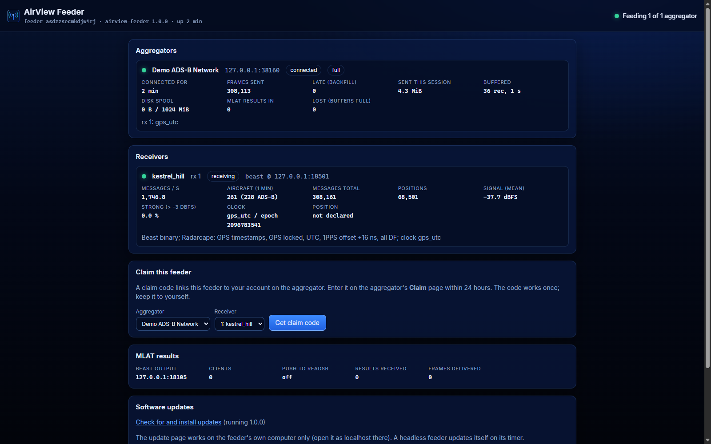

The status page shows each aggregator link (state, `full` or `selective` mode, frames sent, late frames sent from the buffer after an outage, the disk spool, MLAT results received), each receiver (message rate, aircraft, signal, clock class, whether a position is declared), a **Get claim code** button, the local MLAT results output, and software updates.

### Outages and SD cards

The feeder keeps a buffer in memory (10 minutes, up to 12 MB by default) and sends it after a short outage. On Linux hosts that do not boot from an SD card it also writes a disk spool while the network is unreachable (256 MB by default; 1,024 MB on Windows; 0 on an SD card, to spare it), and sends it later at a reduced rate. The setting is `uplinks[].spoolMb` (`-1` = automatic).

### MLAT results on your own map

The network sends back positions it computed for aircraft your station helped to locate (3.4.7). The feeder offers them as Beast data with the MLAT timestamp on `127.0.0.1:30105` (`results.beastPort`) and, with `--readsb-results` or `airview-feeder setup -readsb-push 127.0.0.1:30104`, pushes them into readsb so they appear on your local tar1090 map. They are never sent back to the network or to other networks.

---

## 3.3.5 Windows: AirView Feeder

The network's page offers an installer (`AirView-Feeder-Setup-<version>.exe`, recommended) and a portable ZIP.

**Windows SmartScreen.** The installer is not code-signed, so Windows may show *"Windows protected your PC"*. Check first that you downloaded it from your network's HTTPS page and, if the operator publishes checksums, compare them:

```powershell
Get-FileHash .\AirView-Feeder-Setup-1.0.1.exe -Algorithm SHA256
```

Then click **More info → Run anyway**. If the browser blocks the download, choose **Keep**. For the ZIP: right-click → **Properties** → tick **Unblock** before extracting.

The installer registers a background service (*AirView Feeder*) and a tray icon that starts when you log in. The tray menu has **Open status page**, **Settings…**, **Get claim code…**, **Pause feeding** / **Resume feeding**, **Restart feeder**, **Open logs folder**, **Check for updates…**, **Start with Windows** and **Quit tray**. Settings and the identity key are in `%ProgramData%\AirView Feeder` (`feeder.json`), readable only by the service and administrators.

Inputs: a networked Radarcape or Beast, or the Beast, AVR or SBS output of another program (dump1090 for Windows, airspy_adsb, ModeSMixer2, Virtual Radar Server rebroadcasts), or an RTL-SDR through `rtl_tcp`. SBS and other rebroadcasts carry no usable timing: map only, no MLAT.

---

## 3.3.6 AirView station: Uplinks

If you already run AirView for your receiver (Windows or Pi), you need no extra program. Open **Settings → Uplinks → Add** and enter the server, port 30160, the key pin shown on the network's Feed this network page (empty if the network uses a certificate from a public CA) and your enrol token. Choose the pin level, name and statistics options, and whether to send your location and timestamps. Your local AirView keeps working exactly as before; the uplink only sends a copy.

The same as a configuration entry:

```jsonc
"uplinks": [
  { "id": "club", "host": "adsb.example.org", "port": 30160,
    "serverPin": "sha256/...", "enrolToken": "...",
    "pin": "hidden", "sendLocation": true, "timestamps": true, "shareGnss": false }
]
```

`shareGnss` (default `false`) would upload a Radarcape's own GNSS position; leave it off and enter your position by hand to about 10 m instead.

### Also feeding other aggregators

AirView and `airview-feeder` can feed other aggregators at the same time: an `uplinks[]` entry with `"type": "beast"` sends your receiver's data in Beast format, like readsb's `beast_reduce_plus_out` connector (`airview-feeder setup -beast-out feed.example.org:30004`):

```json
{ "id": "other", "type": "beast", "host": "feed.example.org", "port": 30004 }
```

- `format`: `beast_reduce_plus_out` (default), `beast_reduce_out` or `beast_out`; `reduceMs` sets the reduce interval (250 ms).
- Each Beast destination gets its own random UUID by default, so your AirView identity is never shared with a third party. Set `uuid` to your mlat-client's UUID if that aggregator should join the two links into one station.
- Beast outputs are live only (no buffering) and not encrypted. AirView never forwards MLAT results to them.

---

## 3.3.7 RTL-SDR without readsb

`airview-feeder` and the AirView station can read an RTL-SDR dongle directly through `rtl_tcp` (from the rtl-sdr package, which you install yourself; AirView does not ship it because it is GPL software). The demodulator is AirView's own.

Set the receiver input to type `rtltcp` (default address `127.0.0.1:1234`; keep `rtl_tcp` on loopback, it has no authentication). Options under `input.sdr`, also available as `airview-feeder setup` options:

| Option | Setup flag | Meaning |
|---|---|---|
| `gain` | `-sdr-gain` | `max` (default), `auto` or dB, such as `40.2` |
| `ppm` | `-sdr-ppm` | oscillator correction, −500 to 500 |
| `biasTee` | `-sdr-bias-tee` | switch on the antenna supply |
| `sampleRate` | `-sdr-sample-rate` | 2,000,000 to 3,200,000 samples/s (default 2,400,000) |
| `spawn`, `rtltcpPath`, `device` | `-sdr-spawn`, `-sdr-rtltcp-path`, `-sdr-device` | start `rtl_tcp` for you as a child process |

Timestamps are 12 MHz sample-clock stamps (clock class `SDR 12 MHz`), good enough for MLAT.

---

## 3.3.8 readsb, Ultrafeeder and adsb.im

Keep your setup and add the network as one more destination. The Feed this network page shows these lines with the network's host filled in:

- **Map data (Beast):** readsb `--net-connector adsb.example.org,30004,beast_reduce_plus_out,uuid=<your UUID>` (Ultrafeeder: `adsb,adsb.example.org,30004,beast_reduce_plus_out,uuid=<your UUID>` in `ULTRAFEEDER_CONFIG`).
- **MLAT:** mlat-client `--server adsb.example.org:31090 --user <name> --lat .. --lon .. --alt .. --uuid <your UUID>` (Ultrafeeder: `mlat,adsb.example.org,31090,uuid=<your UUID>`).

Things to know:

- Use **the same UUID** on both lines so the two links are one station. Without a UUID your station is "unidentified" and cannot be claimed. Treat your UUID like a password.
- This traffic is **not encrypted**: timing data, UUID and (for MLAT) your declared position cross the internet in clear text.
- If your mlat-client does not set privacy mode, the network shows a `region` pin and your mlat-client user name, as other networks do. You can change both after claiming.
- On an invite-only network, a new readsb or mlat-client station waits for the operator's approval (it shows as *pending*).

---

## 3.3.9 Claim your station

1. On the network's site, **Create account** (user name and a password of 8 characters or more; no e-mail address). Turn on two-factor authentication if you can, and store the recovery codes.
2. Open **My stations → Claim a feeder**. Read and tick the timestamp notice.
3. **AirView feeder:** enter the 8-character claim code from `airview-feeder claim`, the status page's **Get claim code** button, the tray's **Get claim code…** or the installer's last screen, and click **Claim**. Codes are valid for 24 hours and work once.
4. **readsb / mlat-client:** on the **readsb / mlat-client** tab, enter the full UUID. This works only from the same internet connection as the feeder, and only after its link has been up for 5 minutes.
5. Your station opens under **My stations**.

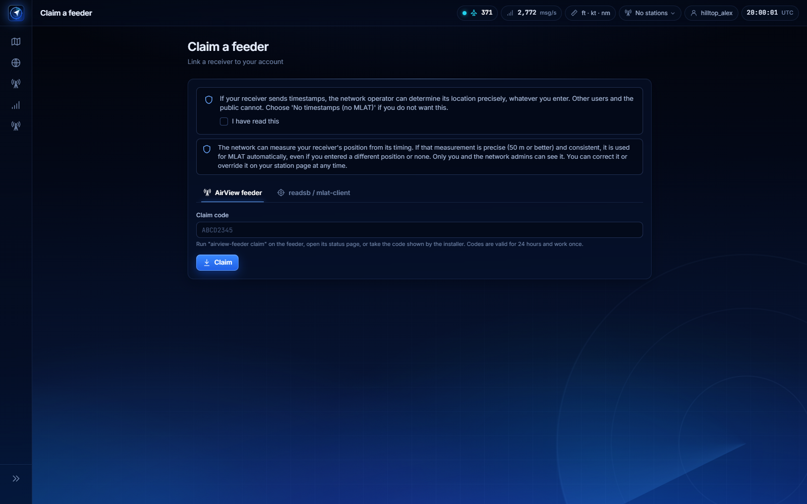

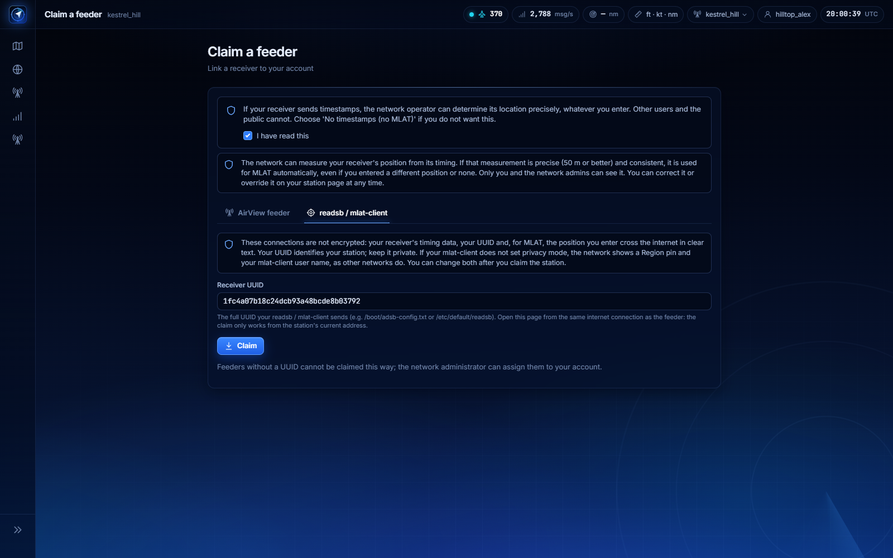

Before you claim, the **Feed Check** page (`#/me/check`, no account needed) shows how many feeder links the network receives from the address you are browsing from. The details are shown only after you log in and only for your own stations, because an internet provider may share one address between many customers.

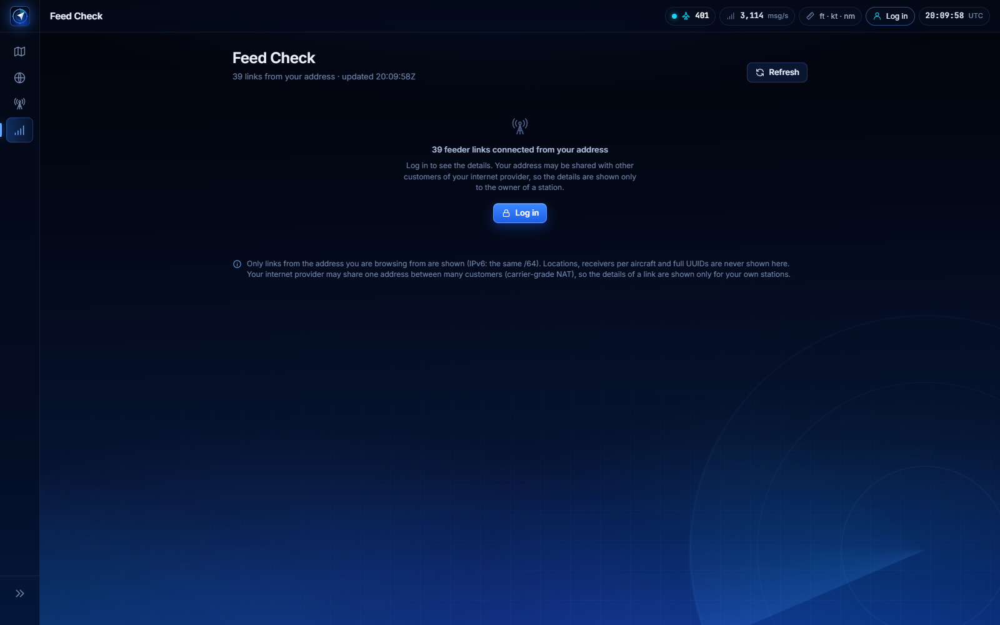

Claims are limited to 5 attempts per 10 minutes and 20 per day. There is no e-mail recovery: if you lose your password and recovery codes, create a new account and claim the station again with a new code, or ask the operator.

---

## 3.3.10 Your station page

**My stations** lists your stations as cards (kind, clock class, last data, location state, public pin, whether statistics are public), with **Claim a feeder**, **Share links** and **Feed Check** at the top. Location news, such as a finished network survey, is shown above the cards.

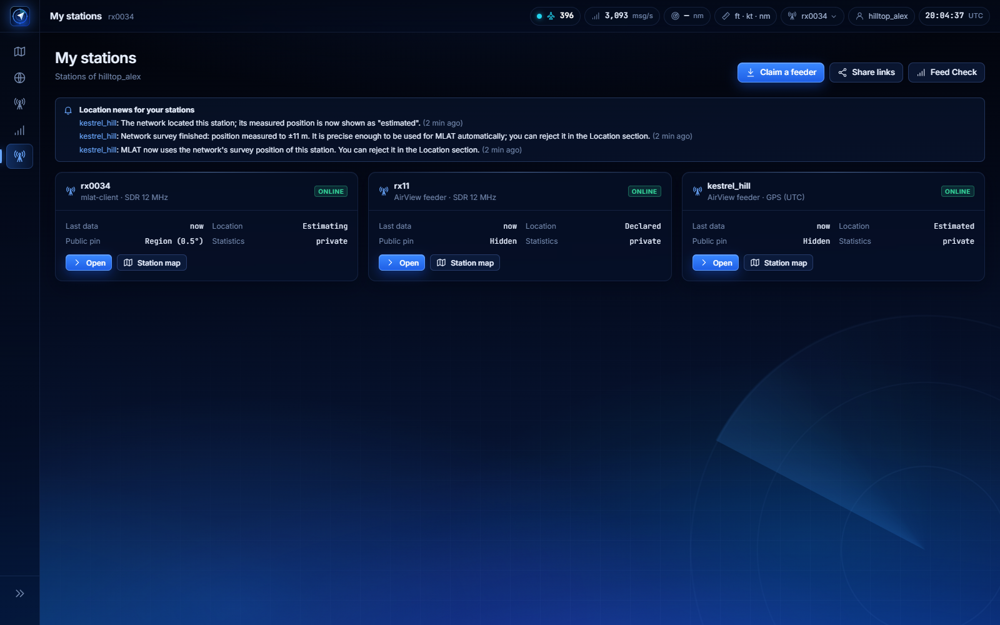

Open a station to see five tabs.

**Connection.** The link (protocol, software, connected since, round trip, data rate, late frames, clock class), the live links, a 7-day uptime bar and the connection log. Addresses in the log are stored only as a hash with a daily salt.

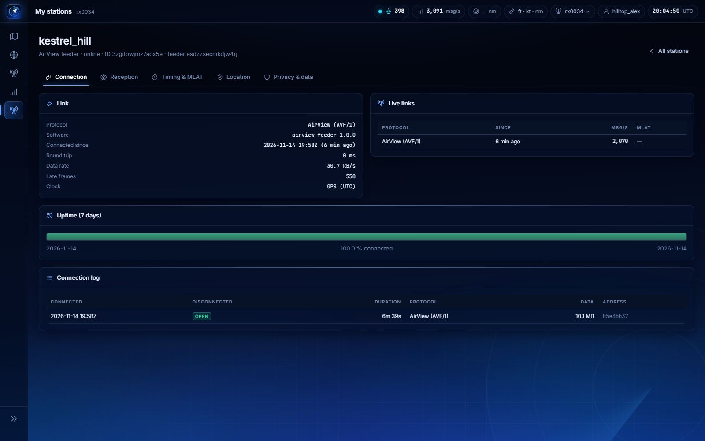

**Reception.** Your reception statistics, refreshed every 10 seconds: messages per second, aircraft this minute, positions, late frames, and buttons to the station map and the aircraft heard by your stations.

**Timing & MLAT.** The position source MLAT uses for your station (declared, receiver GNSS, confirmed by you, network survey, none), your clock (class, anchor state, σ, drift, jitter, steps and clock events), your MLAT contribution, charts of the last 2 hours and 7 days, and your sync peers, each shown only as a weekly tag and a distance band.

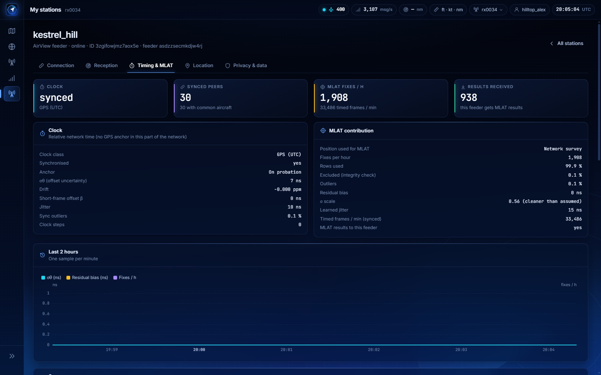

**Location.** The position in use and where it comes from, what the public map shows, the **Network survey** (result, uncertainty, 95 % ellipse, how many aircraft and observations it used, next check), a north-up drawing of declared and measured positions, and the location notices of the last 30 days. The buttons are **Survey now**, **Use this location** (confirm the measured position) and **Do not use it for MLAT**; you can also declare another position. A station marked **suspect** is more than max(100 m, 3σ) from what the network measures and is left out of MLAT until you correct it: check latitude/longitude, the altitude unit, and MSL versus ellipsoid.

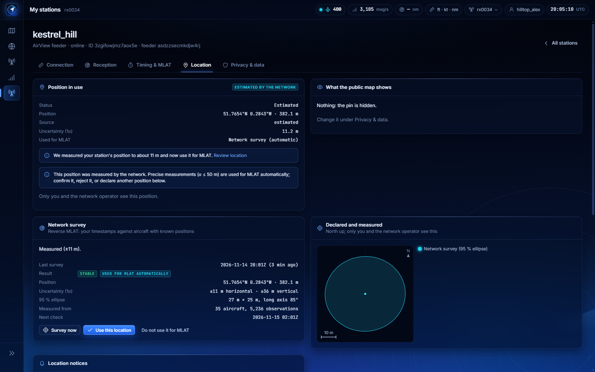

**Privacy & data.** Pin level, whether your name and public statistics are shown, a preview of what the public map shows, **Share this station…** (3.3.11), and your data:

| You want to | Do |
|---|---|
| See everything held about you | **Export my data** (on this tab or the account page): a ZIP of JSON files (account, sessions, stations with exact positions, location estimates, connection log, audit entries about you). |
| Stop public display | Set the pin to `hidden`, switch name and statistics off. Immediate. |
| Stop MLAT use of your receiver | Switch the feeder to **No timestamps** (`airview-feeder config set 'uplinks[0].timestamps=false'`, `setup -no-timestamps`, the installer, or the Uplinks setting). |
| Give the station up | **Unclaim this station**. It keeps feeding; you lose access to its data and can claim it again later. |
| Delete everything | **Delete my account** on the account page (type `DELETE` to confirm). Your account and your stations' statistics, positions and settings are removed at once; feeders that keep sending then appear as unclaimed stations; backups expire within the period the page states (30 days by default). Aircraft positions already merged into the shared map history cannot be separated out. |

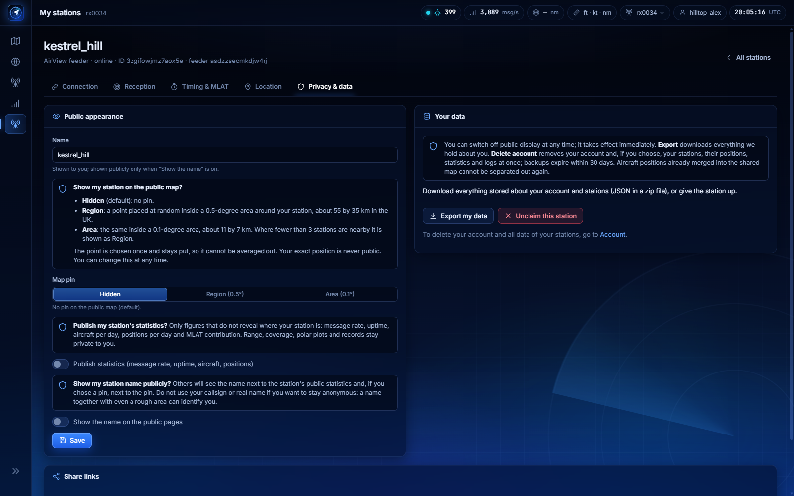

To complain, contact the operator first (see the privacy notice). In the UK you can also complain to the Information Commissioner's Office.

---

## 3.3.11 Share links

A share link lets people without an account watch what your stations hear, read-only and live. Create one from **My stations → Share links** or **Share this station** on the Privacy & data tab: choose the stations, a label, the scope (map, or map and statistics) and the lifetime (1 to 365 days, default 30). Before the link is made you must confirm that the aircraft a station hears reveal roughly where it is. By default low aircraft are rounded to about 5 km.

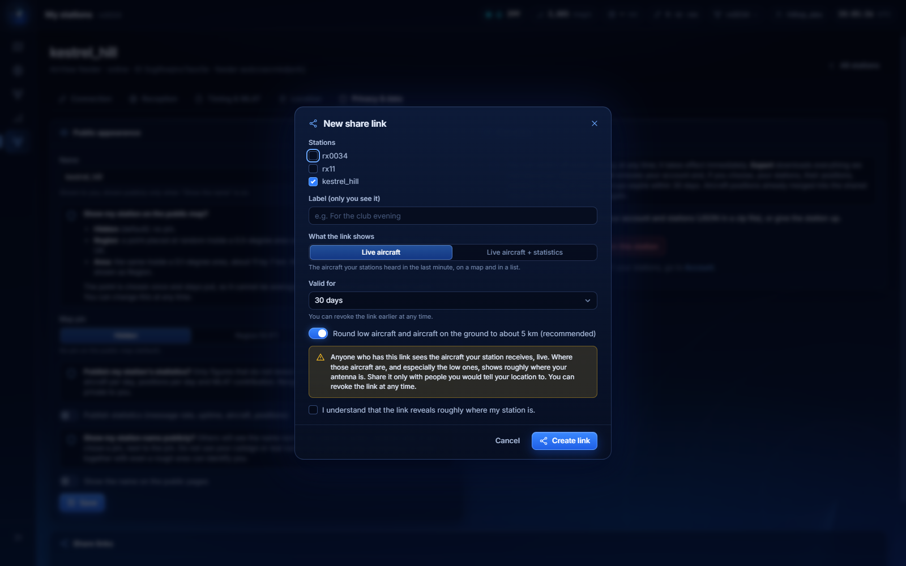

The link is shown once, with a QR code; only a hash is stored. It shows the aircraft your chosen stations heard in the last minute and, with the statistics scope, public-style statistics. It never shows your station's position, pin, ID, range or coverage. You can have up to 20 active links.

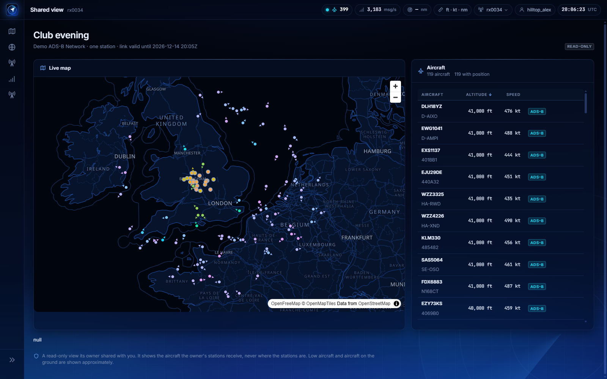

A link stops working when you revoke it, when it expires, or when one of its stations leaves your account. The operator can see and revoke all links.

---

## 3.3.12 Updates

The Linux feeder checks for signed updates daily at a random time and installs one only if its signature verifies (switch off with `--no-auto-update`). `airview-feeder update` or `sudo bash /opt/airview-feeder/install.sh --update` updates at once. On Windows, use the tray's **Check for updates…**. Updates come from the network you feed.

---

## 3.3.13 Troubleshooting

| Problem | Try |
|---|---|
| The installer finds no receiver | Check that your decoder runs and offers Beast on 30005 (`ss -ltn \| grep 30005`), or give `--input host:port`. `airview-feeder detect` lists what it finds. |
| "certificate pin mismatch" | The network changed its key. Copy the new pin from its Feed this network page or re-run the installer. |
| "enrol token invalid or used" | Tokens expire and have a limited number of uses. Ask the operator for a new one. |
| "cloned feeder" | Two machines use the same identity key, usually after copying an SD card. On the copy run `sudo airview-feeder new-identity`, restart it and claim the new station. |
| The station shows `pending` | The operator has not approved it yet. |
| The station shows `suspect` | Your entered position differs from what the network measures by more than 100 m (or 3σ). Check the coordinates, the altitude unit and MSL vs HAE. |
| MLAT never syncs | Is *No timestamps* on? Is the clock class "No timestamps" (SBS input)? Are other stations nearby? A new station spends a few minutes in the timing quarantine first. See the Timing & MLAT tab. |
| No MLAT results on your local map | Results go only to stations that contributed to that aircraft in the last minute and send at least 10 timed frames per minute while synced. Check `results.beastPort` / `results.readsbAddr` in `feeder.json`. |
| The claim with a UUID is refused | Open the page from the feeder's own internet connection, at least 5 minutes after it connected. |
| `airview-feeder claim` mentions `https://<host>/claim` and that page is not found | Use **My stations → Claim a feeder** on the network's site instead (`https://<host>/#/me/claim`). |
