# 3.2 Running an aggregator

This part is for the person who runs an AirView network server. It assumes a headless Linux VPS with systemd and a reverse proxy for HTTPS, which is the supported way to run a public network. Installing the server itself is covered in the installation chapter and in `deploy/server/README.md` (installed as `/opt/airview/README.md`); this part starts where that ends and covers the daily work.

Paths below are those of the server kit: binary `/opt/airview/airview`, operator file `/etc/airview/airview.jsonc`, data directory `/var/lib/airview`. The kit installs a wrapper, `/usr/local/bin/airview`, that runs the binary as the `airview` service account with that file and directory, so `sudo airview <command>` always acts on the running service's data.

Every setting named here is in the configuration reference (`docs/CONFIG.md`, generated from the source) with its default, range and `AIRVIEW_*` environment variable.

---

## 3.2.1 Before the first feeder: decisions and paperwork

### Decisions

| Decision | Setting | Default | Notes |
|---|---|---|---|
| Who may connect a feeder | `aggregator.admission` | `invite` | `invite`: a new native feeder needs an enrol token you mint (3.2.4). `approve`: anyone may connect, but each new station waits until you approve it. `open`: automatic. Start with `invite`. |
| Who may create an owner account | `aggregator.auth.registration` | `open` | `closed`: only accounts that already exist can log in. `open` is safe for a club: an account without a claimed station shows nothing private. |
| Public pin of new stations | `aggregator.defaultPin` | `hidden` | Owners change it per station. mlat-client feeders that send `privacy: false` start at `region` (they have consented to that on other networks). |
| Use surveyed positions for MLAT automatically | `aggregator.mlat.autoUseSurvey`, `aggregator.mlat.autoUseMaxSigmaM` | `true`, `50` | A station position measured by the network is used for MLAT without asking the owner when its horizontal σ is 50 m or better and it passes the consistency checks. The position stays visible only to the owner and admins; the owner is notified and can override it. Your privacy notice must say so. |
| Public map, statistics, tar1090-style JSON | `aggregator.publicMap`, `aggregator.publicStats`, `aggregator.tarJson` | all `true` | Turn off for a members-only network. |
| Coverage-island guard | `aggregator.islandGuard` | `false` | See 3.1.3. |
| MLAT | `aggregator.mlat.enabled` | `true` | The network's own MLAT engine (3.4). |

Most of these can also be changed later in **Network admin → Policy** (3.2.9).

### Legal paperwork (UK GDPR)

A feeder's position is personal data and you, the operator, are its **controller**. The `docs/aggregator` folder contains templates to complete **before** the first feeder connects:

1. `PRIVACY-NOTICE.md`: fill it in and publish it on your site (for example at `https://<your host>/privacy`). Set `aggregator.privacyNoticeUrl` to its address so the feeder and claim pages link to it.
2. `LIA.md`: the legitimate interests assessment and DPIA screening. Keep it; you do not publish it.
3. Check whether you must pay the ICO data protection fee.
4. `RETENTION.md`: align the retention settings (3.2.12), your backup rotation, the proxy access log and journald with it.
5. `CONSENT.md`: the consent and notice texts (C1 to C9) that the installer, the claim page and the feeder page show.

The templates are not legal advice. Have them reviewed if your network is large or commercial.

### Sizing

| Network | vCPU | RAM | Disk | Inbound traffic |
|---|---|---|---|---|
| up to about 100 feeders | 2-4 | 4-8 GB | 40 GB SSD | 15-35 kB/s per busy station in `full` mode: 1.5-3.5 MB/s for 100 |
| 1,000+ feeders, 10,000+ aircraft | 8+ | 16-32 GB | 250 GB SSD/NVMe | stations switch to `selective` traffic above `aggregator.limits.selectiveAbove` (100) online stations: about 3-5 kB/s each, 3-5 MB/s for 1,000 |

Section 3.2.15 explains where these figures come from and what grows with what.

---

## 3.2.2 First admin, reverse proxy and ports

These steps are done once, normally by the installer. They are summarised here because everything else depends on them.

**First admin.** Aggregator mode keeps the feeder ports closed (they report `closed until the admin exists`) until an admin with a password **and** an authenticator exists:

```sh
sudo airview admin init -user admin
```

It asks for the password twice (12 characters or more, not echoed), shows a secret and an `otpauth://` URI for any authenticator app (RFC 6238), asks for the current 6-digit code, and prints **10 recovery codes**. Store them offline; each works once in place of an authenticator code.

Without the CLI, start the service and open the site: the setup page asks for a one-time token from the file `/var/lib/airview/setup-token` (`sudo cat /var/lib/airview/setup-token`; mode 0600, valid 24 hours and renewed while no admin exists, never written to the journal or `airview.log`).

**Lost access.** Anyone with a shell on the server can reset an admin; it sets a new password and authenticator, ends that admin's sessions and prints new recovery codes, and is safe while the server runs:

```sh
sudo airview admin reset -user admin
```

**HTTPS.** Run the web interface on `127.0.0.1:8080` behind Caddy or nginx (the kit's `--proxy` option and `/opt/airview/proxy/` examples). In aggregator mode AirView refuses passwords, authenticator codes and the setup token over plain HTTP from the network: they are accepted over HTTPS through a proxy listed in `aggregator.trustedProxies`, or from the server itself (loopback). `X-Forwarded-For` and `X-Forwarded-Proto` are honoured only from `aggregator.trustedProxies`. The live map uses a server-sent event stream: the proxy must not buffer it (Caddy `flush_interval -1`; nginx `proxy_buffering off`).

**Never put port 30160 behind an HTTP or TLS-terminating proxy.** AVF/1 terminates TLS inside AirView and binds each feeder's signature to that TLS session. A plain TCP pass-through works; TLS termination breaks every feeder.

**Ports.**

| Port | Open to | Purpose (setting) |
|---|---|---|
| 80, 443 TCP | everyone | reverse proxy: web interface, API, feeder installer downloads |
| 30160 TCP | feeders | AVF/1, TLS 1.3 (`aggregator.avfPort`) |
| 30004 TCP | readsb / Ultrafeeder feeders | Beast ingest, map and statistics only (`aggregator.beastPort`) |
| 31090 TCP, plus UDP if `aggregator.mlat.udp` | mlat-client feeders | MLAT timing (`aggregator.mlatPort`) |
| 8080 TCP | localhost only | web interface behind the proxy (`http.port`) |
| 30170 TCP | your federation peers | only when `aggregator.federation.listen` is set (3.2.11) |

Ports 30004 and 31090 carry no encryption (that is how readsb and mlat-client work). Recommend native AirView feeders to owners who care.

**The feeder port key (pin).** AVF/1 uses TLS 1.3. By default AirView creates a self-signed ECDSA P-256 certificate in `/var/lib/airview/avf-tls/` on the first start. Feeders do not check it against a certificate authority; they check its **pin**, `sha256/<base64>`. The pin is:

- built into the installer your server serves at `https://<your host>/feeder/install.sh`, so feeders installed with it need nothing else;
- printed in the start-up log: `AVF/1 listener ... pin="sha256/..."` (`journalctl -u airview | grep 'AVF/1 listener'`);
- returned as `avfPin` by `GET /api/admin/network` (admin).

Give it to owners who set up a feeder by hand (`airview-feeder setup -pin ...`) or through an AirView station's Uplinks setting. Back up `avf-tls/`: if the key is lost, every feeder needs the new pin. Alternatively set `aggregator.tlsCert` and `aggregator.tlsKey` to PEM files from your ACME client (AirView reloads them when they change); feeders then verify against the system CA roots and need no pin. Feeders that still carry the old pin refuse the new certificate until the pin is removed (`airview-feeder config set 'uplinks[0].serverPin='`) or the installer is run again.

AirView limits connections per address on its own (`aggregator.limits.*`): at most 4 unauthenticated and 16 total feeder connections per IP, 32 per IPv4 /24 or IPv6 /48, and 8 stations per IP (`perIpStations`). A host that legitimately carries many stations, such as a club relay, goes into `aggregator.limits.allowCidrs`.

---

## 3.2.3 The Network admin console

Log in as the admin and open **Network admin** (shield icon in the sidebar). The console has eight tabs:

| Tab | What it is for |
|---|---|
| **Stations** | The station registry: search, filter, approve, rename, reveal, ban, delete (3.2.5). |
| **MLAT** | The MLAT console: accuracy, solve rates, clock synchronisation, per-station timing, expected accuracy, ADS-B verification, where to add stations (3.2.7). |
| **Locations** | Station location quality, the survey engine and the hourly bundle adjustment (3.2.8). |
| **Federation** | Links with other AirView networks (3.2.11). |
| **Share links** | Every owner's read-only share links (3.2.10). |
| **Enrol tokens** | Tokens for the `invite` policy (3.2.4). |
| **Audit log** | Every exact-data view and every change, newest first. |
| **Policy** | Admission, registration, public surfaces, default pin, island guard, automatic survey use (3.2.9). |

The heading reminds you that **every exact view is recorded in the audit log**. That includes opening the station list.

The **Audit log** tab lists the entries newest first (200 at a time, **Older entries** for more): time, who (an admin, an owner, or `system`), the action, the station and details. Besides admin views (`station.list`, `station.reveal`) it records claims (`station.claim`), share links (`share.create`, `share.revoke`), admission and owner changes, and the system's own decisions, such as a station's timing being proven (`station.timing.proven`), a survey (`station.survey`, `station.location.survey`) or MLAT switching to a surveyed position (`station.mlat.position`). Entries are kept for `aggregator.retention.auditMonths` (24 months).

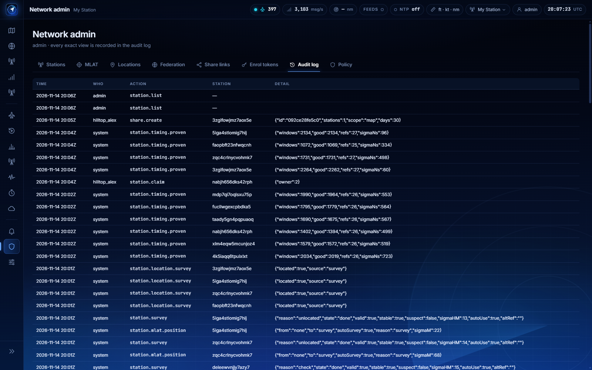

---

## 3.2.4 Admission and enrol tokens

With `aggregator.admission` = `invite`, a new native feeder must present an enrol token the first time it connects. Afterwards it is known by its key and needs no token again.

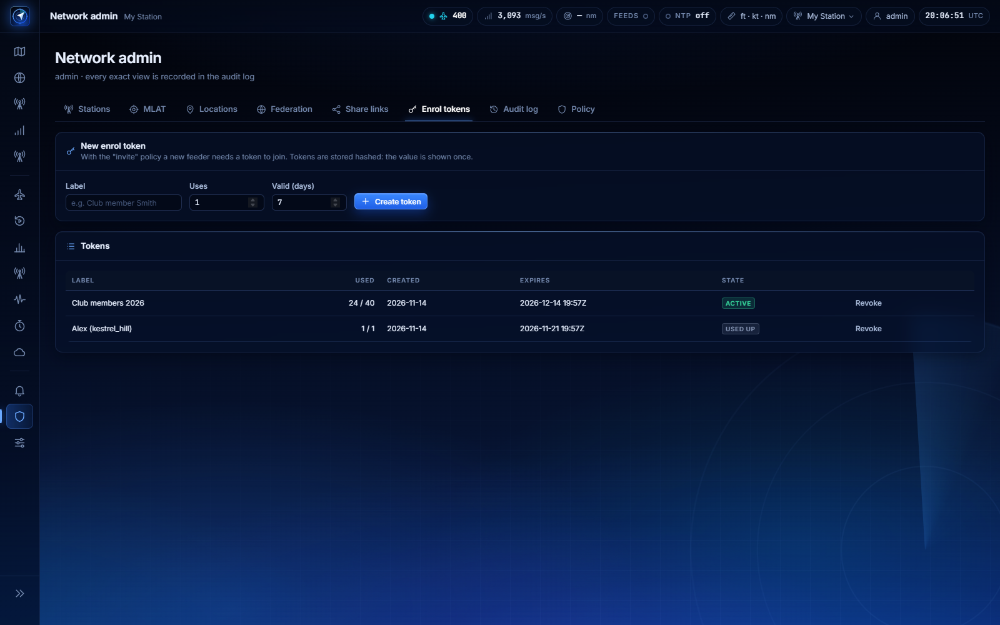

**Create a token.** In **Enrol tokens**, enter a label (for example the owner's name), the number of uses (default 1) and the validity in days (default 7, at most 365), then **Create token**. The token is shown **once**: only a hash is stored. Copy it or download it, and send it to the feeder owner over a private channel.

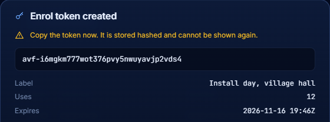

The owner enters the token in the installer (`--token` / `--enrol`), in `airview-feeder setup -server <host> -pin <pin> -enrol TOKEN`, or in the Uplinks setting of their AirView station (3.3). (In version 1.0.0 the token dialog also shows an example line `airview-feeder enrol --server ... --token ...`; that command does not exist. Use `airview-feeder setup` as above, or the installer.)

For an install day, mint one token with a higher use count and a short lifetime. Revoke tokens that are no longer needed (**Revoke** in the token list). Used and expired tokens stay listed with their state.

**readsb and mlat-client feeders** cannot present a token. Under `invite`, a new Beast or mlat-client station that sends a UUID is held as **pending** until you approve it in the registry; a Beast link without a UUID is refused. Under `approve`, every new station waits for you, native ones included. Under `open`, every station is admitted at once.

---

## 3.2.5 The station registry

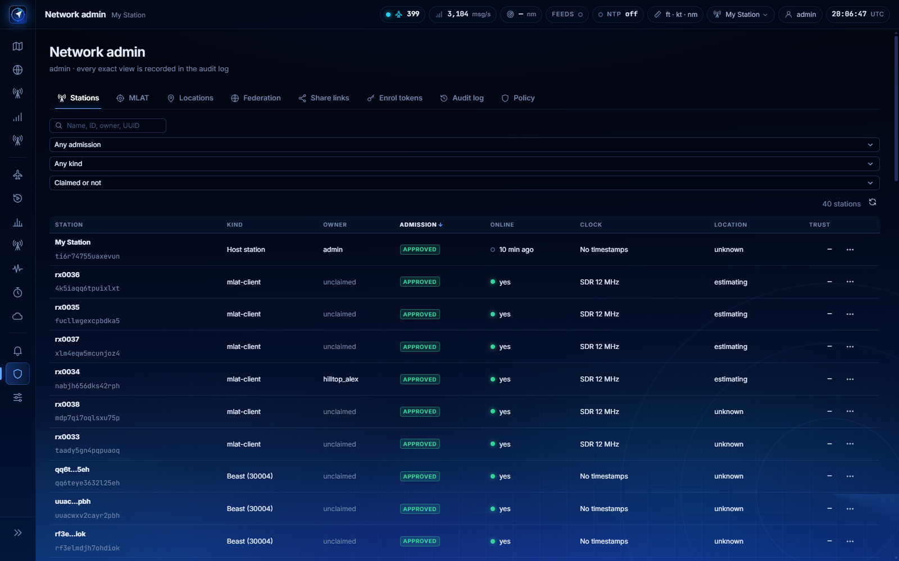

The **Stations** tab lists every station, 50 per page by default, sorted and paged on the server so it stays fast with thousands of stations. Search matches the name, station ID, owner, feeder ID or UUID; the filters narrow it by admission, kind and whether it is claimed. Columns:

| Column | Meaning |
|---|---|
| Station | name, station ID, and for native feeders the feeder ID (as shown on the feeder's own status page) |
| Kind | AirView feeder, Beast (30004), mlat-client or host |
| Owner | the claiming account, or *unclaimed* |
| Admission | approved, pending, denied, revoked |
| Online | *yes*, or when it was last seen |
| Clock | the timing class: GPS (UTC), 12 MHz hardware (Beast / Radarcape), SDR 12 MHz, SBS 20 MHz, No timestamps (3.4.2) |
| Location | declared, surveyed, estimating, unknown ... |
| Trust | the station's trust score |

The **⋯** menu of a row has the actions:

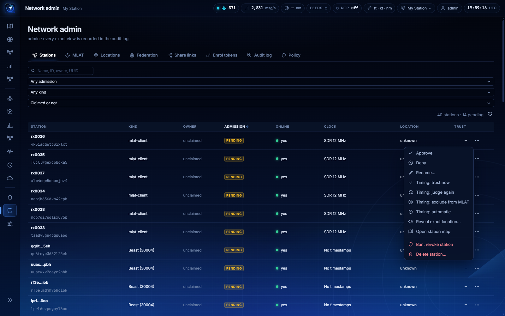


| Action | Effect |
|---|---|
| Approve / Hold (pending) / Deny | Change admission. Held and denied stations' data does not reach the map, the statistics or MLAT. |
| Rename… | Change the display name. |
| Timing: trust now / judge again / exclude from MLAT / automatic | Override the timing quarantine (3.4.2): admit a station to MLAT now, put it back into quarantine, keep it out of MLAT, or return to automatic. |
| Reveal exact location… | Shows the exact position and the current IP address. Asks for confirmation; the view is audited. |
| Open station map | The Live Map centred on that station's view. |
| Ban: revoke feeder key… | For native feeders: every station of that feeder is revoked and the key can never connect again. The owner must create a new identity and enrol again. |
| Ban: revoke station | For Beast / mlat-client stations. |
| Delete station… | Deletes the station and all its statistics (type `DELETE` to confirm). A feeder that keeps connecting comes back as a new, unclaimed station. |

Stations that are unclaimed and offline for `aggregator.retention.offlinePurgeDays` (90 days) are deleted automatically.

**Assigning an owner.** Owners normally claim their own station (3.3.9). For a station that cannot be claimed (no UUID, or an owner without access to the feeder), the API sets the owner: `PUT /api/admin/stations/{sid}` with `{"owner":"<user name>"}`.

---

## 3.2.6 Owners and claims

Owners create an account on your site (**Create account**, user name and password; no e-mail) and then link stations to it:

- **Native feeders:** the owner enters an 8-character **claim code** that the feeder fetches from your server (`airview-feeder claim`, the feeder's status page, the installer's last screen). A code is valid 24 hours and works once; a station has at most 5 open codes.
- **readsb / mlat-client:** the owner enters the station's full **UUID**. This works only from the station's current IP address, so it proves the owner runs the feeder.

Claims are rate-limited to 5 attempts per 10 minutes per client and 20 per day per account.

Owners can **Unclaim this station** (it keeps feeding without an owner) and **Delete my account** (the account and its stations' statistics, positions and settings; feeders that keep sending reappear as unclaimed stations). There is no e-mail recovery: an owner who loses their password and recovery codes creates a new account and claims the station again with a new code, or asks you.

---

## 3.2.7 The MLAT console

**Network admin → MLAT** shows how the network's MLAT engine is doing. The time-range buttons (1 h, 6 h, 24 h, 7 d, 30 d) apply to every chart on the tab. The history is kept in memory and saved to `mlat-history.gob.gz` in the data directory every 10 minutes and at shutdown, so the charts survive a restart.

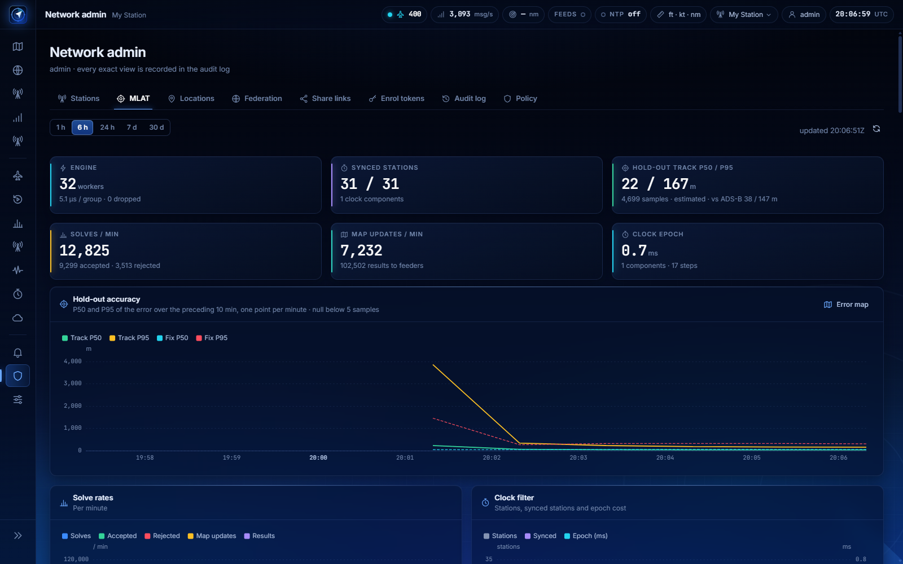

**Summary tiles.**

| Tile | Meaning |
|---|---|
| Engine | worker count, processing time per group of receptions, dropped groups |
| Synced stations | stations whose clocks are synchronised / stations with timing, and the number of clock components (groups of stations that share aircraft) |
| Hold-out track P50 / P95 | the measured accuracy: the error of the hold-out aircraft's MLAT tracks against their own ADS-B positions (3.4.6), with the cross-track estimate |
| Solves / min | position solutions per minute, accepted and rejected |
| Map updates / min | MLAT positions published to the map per minute, and results sent back to feeders |
| Clock epoch | the time one clock-filter step takes (every 0.5 s), components, clock steps |

**Charts and tables** further down: Hold-out accuracy over time (with an **Error map**), Solve rates, Clock filter, Self-validation, a **Stations** table (per station: clock class, anchor state, synced, clock σ, drift ppm, jitter, peers, steps, fixes per hour, excluded share, residual bias, σ scale; **Problems only** narrows it), the **Sync matrix** of station pairs, and **Expected accuracy (CRLB)**: the best accuracy the station geometry allows at 3,000 ft, FL100 and FL300, with the area each accuracy grade covers.

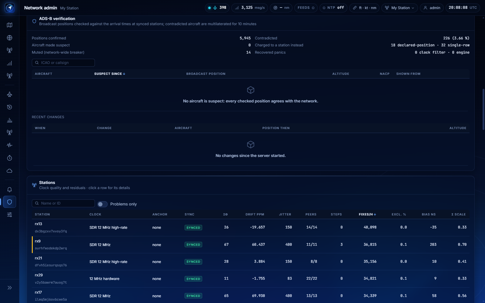

**ADS-B verification.** The engine checks broadcast ADS-B positions against the network's timing. The card shows how many positions the timing confirmed or contradicted, the aircraft that are **suspect** right now (possible spoofing or a faulty transponder; the network multilaterates them for 10 minutes) and the last 200 changes. A station whose timing repeatedly contradicts ADS-B positions gets a survey of its own position (3.2.8).

**Where to add a station.** Ranks 0.5° areas by how much one more receiver (choose GPS, Beast or RTL-SDR timing) would improve the expected MLAT accuracy at 3,000 ft, FL100 or FL300, with the grid cells it would newly cover and the median σ nearby before and after. The Live Map's admin view shows the same as the MLAT quality layer "Where to add a station". This is admin-only because it is computed from exact station positions.

**Mode A/C targets.** With `aggregator.mlat.modeAc` on, the anchors also multilaterate Mode A/C replies; targets without a Mode S address appear on the map as "Mode A/C" with a synthetic `#xxxxxx` ID.

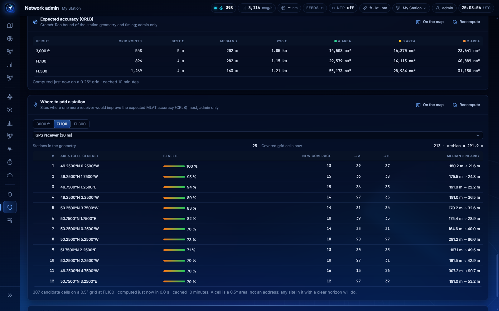

### MLAT settings worth knowing

| Setting | Default | Meaning |
|---|---|---|
| `aggregator.mlat.enabled` | `true` | Run the MLAT engine. |
| `aggregator.mlat.returnResults` | `true` | Send results to stations that contributed (3.4.7). |
| `aggregator.mlat.holdout` | `0.1` | Share of well-tracked ADS-B aircraft solved as if they had no ADS-B, to measure accuracy (0 to 0.5). |
| `aggregator.mlat.autoUseSurvey`, `autoUseMaxSigmaM` | `true`, `50` | Use surveyed positions automatically (3.2.1). |
| `aggregator.mlat.surveyIntervalH` | `6` | How often declared positions are re-checked by survey. |
| `aggregator.mlat.modeAc` | `false` | Mode A/C multilateration among anchors. |
| `aggregator.mlat.udp` | `false` | Accept mlat-client's UDP transport on the mlat port (open UDP in the firewall too). |
| `aggregator.mlat.maxComponentStations` | `200` | Large clock components are partitioned above this size. |
| `aggregator.mlat.engine.workers`, `aggregator.mlat.clock.workers` | one per CPU | Goroutine bounds. |

---

## 3.2.8 Station locations and surveys

MLAT needs every receiver's antenna position to within a few tens of metres. Owners enter it; the network checks it, and measures it when it is missing.

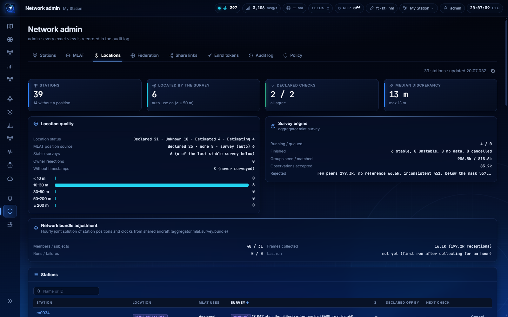

**Network admin → Locations** shows:

- **Stations / Located by the survey / Declared checks / Median discrepancy:** how many stations have no position, how many were located by the network, how many declared positions were checked and how many disagreed.
- **Location quality:** location status of all stations, which position source MLAT uses (declared, surveyed, receiver GNSS, confirmed by the owner, none), owner rejections, stations without timestamps (which can never be surveyed), and a histogram of survey σ.
- **Survey engine:** running and queued surveys and their outcomes.
- **Network bundle adjustment:** once an hour the network solves the positions and clocks of all stations jointly from shared aircraft. Stations whose declaration is far off are "released" and corrected; anchors and honest declarations are kept.
- **Stations:** per station: location status, the position MLAT uses, the survey state with **Start** / **Cancel**, σ, how far the declared position is off, and the next scheduled check.

**How a station is located.**

1. A station with timestamps but no declared position is **surveyed**: the network uses aircraft whose positions it knows (ADS-B) to solve for the receiver's position ("reverse MLAT").
2. If the survey's horizontal σ is ≤ `autoUseMaxSigmaM` (50 m) and it passes the suspect checks, it is used for MLAT at once (`autoUseSurvey`). The owner is notified on the station's Location tab and can confirm, adjust or reject it.
3. Declared positions are re-surveyed every `surveyIntervalH` (6 hours). A station more than max(100 m, 3σ) from its survey is marked **suspect** and excluded from MLAT until the owner corrects the position (often a mix-up between altitude above mean sea level and above the ellipsoid, or a missing unit).

Exact positions appear only on the station's own Location tab and in the bundle result, both admin- or owner-only.

---

## 3.2.9 Policy

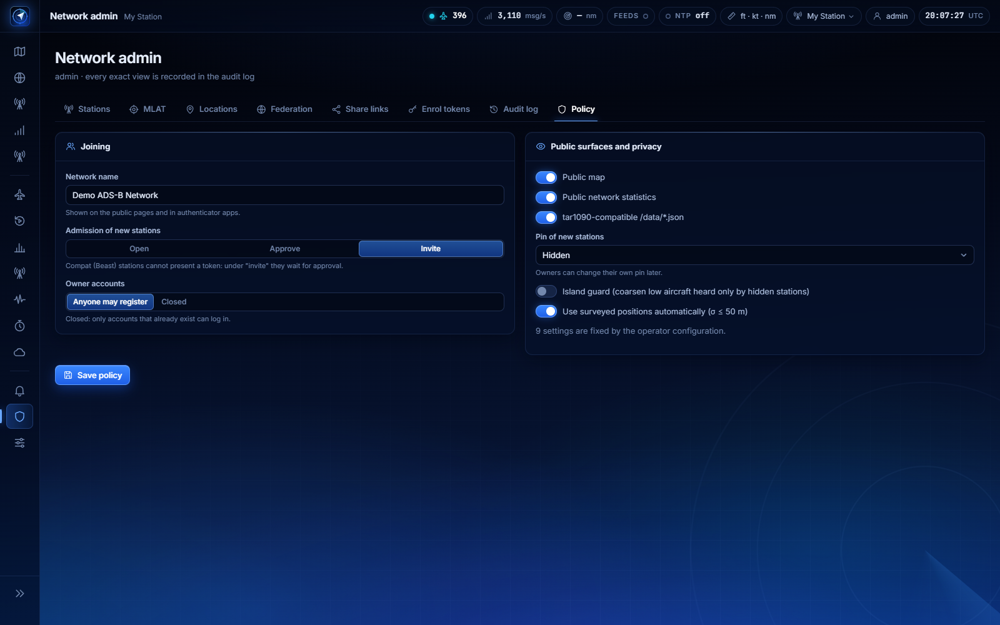

**Network admin → Policy** changes the network-wide settings from the browser: network name, admission (Open / Approve / Invite), owner accounts (Anyone may register / Closed), public map, public statistics, tar1090-compatible `/data/*.json`, the pin of new stations, the island guard and the automatic use of surveyed positions. **Save policy** writes them to `config.json` in the data directory.

A setting that is fixed in the operator file or by an `AIRVIEW_*` variable is shown locked, with the file and line (or the variable) that sets it: the operator file always wins over the web interface. The screenshot shows the demonstration server, whose ports are set by environment variables.

---

## 3.2.10 Share links

Owners can give people without an account a read-only live view of their stations (3.3.11). Before a link is created the owner must confirm that the aircraft a station hears reveal roughly where it is. A link shows the aircraft the chosen stations heard in the last minute in the public shape (no receiver data; low aircraft rounded to about 5 km unless the owner switches that off) and optionally the stations' public-style statistics. It never shows a station position, pin, ID, range or coverage.

Links last 1 to 365 days (default 30); an owner can have at most 20 active links. Only a hash of each link is stored, in `sharelinks.json` in the data directory; the full link is shown to the owner once. A link stops working when it is revoked, expires, or one of its stations leaves the owner's account.

**Network admin → Share links** lists every link with its owner, stations, scope, expiry and state, searchable and paged. You can revoke any link. Creating and revoking are audited (`share.create`, `share.revoke`).

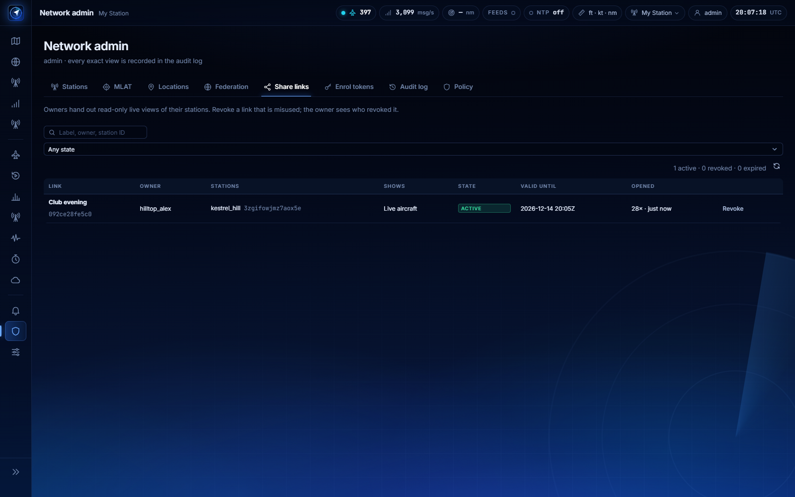

---

## 3.2.11 Federation with other AirView networks

Federation (`aggregator.federation.enabled`, off by default) exchanges aircraft with other AirView aggregators over AVFED/1: TLS 1.3 with mutual Ed25519 identities bound to the TLS session, so a relay that terminates TLS fails.

- **Identity.** `sudo airview federation id` prints this network's node ID (and, when `aggregator.federation.listen` is set, the TLS pin). Exchange node IDs with the other operator out of band; each side lists the other in `aggregator.federation.peers[]` with its `id`, and the side that dials also with `addr`.
- **What peers receive.** At most what your public map shows: aircraft (optionally without MLAT positions, inside configured boxes, above an altitude floor, delayed by `send.delayS`), and MLAT results only with `send.mlat`. Island-guard aircraft are coarsened or dropped (`send.island`). Never feeder identities, station positions, receiver lists, signal levels or IP addresses: the protocol has no fields for them. Data from one peer is passed to another only with `transit` on both sides, bounded by `maxHops`.
- **What you show.** Remote aircraft are drawn on the public map as an overlay unless `hideRemote` is set. They never enter your statistics or records.
- **Out-feeds.** `feeds[]` are federation-safe Beast (timestamps and signal zeroed, de-duplicated) or JSON feeds of your own aircraft for other networks, in `connect` or `listen` mode; listen feeds accept only the `allow` networks (loopback by default).
- **Ports.** 30170/tcp inbound only when `listen` is set.

**Network admin → Federation** shows this node's ID (to give to partners), each peer's state, direction, round-trip time, counters and errors, the out-feeds, and the peer list with its sharing policy; settings fixed in the operator file are shown locked. `GET /api/admin/federation` returns the same. `airview config check` runs the federation checks.

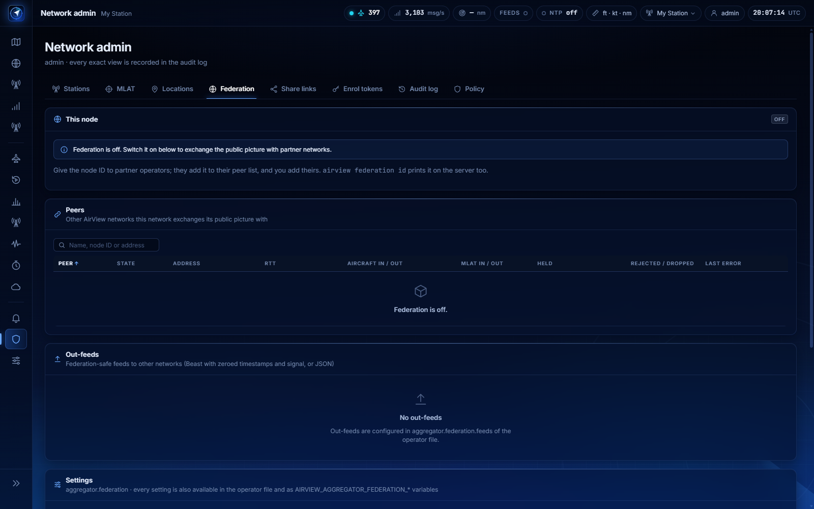

The node identity is the file `federation.key` in the data directory. Keep it in your backups (3.2.13): if it is lost, every peer must be given the new node ID.

---

## 3.2.12 Data protection: retention and requests

### Retention

AirView deletes old data by itself; the defaults match the `RETENTION.md` template:

| Data | Setting | Default |
|---|---|---|
| Connection log (hashed addresses, times, bytes) | `aggregator.retention.connLogDays` | 30 days |
| Per-station minute statistics | `aggregator.retention.minuteDays` | 30 days |
| Per-station hourly statistics | `aggregator.retention.hourMonths` | 13 months |
| Unclaimed stations offline for | `aggregator.retention.offlinePurgeDays` | 90 days |
| Audit log | `aggregator.retention.auditMonths` | 24 months |
| Location estimates kept per station and method | `aggregator.retention.estimatesPerMethod` | 5 |
| Stored aircraft position trails | `aggregator.storage.trailDays` | 7 days (full resolution for `trailFullDays` = 2 days, then one point per `trailThinSec` = 30 s) |
| How long your backups keep deleted data (what owners are told) | `aggregator.retention.backupDays` | 30 days |

AirView makes no backups by itself; `backupDays` is only the figure shown to owners when they delete their account. Make your backup rotation match it.

### Requests from owners

| Request | How |
|---|---|
| Access / portability | The owner downloads **Export my data** (a ZIP of JSON files: account, sessions, stations with exact positions, location estimates, connection log, audit entries about them). |
| Erasure | The owner uses **Delete my account**; or you delete the station in the registry. Deletion runs at once in the live system (it is queued and survives restarts); backups expire within your rotation. Aircraft positions already merged into the shared history cannot be separated out. |
| Rectification | Owners edit name and declared position themselves; you can rename. |
| Objection to MLAT use | The owner switches the feeder to **No timestamps**, or you delete the station. |
| Withdrawal of consent to public display | The owner sets the pin to `hidden` and switches name and public statistics off; effective at once. |

Answer within one month and record what you did. After restoring a backup, re-apply the erasures you completed after it was taken.

---

## 3.2.13 Backup and restore

**Backup.** On a server installed with the kit:

```sh
sudo airview backup                                     # = /opt/airview/backup.sh, cold: stops the service briefly
sudo /opt/airview/backup.sh --online -o /var/backups/airview --keep 30   # service keeps running (needs sqlite3)
```

The kit's script archives the whole data directory (databases, `config.json`, the AVF/1 TLS key, `sharelinks.json`, `federation.key`, the uplink identity) and `/etc/airview` into `airview-backup-<host>-<time>.tar.gz` (mode 0600). It stages database snapshots next to the output directory, not in `/tmp` (a small RAM disk on current Debian); `AV_BACKUP_TMP` moves the staging.

The binary itself also has a consistent online backup that writes a ZIP:

```sh
sudo -u airview /opt/airview/airview backup -data /var/lib/airview -o /var/backups/airview/airview-$(date +%F).zip
```

It snapshots `airview.db` and `stations.db` with `VACUUM INTO` (staged in the data directory by default, so it needs free space for one copy of both; `-tmp DIR` stages elsewhere), and adds `config.json`, `airview.jsonc` (if it is in the data directory), `sharelinks.json`, the `uplink` identity and `avf-tls`, with a manifest of SHA-256 checksums. It does **not** include `federation.key` or the MLAT console history: copy `federation.key` yourself if you use federation. `airview db snapshot -o DIR` writes only the database copies.

Backups contain exact station positions, password hashes, TOTP secrets and private keys. Encrypt them before they leave the server and keep them no longer than `backupDays`.

**Restore.**

```sh
sudo airview restore /var/backups/airview/airview-backup-<host>-<time>.tar.gz
```

The kit's restore stops the service, moves the current data directory and `/etc/airview` aside (`*.pre-restore-<time>`; nothing is deleted), unpacks the backup, starts the service and checks it. A backup can be restored on a new server after installing the kit there; the AVF/1 TLS key travels with it, so feeders that pin the certificate keep working once DNS points at the new address.

For the ZIP format: stop the service, then `sudo -u airview /opt/airview/airview restore -data /var/lib/airview FILE.zip`. It refuses to run while AirView is running (unless `-force` for a stale lock), verifies every file against the manifest and moves replaced files to `<data>/pre-restore-<time>/`.

---

## 3.2.14 Monitoring and logs

### `/healthz`

`GET /healthz` is the health endpoint for uptime monitors, load balancers, Docker `HEALTHCHECK` and the kit's upgrade check. It is cheap, never rate-limited and says nothing about stations. From the demonstration server:

```sh
curl -fsS http://127.0.0.1:8080/healthz
{"ok":true,"status":"ok","mode":"aggregator","version":"1.0.0","uptimeS":77,
 "checks":{"engine":"ok","listener.avf":"listening","listener.beast":"listening",
           "listener.mlatc":"listening","listener.sbsIn":"off","mlat":"ok","registry":"ok",
           "store.main":"ok","store.stations":"ok"},"adminReady":true}
```

| HTTP status | `status` | Meaning |
|---|---|---|
| 200 | `ok` | Everything runs. |
| 200 | `degraded` | A non-essential part is missing. |
| 503 | `failing` | A configured feeder port could not be opened (`listener.*` says `failed: ...`, for example "address already in use"), or a database writer has not written for 2 minutes while rows are waiting (`store.*`). Feeders cannot deliver data: act on it. |
| 503 | `unavailable` | The engine is not running (starting, stopping, factory reset). |

Before the admin exists the feeder listeners report `closed until the admin exists`; that is not a failure. `store.stations` also reports rows dropped since the start: if that number grows, the disk is too slow for the statistics writer (3.2.15).

Other quick checks:

```sh
systemctl is-active airview
openssl s_client -connect 127.0.0.1:30160 -tls1_3 -alpn avf/1 </dev/null 2>/dev/null | grep -E 'ALPN|Protocol'
```

A headless aggregator does not move to another web port when `http.port` is taken: it stops with an error, so the proxy never points at the wrong service.

### Logs

- `journalctl -u airview -f` (or `sudo airview logs`): start-up, configuration corrections, warnings and errors.
- `/var/lib/airview/airview.log`: the same, rotated by AirView at `process.logMaxMb` (64 MB in aggregator mode), keeping `process.logFiles` (10) older files. `process.logLevel` sets the level; `AIRVIEW_DEBUG=1` in a systemd drop-in turns on debug output temporarily.
- In aggregator mode the logs contain no raw IP addresses, positions or per-station timing data; a client's network is logged as `/24` (IPv6 `/48`).
- Feeder disconnects are logged with the cause, for example `avfsrv: feeder disconnected feeder=... reason="server: rate_limited: ..." reconnectIn=5m0s`, `reason="closed by the feeder (EOF)"`, `reason="idle timeout"` or `reason="feeder goodbye: shutting_down"`.
- Survey and MLAT events are logged at INFO, for example `mlat: station contradicts ADS-B positions; survey requested` and `survey started ... reason=bias`.
- Cap journald to your retention (`/etc/systemd/journald.conf`: `MaxRetentionSec=30day`, `SystemMaxUse=1G`), and keep the proxy access log short (14 days in `RETENTION.md`): it is the only place IP addresses persist.

---

## 3.2.15 Scaling to 1,000+ feeders

The defaults are sized for 1,000+ feeders and 10,000+ aircraft. What changes as the network grows:

1. **Traffic mode.** Above `aggregator.limits.selectiveAbove` (100) approved online stations, feeders switch from `full` to `selective` traffic (about 3-5 kB/s instead of 15-35 kB/s). Per-station statistics stay exact through per-minute counters the feeder sends.
2. **Hard caps.** `aggregator.limits.maxStations` (2,000 approved stations), `maxAircraft` (30,000), `ingestFps` (3,000,000 frames per second; selective-eligible traffic is shed first). Raise them deliberately. `aggregator.limits.trackerShards` (0 = from the CPU count) splits the aircraft tracker.
3. **Beast links.** `aggregator.beast.maxLinks` (4,096) caps concurrent 30004 connections.
4. **File descriptors and web connections.** The kit's unit sets `LimitNOFILE=65536`; keep it well above feeder links plus web clients. Web connections are capped at `aggregator.limits.maxHttpConns` (20,000) in total and `maxHttpConnsPerIp` (64) per IPv4 address or IPv6 /64; loopback and trusted proxies are exempt, so behind a proxy, cap per client in the proxy. `maxPublicSse` (2,000) caps public live streams.
5. **Viewers.** The map's live stream sends one picture and then only changes: about 70-80 bytes per moving aircraft per second (measured 0.8 MB/s at 10,000 aircraft, against 3.5 MB/s for full pictures). Above 1,500 aircraft the Live Map switches to a viewport stream on its own (back below 1,000): a zoom-8 view at 10,000 aircraft costs about 54 kB/s (10.5 kB/s compressed). Public trails are limited to 10 minutes and 120 points per aircraft.
6. **MLAT CPU and memory** (simulated, see 3.4.9): 100 stations about 0.25 cores and 150 MB, 300 stations about 1 core and 410 MB; projected 3-4 cores and 1.5-2 GB at 1,000 stations and 10,000 aircraft. A 1,000-station MLAT run has not been executed.
7. **Disk.** Measured on simulations:
   - `airview.db` grows by about 0.6 GB per 1,000 aircraft and day, almost all of it position trails. With the default trail retention (7 days, thinned after 2) it settles at about 1.7 GB per 1,000 aircraft (17 GB at 10,000).
   - Per busy station: `stations.db` settles at about 22 MB (heat map, minute/hour/day statistics, range and coverage), and the station rows of `flight_station` in `airview.db` at about 100 MB.
   - So 1,000 busy feeders with 3,000-10,000 aircraft need about 140-160 GB with the defaults; 250 GB leaves room for growth and one backup snapshot. Quiet rural stations need a fraction of this, and shorter retention scales it down linearly.
   - The statistics writer takes bursts of millions of rows; `aggregator.storage.queueRows` (2,000,000, about 100 bytes of RAM each) bounds its queue. If `/healthz` shows rows dropped in `store.stations`, use faster storage or raise it.
8. **Trusted Beast relays.** `aggregator.trustedRelays` entries are `uuid@cidr`: a relay's receiver IDs are honoured only from those addresses, because Beast UUIDs are self-declared and sent in clear text.
9. **Outbound to feeders.** MLAT results go only to stations that contributed (3.4.7), so return traffic grows with MLAT coverage, not with the number of feeders.

A Raspberry Pi 5 can host a small aggregator only with an NVMe or USB SSD; on an SD card AirView warns and shortens minute retention to 7 days.

---

## 3.2.16 Changing settings

Layers, later wins: built-in defaults < `config.json` (written by the web interface) < operator file `/etc/airview/airview.jsonc` < `AIRVIEW_*` environment variables < `-set path=value` on the command line.

- **Operator file:** edit, run `sudo airview config check`, then `sudo systemctl restart airview`. `config check` reports syntax errors, unknown or misspelt settings (with a suggestion), wrong types and out-of-range values with file, line and column; exit status 0 = valid, 1 = errors. `sudo airview config print -sources` shows the effective configuration and where each value came from, with secrets redacted.
- **Environment:** `sudo systemctl edit airview`, for example `Environment=AIRVIEW_AGGREGATOR_LIMITS_SELECTIVE_ABOVE=150`. Secrets are better passed as files: `AIRVIEW_<NAME>_FILE=/path`. `airview config env` lists every variable.
- **Web interface:** Policy (3.2.9) and Settings, saved to `config.json`; locked where the file or environment sets them.

`sudo airview config example -o /etc/airview/airview.example.jsonc` writes the fully commented reference (the kit refreshes it on every upgrade).

---

## 3.2.17 Onboarding a feeder: checklist

1. Mint an enrol token (3.2.4).
2. Send the owner the token, the AVF/1 pin if they will not use your installer (3.2.2), your site's **Feed this network** page (`https://<your host>/#/feeder`) and the link to your privacy notice. The feeder part of this manual (3.3) is written for them.
3. The owner installs the feeder; it prints a claim code.
4. The owner creates an account on your site and claims the station.
5. Check in **Stations** that the station is approved and online and, for timed feeders, in **MLAT** that it is synced after its quarantine (a few minutes).

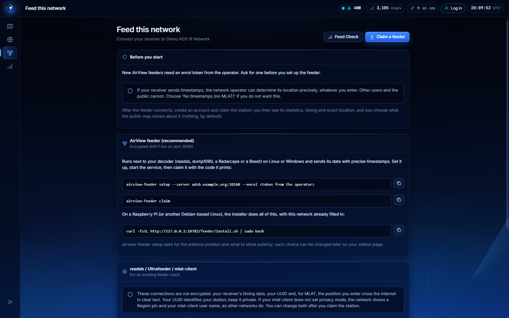

The **Feed this network** page is public. It shows the commands and configuration lines with your host name (`aggregator.publicHost`) and open ports filled in, the timestamp notice, and for readsb / Ultrafeeder users the Beast and mlat-client lines. The installer served at `https://<your host>/feeder/install.sh` has your server address and AVF/1 key pin built in. In version 1.0.0 the page's `airview-feeder setup --server ...` line carries no `--pin`: with the default self-signed certificate an owner who follows it must add `--pin sha256/...` (or use the installer).

---

## 3.2.18 Troubleshooting

| Symptom | Likely cause and fix |
|---|---|
| Service exits at once; the journal shows a configuration error with file:line:col | Fix the operator file; check with `sudo airview config check`. |
| Feeders cannot connect; `/healthz` shows `closed until the admin exists` | No admin yet (3.2.2). |
| Every native feeder fails the TLS handshake | Port 30160 is behind a TLS-terminating proxy, or the certificate changed and feeders still pin the old one. |
| Some native feeders on one host are refused | The per-IP limits (16 connections, 8 stations per IP). Add the host to `aggregator.limits.allowCidrs` if that is legitimate. |
| Logins are lost at once, or every change fails with 403 | The proxy does not send `X-Forwarded-Proto: https` from an address in `aggregator.trustedProxies`. |
| All visitors appear to come from 127.0.0.1 | `aggregator.trustedProxies` does not list the proxy. |
| The live map does not update through nginx | Missing `proxy_buffering off` for the event stream. |
| A Beast feeder shows as "unidentified" | It sends no UUID; the owner must set one in readsb / Ultrafeeder. |
| A readsb feeder stays pending | Admission `invite` or `approve`: approve it in Stations. |
| A native feeder is refused as "cloned feeder" | The same identity key is connected from two places (a copied SD card). The owner runs `airview-feeder new-identity` on the copy. |
| A station is marked suspect | Its declared position disagrees with the survey by more than max(100 m, 3σ). The owner should check coordinates, altitude unit and MSL vs ellipsoid. |
| A station connects but never syncs for MLAT | No timestamps, clock class `none`, no other synced station in common view, or still in timing quarantine. See its row in MLAT → Stations. |
| `stations.db schema version ... is newer than this program` | An older binary was started after an upgrade: reinstall the newer one or restore the pre-upgrade backup. |

---

## 3.2.19 Command reference

| Command | Purpose |
|---|---|
| `airview serve` / `airview -headless` `[-data dir] [-config file] [-set path=value]...` | run the server |
| `airview config check [-json] [-q] [-no-config] [-no-env]` | validate every configuration layer |
| `airview config print [-sources] [-json]` | effective configuration, secrets redacted |
| `airview config example [-o file]` | commented reference of every setting |
| `airview config env` | every `AIRVIEW_*` variable |
| `airview admin init` / `admin reset` `[-user name]` | create the first admin / break-glass reset |
| `airview backup [-o file.zip] [-tmp dir]` | consistent online backup (ZIP) |
| `airview restore [-force] file.zip` | restore a ZIP backup (server stopped) |
| `airview db snapshot -o dir` | consistent database copies, online |
| `airview federation id` | this network's federation identity |
| `airview update [-check] [-status] ...` | check for and install a signed release |
| `curl -fsS http://127.0.0.1:8080/healthz` | health endpoint (3.2.14) |
| `airview version [-json]` | version, platform and Go version |
| `sudo airview backup / restore / upgrade / uninstall / status / logs` | server-kit wrapper: the kit's scripts and systemd |
