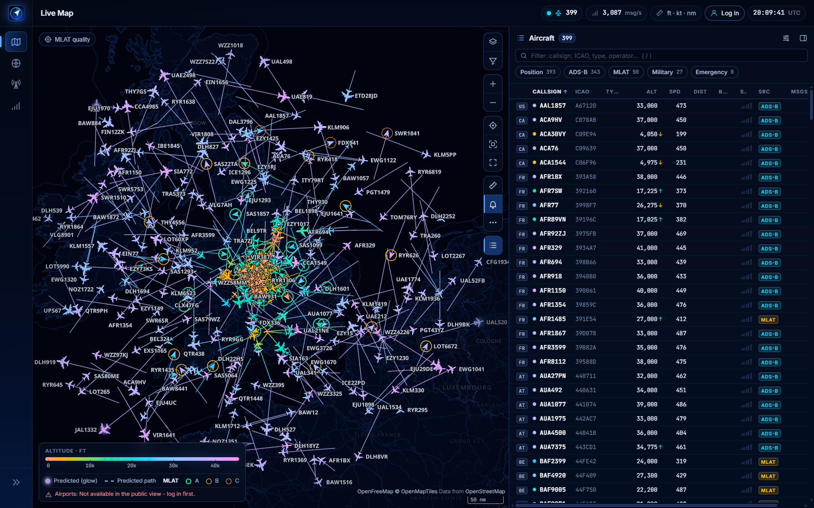
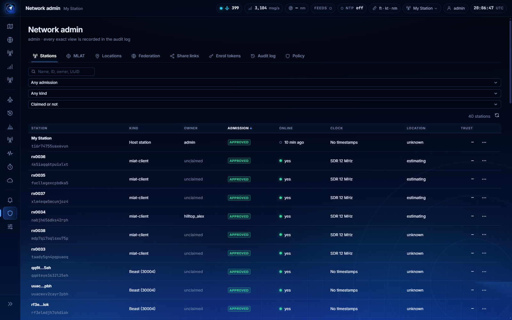

# 3. AirView Network

AirView can run as a **network aggregator**: one server that many receivers ("feeders") connect to. The aggregator merges their data into one live map, works out the position of aircraft that do not broadcast it themselves (multilateration, MLAT), keeps statistics per station, and lets each feeder owner see the data of their own station.

This chapter has four parts:

| Part | For | File |
|---|---|---|
| 3.1 Overview, roles and the privacy model (this page) | everyone | `03-network.md` |
| 3.2 Running an aggregator | the network operator | [03-network-operator.md](03-network-operator.md) |
| 3.3 Feeding a network | feeder owners | [03-network-feeder.md](03-network-feeder.md) |
| 3.4 MLAT explained, with measured accuracy | everyone who wants to know how good the positions are | [03-network-mlat.md](03-network-mlat.md) |

The screenshots in this chapter come from a demonstration network: an AirView 1.0.0 aggregator fed by 38 simulated receivers (24 native AirView feeders, 8 readsb-style Beast feeders and 6 mlat-clients) and 400 simulated aircraft over central England, plus one real `airview-feeder` (station `kestrel_hill`) reading a simulated GPS Radarcape. Station names such as `rx11` are generated by the simulator; the owner account `hilltop_alex` is invented.



---

## 3.1.1 How a network fits together

```
 feeders (Pi, Windows, AirView stations)          aggregator (Linux VPS)
 ---------------------------------------          --------------------------------------------
 airview-feeder / AirView "Uplinks"  --AVF/1 TLS-->  :30160 ┐
 readsb  beast_reduce_plus_out       --Beast------>  :30004 ├─ airview  (mode "aggregator")
 mlat-client                         --mlat v3---->  :31090 ┘    data: /var/lib/airview
                                                                  config: /etc/airview/airview.jsonc
 browsers  --HTTPS 443-->  Caddy / nginx  --HTTP-->  127.0.0.1:8080  (web interface + API)
```

- **AVF/1** (port 30160) is AirView's own feeder protocol. It is encrypted (TLS 1.3), the feeder has a key pair that identifies it across IP address changes, data is buffered during outages, and MLAT results come back over the same link.
- **Beast** (port 30004) and **mlat-client** (port 31090) are the protocols that readsb, Ultrafeeder and mlat-client already speak, so existing feeder setups can join without new software. These links are **not encrypted**.
- The **web interface** runs on a local port behind a reverse proxy that provides HTTPS.

The aggregator is the same `airview` program as the desktop and Raspberry Pi station, started with `"mode": "aggregator"`. On Linux it is one static binary without a graphical interface.

### Stations

A **station** is one receiver clock. A Radarcape with two channels is one station; a Raspberry Pi with both an RTL-SDR dongle and a Radarcape is two stations. Each station has a short ID (for example `m6tt3ehr4sk4qwpq`), a kind (`AirView feeder`, `Beast`, `mlat-client`, or the aggregator's own `host` receiver), an admission state and, once claimed, an owner.

| Admission state | Meaning |
|---|---|
| `approved` | Its data reaches the map, the statistics and MLAT. |
| `pending` | Connected but held: nothing of its data is used until the operator approves it. |
| `denied` / `revoked` | Refused. A revoked native feeder key can no longer connect. |

---

## 3.1.2 Roles

| Role | Who | Signs in with | Sees |
|---|---|---|---|
| **Public** | anyone | nothing | the merged live map, the public network page, opted-in station pins and statistics, the "Feed this network" and "Feed Check" pages |
| **Owner** | a feeder owner who has claimed one or more stations | user name and password (8 characters or more), optional authenticator code (TOTP); no e-mail address is asked for | everything about their own stations: exact position, range, coverage, timing, MLAT contribution, connection history |
| **Admin** | the operator and trusted co-operators | user name, password (12 characters or more) **and** an authenticator code (mandatory) | everything, including every station's exact position and current IP address; every exact view is written to the audit log |

An owner's sidebar adds **My stations**. An admin's sidebar also shows **Network admin**, **Settings**, alerts and the single-station pages of the aggregator's own receiver.



---

## 3.1.3 The privacy model

A feeder usually sits at someone's home, so its position is personal data. AirView is built so that the public interface **cannot** reveal where a station is, whatever the operator configures.

**What the public never gets.** The public data types have no fields for station coordinates, distances or bearings to a station, the list of receivers that heard an aircraft, signal levels, IP addresses or raw timestamps. A public page therefore cannot leak them by accident, and the operator cannot switch them on. The code checks this with "golden" privacy tests that scan every public response for station coordinates, IP addresses and forbidden field names.

**What owners choose.** For each station the owner decides what the public map shows:

| Pin level | What the public sees |
|---|---|
| `hidden` (default) | No pin at all. |
| `region` | A point placed at random inside the 0.5° cell (about 55 × 35 km in the UK) around the station. It is computed once and does not move unless the station moves to another cell. |
| `cell01` | The same inside a 0.1° cell (about 11 × 7 km). Where fewer than 3 located, approved stations share the surrounding 1° cell, the pin is shown as `region` instead, so a lone rural station cannot be narrowed down. |

The station name and its public statistics (message rate, uptime, aircraft per day, figures that do not reveal a location) are shown only if the owner switches them on. All of this can be changed at any time on the station's **Privacy & data** tab, which also shows a preview of exactly what the public sees.

**What other feeders see.** In the timing (sync) view an owner sees the stations their receiver synchronises with only as an anonymous tag that changes every week and differs for every viewer, plus a distance band (`< 50 km`, `50–150 km`, `> 150 km`) and the timing quality. Never a name, position or bearing.

**What the operator sees, and the audit log.** The admin sees every station's exact position, its current IP address while connected, and the receivers that heard each aircraft. Every view of exact data (station detail, revealing a position, the station list itself) is written to the audit log with the admin's name and the time. Owners find the audit entries about their stations in their data export.

**Timestamps reveal location to the operator.** A receiver that sends precise timestamps can be located by the network from its timing (section 3.4), whatever position its owner enters. Every place where a feeder is installed or claimed shows this notice:

> "If your receiver sends timestamps, the network operator can determine its location precisely, whatever you enter. Other users and the public cannot. Choose 'No timestamps (no MLAT)' if you do not want this."

An owner who does not want this switches the feeder to **No timestamps**; the station then still feeds the map but does not take part in MLAT.

**IP addresses.** In aggregator mode AirView never stores raw IP addresses. The connection log keeps them only as a hash with a daily salt (shown as "Address" in the owner's connection table), and logs show networks (`/24`, IPv6 `/48`), not addresses. The current address of a connected station is held in memory only and shown to its owner and the admin. The reverse proxy's access log is the one place where addresses persist; the operator guide (3.2) explains how to keep it short.

**Coverage-island guard.** Optionally (`aggregator.islandGuard`, off by default) the aggregator coarsens low-flying aircraft that only hidden-pin stations hear, because a cluster of such aircraft could otherwise outline a single station's coverage.

**Unencrypted links.** Beast (30004) and mlat-client (31090) traffic crosses the internet in clear text, including the station's UUID and (for mlat-client) its declared position. Native AirView feeders (AVF/1) are encrypted.

---

## 3.1.4 Choosing how to feed

| You have | Use | Encrypted | MLAT results back | Section |
|---|---|---|---|---|
| A Raspberry Pi or other Linux computer with readsb / dump1090 or a Radarcape | `airview-feeder` (installer script or SD-card image) | yes | yes | 3.3.4 |
| A Windows PC connected to a receiver | AirView Feeder for Windows | yes | yes | 3.3.5 |
| AirView already running as your station | its **Uplinks** setting | yes | yes | 3.3.6 |
| An RTL-SDR dongle and no decoder | `airview-feeder` or AirView reading `rtl_tcp` | yes | yes | 3.3.7 |
| readsb / Ultrafeeder / adsb.im that you want to keep as it is | two configuration lines | no | through mlat-client | 3.3.8 |

## 3.1.5 Glossary

| Term | Meaning |
|---|---|
| Aggregator | The AirView server a network's feeders connect to. |
| Feeder | A program (or an AirView station) that sends one or more receivers' data to an aggregator. |
| Station | One receiver clock registered at the aggregator. |
| Enrol token | A one-time secret from the operator that lets a new native feeder join an invite-only network. |
| Claim code | An 8-character code a feeder fetches from the aggregator; entering it links the station to an owner account. |
| MLAT | Multilateration: locating an aircraft from the differences in the times at which several receivers heard the same transmission. |
| Anchor | A station with a GPS-disciplined clock (for example a Radarcape with GPS), which ties network time to UTC. |
| Survey | The network measuring a station's own position from its timing ("reverse MLAT"). |
| Hold-out | 10 % of ADS-B aircraft that the network solves as if they had no ADS-B, to measure its own MLAT accuracy. |
| σ (sigma) | The one-standard-deviation uncertainty of a position or clock estimate. |
| P50 / P95 | Median and 95th-percentile error: half of the values are smaller than P50, 95 % are smaller than P95. |
