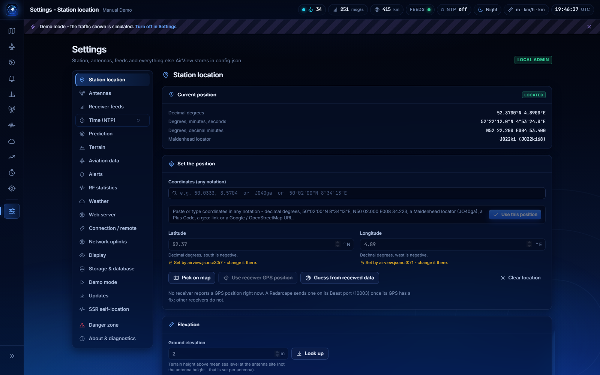
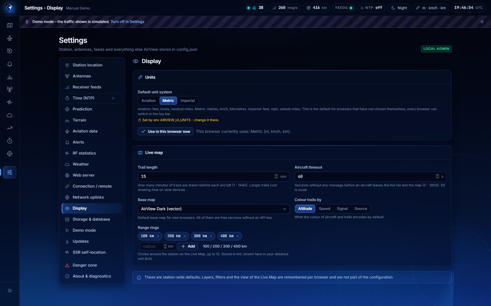

# 4.1 Configuration reference

Every AirView setting can be set without the web interface: in a configuration file, through an environment variable or on the command line. This is how you run AirView on a headless Linux server, in Docker or from configuration management, and it is the only reference that lists **every** setting.

The chapter has two parts:

- [4.1.1 – 4.1.9](#411-where-settings-come-from) the AirView program (`airview`: desktop station, headless station and network aggregator);
- [4.1.10](#4110-airview-feeder-feederjson) the feeder program (`airview-feeder`) and the Raspberry Pi image's `feeder-setup.txt`.

The setting tables in 4.1.9 are generated from the same source as `airview config example` and `airview config env` (AirView 1.0.0). When in doubt, the program on your machine is the authority: `airview config env` lists every variable of *that* build.

---

## 4.1.1 Where settings come from

The effective configuration is assembled from five layers. A later layer overrides an earlier one, setting by setting:

| # | Layer | Written by | Notes |
|---|---|---|---|
| 1 | Built-in defaults | – | The *Default* column of the tables below. |
| 2 | `config.json` in the data directory | AirView itself | The Settings page of the web interface saves here. Plain JSON; comments are tolerated but removed on the next save. |
| 3 | The **operator file** (JSON with comments) | you | Read only, never written. Taken from `-config <file>`, else `$AIRVIEW_CONFIG`, else `airview.jsonc` in the data directory when that file exists. List only the settings you want to pin. Typical location on a Linux server: `/etc/airview/airview.jsonc`. |
| 4 | Environment variables `AIRVIEW_*` | you | One variable per setting (4.1.3). |
| 5 | Command-line overrides `-set path=value` | you | Repeatable, e.g. `-set http.port=8080`. The older `-port` and `-demo` flags keep working. |

Settings from layers 3–5 are **locked**: they are in force and visible in the web interface, but saving in the interface never writes them to `config.json`. Each locked field carries a padlock and names its origin ("Set by airview.jsonc:3:57 – change it there", "Set by env AIRVIEW_UI_UNITS"). Remove the override and the `config.json` value applies again. A secret given this way therefore never ends up on disk.



*Figure 4.1 – Latitude and longitude set in the operator file `airview.jsonc` (line 3) are shown read-only, with the file position that sets them.*



*Figure 4.2 – The default unit system set by the environment variable `AIRVIEW_UI_UNITS=metric`.*

### Data directory

The data directory holds `config.json`, the databases, the logs and the station identity. It is `-data <dir>` or `$AIRVIEW_DATA`; without either it is `data` next to the executable when that folder is writable, otherwise the per-user configuration directory (`%AppData%\AirView` on Windows, `~/.config/AirView` on Linux). The Linux server and Raspberry Pi installers use `/var/lib/airview`.

---

## 4.1.2 File format of the operator file

- JSON plus `//` line comments, `/* */` block comments and trailing commas.
- Names are case-sensitive and are the names shown in the tables (`http.port` is `{"http": {"port": ...}}`).
- Unknown names, wrong value types and duplicate names are **errors** that `airview config check` reports with file, line and column (it also suggests the name you probably meant).
- Values outside their allowed range are corrected when AirView starts (the correction is logged) and are reported by `airview config check`.
- Lists (`antennas`, `feeds`, `uplinks`, `ui.rangeRingsKm`, …) are replaced as a whole: a list in the operator file replaces the list from `config.json`.
- An operator file named explicitly (`-config` or `AIRVIEW_CONFIG`) that is missing or invalid stops the start; the error names file, line and column.

A minimal operator file for an aggregator:

```jsonc
// /etc/airview/airview.jsonc
{
  "mode": "aggregator",
  "http": { "port": 8080, "bindAddr": "127.0.0.1" },
  "aggregator": {
    "name": "Example Network",
    "publicHost": "feed.example.org",
    "trustedProxies": ["127.0.0.1"],   // the reverse proxy on this host
  },
}
```

`airview config example -o airview.example.jsonc` writes a fully commented file with every setting at its default; copy the parts you need.

---

## 4.1.3 Environment variables

The variable name is `AIRVIEW_` followed by the setting path in upper-case snake case, with `_` between the levels:

| Setting | Variable |
|---|---|
| `http.port` | `AIRVIEW_HTTP_PORT` |
| `aggregator.limits.maxStations` | `AIRVIEW_AGGREGATOR_LIMITS_MAX_STATIONS` |
| `uplinks[0].enrolToken` | `AIRVIEW_UPLINKS_0_ENROL_TOKEN` |

Value syntax:

- **Booleans:** `true`/`false` (also `1`/`0`, `yes`/`no`, `on`/`off`).
- **Lists of numbers or strings:** comma separated (`AIRVIEW_UI_RANGE_RINGS_KM=50,100,200`) or JSON (`[50,100,200]`); an empty value is an empty list.
- **Lists of objects:** the whole list as JSON (`AIRVIEW_UPLINKS='[{"id":"club","host":"agg.example.org"}]'`), one element as JSON (`AIRVIEW_UPLINKS_0='{...}'`) or one field of one element (`AIRVIEW_UPLINKS_0_ENROL_TOKEN=...`). Elements are numbered from 0; using the next free number adds an element.
- **`_FILE` suffix:** any variable can be suffixed `_FILE` to read the value from a file (Docker and systemd secrets), e.g. `AIRVIEW_HUB_PASSWORD_FILE=/run/secrets/hub`. One trailing newline is removed.
- Unknown `AIRVIEW_*` variables are ignored with a warning (`airview config check` lists them).

### Variables that are not settings

| Variable | Program | Meaning |
|---|---|---|
| `AIRVIEW_CONFIG` | airview | Operator file, like `-config`. Also honoured by airview-feeder when `AIRVIEW_FEEDER_CONFIG` is not set. |
| `AIRVIEW_DATA` | airview | Data directory, like `-data`. Also honoured by airview-feeder when `AIRVIEW_FEEDER_DATA` is not set. |
| `AIRVIEW_LISTEN_HOST` | airview | Aggregator mode: address the feeder listeners (AVF, Beast, mlat-client) bind to, like `-listen-host`. Takes precedence over `aggregator.listenAddr`. |
| `AIRVIEW_DEBUG` | airview | `1` or `true` forces debug logging (overrides `process.logLevel`); in the Windows desktop window it also enables the context menu and the developer tools (F12). |
| `AIRVIEW_TILECACHE_MB` | airview | Disk cap of the map tile cache in MB (16 … 1048576; default 512). Least recently used tiles are removed above it. |
| `AIRVIEW_GENERATE_ADMIN_PASSWORD` | airview | `1`/`true`: a headless *standalone* server without an admin password generates one on its first start, stores it hashed in `config.json` and in plain text in `<data>/admin-password.txt` (readable by the service account only) and logs that file's path. The Docker image sets it. |
| `AIRVIEW_REMOTE` | airview | `1`/`true` allows the `remote-data` mode in a headless (non-desktop) build. |
| `AIRVIEW_FEEDER_CONFIG`, `AIRVIEW_FEEDER_DATA` | airview-feeder | Configuration file and data directory, like `-config` and `-data`. |
| `AIRVIEW_FEEDER_LOG_DIR`, `AIRVIEW_FEEDER_LOG_MAX_MB`, `AIRVIEW_FEEDER_LOG_KEEP` | airview-feeder (Windows) | Log folder (default `<data>\logs`), rotation size (default 10 MB) and number of old files kept (default 5) of the Windows service and the tray-hosted feeder. |
| `AIRVIEW_FEEDER_UPDATER` | airview-feeder | Set to `external` by the Raspberry Pi installer's service unit: updates are installed by the installer's daily timer, not by the feeder process. |
| `AIRVIEW_HEALTHCHECK_URL` | airview-healthcheck | URL probed by the container health check (default `http://127.0.0.1:$AIRVIEW_HTTP_PORT/healthz`). |
| `GOMEMLIMIT` | airview | Standard Go soft memory limit; wins over `process.memoryLimitMb`. |

Other `AIRVIEW_*` names that appear in the source code (`AIRVIEW_LIVE_TESTS`, `AIRVIEW_GROWTH`, `AIRVIEW_SETUP_FOLDER_*`, …) are switches of the developers' test suites and have no effect on a normal installation.

---

## 4.1.4 Configuration commands

| Command | What it does |
|---|---|
| `airview config check [-data dir] [-config file] [-set p=v]... [-no-config] [-no-env] [-json] [-q]` | Loads every layer without changing anything and reports syntax errors, unknown settings, wrong types and out-of-range values with their location. Exit status 0 = valid (warnings allowed), 1 = errors, 2 = usage error. |
| `airview config print [-data dir] [-config file] [-sources] [-json]` | Prints the effective configuration with secrets redacted. `-sources` adds a comment with the origin (file:line:col, `env NAME`, `-set`) above every overridden setting. |
| `airview config example [-o file]` | Writes the fully commented example file (every setting at its default). `-o` refuses to overwrite an existing file. |
| `airview config env [-json]` | Lists every environment variable with its setting and type. |

Example of a check that finds two mistakes:

```text
$ airview config check -config bad.jsonc
error: bad.jsonc:1:21: http.port: expected an integer, found a string (remove the quotes)
error: bad.jsonc:1:29: recevier: unknown setting (did you mean "receiver"?)
configuration has errors: 2 error(s), 0 warning(s) [.../config.json, bad.jsonc]
```

Run `airview config check` after every change to the operator file and before every upgrade (the new binary may know new settings or new limits). The Linux server's systemd unit runs it before each start, so configuration errors appear in the journal.

---

## 4.1.5 Secrets

These settings are secrets: the API and `airview config print` show only `"set"` or `""`:

| Setting | Notes |
|---|---|
| `http.adminPasswordHash` | Stored as `sha256:<salt>:<hash>`. In the operator file or the environment you may write `plain:<password>`; it is hashed when loaded and never written to `config.json`. |
| `hub.password` | Shared secret of the hub data port. |
| `remote.password` | The hub password the desktop app uses in remote-data mode. |
| `uplinks[].enrolToken` | Enrol token for an invite-only aggregator. |
| `aggregator.outputToken` | Protects the merged Beast/SBS outputs. |
| `aggregator.tlsKey` | Private key of the AVF/1 feeder-port certificate. |

Prefer environment variables with the `_FILE` suffix, or an operator file readable only by the service account (`chmod 600`, owner `airview`).

---

## 4.1.6 Ranges and automatic values

Many numeric settings use **0 = automatic / package default**. The description column then gives the value AirView actually uses (for example `process.logMaxMb`: 0 = 4 MiB in standalone mode, 64 MiB in aggregator mode). `airview config print` shows the stored value (0), the log and the API show what is in effect. A value outside the documented range (`a..b`) is replaced by the default when AirView starts and the correction is logged.

---

## 4.1.7 Run modes

`mode` selects what the program does. Blocks that do not apply to the selected mode are kept but have no effect:

| `mode` | What runs | Mode-specific blocks |
|---|---|---|
| `standalone` (default) | Local receiver(s), map and statistics | `receiver`, `antennas`, `feeds`, `hub`, `uplinks` |
| `aggregator` | Multi-station network server | `aggregator` (and its sub-blocks); `hub` is admin login only |
| `remote-data` | Desktop app fed from another AirView's hub port | `remote` |
| `remote-web` | Desktop window showing another AirView's website | `remote` |

`remote-data` needs the desktop window (Windows) or `AIRVIEW_REMOTE=1` on a headless build.

---

## 4.1.8 Typical deployments

**Headless station on a Raspberry Pi** (systemd, data in `/var/lib/airview`):

```ini
# /etc/systemd/system/airview.service.d/override.conf
[Service]
Environment=AIRVIEW_HTTP_PORT=8080
Environment=AIRVIEW_RECEIVER_NAME=Rooftop
Environment=AIRVIEW_FEEDS='[{"id":"readsb","name":"readsb","enabled":true,"type":"beast","host":"127.0.0.1","port":30005}]'
```

**Docker** (secrets as files):

```yaml
environment:
  AIRVIEW_MODE: aggregator
  AIRVIEW_AGGREGATOR_PUBLIC_HOST: feed.example.org
  AIRVIEW_AGGREGATOR_TRUSTED_PROXIES: 172.18.0.1
  AIRVIEW_AGGREGATOR_OUTPUT_TOKEN_FILE: /run/secrets/output_token
```

**One-off override** while testing: `airview serve -data ./testdata -set http.port=18080 -set demo.enabled=true`.

---

## 4.1.9 All settings of `airview`

Columns: **Setting** is the path in the operator file; **Type** is the JSON type; **Default** is the built-in default (`–` for fields of list elements, which have no default of their own); **Environment variable** is the `AIRVIEW_*` name (`<n>` = list index from 0).

<!-- BEGIN GENERATED: settings (from docs/CONFIG.md, AirView 1.0.0) -->

### General

| Setting | Type | Default | Environment variable | Description |
|---|---|---|---|---|
| `mode` | string | `"standalone"` | `AIRVIEW_MODE` | Run mode: "standalone" (local receiver, map and statistics), "aggregator" (multi-station network server, see the aggregator section), "remote-data" (desktop app fed from another AirView's hub port) or "remote-web" (desktop window showing another AirView's website). |

### Web server (`http`)

Configures the built-in web server.

| Setting | Type | Default | Environment variable | Description |
|---|---|---|---|---|
| `http.port` | integer | `80` | `AIRVIEW_HTTP_PORT` | Default 80; if busy the server falls back to 8080, 8081.. then an ephemeral port. |
| `http.bindAddr` | string | `""` | `AIRVIEW_HTTP_BIND_ADDR` | bindAddr "" = all interfaces. "127.0.0.1" = local only. |
| `http.adminPasswordHash` | string | `""` (secret) | `AIRVIEW_HTTP_ADMIN_PASSWORD_HASH` | Admin password protecting settings changes from other computers. Stored as "sha256:<salt>:<hash>". In the operator file or AIRVIEW_HTTP_ADMIN_PASSWORD_HASH you may give "plain:<password>" instead; it is hashed when loaded and never written to config.json. "" = no password (changes allowed from everywhere). |
| `http.tileCache` | boolean | `true` | `AIRVIEW_HTTP_TILE_CACHE` | Cache map tiles on disk via /tilecache/. |
| `http.allowInsecureLogin` | boolean | `false` | `AIRVIEW_HTTP_ALLOW_INSECURE_LOGIN` | allowInsecureLogin (aggregator mode) accepts passwords, TOTP codes and the setup token from remote clients over plain HTTP. Off by default: credentials are accepted only over HTTPS (a trusted reverse proxy that sets X-Forwarded-Proto) or from the machine itself. |
| `http.allowOpenAdmin` | boolean | `false` | `AIRVIEW_HTTP_ALLOW_OPEN_ADMIN` | allowOpenAdmin (standalone mode, no admin password) makes every client admin, also those outside the private networks. Off by default: without a password only this machine and private-network (RFC 1918, IPv6 ULA, link-local) clients are admin. |
| `http.sseGzipMax` | integer | `0` | `AIRVIEW_HTTP_SSE_GZIP_MAX` | sseGzipMax caps the live streams (/api/live) that are gzip-compressed at once; each holds a compressor of about 800 KiB (0..100000; 0 = automatic: 12 in standalone mode, every stream in aggregator mode). Streams above the cap are sent uncompressed. |

### Receiver (`receiver`)

Describes the receiving station.

| Setting | Type | Default | Environment variable | Description |
|---|---|---|---|---|
| `receiver.name` | string | `"My Station"` | `AIRVIEW_RECEIVER_NAME` | Display name of this station. |
| `receiver.model` | string | `"Radarcape EVO 2CH"` | `AIRVIEW_RECEIVER_MODEL` | E.g. "Radarcape EVO 2CH". |
| `receiver.located` | boolean | `false` | `AIRVIEW_RECEIVER_LOCATED` | False until the user (or the guesser) sets coordinates. |
| `receiver.lat` | number | `0` | `AIRVIEW_RECEIVER_LAT` | Latitude in WGS84 degrees (north positive). |
| `receiver.lon` | number | `0` | `AIRVIEW_RECEIVER_LON` | Longitude in WGS84 degrees (east positive). |
| `receiver.groundElevM` | number | `0` | `AIRVIEW_RECEIVER_GROUND_ELEV_M` | groundElevM is the terrain elevation at the site, metres above mean sea level. |

### Antennas (`antennas[]`)

The physical antennas and their RF chains (at most 16).

Describes one physical antenna and its RF chain.

Environment: `AIRVIEW_ANTENNAS` (whole list as JSON), `AIRVIEW_ANTENNAS_<n>` (one element as JSON), `AIRVIEW_ANTENNAS_<n>_<FIELD>` (one field). Each element has these fields:

| Setting | Type | Default | Environment variable | Description |
|---|---|---|---|---|
| `antennas[].id` | string | – | `AIRVIEW_ANTENNAS_<n>_ID` | Stable slug, unique. |
| `antennas[].name` | string | – | `AIRVIEW_ANTENNAS_<n>_NAME` | Display name of the antenna. |
| `antennas[].type` | string | – | `AIRVIEW_ANTENNAS_<n>_TYPE` | Ant* constants. |
| `antennas[].channel` | integer | – | `AIRVIEW_ANTENNAS_<n>_CHANNEL` | Receiver RF channel index this antenna is plugged into (0-based), -1 = n/a. |
| `antennas[].gainDbi` | number | – | `AIRVIEW_ANTENNAS_<n>_GAIN_DBI` | Peak gain. |
| `antennas[].heightAglM` | number | – | `AIRVIEW_ANTENNAS_<n>_HEIGHT_AGL_M` | Feed-point height above ground, metres. |
| `antennas[].azimuthDeg` | number | – | `AIRVIEW_ANTENNAS_<n>_AZIMUTH_DEG` | Directional parameters (yagi/patch). Azimuth is the boresight in degrees true. |
| `antennas[].tiltDeg` | number | – | `AIRVIEW_ANTENNAS_<n>_TILT_DEG` | Boresight elevation above horizon. |
| `antennas[].hBeamwidthDeg` | number | – | `AIRVIEW_ANTENNAS_<n>_H_BEAMWIDTH_DEG` | -3 dB horizontal beamwidth. |
| `antennas[].vBeamwidthDeg` | number | – | `AIRVIEW_ANTENNAS_<n>_V_BEAMWIDTH_DEG` | -3 dB vertical beamwidth. |
| `antennas[].frontToBackDb` | number | – | `AIRVIEW_ANTENNAS_<n>_FRONT_TO_BACK_DB` | Front-to-back ratio of a directional antenna in dB. |
| `antennas[].elements` | integer | – | `AIRVIEW_ANTENNAS_<n>_ELEMENTS` | Yagi element count (informational / used to estimate beamwidth when 0) |
| `antennas[].polarization` | string | – | `AIRVIEW_ANTENNAS_<n>_POLARIZATION` | "vertical" (ADS-B) \| "horizontal". |
| `antennas[].cableLossDb` | number | – | `AIRVIEW_ANTENNAS_<n>_CABLE_LOSS_DB` | Feedline loss before the first amplifier. |
| `antennas[].lnaGainDb` | number | – | `AIRVIEW_ANTENNAS_<n>_LNA_GAIN_DB` | Gain of the low-noise amplifier in dB (0 = none). |
| `antennas[].lnaNoiseFigDb` | number | – | `AIRVIEW_ANTENNAS_<n>_LNA_NOISE_FIG_DB` | Noise figure of the low-noise amplifier in dB. |
| `antennas[].filterLossDb` | number | – | `AIRVIEW_ANTENNAS_<n>_FILTER_LOSS_DB` | Insertion loss of filters before the first amplifier in dB. |
| `antennas[].notes` | string | – | `AIRVIEW_ANTENNAS_<n>_NOTES` | Free-text notes. |
| `antennas[].color` | string | – | `AIRVIEW_ANTENNAS_<n>_COLOR` | UI colour for this antenna's overlays (hex) |

### Feeds (`feeds[]`)

The data inputs (at most 32).

This is one data input.

Environment: `AIRVIEW_FEEDS` (whole list as JSON), `AIRVIEW_FEEDS_<n>` (one element as JSON), `AIRVIEW_FEEDS_<n>_<FIELD>` (one field). Each element has these fields:

| Setting | Type | Default | Environment variable | Description |
|---|---|---|---|---|
| `feeds[].id` | string | – | `AIRVIEW_FEEDS_<n>_ID` | Stable slug, unique. |
| `feeds[].name` | string | – | `AIRVIEW_FEEDS_<n>_NAME` | Display name of the feed. |
| `feeds[].enabled` | boolean | – | `AIRVIEW_FEEDS_<n>_ENABLED` | Connect this feed (false keeps the entry without using it). |
| `feeds[].type` | string | – | `AIRVIEW_FEEDS_<n>_TYPE` | Protocol: "beast", "avr", "sbs", "json" (HTTP polling of aircraft.json), "hub" (another AirView) or "demo" (simulator). |
| `feeds[].host` | string | – | `AIRVIEW_FEEDS_<n>_HOST` | Host name or IP address of the data source (Beast/AVR/SBS/hub feeds). |
| `feeds[].port` | integer | – | `AIRVIEW_FEEDS_<n>_PORT` | TCP port of the data source; 0 = the usual port of the feed type (Beast 10003, AVR 10002, SBS 30003, hub 30154). |
| `feeds[].url` | string | – | `AIRVIEW_FEEDS_<n>_URL` | For FeedJSON. |
| `feeds[].antennaId` | string | – | `AIRVIEW_FEEDS_<n>_ANTENNA_ID` | antennaId is the antenna this feed's frames are attributed to when the protocol does not carry a channel number. "" = unknown/combined. |
| `feeds[].mlatOnly` | boolean | – | `AIRVIEW_FEEDS_<n>_MLAT_ONLY` | mlatOnly marks a feed that only carries MLAT results. |
| `feeds[].notes` | string | – | `AIRVIEW_FEEDS_<n>_NOTES` | Free-text notes. |
| `feeds[].noForward` | boolean | – | `AIRVIEW_FEEDS_<n>_NO_FORWARD` | noForward keeps this feed's data off every uplink (DESIGN §1). Feeds with MLATOnly are never forwarded regardless of this flag. |
| `feeds[].clockClass` | string | – | `AIRVIEW_FEEDS_<n>_CLOCK_CLASS` | Overrides the detected receiver clock class sent on uplinks ("" = detect). One of "none", "gps_utc", "gps_gpst", "gps_emul", "hw12", "sdr12", "sdr12_hires", "sbs20". |

#### `feeds[].sdr`

Tunes an rtltcp feed (Feed.SDR). Zero = default.

| Setting | Type | Default | Environment variable | Description |
|---|---|---|---|---|
| `feeds[].sdr.gain` | string | – | `AIRVIEW_FEEDS_<n>_SDR_GAIN` | gain is "max" (default: the highest manual gain step), "auto" (the tuner's AGC, not recommended for Mode S) or a manual gain in dB such as "40.2". |
| `feeds[].sdr.ppm` | integer | – | `AIRVIEW_FEEDS_<n>_SDR_PPM` | ppm is the oscillator frequency correction (-500..500). |
| `feeds[].sdr.biasTee` | boolean | – | `AIRVIEW_FEEDS_<n>_SDR_BIAS_TEE` | biasTee switches on the antenna supply of dongles that have one. |
| `feeds[].sdr.sampleRate` | integer | – | `AIRVIEW_FEEDS_<n>_SDR_SAMPLE_RATE` | sampleRate is the complex sample rate in samples per second (default 2400000, 2000000..3200000). |
| `feeds[].sdr.spawn` | boolean | – | `AIRVIEW_FEEDS_<n>_SDR_SPAWN` | spawn starts the user's own rtl_tcp as a child process (found on PATH or next to the program, or at RTLTCPPath). AirView never ships or downloads rtl_tcp. |
| `feeds[].sdr.rtltcpPath` | string | – | `AIRVIEW_FEEDS_<n>_SDR_RTLTCP_PATH` | rtltcpPath is the rtl_tcp executable for Spawn ("" = search). |
| `feeds[].sdr.device` | integer | – | `AIRVIEW_FEEDS_<n>_SDR_DEVICE` | device is the dongle index passed to a spawned rtl_tcp (0..31). |
| `feeds[].sdr.acceptUnverifiedAp` | boolean | – | `AIRVIEW_FEEDS_<n>_SDR_ACCEPT_UNVERIFIED_AP` | acceptUnverifiedAp passes address/parity replies whose address was not confirmed by a recent all-call or ADS-B message (default false). |

### NTP reference (`ntp`)

Configures the SNTP reference used for timing analysis.

| Setting | Type | Default | Environment variable | Description |
|---|---|---|---|---|
| `ntp.enabled` | boolean | `false` | `AIRVIEW_NTP_ENABLED` | Sample an NTP server to measure the host clock offset (timing analysis). |
| `ntp.server` | string | `""` | `AIRVIEW_NTP_SERVER` | Host or host:port; "" = disabled. |
| `ntp.intervalSec` | integer | `64` | `AIRVIEW_NTP_INTERVAL_SEC` | Sampling interval, default 64. |

### Weather (`weather`)

Configures free weather data ingestion (Open-Meteo, no API key).

| Setting | Type | Default | Environment variable | Description |
|---|---|---|---|---|
| `weather.enabled` | boolean | `true` | `AIRVIEW_WEATHER_ENABLED` | Download free weather data (Open-Meteo, no API key) for the station location. |
| `weather.intervalMin` | integer | `15` | `AIRVIEW_WEATHER_INTERVAL_MIN` | Refresh period, default 15. |
| `weather.radarOverlay` | boolean | `false` | `AIRVIEW_WEATHER_RADAR_OVERLAY` | RainViewer precipitation radar layer on the map. |

### Hub data port (`hub`)

Configures the data port that other AirView instances log in to.

| Setting | Type | Default | Environment variable | Description |
|---|---|---|---|---|
| `hub.enabled` | boolean | `false` | `AIRVIEW_HUB_ENABLED` | Open the hub data port that other AirView instances (remote-data mode) log in to. |
| `hub.port` | integer | `30154` | `AIRVIEW_HUB_PORT` | Default 30154. |
| `hub.password` | string | `""` (secret) | `AIRVIEW_HUB_PASSWORD` | Shared secret for the HMAC challenge login; "" = open. |

### Remote modes (`remote`)

This is used by the desktop app in remote-data / remote-web modes.

| Setting | Type | Default | Environment variable | Description |
|---|---|---|---|---|
| `remote.host` | string | `""` | `AIRVIEW_REMOTE_HOST` | AirView host (e.g. the Raspberry Pi) |
| `remote.dataPort` | integer | `30154` | `AIRVIEW_REMOTE_DATA_PORT` | Host's hub port, default 30154. |
| `remote.httpPort` | integer | `80` | `AIRVIEW_REMOTE_HTTP_PORT` | Host's website port, default 80. |
| `remote.password` | string | `""` (secret) | `AIRVIEW_REMOTE_PASSWORD` | Hub password. |
| `remote.useHostReceiver` | boolean | `true` | `AIRVIEW_REMOTE_USE_HOST_RECEIVER` | Adopt the host's receiver/antenna settings. |

### Storage and retention (`storage`)

Controls database retention.

| Setting | Type | Default | Environment variable | Description |
|---|---|---|---|---|
| `storage.trailIntervalSec` | integer | `5` | `AIRVIEW_STORAGE_TRAIL_INTERVAL_SEC` | Min seconds between stored trail points per aircraft (default 5) |
| `storage.trailRetentionDays` | integer | `30` | `AIRVIEW_STORAGE_TRAIL_RETENTION_DAYS` | Stored position trails (default 30) |
| `storage.flightRetentionDays` | integer | `730` | `AIRVIEW_STORAGE_FLIGHT_RETENTION_DAYS` | Flight/session rows (default 730, 0 = forever) |
| `storage.minuteRetentionDays` | integer | `90` | `AIRVIEW_STORAGE_MINUTE_RETENTION_DAYS` | Per-minute stats (default 90); hourly/daily rollups are kept forever. |

### User interface defaults (`ui`)

Holds shared UI defaults (per-browser preferences live in localStorage).

| Setting | Type | Default | Environment variable | Description |
|---|---|---|---|---|
| `ui.units` | string | `"aviation"` | `AIRVIEW_UI_UNITS` | "aviation" (ft/kt/nm) \| "metric" \| "imperial". |
| `ui.trailMinutes` | integer | `15` | `AIRVIEW_UI_TRAIL_MINUTES` | Live map trail length, default 15. |
| `ui.rangeRingsKm` | list of integers | `[100,200,300,400]` | `AIRVIEW_UI_RANGE_RINGS_KM` | E.g. [100,200,300,400]. |
| `ui.aircraftTtlS` | integer | `60` | `AIRVIEW_UI_AIRCRAFT_TTL_S` | Seconds until a silent aircraft leaves the live list (default 60) |
| `ui.mapStyle` | string | `"airview-dark"` | `AIRVIEW_UI_MAP_STYLE` | "airview-dark" default. |
| `ui.colorTrailsBy` | string | `"altitude"` | `AIRVIEW_UI_COLOR_TRAILS_BY` | "altitude" \| "speed" \| "signal" \| "source". |

### Demo traffic (`demo`)

Enables the built-in traffic simulator (no receiver needed).

| Setting | Type | Default | Environment variable | Description |
|---|---|---|---|---|
| `demo.enabled` | boolean | `false` | `AIRVIEW_DEMO_ENABLED` | Feed the built-in traffic simulator instead of (or besides) a receiver. |
| `demo.aircraft` | integer | `60` | `AIRVIEW_DEMO_AIRCRAFT` | Simulated aircraft count, default 60. |

### Trajectory prediction (`prediction`)

Controls the trajectory filter (internal/trajectory): coasting aircraft on the live map and predicted paths.

| Setting | Type | Default | Environment variable | Description |
|---|---|---|---|---|
| `prediction.enabled` | boolean | `true` | `AIRVIEW_PREDICTION_ENABLED` | Run the tracking filter (default true) |
| `prediction.coastSec` | integer | `60` | `AIRVIEW_PREDICTION_COAST_SEC` | coastSec is how long an aircraft without new positions is shown at its predicted position (default 60, 5..120). Predicted positions start PredictAfterSec (4 s) after the last real position. |
| `prediction.pathSec` | integer | `120` | `AIRVIEW_PREDICTION_PATH_SEC` | pathSec is the default horizon of predicted paths (default 120, 10..900). |
| `prediction.showPaths` | boolean | `true` | `AIRVIEW_PREDICTION_SHOW_PATHS` | ShowPaths: the map draws the predicted path of the selected aircraft (default true). |

### Terrain analysis (`terrain`)

Controls the terrain line-of-sight analysis (internal/terrain).

| Setting | Type | Default | Environment variable | Description |
|---|---|---|---|---|
| `terrain.enabled` | boolean | `true` | `AIRVIEW_TERRAIN_ENABLED` | Default true. |
| `terrain.radiusKm` | integer | `450` | `AIRVIEW_TERRAIN_RADIUS_KM` | radiusKm of the analysis around the receiver (default 450, 50..1000). |
| `terrain.zoom` | integer | `0` | `AIRVIEW_TERRAIN_ZOOM` | zoom of the elevation tiles: 0 = automatic (default), else 6..12. |
| `terrain.kFactor` | number | `1.3333333333333333` | `AIRVIEW_TERRAIN_K_FACTOR` | kFactor is the effective earth radius factor for radio line of sight (default 4/3, 0.5..10). |
| `terrain.autoPrefetch` | boolean | `true` | `AIRVIEW_TERRAIN_AUTO_PREFETCH` | autoPrefetch downloads the elevation tiles (AWS Terrain Tiles, about 30-40 MB for 450 km) and runs the analysis automatically once the receiver is located (default true). Off = only on request. |

### Aviation reference data (`navData`)

Controls aviation reference data (internal/navdata). Nothing is downloaded automatically: imports run only on request.

| Setting | Type | Default | Environment variable | Description |
|---|---|---|---|---|
| `navData.airportsOverlay` | boolean | `true` | `AIRVIEW_NAV_DATA_AIRPORTS_OVERLAY` | Airports layer offered on the map (default true) |
| `navData.routesOnline` | boolean | `false` | `AIRVIEW_NAV_DATA_ROUTES_ONLINE` | routesOnline looks unknown callsigns up at adsbdb.com (sends the callsign to a third party; default false). Without it only the imported offline standing data is used. |
| `navData.photos` | boolean | `false` | `AIRVIEW_NAV_DATA_PHOTOS` | photos shows aircraft photos from planespotters.net (sends the ICAO address; default false). Requires PhotoContact. |
| `navData.photoContact` | string | `""` | `AIRVIEW_NAV_DATA_PHOTO_CONTACT` | Contact URL or e-mail sent in the User-Agent (required by planespotters.net) |

### Alerts (`alerts`)

Controls the alert rules engine (internal/alerts).

| Setting | Type | Default | Environment variable | Description |
|---|---|---|---|---|
| `alerts.enabled` | boolean | `true` | `AIRVIEW_ALERTS_ENABLED` | Evaluate rules (default true) |
| `alerts.sound` | boolean | `true` | `AIRVIEW_ALERTS_SOUND` | Alerts may play a sound in the UI (default true) |
| `alerts.webhooks` | boolean | `true` | `AIRVIEW_ALERTS_WEBHOOKS` | webhooks allows rules to POST to their webhook URL (default true; off = no webhook is sent). |

### RF statistics (`rfStat`)

Controls the RF / protocol statistics (internal/rfstat).

| Setting | Type | Default | Environment variable | Description |
|---|---|---|---|---|
| `rfStat.enabled` | boolean | `true` | `AIRVIEW_RF_STAT_ENABLED` | Default true. |

### Uplinks (feeding an aggregator) (`uplinks[]`)

uplinks feed this station to AirView aggregators over AVF/1 (standalone and aggregator modes; omitted from config.json when empty).

This is one connection from this AirView (standalone or aggregator mode) or from airview-feeder to an AirView aggregator over AVF/1. Config.Uplinks / FeederConfig.Uplinks hold them. Missing JSON fields take the DefaultUplink values (see UnmarshalJSON), so a hand-written entry needs only "id" and "host".

Environment: `AIRVIEW_UPLINKS` (whole list as JSON), `AIRVIEW_UPLINKS_<n>` (one element as JSON), `AIRVIEW_UPLINKS_<n>_<FIELD>` (one field). Each element has these fields:

| Setting | Type | Default | Environment variable | Description |
|---|---|---|---|---|
| `uplinks[].id` | string | `""` | `AIRVIEW_UPLINKS_<n>_ID` | id is a stable slug, unique among the uplinks. |
| `uplinks[].host` | string | `""` | `AIRVIEW_UPLINKS_<n>_HOST` | host is the aggregator's host name or IP address. |
| `uplinks[].port` | integer | `30160` | `AIRVIEW_UPLINKS_<n>_PORT` | port is the aggregator's AVF/1 port (default 30160). |
| `uplinks[].serverPin` | string | `""` | `AIRVIEW_UPLINKS_<n>_SERVER_PIN` | serverPin is the expected server key: "sha256/<base64 SHA-256 of the certificate's SubjectPublicKeyInfo>". "" verifies the certificate against the system roots instead. |
| `uplinks[].enrolToken` | string | `""` (secret) | `AIRVIEW_UPLINKS_<n>_ENROL_TOKEN` | enrolToken is the admin-minted enrol token for an "invite" aggregator. It is a secret: config redaction treats it like the hub password. |
| `uplinks[].inputs` | list of strings | `[]` | `AIRVIEW_UPLINKS_<n>_INPUTS` | inputs lists the local feed IDs (Config.Feeds[].ID) forwarded on this uplink. Empty = every enabled feed that delivers timed frames. |
| `uplinks[].sendLocation` | boolean | `true` | `AIRVIEW_UPLINKS_<n>_SEND_LOCATION` | sendLocation sends the receiver position in the RECEIVER record (default true). Off = the aggregator must locate the station itself. |
| `uplinks[].shareGnss` | boolean | `false` | `AIRVIEW_UPLINKS_<n>_SHARE_GNSS` | shareGnss forwards the receiver's own GNSS position (Radarcape type '5' frames) as GNSS_POS records (default false). |
| `uplinks[].timestamps` | boolean | `true` | `AIRVIEW_UPLINKS_<n>_TIMESTAMPS` | timestamps sends receiver timestamps (default true). Off = no MLAT and no timing-based self-location: only untimed data is sent. |
| `uplinks[].returnMlat` | boolean | `true` | `AIRVIEW_UPLINKS_<n>_RETURN_MLAT` | returnMlat asks for MLAT results for aircraft this station helped to locate (default true). |
| `uplinks[].spoolMb` | integer | `-1` | `AIRVIEW_UPLINKS_<n>_SPOOL_MB` | Size of the on-disk spool written while the aggregator is unreachable, in MiB. 0 = RAM ring only; -1 = automatic (0 on an SD-card root, 256 on other Linux hosts, 1024 on Windows). |
| `uplinks[].pin` | string | `"hidden"` | `AIRVIEW_UPLINKS_<n>_PIN` | Requested precision of this station's public map pin: "hidden" (default, no pin), "region" or "cell01". |
| `uplinks[].publicStats` | boolean | `false` | `AIRVIEW_UPLINKS_<n>_PUBLIC_STATS` | publicStats publishes non-locating statistics of this station (default false). |
| `uplinks[].showName` | boolean | `false` | `AIRVIEW_UPLINKS_<n>_SHOW_NAME` | showName shows the station name publicly (default false). |
| `uplinks[].federate` | boolean | `false` | `AIRVIEW_UPLINKS_<n>_FEDERATE` | federate is used by an aggregator only (phase 5 federation): besides the host station, forward every approved network station as its own receiver. Default false. |
| `uplinks[].disabled` | boolean | `false` | `AIRVIEW_UPLINKS_<n>_DISABLED` | disabled keeps the entry but does not connect. |
| `uplinks[].type` | string | `""` | `AIRVIEW_UPLINKS_<n>_TYPE` | type is UplinkAVF ("avf", default when empty: an AirView aggregator over AVF/1) or UplinkBeast ("beast": "also feed others", a Beast output to a third-party aggregator such as readsb on port 30004; DESIGN §12.1 phase 5). For a Beast entry the port defaults to 30004, timestamps applies, and serverPin, enrolToken, spoolMb, shareGnss, returnMlat, sendLocation, pin, publicStats, showName and federate do not apply. |
| `uplinks[].format` | string | `""` | `AIRVIEW_UPLINKS_<n>_FORMAT` | format is the Beast output format (Beast only): beast_reduce_plus_out (default), beast_reduce_out or beast_out. |
| `uplinks[].uuid` | string | `""` | `AIRVIEW_UPLINKS_<n>_UUID` | uuid is the station UUID sent to a Beast aggregator (Beast only; "" = a random UUID generated for this uplink). An identifier at that aggregator, not a password: shown to the owner, never public. |
| `uplinks[].reduceMs` | integer | `0` | `AIRVIEW_UPLINKS_<n>_REDUCE_MS` | reduceMs is the Beast reduce interval (Beast only; default 250, 50..5000 ms; ignored for beast_out). |

### Uplink tuning (`uplinkTuning`)

Holds the global tunables of the AVF/1 uplink client (internal/uplink; DESIGN §5.2, §20.3). They apply to every uplink.

| Setting | Type | Default | Environment variable | Description |
|---|---|---|---|---|
| `uplinkTuning.ringSec` | integer | `600` | `AIRVIEW_UPLINK_TUNING_RING_SEC` | ringSec is the span of the in-memory ring of unacknowledged data (default 600, 60..3600 s). |
| `uplinkTuning.ringMb` | integer | `12` | `AIRVIEW_UPLINK_TUNING_RING_MB` | ringMb is the size of that ring (default 12, 1..512 MiB). |
| `uplinkTuning.backfillQueueMb` | integer | `24` | `AIRVIEW_UPLINK_TUNING_BACKFILL_QUEUE_MB` | backfillQueueMb is the in-memory backfill queue (default 24, 1..1024 MiB). |
| `uplinkTuning.resumeWindowSec` | integer | `30` | `AIRVIEW_UPLINK_TUNING_RESUME_WINDOW_SEC` | ResumeWindowSec: unacknowledged data younger than this is resent live after a reconnect, older data as backfill (default 30, 5..300 s). |
| `uplinkTuning.backfillMinKBps` | integer | `64` | `AIRVIEW_UPLINK_TUNING_BACKFILL_MIN_K_BPS` | backfillMinKBps is the backfill rate floor (default 64, 1..100000 KiB/s). |
| `uplinkTuning.backoffMinSec` | integer | `1` | `AIRVIEW_UPLINK_TUNING_BACKOFF_MIN_SEC` | backoffMinSec is the first reconnect delay (default 1, 1..60 s). |
| `uplinkTuning.backoffMaxSec` | integer | `60` | `AIRVIEW_UPLINK_TUNING_BACKOFF_MAX_SEC` | backoffMaxSec is the longest reconnect delay (default 60, 5..3600 s). |
| `uplinkTuning.livenessSec` | integer | `30` | `AIRVIEW_UPLINK_TUNING_LIVENESS_SEC` | livenessSec reconnects after this long without PING or ACK (default 30, 5..600 s). |
| `uplinkTuning.spoolSegmentMb` | integer | `4` | `AIRVIEW_UPLINK_TUNING_SPOOL_SEGMENT_MB` | spoolSegmentMb is the size of one disk spool segment (default 4, 1..64 MiB). |

### Aggregator mode (`aggregator`)

This is the configuration of aggregator mode (DESIGN §1). It is used only when Config.Mode is ModeAggregator. Registry data, keys, owners, claims and enrol tokens are mutable secrets that live in stations.db, not here. Missing JSON fields take their default (see UnmarshalJSON), so a config file needs to list only the settings it changes.

| Setting | Type | Default | Environment variable | Description |
|---|---|---|---|---|
| `aggregator.name` | string | `"AirView Network"` | `AIRVIEW_AGGREGATOR_NAME` | name is the network's display name. |
| `aggregator.publicHost` | string | `""` | `AIRVIEW_AGGREGATOR_PUBLIC_HOST` | publicHost is the host name feeders use to reach this aggregator (embedded in install one-liners). "" = taken from the HTTP request. |
| `aggregator.privacyNoticeUrl` | string | `""` | `AIRVIEW_AGGREGATOR_PRIVACY_NOTICE_URL` | privacyNoticeUrl is the address of the operator's published privacy notice (template: docs/aggregator/PRIVACY-NOTICE.md), linked from the registration form, the feeder page and the consent texts: an http(s) URL or a path on this server starting with "/" ("" = no link). |
| `aggregator.avfPort` | integer | `30160` | `AIRVIEW_AGGREGATOR_AVF_PORT` | Listener ports; 0 disables a listener. AVF/1 (default 30160) |
| `aggregator.beastPort` | integer | `30004` | `AIRVIEW_AGGREGATOR_BEAST_PORT` | Beast compat ingest (default 30004) |
| `aggregator.mlatPort` | integer | `31090` | `AIRVIEW_AGGREGATOR_MLAT_PORT` | Mlat-client compat ingest (default 31090) |
| `aggregator.sbsInLocalPort` | integer | `0` | `AIRVIEW_AGGREGATOR_SBS_IN_LOCAL_PORT` | 127.0.0.1-only SBS bridge input (default 0) |
| `aggregator.beastOutPort` | integer | `0` | `AIRVIEW_AGGREGATOR_BEAST_OUT_PORT` | Merged Beast output (default 0) |
| `aggregator.sbsOutPort` | integer | `0` | `AIRVIEW_AGGREGATOR_SBS_OUT_PORT` | Merged SBS output (default 0) |
| `aggregator.outputToken` | string | `""` (secret) | `AIRVIEW_AGGREGATOR_OUTPUT_TOKEN` | outputToken protects BeastOutPort / SBSOutPort ("" = outputs refuse all clients). It is a secret. |
| `aggregator.admission` | string | `"invite"` | `AIRVIEW_AGGREGATOR_ADMISSION` | How new stations are admitted: "open" (automatically), "approve" (held until the admin approves) or "invite" (default; an admin-minted enrol token is required). |
| `aggregator.tlsCert` | string | `""` | `AIRVIEW_AGGREGATOR_TLS_CERT` | PEM certificate (chain) file of an operator TLS certificate for AVF/1 (used together with tlsKey; "" = self-signed ECDSA P-256 certificate in <data>/avf-tls/). |
| `aggregator.tlsKey` | string | `""` (secret) | `AIRVIEW_AGGREGATOR_TLS_KEY` | PEM private key file of an operator TLS certificate for AVF/1 (used together with tlsCert; "" = self-signed certificate in <data>/avf-tls/). Treated as a secret. |
| `aggregator.trustedProxies` | list of strings | `[]` | `AIRVIEW_AGGREGATOR_TRUSTED_PROXIES` | trustedProxies are CIDRs whose X-Forwarded-For header is honoured. |
| `aggregator.publicMap` | boolean | `true` | `AIRVIEW_AGGREGATOR_PUBLIC_MAP` | Serve the public merged live map (default true). |
| `aggregator.publicStats` | boolean | `true` | `AIRVIEW_AGGREGATOR_PUBLIC_STATS` | Serve the public network statistics (default true). |
| `aggregator.tarJson` | boolean | `true` | `AIRVIEW_AGGREGATOR_TAR_JSON` | Serve tar1090-shaped /data/aircraft.json and /data/receiver.json (default true). |
| `aggregator.defaultPin` | string | `"hidden"` | `AIRVIEW_AGGREGATOR_DEFAULT_PIN` | Public pin precision of new stations: "hidden" (default), "region" or "cell01". |
| `aggregator.islandGuard` | boolean | `false` | `AIRVIEW_AGGREGATOR_ISLAND_GUARD` | islandGuard coarsens low single-station aircraft heard only by hidden stations (DESIGN §8.6; default false). |
| `aggregator.trustedRelays` | list of strings | `[]` | `AIRVIEW_AGGREGATOR_TRUSTED_RELAYS` | trustedRelays are the Beast relays whose 0xE3 receiver IDs are honoured (each becomes a sub-station): "uuid@cidr" binds the relay's station UUID to the addresses it connects from; a plain "uuid" is honoured only from limits.allowCidrs. The UUID alone is no secret. |
| `aggregator.listenAddr` | string | `""` | `AIRVIEW_AGGREGATOR_LISTEN_ADDR` | listenAddr is the bind address of the feeder listeners (AVF, Beast, mlat-client); "" = every interface. The -listen-host flag and $AIRVIEW_LISTEN_HOST take precedence. |
| `aggregator.feederReleaseDir` | string | `""` | `AIRVIEW_AGGREGATOR_FEEDER_RELEASE_DIR` | feederReleaseDir is a directory with signed airview-feeder releases served to the Pi installer: manifest.json, manifest.json.sig and one file per target (linux-arm64, linux-armv7, linux-amd64, ...) at /feeder/manifest.json, /feeder/manifest.json.sig and /feeder/dl/<target> ("" = not served; the installer then needs a local binary). |
| `aggregator.feederManifestKey` | string | `""` | `AIRVIEW_AGGREGATOR_FEEDER_MANIFEST_KEY` | feederManifestKey is the base64 Ed25519 public key (32 bytes) that signs manifest.json; /feeder/install.sh carries it as its preset ("" = none). |

#### `aggregator.mlat`

Holds the MLAT engine settings of an aggregator (DESIGN §9, §19).

| Setting | Type | Default | Environment variable | Description |
|---|---|---|---|---|
| `aggregator.mlat.enabled` | boolean | `true` | `AIRVIEW_AGGREGATOR_MLAT_ENABLED` | enabled runs the own MLAT engine (default true). |
| `aggregator.mlat.returnResults` | boolean | `true` | `AIRVIEW_AGGREGATOR_MLAT_RETURN_RESULTS` | returnResults sends results to contributing stations (default true; the minimum-contribution rule of DESIGN §8.4 always applies). |
| `aggregator.mlat.holdout` | number | `0.1` | `AIRVIEW_AGGREGATOR_MLAT_HOLDOUT` | holdout is the fraction of good ADS-B aircraft solved as Mode S-only for self-validation (default 0.10, 0..0.5). |
| `aggregator.mlat.autoUseSurvey` | boolean | `true` | `AIRVIEW_AGGREGATOR_MLAT_AUTO_USE_SURVEY` | Use a reverse-MLAT (surveyed) station position for MLAT without owner confirmation when its horizontal sigma is at most autoUseMaxSigmaM and it passes the suspect checks. The position stays owner/admin-only. |
| `aggregator.mlat.autoUseMaxSigmaM` | number | `50` | `AIRVIEW_AGGREGATOR_MLAT_AUTO_USE_MAX_SIGMA_M` | autoUseMaxSigmaM is that sigma threshold in metres (default 50, 5..500). |
| `aggregator.mlat.epochMs` | integer | `500` | `AIRVIEW_AGGREGATOR_MLAT_EPOCH_MS` | epochMs is the clock filter epoch (default 500, 100..2000). |
| `aggregator.mlat.maxComponentStations` | integer | `200` | `AIRVIEW_AGGREGATOR_MLAT_MAX_COMPONENT_STATIONS` | maxComponentStations is the station count above which a clock-sync component is partitioned (default 200, 20..2000; DESIGN §20.2). |
| `aggregator.mlat.modeAc` | boolean | `false` | `AIRVIEW_AGGREGATOR_MLAT_MODE_AC` | modeAc enables Mode A/C multilateration among anchors (default false). |
| `aggregator.mlat.udp` | boolean | `false` | `AIRVIEW_AGGREGATOR_MLAT_UDP` | udp accepts the mlat-client UDP transport on MLATPort (default false). |
| `aggregator.mlat.surveyIntervalH` | integer | `6` | `AIRVIEW_AGGREGATOR_MLAT_SURVEY_INTERVAL_H` | surveyIntervalH is how often declared positions are re-surveyed (default 6, 1..168 hours). |
| `aggregator.mlat.refractivityN0` | number | `315` | `AIRVIEW_AGGREGATOR_MLAT_REFRACTIVITY_N0` | refractivityN0 is the surface radio refractivity in N-units used for the propagation delay (default 315, 200..450; 0 = derive it from METAR when available, else 315). |
| `aggregator.mlat.refractivityScaleHeightM` | number | `7000` | `AIRVIEW_AGGREGATOR_MLAT_REFRACTIVITY_SCALE_HEIGHT_M` | refractivityScaleHeightM is the scale height of the exponential refractivity profile in metres (default 7000, 4000..12000). |
| `aggregator.mlat.geoidFile` | string | `""` | `AIRVIEW_AGGREGATOR_MLAT_GEOID_FILE` | geoidFile is a geoid grid replacing the embedded EGM96 1-degree grid (NGA WW15MGH.GRD, GeographicLib .pgm or AirView .avg; "" = embedded). |

#### `aggregator.mlat.ref`

Tunes the ADS-B reference tracks (internal/mlat/ref, DESIGN §9.2.2, §9.6). Zero = default.

| Setting | Type | Default | Environment variable | Description |
|---|---|---|---|---|
| `aggregator.mlat.ref.window` | integer | `0` | `AIRVIEW_AGGREGATOR_MLAT_REF_WINDOW` | window is the number of measurement nodes kept per track (default 16, 6..64). |
| `aggregator.mlat.ref.qHorizontal` | number | `0` | `AIRVIEW_AGGREGATOR_MLAT_REF_Q_HORIZONTAL` | qHorizontal is the horizontal white-jerk PSD in m²/s⁵ (default 4). |
| `aggregator.mlat.ref.qVertical` | number | `0` | `AIRVIEW_AGGREGATOR_MLAT_REF_Q_VERTICAL` | qVertical is the vertical white-jerk PSD in m²/s⁵ (default 1). |
| `aggregator.mlat.ref.minNacp` | integer | `0` | `AIRVIEW_AGGREGATOR_MLAT_REF_MIN_NACP` | minNacp is the sync-reference NACp gate (default 8, 1..11). |
| `aggregator.mlat.ref.minNic` | integer | `0` | `AIRVIEW_AGGREGATOR_MLAT_REF_MIN_NIC` | minNic is the sync-reference NIC gate (default 7, 1..11). |
| `aggregator.mlat.ref.maxPosAgeS` | number | `0` | `AIRVIEW_AGGREGATOR_MLAT_REF_MAX_POS_AGE_S` | maxPosAgeS is the largest time from a queried instant to the nearest position report of a usable reference (default 1 s). |
| `aggregator.mlat.ref.latencySigmaS` | number | `0` | `AIRVIEW_AGGREGATOR_MLAT_REF_LATENCY_SIGMA_S` | latencySigmaS is the prior 1σ position latency of T=0 transmitters (default 0.15 s). |
| `aggregator.mlat.ref.gateChi2` | number | `0` | `AIRVIEW_AGGREGATOR_MLAT_REF_GATE_CHI2` | gateChi2 is the position innovation gate (2 degrees of freedom, default 30). |
| `aggregator.mlat.ref.gateFloorM` | number | `0` | `AIRVIEW_AGGREGATOR_MLAT_REF_GATE_FLOOR_M` | gateFloorM is the innovation always accepted (default 25 m). |
| `aggregator.mlat.ref.probationS` | number | `0` | `AIRVIEW_AGGREGATOR_MLAT_REF_PROBATION_S` | probationS keeps a track unusable after a jump (default 30 s). |
| `aggregator.mlat.ref.suspendS` | number | `0` | `AIRVIEW_AGGREGATOR_MLAT_REF_SUSPEND_S` | suspendS suspends an unstable (duplicate or spoofed) address (default 600 s). |
| `aggregator.mlat.ref.trackTimeoutS` | number | `0` | `AIRVIEW_AGGREGATOR_MLAT_REF_TRACK_TIMEOUT_S` | trackTimeoutS drops tracks not updated for this long (default 120 s). |
| `aggregator.mlat.ref.altReplyMinS` | number | `0` | `AIRVIEW_AGGREGATOR_MLAT_REF_ALT_REPLY_MIN_S` | AltReplyMinS: the barometric altitude of a Mode S reply (DF0/4/16/20) updates a reference track's vertical channel at most once per this interval (default 2 s). |
| `aggregator.mlat.ref.pairBaroS` | number | `0` | `AIRVIEW_AGGREGATOR_MLAT_REF_PAIR_BARO_S` | PairBaroS: a GNSS height (TC 20-22) and a pressure altitude reported within this interval form one GNSS−baro sample (default 1.5 s). |
| `aggregator.mlat.ref.noAltReplies` | boolean | `false` | `AIRVIEW_AGGREGATOR_MLAT_REF_NO_ALT_REPLIES` | noAltReplies ignores the altitude of Mode S replies in the reference tracks (default false). |

#### `aggregator.mlat.ref.field`

Tunes the regional GNSS−baro field (DESIGN §9.6). Zero = default.

| Setting | Type | Default | Environment variable | Description |
|---|---|---|---|---|
| `aggregator.mlat.ref.field.cellKm` | number | `0` | `AIRVIEW_AGGREGATOR_MLAT_REF_FIELD_CELL_KM` | cellKm is the horizontal cell size (default 50 km). |
| `aggregator.mlat.ref.field.bandFt` | number | `0` | `AIRVIEW_AGGREGATOR_MLAT_REF_FIELD_BAND_FT` | bandFt is the altitude band of a cell (default 2000 ft). |
| `aggregator.mlat.ref.field.driftMPerH` | number | `0` | `AIRVIEW_AGGREGATOR_MLAT_REF_FIELD_DRIFT_M_PER_H` | driftMPerH is the random-walk rate of a cell in m per √h (default 20). |
| `aggregator.mlat.ref.field.obsSigmaM` | number | `0` | `AIRVIEW_AGGREGATOR_MLAT_REF_FIELD_OBS_SIGMA_M` | obsSigmaM is the 1σ of one per-aircraft observation (default 12 m). |
| `aggregator.mlat.ref.field.profileSigmaM` | number | `0` | `AIRVIEW_AGGREGATOR_MLAT_REF_FIELD_PROFILE_SIGMA_M` | profileSigmaM is the 1σ of the weather-profile fallback used where no cell has been learned (default 25 m). |
| `aggregator.mlat.ref.field.profileSigmaTK` | number | `0` | `AIRVIEW_AGGREGATOR_MLAT_REF_FIELD_PROFILE_SIGMA_TK` | profileSigmaTK is the 1σ temperature error of that profile (default 1.5 K). |

#### `aggregator.mlat.group`

Tunes the cluster assembler (internal/mlat/group, DESIGN §9.3). Zero = default.

| Setting | Type | Default | Environment variable | Description |
|---|---|---|---|---|
| `aggregator.mlat.group.nSigma` | number | `0` | `AIRVIEW_AGGREGATOR_MLAT_GROUP_N_SIGMA` | nSigma is the gate width in σ of the timing noise (default 4, 2..8). |
| `aggregator.mlat.group.slackM` | number | `0` | `AIRVIEW_AGGREGATOR_MLAT_GROUP_SLACK_M` | slackM is the geometric slack of the baseline gate (default 1000 m). |
| `aggregator.mlat.group.hintSlackM` | number | `0` | `AIRVIEW_AGGREGATOR_MLAT_GROUP_HINT_SLACK_M` | hintSlackM is the geometric slack of the predicted-position gate (default 300 m). |
| `aggregator.mlat.group.hintMaxSigmaM` | number | `0` | `AIRVIEW_AGGREGATOR_MLAT_GROUP_HINT_MAX_SIGMA_M` | hintMaxSigmaM ignores position hints with a larger 1σ (default 5000 m). |
| `aggregator.mlat.group.colocatedM` | number | `0` | `AIRVIEW_AGGREGATOR_MLAT_GROUP_COLOCATED_M` | ColocatedM: stations closer than this are one site (default 1000 m). |
| `aggregator.mlat.group.minSites` | integer | `0` | `AIRVIEW_AGGREGATOR_MLAT_GROUP_MIN_SITES` | minSites is the number of sites needed to solve without an altitude (default 4, 3..8). |
| `aggregator.mlat.group.minSitesAlt` | integer | `0` | `AIRVIEW_AGGREGATOR_MLAT_GROUP_MIN_SITES_ALT` | minSitesAlt is the number of sites needed with an altitude (default 3). |
| `aggregator.mlat.group.maxParts` | integer | `0` | `AIRVIEW_AGGREGATOR_MLAT_GROUP_MAX_PARTS` | maxParts is the most clusters taken from one ingest group (default 4, 1..8). |
| `aggregator.mlat.group.lateHoldMs` | integer | `0` | `AIRVIEW_AGGREGATOR_MLAT_GROUP_LATE_HOLD_MS` | lateHoldMs keeps emitted clusters this long for late copies (default 2000, ..5000). |
| `aggregator.mlat.group.lateSlots` | integer | `0` | `AIRVIEW_AGGREGATOR_MLAT_GROUP_LATE_SLOTS` | lateSlots is the size of the late-copy ring per MLAT worker (default 16384, about 1 kB per slot); above 4 workers the rings share 4x this size (at least 2048 slots each). |

#### `aggregator.mlat.plan`

Tunes the MLAT planner (internal/mlat/plan, DESIGN §4.4, §9.3). Zero = default.

| Setting | Type | Default | Environment variable | Description |
|---|---|---|---|---|
| `aggregator.mlat.plan.syncSetMin` | integer | `0` | `AIRVIEW_AGGREGATOR_MLAT_PLAN_SYNC_SET_MIN` | syncSetMin is the smallest syncSet per station (default 15). |
| `aggregator.mlat.plan.syncSetMax` | integer | `0` | `AIRVIEW_AGGREGATOR_MLAT_PLAN_SYNC_SET_MAX` | syncSetMax is the largest syncSet per station (default 30). |
| `aggregator.mlat.plan.mlatSetMax` | integer | `0` | `AIRVIEW_AGGREGATOR_MLAT_PLAN_MLAT_SET_MAX` | mlatSetMax caps a station's mlatSet in aircraft (default 400). |
| `aggregator.mlat.plan.stationFpsBudget` | number | `0` | `AIRVIEW_AGGREGATOR_MLAT_PLAN_STATION_FPS_BUDGET` | stationFpsBudget caps the frame rate a selective station is asked for (default 400 frames/s). |
| `aggregator.mlat.plan.stationsPerAircraft` | integer | `0` | `AIRVIEW_AGGREGATOR_MLAT_PLAN_STATIONS_PER_AIRCRAFT` | stationsPerAircraft is the most stations asked for one MLAT aircraft (default 12, 4..64). |
| `aggregator.mlat.plan.minStationsPerAircraft` | integer | `0` | `AIRVIEW_AGGREGATOR_MLAT_PLAN_MIN_STATIONS_PER_AIRCRAFT` | minStationsPerAircraft is the number always asked for when available (default 6). |
| `aggregator.mlat.plan.targetSigmaM` | number | `0` | `AIRVIEW_AGGREGATOR_MLAT_PLAN_TARGET_SIGMA_M` | TargetSigmaM: above the minimum, stations are added while the expected horizontal σ is above this (default 30 m). |
| `aggregator.mlat.plan.heardTtlS` | integer | `0` | `AIRVIEW_AGGREGATOR_MLAT_PLAN_HEARD_TTL_S` | HeardTTLS: a station counts as hearing an aircraft this long after its last copy (default 60 s). |
| `aggregator.mlat.plan.adsbGoodAgeS` | integer | `0` | `AIRVIEW_AGGREGATOR_MLAT_PLAN_ADSB_GOOD_AGE_S` | ADSBGoodAgeS: an aircraft with a good ADS-B position this recent is no MLAT candidate (default 10 s). |
| `aggregator.mlat.plan.minDwellS` | integer | `0` | `AIRVIEW_AGGREGATOR_MLAT_PLAN_MIN_DWELL_S` | minDwellS keeps a set member at least this long (default 30 s). |
| `aggregator.mlat.plan.maxChurn` | integer | `0` | `AIRVIEW_AGGREGATOR_MLAT_PLAN_MAX_CHURN` | maxChurn is the most set changes per station and replan (default 10). |
| `aggregator.mlat.plan.replanEveryS` | integer | `0` | `AIRVIEW_AGGREGATOR_MLAT_PLAN_REPLAN_EVERY_S` | replanEveryS is the replan period (default 5 s). |
| `aggregator.mlat.plan.acquireHz` | number | `0` | `AIRVIEW_AGGREGATOR_MLAT_PLAN_ACQUIRE_HZ` | acquireHz is the solve rate of aircraft being acquired (default 4). |
| `aggregator.mlat.plan.trackedHz` | number | `0` | `AIRVIEW_AGGREGATOR_MLAT_PLAN_TRACKED_HZ` | trackedHz is the solve rate of tracked aircraft (default 2). |
| `aggregator.mlat.plan.holdOutHz` | number | `0` | `AIRVIEW_AGGREGATOR_MLAT_PLAN_HOLD_OUT_HZ` | holdOutHz is the solve rate of hold-out ADS-B aircraft (default 1). |
| `aggregator.mlat.plan.suspectHz` | number | `0` | `AIRVIEW_AGGREGATOR_MLAT_PLAN_SUSPECT_HZ` | suspectHz is the solve rate of suspect ADS-B aircraft (default 0.5). |
| `aggregator.mlat.plan.globalSolveHz` | number | `0` | `AIRVIEW_AGGREGATOR_MLAT_PLAN_GLOBAL_SOLVE_HZ` | globalSolveHz is the solver budget of the whole network (default 20000 solves/s). |

#### `aggregator.mlat.solve`

Tunes the position solver (internal/mlat/solve, DESIGN §9.4). Zero = default.

| Setting | Type | Default | Environment variable | Description |
|---|---|---|---|---|
| `aggregator.mlat.solve.maxIter` | integer | `0` | `AIRVIEW_AGGREGATOR_MLAT_SOLVE_MAX_ITER` | maxIter bounds the Levenberg-Marquardt iterations per start (default 10). |
| `aggregator.mlat.solve.huberK` | number | `0` | `AIRVIEW_AGGREGATOR_MLAT_SOLVE_HUBER_K` | huberK is the Huber threshold on the w-test (default 1.345). |
| `aggregator.mlat.solve.pfa` | number | `0` | `AIRVIEW_AGGREGATOR_MLAT_SOLVE_PFA` | pfa is the false-alarm probability of the RAIM test (default 0.001). |
| `aggregator.mlat.solve.maxSigmaHM` | number | `0` | `AIRVIEW_AGGREGATOR_MLAT_SOLVE_MAX_SIGMA_HM` | maxSigmaHM rejects fixes with a larger horizontal σ (default 2000 m). |
| `aggregator.mlat.solve.altRejectSigma` | number | `0` | `AIRVIEW_AGGREGATOR_MLAT_SOLVE_ALT_REJECT_SIGMA` | altRejectSigma rejects fixes whose height disagrees with the altitude by more σ (default 4). |
| `aggregator.mlat.solve.priorSeedMaxSigmaM` | number | `0` | `AIRVIEW_AGGREGATOR_MLAT_SOLVE_PRIOR_SEED_MAX_SIGMA_M` | PriorSeedMaxSigmaM: a track prior with a smaller horizontal σ seeds the solve (default 2000 m). |
| `aggregator.mlat.solve.gridStepM` | number | `0` | `AIRVIEW_AGGREGATOR_MLAT_SOLVE_GRID_STEP_M` | gridStepM is the step of the 3+altitude start grid (default 5000 m). |
| `aggregator.mlat.solve.gridHalfM` | number | `0` | `AIRVIEW_AGGREGATOR_MLAT_SOLVE_GRID_HALF_M` | gridHalfM is the half width of that grid (default 400000 m). |
| `aggregator.mlat.solve.maxSpeedMps` | number | `0` | `AIRVIEW_AGGREGATOR_MLAT_SOLVE_MAX_SPEED_MPS` | maxSpeedMps is the implied-speed limit (default 308.7 m/s = 600 kt). |
| `aggregator.mlat.solve.machFactor` | number | `0` | `AIRVIEW_AGGREGATOR_MLAT_SOLVE_MACH_FACTOR` | machFactor scales a reported Mach number (default 1.25). |
| `aggregator.mlat.solve.hostTolS` | number | `0` | `AIRVIEW_AGGREGATOR_MLAT_SOLVE_HOST_TOL_S` | hostTolS is the transmit-time tolerance against the host arrival time (default 0.05 s). |
| `aggregator.mlat.solve.horizonSlackM` | number | `0` | `AIRVIEW_AGGREGATOR_MLAT_SOLVE_HORIZON_SLACK_M` | horizonSlackM is the accepted clearance below the radio horizon (default 300 m). |
| `aggregator.mlat.solve.minHaeM` | number | `0` | `AIRVIEW_AGGREGATOR_MLAT_SOLVE_MIN_HAE_M` | minHaeM is the lowest plausible height above the ellipsoid (default -500 m; may be negative). |
| `aggregator.mlat.solve.maxHaeM` | number | `0` | `AIRVIEW_AGGREGATOR_MLAT_SOLVE_MAX_HAE_M` | maxHaeM is the highest plausible height (default 25000 m). |
| `aggregator.mlat.solve.maxRangeM` | number | `0` | `AIRVIEW_AGGREGATOR_MLAT_SOLVE_MAX_RANGE_M` | maxRangeM bounds the distance from the nearest station (default 800000 m). |
| `aggregator.mlat.solve.relinM` | number | `0` | `AIRVIEW_AGGREGATOR_MLAT_SOLVE_RELIN_M` | relinM re-linearises the refraction excess after this movement (default 5000 m). |
| `aggregator.mlat.solve.ransacMinStations` | integer | `0` | `AIRVIEW_AGGREGATOR_MLAT_SOLVE_RANSAC_MIN_STATIONS` | ransacMinStations enables RANSAC from this many stations (default 6). |
| `aggregator.mlat.solve.ransacMaxSubsets` | integer | `0` | `AIRVIEW_AGGREGATOR_MLAT_SOLVE_RANSAC_MAX_SUBSETS` | ransacMaxSubsets bounds the RANSAC subsets (default 64). |
| `aggregator.mlat.solve.alwaysAlternates` | boolean | `false` | `AIRVIEW_AGGREGATOR_MLAT_SOLVE_ALWAYS_ALTERNATES` | alwaysAlternates always searches for the second solution branch (default false). |

#### `aggregator.mlat.track`

Tunes the MLAT tracker (internal/mlat/track, DESIGN §9.5). Zero = default.

| Setting | Type | Default | Environment variable | Description |
|---|---|---|---|---|
| `aggregator.mlat.track.qCv` | number | `0` | `AIRVIEW_AGGREGATOR_MLAT_TRACK_Q_CV` | qCv is the horizontal acceleration PSD of the constant-velocity model (default 0.3 m²/s³). |
| `aggregator.mlat.track.qCt` | number | `0` | `AIRVIEW_AGGREGATOR_MLAT_TRACK_Q_CT` | qCt is the horizontal acceleration PSD of the turn model (default 0.5). |
| `aggregator.mlat.track.qVert` | number | `0` | `AIRVIEW_AGGREGATOR_MLAT_TRACK_Q_VERT` | qVert is the vertical acceleration PSD (default 1). |
| `aggregator.mlat.track.qOmega` | number | `0` | `AIRVIEW_AGGREGATOR_MLAT_TRACK_Q_OMEGA` | qOmega is the turn-rate acceleration PSD (default 3e-5 rad²/s³). |
| `aggregator.mlat.track.omegaTauS` | number | `0` | `AIRVIEW_AGGREGATOR_MLAT_TRACK_OMEGA_TAU_S` | omegaTauS is the correlation time of the turn rate (default 20 s). |
| `aggregator.mlat.track.sojournCvS` | number | `0` | `AIRVIEW_AGGREGATOR_MLAT_TRACK_SOJOURN_CV_S` | sojournCvS is the mean time in the straight-flight mode (default 300 s). |
| `aggregator.mlat.track.sojournCtS` | number | `0` | `AIRVIEW_AGGREGATOR_MLAT_TRACK_SOJOURN_CT_S` | sojournCtS is the mean time in the turn mode (default 20 s). |
| `aggregator.mlat.track.initPCt` | number | `0` | `AIRVIEW_AGGREGATOR_MLAT_TRACK_INIT_P_CT` | initPCt is the turn-mode probability of a new track (default 0.1). |
| `aggregator.mlat.track.initSigmaVelH` | number | `0` | `AIRVIEW_AGGREGATOR_MLAT_TRACK_INIT_SIGMA_VEL_H` | initSigmaVelH is the prior 1σ horizontal speed of a new track (default 150 m/s). |
| `aggregator.mlat.track.initSigmaVelU` | number | `0` | `AIRVIEW_AGGREGATOR_MLAT_TRACK_INIT_SIGMA_VEL_U` | initSigmaVelU is the prior 1σ vertical rate (default 15 m/s). |
| `aggregator.mlat.track.initSigmaOmega` | number | `0` | `AIRVIEW_AGGREGATOR_MLAT_TRACK_INIT_SIGMA_OMEGA` | initSigmaOmega is the prior 1σ turn rate (default 0.03 rad/s). |
| `aggregator.mlat.track.gateProb` | number | `0` | `AIRVIEW_AGGREGATOR_MLAT_TRACK_GATE_PROB` | gateProb is the probability mass of the gate (default 0.999). |
| `aggregator.mlat.track.iterations` | integer | `0` | `AIRVIEW_AGGREGATOR_MLAT_TRACK_ITERATIONS` | iterations is the iterated-EKF relinearisations per update (default 3). |
| `aggregator.mlat.track.confirmWindowS` | number | `0` | `AIRVIEW_AGGREGATOR_MLAT_TRACK_CONFIRM_WINDOW_S` | confirmWindowS is the confirmation window of a new track (default 10 s). |
| `aggregator.mlat.track.confirmUpdates` | integer | `0` | `AIRVIEW_AGGREGATOR_MLAT_TRACK_CONFIRM_UPDATES` | confirmUpdates is the number of updates that confirm it (default 2). |
| `aggregator.mlat.track.coastS` | number | `0` | `AIRVIEW_AGGREGATOR_MLAT_TRACK_COAST_S` | coastS deletes a track without updates for this long (default 60 s). |
| `aggregator.mlat.track.maxSigmaHM` | number | `0` | `AIRVIEW_AGGREGATOR_MLAT_TRACK_MAX_SIGMA_HM` | maxSigmaHM deletes a track with a larger horizontal σ (default 5000 m). |
| `aggregator.mlat.track.maxSpeedMS` | number | `0` | `AIRVIEW_AGGREGATOR_MLAT_TRACK_MAX_SPEED_MS` | maxSpeedMS is the speed ceiling of a hypothesis (default 360 m/s). |
| `aggregator.mlat.track.hypLR` | number | `0` | `AIRVIEW_AGGREGATOR_MLAT_TRACK_HYP_LR` | hypLR drops a competing hypothesis at this likelihood ratio (default 100). |
| `aggregator.mlat.track.maxHyp` | integer | `0` | `AIRVIEW_AGGREGATOR_MLAT_TRACK_MAX_HYP` | maxHyp is the number of hypotheses kept per address (default 4). |
| `aggregator.mlat.track.respawnMisses` | integer | `0` | `AIRVIEW_AGGREGATOR_MLAT_TRACK_RESPAWN_MISSES` | respawnMisses starts a competing hypothesis after this many non-gating fixes (default 3). |
| `aggregator.mlat.track.losMarginM` | number | `0` | `AIRVIEW_AGGREGATOR_MLAT_TRACK_LOS_MARGIN_M` | losMarginM penalises a hypothesis hidden below a hearer's radio horizon by more than this (default 3000 m). |
| `aggregator.mlat.track.maxMembers` | integer | `0` | `AIRVIEW_AGGREGATOR_MLAT_TRACK_MAX_MEMBERS` | maxMembers caps the stations used from one cluster (default 24, 2..32). |
| `aggregator.mlat.track.maxExclude` | integer | `0` | `AIRVIEW_AGGREGATOR_MLAT_TRACK_MAX_EXCLUDE` | maxExclude is the number of outlier members that may be excluded from a cluster (default 2, negative = none, ..4). |
| `aggregator.mlat.track.maxLagS` | number | `0` | `AIRVIEW_AGGREGATOR_MLAT_TRACK_MAX_LAG_S` | maxLagS drops measurements older than the track by more (default 2.5 s). |
| `aggregator.mlat.track.excessRefreshM` | number | `0` | `AIRVIEW_AGGREGATOR_MLAT_TRACK_EXCESS_REFRESH_M` | excessRefreshM recomputes a cached refraction excess after this movement (default 2000 m). |
| `aggregator.mlat.track.recentreM` | number | `0` | `AIRVIEW_AGGREGATOR_MLAT_TRACK_RECENTRE_M` | recentreM moves the local frame after this offset (default 5000 m). |
| `aggregator.mlat.track.syncTauS` | number | `0` | `AIRVIEW_AGGREGATOR_MLAT_TRACK_SYNC_TAU_S` | syncTauS is the correlation time of clock-sync errors (default 15 s). |

#### `aggregator.mlat.engine`

Tunes the MLAT engine root (internal/mlat, DESIGN §9, §20.3). Zero = default.

| Setting | Type | Default | Environment variable | Description |
|---|---|---|---|---|
| `aggregator.mlat.engine.workers` | integer | `0` | `AIRVIEW_AGGREGATOR_MLAT_ENGINE_WORKERS` | workers is the number of processing goroutines (default GOMAXPROCS, 1..64). |
| `aggregator.mlat.engine.queueLen` | integer | `0` | `AIRVIEW_AGGREGATOR_MLAT_ENGINE_QUEUE_LEN` | queueLen is the per-worker queue length in groups (default 4096); a full queue drops the group and counts it. |
| `aggregator.mlat.engine.publishIntervalMs` | integer | `0` | `AIRVIEW_AGGREGATOR_MLAT_ENGINE_PUBLISH_INTERVAL_MS` | publishIntervalMs is the shortest interval between two map updates of one aircraft (default 500 ms). |
| `aggregator.mlat.engine.maxSolveSites` | integer | `0` | `AIRVIEW_AGGREGATOR_MLAT_ENGINE_MAX_SOLVE_SITES` | maxSolveSites caps the stations used in one solve (default 16, 4..64). |
| `aggregator.mlat.engine.contribWindowSec` | integer | `0` | `AIRVIEW_AGGREGATOR_MLAT_ENGINE_CONTRIB_WINDOW_SEC` | ContribWindowSec: a station receives an aircraft's results only when it contributed to its track within this window (default 60 s, DESIGN §8.4). |
| `aggregator.mlat.engine.minTimedPerMin` | integer | `0` | `AIRVIEW_AGGREGATOR_MLAT_ENGINE_MIN_TIMED_PER_MIN` | minTimedPerMin is the timed frames per minute a synced station must deliver to receive results (default 10). |
| `aggregator.mlat.engine.holdoutRotateMin` | integer | `0` | `AIRVIEW_AGGREGATOR_MLAT_ENGINE_HOLDOUT_ROTATE_MIN` | holdoutRotateMin rotates the hold-out set (default 10 minutes). |
| `aggregator.mlat.engine.latencyFeedback` | boolean | `false` | `AIRVIEW_AGGREGATOR_MLAT_ENGINE_LATENCY_FEEDBACK` | latencyFeedback feeds hold-out fixes into the reference store's position-latency estimate (default false; DESIGN §9.6 excludes it). |
| `aggregator.mlat.engine.jitterFeedback` | boolean | `false` | `AIRVIEW_AGGREGATOR_MLAT_ENGINE_JITTER_FEEDBACK` | jitterFeedback passes the jitter learned from solver residuals to the clock filter (default false). |
| `aggregator.mlat.engine.applyKAtm` | boolean | `false` | `AIRVIEW_AGGREGATOR_MLAT_ENGINE_APPLY_K_ATM` | applyKAtm applies the hourly k_atm estimate to the solver and the clock filter (default false: advisory only). |
| `aggregator.mlat.engine.verifyEverySec` | integer | `0` | `AIRVIEW_AGGREGATOR_MLAT_ENGINE_VERIFY_EVERY_SEC` | verifyEverySec is the per-aircraft interval of the ADS-B TDOA verification (default 5 s; -1 = off). |
| `aggregator.mlat.engine.syncWarmupSec` | integer | `0` | `AIRVIEW_AGGREGATOR_MLAT_ENGINE_SYNC_WARMUP_SEC` | syncWarmupSec holds sync observations back after the start (default 60 s; -1 = none). |
| `aggregator.mlat.engine.ingestGate` | boolean | `false` | `AIRVIEW_AGGREGATOR_MLAT_ENGINE_INGEST_GATE` | ingestGate gives the ingest the clock filter's gate view: synced copies are checked against their network time (with a 50 µs floor) and sync candidates are flushed early and re-delivered with every copy (default false). |
| `aggregator.mlat.engine.modeAcCodeFormat` | string | `""` | `AIRVIEW_AGGREGATOR_MLAT_ENGINE_MODE_AC_CODE_FORMAT` | modeAcCodeFormat is the layout of the 2-byte Mode A/C payload delivered by the feeders: "pulses" (default, "" = pulses: the reply pulse order of the Beast description) or "nibbles" (4 octal digits). |
| `aggregator.mlat.engine.modeAcJitterNs` | number | `0` | `AIRVIEW_AGGREGATOR_MLAT_ENGINE_MODE_AC_JITTER_NS` | modeAcJitterNs is the extra timing noise of Mode A/C replies (default 50 ns, up to 1000; negative = none). |

#### `aggregator.mlat.clock`

Tunes the joint clock filter (internal/mlat/clock, DESIGN §9.2). The epoch and the component partition size stay in aggregator.mlat (epochMs, maxComponentStations). Zero = default.

| Setting | Type | Default | Environment variable | Description |
|---|---|---|---|---|
| `aggregator.mlat.clock.hostSigmaS` | number | `0` | `AIRVIEW_AGGREGATOR_MLAT_CLOCK_HOST_SIGMA_S` | hostSigmaS is the 1σ error of server-side host times used to start a new clock epoch (default 0.05 s). |
| `aggregator.mlat.clock.ppsCorrelatedNs` | number | `0` | `AIRVIEW_AGGREGATOR_MLAT_CLOCK_PPS_CORRELATED_NS` | ppsCorrelatedNs is the part of a GPS-class station's timestamp error that is common to one second (1PPS discipline error; default 30 ns, negative = off). |
| `aggregator.mlat.clock.resetThetaSigmaNs` | number | `0` | `AIRVIEW_AGGREGATOR_MLAT_CLOCK_RESET_THETA_SIGMA_NS` | resetThetaSigmaNs is the smallest clock-offset 1σ after a detected step (default 1000000 ns = 1 ms). |
| `aggregator.mlat.clock.maxMembers` | integer | `0` | `AIRVIEW_AGGREGATOR_MLAT_CLOCK_MAX_MEMBERS` | maxMembers caps the stations used from one sync group (default 32, 3..256). |
| `aggregator.mlat.clock.syncRatePerStation` | number | `0` | `AIRVIEW_AGGREGATOR_MLAT_CLOCK_SYNC_RATE_PER_STATION` | syncRatePerStation is the target number of sync groups per station and second (default 6, up to 100). |
| `aggregator.mlat.clock.maxObsAgeS` | number | `0` | `AIRVIEW_AGGREGATOR_MLAT_CLOCK_MAX_OBS_AGE_S` | maxObsAgeS drops sync groups older than this at their epoch (default 5 s). |
| `aggregator.mlat.clock.stationTimeoutS` | number | `0` | `AIRVIEW_AGGREGATOR_MLAT_CLOCK_STATION_TIMEOUT_S` | stationTimeoutS removes a station from its component after this long without an accepted observation (default 120 s). |
| `aggregator.mlat.clock.coObsWindowS` | number | `0` | `AIRVIEW_AGGREGATOR_MLAT_CLOCK_CO_OBS_WINDOW_S` | coObsWindowS is the co-observation window that defines the connected clock components (default 60 s). |
| `aggregator.mlat.clock.probationS` | number | `0` | `AIRVIEW_AGGREGATOR_MLAT_CLOCK_PROBATION_S` | probationS is the anchor probation of a GPS station (default 600 s). |
| `aggregator.mlat.clock.anchorFreqMaxPpb` | number | `0` | `AIRVIEW_AGGREGATOR_MLAT_CLOCK_ANCHOR_FREQ_MAX_PPB` | anchorFreqMaxPpb is the frequency limit for anchor promotion (default 2 ppb). |
| `aggregator.mlat.clock.anchorOffsetMaxNs` | number | `0` | `AIRVIEW_AGGREGATOR_MLAT_CLOCK_ANCHOR_OFFSET_MAX_NS` | anchorOffsetMaxNs is the offset limit against the other anchors for promotion (default 200 ns). |
| `aggregator.mlat.clock.anchorDriftMaxNsPerH` | number | `0` | `AIRVIEW_AGGREGATOR_MLAT_CLOCK_ANCHOR_DRIFT_MAX_NS_PER_H` | anchorDriftMaxNsPerH demotes an anchor that drifts faster (default 100 ns/h). |
| `aggregator.mlat.clock.anchorHostMaxS` | number | `0` | `AIRVIEW_AGGREGATOR_MLAT_CLOCK_ANCHOR_HOST_MAX_S` | anchorHostMaxS is how far a GPS station's clock may be from the server's corrected time before it can become an anchor (default 0.4 s). |
| `aggregator.mlat.clock.gateProb` | number | `0` | `AIRVIEW_AGGREGATOR_MLAT_CLOCK_GATE_PROB` | gateProb is the probability of the sync innovation gate (default 0.999, below 1). |
| `aggregator.mlat.clock.wTestMax` | number | `0` | `AIRVIEW_AGGREGATOR_MLAT_CLOCK_W_TEST_MAX` | wTestMax is the largest studentised innovation of an accepted sync member (default 4.5). |
| `aggregator.mlat.clock.stepSigma` | number | `0` | `AIRVIEW_AGGREGATOR_MLAT_CLOCK_STEP_SIGMA` | stepSigma is the outlier size, in σ, that counts towards a step (default 4). |
| `aggregator.mlat.clock.stepCount` | integer | `0` | `AIRVIEW_AGGREGATOR_MLAT_CLOCK_STEP_COUNT` | stepCount consecutive same-sign outliers declare a clock step (default 5). |
| `aggregator.mlat.clock.stepRunCount` | integer | `0` | `AIRVIEW_AGGREGATOR_MLAT_CLOCK_STEP_RUN_COUNT` | stepRunCount same-sign steps of a free clock within StepRunWindowS also reset its frequency (default 3; -1 = off). |
| `aggregator.mlat.clock.stepRunWindowS` | number | `0` | `AIRVIEW_AGGREGATOR_MLAT_CLOCK_STEP_RUN_WINDOW_S` | stepRunWindowS is the window of StepRunCount (default 60 s). |
| `aggregator.mlat.clock.blacklistS` | number | `0` | `AIRVIEW_AGGREGATOR_MLAT_CLOCK_BLACKLIST_S` | blacklistS is how long an aircraft that keeps failing sync is not used as a reference (default 600 s). |
| `aggregator.mlat.clock.blacklistMaxFrac` | number | `0` | `AIRVIEW_AGGREGATOR_MLAT_CLOCK_BLACKLIST_MAX_FRAC` | blacklistMaxFrac caps the blacklisted share of the sync aircraft (default 0.2, up to 1). |
| `aggregator.mlat.clock.stationBadOutlier` | number | `0` | `AIRVIEW_AGGREGATOR_MLAT_CLOCK_STATION_BAD_OUTLIER` | StationBadOutlier: a member whose outlier share is at least this does not count towards an aircraft's failure (default 0.25, up to 1). |
| `aggregator.mlat.clock.syncedMinObs` | integer | `0` | `AIRVIEW_AGGREGATOR_MLAT_CLOCK_SYNCED_MIN_OBS` | syncedMinObs is the accepted observations in SyncedWindowS a station needs to count as synced (default 5). |
| `aggregator.mlat.clock.syncedWindowS` | number | `0` | `AIRVIEW_AGGREGATOR_MLAT_CLOCK_SYNCED_WINDOW_S` | syncedWindowS is the window of SyncedMinObs (default 30 s). |
| `aggregator.mlat.clock.workers` | integer | `0` | `AIRVIEW_AGGREGATOR_MLAT_CLOCK_WORKERS` | workers is the number of goroutines that update clock components in parallel (default GOMAXPROCS, up to 64). |
| `aggregator.mlat.clock.noJitterLearning` | boolean | `false` | `AIRVIEW_AGGREGATOR_MLAT_CLOCK_NO_JITTER_LEARNING` | noJitterLearning turns off the on-line learning of receiver jitter (default false). |
| `aggregator.mlat.clock.reoriginS` | number | `0` | `AIRVIEW_AGGREGATOR_MLAT_CLOCK_REORIGIN_S` | reoriginS moves the filter's internal time origin forward after this many seconds (default 86400, at least 10). |
| `aggregator.mlat.clock.relGaugeBetaSigmaNs` | number | `0` | `AIRVIEW_AGGREGATOR_MLAT_CLOCK_REL_GAUGE_BETA_SIGMA_NS` | relGaugeBetaSigmaNs is the β_short gauge of relative components without GPS-class clocks (default 10 ns; negative = no β gauge). |
| `aggregator.mlat.clock.externalInflate` | number | `0` | `AIRVIEW_AGGREGATOR_MLAT_CLOCK_EXTERNAL_INFLATE` | externalInflate scales the variance of a member from another partition (default 2, at least 1). |
| `aggregator.mlat.clock.partitionStations` | integer | `0` | `AIRVIEW_AGGREGATOR_MLAT_CLOCK_PARTITION_STATIONS` | partitionStations is the largest partition of a partitioned time domain (default min(100, maxComponentStations); 4..2000). |
| `aggregator.mlat.clock.externalStates` | integer | `0` | `AIRVIEW_AGGREGATOR_MLAT_CLOCK_EXTERNAL_STATES` | externalStates caps the cross-partition members per partition and epoch that are estimated as shared states (default 64, up to 1024; negative = off). |
| `aggregator.mlat.clock.partitionDriftNs` | number | `0` | `AIRVIEW_AGGREGATOR_MLAT_CLOCK_PARTITION_DRIFT_NS` | partitionDriftNs is the common-mode random walk (ns/sqrt(s)) of the partitions that do not carry the gauge (default 1, up to 100; negative = off). |

#### `aggregator.mlat.quarantine`

This is the timing quarantine of new stations (internal/registry/trust, H-mlatc): a new station's copies reach MLAT only after its timing agreed with trusted references. Zero = default.

| Setting | Type | Default | Environment variable | Description |
|---|---|---|---|---|
| `aggregator.mlat.quarantine.disabled` | boolean | `false` | `AIRVIEW_AGGREGATOR_MLAT_QUARANTINE_DISABLED` | disabled admits new stations to MLAT without proving their timing (default false: new stations start in timing quarantine). |
| `aggregator.mlat.quarantine.minRefs` | integer | `0` | `AIRVIEW_AGGREGATOR_MLAT_QUARANTINE_MIN_REFS` | minRefs is the number of distinct reference stations a station's timing must agree with (default 2). |
| `aggregator.mlat.quarantine.windowSec` | integer | `0` | `AIRVIEW_AGGREGATOR_MLAT_QUARANTINE_WINDOW_SEC` | windowSec is the length of one fit window per station pair (default 30 s). |
| `aggregator.mlat.quarantine.maxSigmaNs` | number | `0` | `AIRVIEW_AGGREGATOR_MLAT_QUARANTINE_MAX_SIGMA_NS` | maxSigmaNs is the floor of the per-pair residual threshold (default 1500 ns). |
| `aggregator.mlat.quarantine.goodWindows` | integer | `0` | `AIRVIEW_AGGREGATOR_MLAT_QUARANTINE_GOOD_WINDOWS` | goodWindows good windows prove the timing (default 8). |
| `aggregator.mlat.quarantine.maxBadFrac` | number | `0` | `AIRVIEW_AGGREGATOR_MLAT_QUARANTINE_MAX_BAD_FRAC` | maxBadFrac is the largest share of judged references with as many bad windows as good ones (default 0.2, up to 1). |
| `aggregator.mlat.quarantine.minAgeSec` | integer | `0` | `AIRVIEW_AGGREGATOR_MLAT_QUARANTINE_MIN_AGE_SEC` | minAgeSec is the time from the first comparison before a proof (default 180 s). |

#### `aggregator.mlat.survey`

Tunes the reverse-MLAT station survey (internal/mlat/survey, DESIGN §10.2-10.3). Zero = the package default.

| Setting | Type | Default | Environment variable | Description |
|---|---|---|---|---|
| `aggregator.mlat.survey.disabled` | boolean | `false` | `AIRVIEW_AGGREGATOR_MLAT_SURVEY_DISABLED` | disabled turns the survey off (default false). |
| `aggregator.mlat.survey.maxJobs` | integer | `0` | `AIRVIEW_AGGREGATOR_MLAT_SURVEY_MAX_JOBS` | maxJobs bounds the concurrently collecting surveys (default 64, 1..4096). |
| `aggregator.mlat.survey.maxCheckFrac` | number | `0` | `AIRVIEW_AGGREGATOR_MLAT_SURVEY_MAX_CHECK_FRAC` | maxCheckFrac bounds the periodic checks of located stations to this share of the stations (default 0.1, 0.001..1). |
| `aggregator.mlat.survey.minDurationSec` | integer | `0` | `AIRVIEW_AGGREGATOR_MLAT_SURVEY_MIN_DURATION_SEC` | minDurationSec is the collection time before the first evaluation (default 180, 30..21600 s). |
| `aggregator.mlat.survey.evalEverySec` | integer | `0` | `AIRVIEW_AGGREGATOR_MLAT_SURVEY_EVAL_EVERY_SEC` | evalEverySec is the evaluation period after that (default 60, 5..3600 s). |
| `aggregator.mlat.survey.maxDurationMin` | integer | `0` | `AIRVIEW_AGGREGATOR_MLAT_SURVEY_MAX_DURATION_MIN` | maxDurationMin ends a survey (default 30, 1..1440 min). |
| `aggregator.mlat.survey.noDataAfterMin` | integer | `0` | `AIRVIEW_AGGREGATOR_MLAT_SURVEY_NO_DATA_AFTER_MIN` | noDataAfterMin ends a survey that collected almost nothing (default 10, 1..1440 min). |
| `aggregator.mlat.survey.retryAfterMin` | integer | `0` | `AIRVIEW_AGGREGATOR_MLAT_SURVEY_RETRY_AFTER_MIN` | retryAfterMin is the pause after an unsuccessful survey of an unlocated station (default 30, 1..43200 min; doubles up to surveyIntervalH). |
| `aggregator.mlat.survey.ownerMinIntervalMin` | integer | `0` | `AIRVIEW_AGGREGATOR_MLAT_SURVEY_OWNER_MIN_INTERVAL_MIN` | ownerMinIntervalMin rate-limits owner-started surveys per station (default 60, up to 10080 min; negative = no limit). |
| `aggregator.mlat.survey.maxObs` | integer | `0` | `AIRVIEW_AGGREGATOR_MLAT_SURVEY_MAX_OBS` | maxObs bounds a survey's observations (default 15000, 500..200000). |
| `aggregator.mlat.survey.minIntervalMs` | integer | `0` | `AIRVIEW_AGGREGATOR_MLAT_SURVEY_MIN_INTERVAL_MS` | minIntervalMs thins observations to one per aircraft per interval (default 1000, 100..60000 ms). |
| `aggregator.mlat.survey.minPeers` | integer | `0` | `AIRVIEW_AGGREGATOR_MLAT_SURVEY_MIN_PEERS` | minPeers is the number of synced, located peers that fix a transmission's emission time (default 2, 1..16). |
| `aggregator.mlat.survey.maxPeerSigmaNs` | number | `0` | `AIRVIEW_AGGREGATOR_MLAT_SURVEY_MAX_PEER_SIGMA_NS` | maxPeerSigmaNs drops peers with a noisier network time (default 600, 20..10000 ns). |
| `aggregator.mlat.survey.maskDeg` | number | `0` | `AIRVIEW_AGGREGATOR_MLAT_SURVEY_MASK_DEG` | maskDeg is the elevation mask (default 2.5, up to 15 degrees). |
| `aggregator.mlat.survey.heightSigmaM` | number | `0` | `AIRVIEW_AGGREGATOR_MLAT_SURVEY_HEIGHT_SIGMA_M` | heightSigmaM is the 1-sigma of the terrain + antenna height prior (default 20, 1..1000 m). |
| `aggregator.mlat.survey.defaultAglM` | number | `0` | `AIRVIEW_AGGREGATOR_MLAT_SURVEY_DEFAULT_AGL_M` | defaultAglM is the antenna height above ground when none is declared (default 10, up to 500 m). |
| `aggregator.mlat.survey.searchRadiusKm` | number | `0` | `AIRVIEW_AGGREGATOR_MLAT_SURVEY_SEARCH_RADIUS_KM` | searchRadiusKm is the seed grid's radius around the declared or Locate Me position (default 50, 1..1000 km). |
| `aggregator.mlat.survey.stableSigmaGpsM` | number | `0` | `AIRVIEW_AGGREGATOR_MLAT_SURVEY_STABLE_SIGMA_GPS_M` | stableSigmaGpsM is the horizontal sigma a GPS-timed station's survey must reach to be stable (default 30, 1..1000 m). |
| `aggregator.mlat.survey.stableSigmaM` | number | `0` | `AIRVIEW_AGGREGATOR_MLAT_SURVEY_STABLE_SIGMA_M` | stableSigmaM is the same limit for other clock classes (default 200, 1..5000 m). |
| `aggregator.mlat.survey.minAzSpreadDeg` | number | `0` | `AIRVIEW_AGGREGATOR_MLAT_SURVEY_MIN_AZ_SPREAD_DEG` | minAzSpreadDeg is the azimuth spread of reference aircraft a stable survey needs (default 180, up to 360 degrees). |
| `aggregator.mlat.survey.minAircraft` | integer | `0` | `AIRVIEW_AGGREGATOR_MLAT_SURVEY_MIN_AIRCRAFT` | minAircraft is the number of distinct reference aircraft a stable survey needs (default 10, 2..10000). |
| `aggregator.mlat.survey.suspectMinM` | number | `0` | `AIRVIEW_AGGREGATOR_MLAT_SURVEY_SUSPECT_MIN_M` | SuspectMinM: a declared position is suspect when it is more than max(suspectMinM, suspectK x sigma) from the survey (default 100, 1..100000 m). |
| `aggregator.mlat.survey.suspectK` | number | `0` | `AIRVIEW_AGGREGATOR_MLAT_SURVEY_SUSPECT_K` | suspectK is that sigma factor (default 3, 1..20). |

#### `aggregator.mlat.survey.bundle`

Tunes the network bundle adjustment (aggregator.mlat.survey.bundle; internal/mlat/survey Bundler): station positions and clocks of up to maxStations stations refined together, wrong declarations released and flagged. Zero = default.

| Setting | Type | Default | Environment variable | Description |
|---|---|---|---|---|
| `aggregator.mlat.survey.bundle.disabled` | boolean | `false` | `AIRVIEW_AGGREGATOR_MLAT_SURVEY_BUNDLE_DISABLED` | disabled turns the bundle adjustment off (default false). |
| `aggregator.mlat.survey.bundle.everyMin` | integer | `0` | `AIRVIEW_AGGREGATOR_MLAT_SURVEY_BUNDLE_EVERY_MIN` | everyMin is the adjustment period (default 60, 1..1440 min). |
| `aggregator.mlat.survey.bundle.spanMin` | integer | `0` | `AIRVIEW_AGGREGATOR_MLAT_SURVEY_BUNDLE_SPAN_MIN` | spanMin is the data span of one adjustment (default 60, 5..360 min). |
| `aggregator.mlat.survey.bundle.maxStations` | integer | `0` | `AIRVIEW_AGGREGATOR_MLAT_SURVEY_BUNDLE_MAX_STATIONS` | maxStations bounds one adjustment (default 64, 2..512). |
| `aggregator.mlat.survey.bundle.windowS` | number | `0` | `AIRVIEW_AGGREGATOR_MLAT_SURVEY_BUNDLE_WINDOW_S` | windowS is the clock polynomial window (default 10, 2..120 s). |
| `aggregator.mlat.survey.bundle.thinIntervalS` | integer | `0` | `AIRVIEW_AGGREGATOR_MLAT_SURVEY_BUNDLE_THIN_INTERVAL_S` | thinIntervalS keeps one transmission per aircraft per interval (default 8, 1..60 s). |
| `aggregator.mlat.survey.bundle.maxFrames` | integer | `0` | `AIRVIEW_AGGREGATOR_MLAT_SURVEY_BUNDLE_MAX_FRAMES` | maxFrames bounds the stored transmissions (default 200000, 1000..5000000). |
| `aggregator.mlat.survey.bundle.minStationRecs` | integer | `0` | `AIRVIEW_AGGREGATOR_MLAT_SURVEY_BUNDLE_MIN_STATION_RECS` | MinStationRecs: a station with fewer usable receptions is left out (default 100, 10..1000000). |
| `aggregator.mlat.survey.bundle.outlierMinM` | number | `0` | `AIRVIEW_AGGREGATOR_MLAT_SURVEY_BUNDLE_OUTLIER_MIN_M` | OutlierMinM: a prior position is contradicted beyond max(outlierMinM, outlierK x sigma) (default 100, 1..100000 m). |
| `aggregator.mlat.survey.bundle.outlierK` | number | `0` | `AIRVIEW_AGGREGATOR_MLAT_SURVEY_BUNDLE_OUTLIER_K` | outlierK is that sigma factor (default 3, 1..100). |
| `aggregator.mlat.survey.bundle.declaredSigmaM` | number | `0` | `AIRVIEW_AGGREGATOR_MLAT_SURVEY_BUNDLE_DECLARED_SIGMA_M` | declaredSigmaM is the prior 1-sigma of a declared position that passed the test (default 30, 1..10000 m). |
| `aggregator.mlat.survey.bundle.anchorSigmaM` | number | `0` | `AIRVIEW_AGGREGATOR_MLAT_SURVEY_BUNDLE_ANCHOR_SIGMA_M` | anchorSigmaM is the horizontal prior 1-sigma of an anchor (GNSS or confirmed position; default 5, 0.1..1000 m). |
| `aggregator.mlat.survey.bundle.maxReleases` | integer | `0` | `AIRVIEW_AGGREGATOR_MLAT_SURVEY_BUNDLE_MAX_RELEASES` | maxReleases bounds the priors released in one adjustment (default 16, 1..512). |
| `aggregator.mlat.survey.bundle.workers` | integer | `0` | `AIRVIEW_AGGREGATOR_MLAT_SURVEY_BUNDLE_WORKERS` | workers is the number of goroutines of one adjustment (default min(GOMAXPROCS, 8), up to 256). |

#### `aggregator.mlat.latencyCal`

Configures aggregator.mlat.latencyCal: the per-airframe ADS-B position-latency calibration of the reference tracks with its own A/B gate (internal/mlat/quality LatencyCal, DESIGN §9.6). Zero = default.

| Setting | Type | Default | Environment variable | Description |
|---|---|---|---|---|
| `aggregator.mlat.latencyCal.enabled` | boolean | `false` | `AIRVIEW_AGGREGATOR_MLAT_LATENCY_CAL_ENABLED` | enabled runs the calibration (default false). Even when on, the built-in A/B test applies learned latencies only after they measurably reduce the along-track error of the treated half of the airframes. |
| `aggregator.mlat.latencyCal.minGain` | number | `0` | `AIRVIEW_AGGREGATOR_MLAT_LATENCY_CAL_MIN_GAIN` | minGain is the relative error reduction the A/B test needs before the calibration is applied (default 0.05, 0.001..1). |
| `aggregator.mlat.latencyCal.zEnable` | number | `0` | `AIRVIEW_AGGREGATOR_MLAT_LATENCY_CAL_Z_ENABLE` | zEnable is the significance needed to enable it (default 3, 0.5..20). |
| `aggregator.mlat.latencyCal.zDisable` | number | `0` | `AIRVIEW_AGGREGATOR_MLAT_LATENCY_CAL_Z_DISABLE` | zDisable is the significance below which an enabled calibration is switched off again (default 2, 0.1..20). |
| `aggregator.mlat.latencyCal.treatFraction` | number | `0` | `AIRVIEW_AGGREGATOR_MLAT_LATENCY_CAL_TREAT_FRACTION` | treatFraction is the share of calibrated airframes that get their learned latency (the rest are the control arm; default 0.5, 0.05..0.95). |
| `aggregator.mlat.latencyCal.minCalSamples` | integer | `0` | `AIRVIEW_AGGREGATOR_MLAT_LATENCY_CAL_MIN_CAL_SAMPLES` | MinCalSamples: an airframe counts as calibrated after this many samples (default 20, 1..100000). |
| `aggregator.mlat.latencyCal.minArmSamples` | integer | `0` | `AIRVIEW_AGGREGATOR_MLAT_LATENCY_CAL_MIN_ARM_SAMPLES` | minArmSamples is the samples each A/B arm needs (default 500, 10..10000000). |
| `aggregator.mlat.latencyCal.minArmAircraft` | integer | `0` | `AIRVIEW_AGGREGATOR_MLAT_LATENCY_CAL_MIN_ARM_AIRCRAFT` | minArmAircraft is the airframes each A/B arm needs (default 20, 2..100000). |
| `aggregator.mlat.latencyCal.windowH` | integer | `0` | `AIRVIEW_AGGREGATOR_MLAT_LATENCY_CAL_WINDOW_H` | windowH is the A/B window in hours (default 6, 1..168). |
| `aggregator.mlat.latencyCal.priorSigmaS` | number | `0` | `AIRVIEW_AGGREGATOR_MLAT_LATENCY_CAL_PRIOR_SIGMA_S` | priorSigmaS is the prior 1-sigma of an airframe latency in seconds (default 0.15, 0.001..2). |
| `aggregator.mlat.latencyCal.calibratedSigmaS` | number | `0` | `AIRVIEW_AGGREGATOR_MLAT_LATENCY_CAL_CALIBRATED_SIGMA_S` | CalibratedSigmaS: an airframe counts as calibrated below this posterior 1-sigma in seconds (default 0.04, 0.001..1). |

#### `aggregator.retention`

Holds the aggregator's retention schedule (DESIGN §8.5, §20.2).

| Setting | Type | Default | Environment variable | Description |
|---|---|---|---|---|
| `aggregator.retention.connLogDays` | integer | `30` | `AIRVIEW_AGGREGATOR_RETENTION_CONN_LOG_DAYS` | Connection log (default 30, 1..365) |
| `aggregator.retention.minuteDays` | integer | `30` | `AIRVIEW_AGGREGATOR_RETENTION_MINUTE_DAYS` | Per-station minute stats (default 30, 1..365) |
| `aggregator.retention.hourMonths` | integer | `13` | `AIRVIEW_AGGREGATOR_RETENTION_HOUR_MONTHS` | Per-station hourly stats (default 13, 1..120) |
| `aggregator.retention.offlinePurgeDays` | integer | `90` | `AIRVIEW_AGGREGATOR_RETENTION_OFFLINE_PURGE_DAYS` | Unclaimed + offline stations are purged after (default 90, 7..3650) |
| `aggregator.retention.auditMonths` | integer | `24` | `AIRVIEW_AGGREGATOR_RETENTION_AUDIT_MONTHS` | Audit log (default 24, 1..120) |
| `aggregator.retention.estimatesPerMethod` | integer | `5` | `AIRVIEW_AGGREGATOR_RETENTION_ESTIMATES_PER_METHOD` | estimatesPerMethod is how many location estimates are kept per station and method (default 5, 1..100). |
| `aggregator.retention.backupDays` | integer | `30` | `AIRVIEW_AGGREGATOR_RETENTION_BACKUP_DAYS` | backupDays is how long the operator's backups keep deleted data (default 30, 1..3650). AirView makes no backups by itself; the value is what owners are told when they delete their data (consent text C8, privacy notice), so set it to the retention of your backup rotation. |

#### `aggregator.limits`

Holds the aggregator's admission and load limits (DESIGN §4.6), sized for the publication target of 1,000+ feeders and 10k+ concurrent aircraft on a mid-size VPS (DESIGN §20.2).

| Setting | Type | Default | Environment variable | Description |
|---|---|---|---|---|
| `aggregator.limits.maxStations` | integer | `2000` | `AIRVIEW_AGGREGATOR_LIMITS_MAX_STATIONS` | maxStations is the maximum number of registered, approved stations (default 2000, 1..100000). |
| `aggregator.limits.selectiveAbove` | integer | `100` | `AIRVIEW_AGGREGATOR_LIMITS_SELECTIVE_ABOVE` | selectiveAbove switches stations to selective traffic when more than this many approved stations are online (default 100, 0..100000; 0 = always selective). |
| `aggregator.limits.perIpStations` | integer | `8` | `AIRVIEW_AGGREGATOR_LIMITS_PER_IP_STATIONS` | perIpStations is the maximum number of stations behind one IP address unless the address is in AllowCIDRs (default 8, 1..1000). |
| `aggregator.limits.maxFpsPerStation` | integer | `6000` | `AIRVIEW_AGGREGATOR_LIMITS_MAX_FPS_PER_STATION` | MaxFPSPerStation: above this frame rate the station gets FLOW, then is disconnected with a cool-down (default 6000, 100..100000). |
| `aggregator.limits.maxKBpsPerStation` | integer | `200` | `AIRVIEW_AGGREGATOR_LIMITS_MAX_K_BPS_PER_STATION` | maxKBpsPerStation is the compressed byte-rate limit per station in kB/s (default 200, 10..10000). |
| `aggregator.limits.maxUnauthPerIp` | integer | `4` | `AIRVIEW_AGGREGATOR_LIMITS_MAX_UNAUTH_PER_IP` | maxUnauthPerIp is the number of not yet authenticated connections per IP (default 4, 1..1000). |
| `aggregator.limits.maxConnsPerIp` | integer | `16` | `AIRVIEW_AGGREGATOR_LIMITS_MAX_CONNS_PER_IP` | maxConnsPerIp is the number of connections per IP (default 16, 1..10000). |
| `aggregator.limits.maxConnsPerSubnet` | integer | `32` | `AIRVIEW_AGGREGATOR_LIMITS_MAX_CONNS_PER_SUBNET` | maxConnsPerSubnet is the number of connections per IPv4 /24 or IPv6 /48 (default 32, 1..100000). |
| `aggregator.limits.handshakeTimeoutSec` | integer | `10` | `AIRVIEW_AGGREGATOR_LIMITS_HANDSHAKE_TIMEOUT_SEC` | handshakeTimeoutSec bounds the TLS + AVF handshake (default 10, 2..120). |
| `aggregator.limits.ingestFps` | integer | `3000000` | `AIRVIEW_AGGREGATOR_LIMITS_INGEST_FPS` | ingestFps is the global ingest budget in frames per second across all stations; selective-eligible traffic is shed first above it (default 3,000,000, 10,000..100,000,000). |
| `aggregator.limits.maxAircraft` | integer | `30000` | `AIRVIEW_AGGREGATOR_LIMITS_MAX_AIRCRAFT` | maxAircraft is the maximum number of concurrently tracked aircraft (default 30000, 1000..1,000,000). |
| `aggregator.limits.trackerShards` | integer | `0` | `AIRVIEW_AGGREGATOR_LIMITS_TRACKER_SHARDS` | trackerShards is the number of ICAO shards of the global tracker (default 0 = automatic from GOMAXPROCS, else 1..256). |
| `aggregator.limits.publicRps` | number | `1` | `AIRVIEW_AGGREGATOR_LIMITS_PUBLIC_RPS` | Public API rate limit per client IP in requests per second (default 1, 0.1..1000). |
| `aggregator.limits.publicBurst` | integer | `10` | `AIRVIEW_AGGREGATOR_LIMITS_PUBLIC_BURST` | Burst size of the public API rate limit per client IP (default 10, 1..10000). |
| `aggregator.limits.maxPublicSse` | integer | `2000` | `AIRVIEW_AGGREGATOR_LIMITS_MAX_PUBLIC_SSE` | maxPublicSse is the total number of public SSE streams (one per IP; default 2000, 1..100000). |
| `aggregator.limits.maxHttpConns` | integer | `20000` | `AIRVIEW_AGGREGATOR_LIMITS_MAX_HTTP_CONNS` | maxHttpConns is the total number of open web (HTTP) connections (default 20000, 100..1,000,000); further connections wait in the kernel backlog. |
| `aggregator.limits.maxHttpConnsPerIp` | integer | `64` | `AIRVIEW_AGGREGATOR_LIMITS_MAX_HTTP_CONNS_PER_IP` | maxHttpConnsPerIp is the number of open web connections per client IPv4 address or IPv6 /64 (default 64, 1..100000). Loopback and aggregator.trustedProxies are exempt. |
| `aggregator.limits.allowCidrs` | list of strings | `[]` | `AIRVIEW_AGGREGATOR_LIMITS_ALLOW_CIDRS` | allowCidrs are exempt from PerIPStations and the per-IP / per-subnet connection limits (e.g. a club's relay host). |

#### `aggregator.auth`

Holds the aggregator account and session policy (DESIGN §7, §20.3).

| Setting | Type | Default | Environment variable | Description |
|---|---|---|---|---|
| `aggregator.auth.ownerSessionDays` | integer | `30` | `AIRVIEW_AGGREGATOR_AUTH_OWNER_SESSION_DAYS` | ownerSessionDays is the absolute lifetime of a station-owner session (default 30, 1..365 days). |
| `aggregator.auth.ownerIdleDays` | integer | `14` | `AIRVIEW_AGGREGATOR_AUTH_OWNER_IDLE_DAYS` | ownerIdleDays ends an owner session without activity (default 14, 1..365 days). |
| `aggregator.auth.adminSessionHours` | integer | `12` | `AIRVIEW_AGGREGATOR_AUTH_ADMIN_SESSION_HOURS` | adminSessionHours is the absolute lifetime of an admin session (default 12, 1..168 hours). |
| `aggregator.auth.adminIdleMinutes` | integer | `120` | `AIRVIEW_AGGREGATOR_AUTH_ADMIN_IDLE_MINUTES` | adminIdleMinutes ends an admin session without activity (default 120, 5..1440 minutes). |
| `aggregator.auth.registration` | string | `"open"` | `AIRVIEW_AGGREGATOR_AUTH_REGISTRATION` | registration is "open" (default: anyone may create an owner account) or "closed" (accounts are created by the admin only). |
| `aggregator.auth.loginFreeFailures` | integer | `5` | `AIRVIEW_AGGREGATOR_AUTH_LOGIN_FREE_FAILURES` | loginFreeFailures is the number of failed logins per client and user name before the login throttle starts delaying (default 5, 1..100). |

#### `aggregator.beast`

Holds the tunables of the Beast compat listener on BeastPort (DESIGN §5.1, §20.3). The rate and connection limits are in AggLimits.

| Setting | Type | Default | Environment variable | Description |
|---|---|---|---|---|
| `aggregator.beast.identifyWaitMs` | integer | `2000` | `AIRVIEW_AGGREGATOR_BEAST_IDENTIFY_WAIT_MS` | identifyWaitMs is how long a link may send Beast data before its UUID arrives; after it the link is attached as unidentified (default 2000, 100..60000 ms). |
| `aggregator.beast.idleTimeoutSec` | integer | `180` | `AIRVIEW_AGGREGATOR_BEAST_IDLE_TIMEOUT_SEC` | idleTimeoutSec closes links that are silent this long (default 180, 10..3600 s). |
| `aggregator.beast.pingIntervalSec` | integer | `5` | `AIRVIEW_AGGREGATOR_BEAST_PING_INTERVAL_SEC` | pingIntervalSec is the period of the server's own pings once the feeder asked for them (default 5, 1..300 s). |
| `aggregator.beast.slowDownEverySec` | integer | `10` | `AIRVIEW_AGGREGATOR_BEAST_SLOW_DOWN_EVERY_SEC` | slowDownEverySec is the minimum interval between two slow-down requests on one link (default 10, 1..600 s). |
| `aggregator.beast.queueBatches` | integer | `64` | `AIRVIEW_AGGREGATOR_BEAST_QUEUE_BATCHES` | queueBatches is the per-link delivery queue length in batches (default 64, 4..65536). |
| `aggregator.beast.maxLinks` | integer | `4096` | `AIRVIEW_AGGREGATOR_BEAST_MAX_LINKS` | maxLinks caps concurrent Beast links (default 4096, 1..100000). |
| `aggregator.beast.acceptMlatResults` | boolean | `false` | `AIRVIEW_AGGREGATOR_BEAST_ACCEPT_MLAT_RESULTS` | acceptMlatResults passes frames carrying the MLAT magic timestamp (default false: they are dropped and counted). |
| `aggregator.beast.stripClock` | boolean | `false` | `AIRVIEW_AGGREGATOR_BEAST_STRIP_CLOCK` | stripClock clears the receiver timestamps of every Beast frame (default false; Beast frames never enter MLAT either way). |
| `aggregator.beast.overLimitSeconds` | integer | `5` | `AIRVIEW_AGGREGATOR_BEAST_OVER_LIMIT_SECONDS` | overLimitSeconds consecutive seconds above the rate limits disconnect a link (default 5, 1..300). |
| `aggregator.beast.coolDownSec` | integer | `300` | `AIRVIEW_AGGREGATOR_BEAST_COOL_DOWN_SEC` | coolDownSec is how long a station disconnected for its rate is refused (default 300, 0..86400 s; 0 = no cool-down). |

#### `aggregator.lanes`

Holds the per-station statistics lane settings of the network tracker (DESIGN §6.3-6.4, §20.3).

| Setting | Type | Default | Environment variable | Description |
|---|---|---|---|---|
| `aggregator.lanes.flushSec` | integer | `10` | `AIRVIEW_AGGREGATOR_LANES_FLUSH_SEC` | flushSec is the interval of the per-station minute statistics rows (default 10, 2..60 s). |
| `aggregator.lanes.slowFlushSec` | integer | `300` | `AIRVIEW_AGGREGATOR_LANES_SLOW_FLUSH_SEC` | slowFlushSec is the interval of the range, coverage, signal, elevation and heat increments (default 300, 60..3600 s). |
| `aggregator.lanes.evictHours` | integer | `24` | `AIRVIEW_AGGREGATOR_LANES_EVICT_HOURS` | evictHours drops the in-memory lane of a station silent this long (default 24, 1..720 h). |
| `aggregator.lanes.maxRangeKm` | number | `800` | `AIRVIEW_AGGREGATOR_LANES_MAX_RANGE_KM` | maxRangeKm is the range gate: positions farther than this from a station never enter its range and coverage products, and are refused as implausible for it (default 800, 100..1500 km). |

#### `aggregator.storage`

Holds the tiered retention and maintenance settings of the aggregator's databases (airview.db and stations.db; DESIGN §20.2, §20.3). They map onto store.TierPolicy.

| Setting | Type | Default | Environment variable | Description |
|---|---|---|---|---|
| `aggregator.storage.minuteDays` | integer | `0` | `AIRVIEW_AGGREGATOR_STORAGE_MINUTE_DAYS` | minuteDays keeps minute statistics this long (0 = retention.minuteDays, else 1..3650). |
| `aggregator.storage.hourDays` | integer | `0` | `AIRVIEW_AGGREGATOR_STORAGE_HOUR_DAYS` | hourDays keeps hourly statistics this long (0 = 30 x retention.hourMonths, else 7..3650). |
| `aggregator.storage.dayDays` | integer | `0` | `AIRVIEW_AGGREGATOR_STORAGE_DAY_DAYS` | dayDays keeps the daily totals this long (default 0 = forever, else 1..36500). |
| `aggregator.storage.histDailyDays` | integer | `35` | `AIRVIEW_AGGREGATOR_STORAGE_HIST_DAILY_DAYS` | histDailyDays keeps histograms per day this long before they are merged into month buckets (default 35, 1..3650). |
| `aggregator.storage.histDays` | integer | `395` | `AIRVIEW_AGGREGATOR_STORAGE_HIST_DAYS` | histDays deletes histogram rows older than this (default 395, 0 = forever). |
| `aggregator.storage.heatIdleDays` | integer | `395` | `AIRVIEW_AGGREGATOR_STORAGE_HEAT_IDLE_DAYS` | heatIdleDays deletes heat cells not updated for this long (default 395, 0 = forever). |
| `aggregator.storage.flightStationDays` | integer | `90` | `AIRVIEW_AGGREGATOR_STORAGE_FLIGHT_STATION_DAYS` | flightStationDays deletes the station links of flights that ended longer ago (default 90; 0 = keep them as long as the flights). |
| `aggregator.storage.trailDays` | integer | `7` | `AIRVIEW_AGGREGATOR_STORAGE_TRAIL_DAYS` | trailDays keeps the stored position trails (the positions table of airview.db, the largest table of a busy aggregator: about 0.6 GB per 1000 aircraft and day) of flights that ended this long ago; it replaces storage.trailRetentionDays in aggregator mode (default 7, 1..3650). |
| `aggregator.storage.trailFullDays` | integer | `2` | `AIRVIEW_AGGREGATOR_STORAGE_TRAIL_FULL_DAYS` | trailFullDays keeps the stored trails of flights at full resolution for this many days after the flight ended, then thins them to one point per TrailThinSec (default 2, 0..3650; 0 = never thin). |
| `aggregator.storage.trailThinSec` | integer | `30` | `AIRVIEW_AGGREGATOR_STORAGE_TRAIL_THIN_SEC` | trailThinSec is the point interval of thinned trails in seconds (default 30, 0 or 2..3600; 0 = never thin). |
| `aggregator.storage.freePct` | integer | `10` | `AIRVIEW_AGGREGATOR_STORAGE_FREE_PCT` | freePct releases free pages when more than this share of a file is free (default 10, 1..90 %). |
| `aggregator.storage.walCheckpointMb` | integer | `64` | `AIRVIEW_AGGREGATOR_STORAGE_WAL_CHECKPOINT_MB` | walCheckpointMb truncates a write-ahead log larger than this (default 64, 4..4096 MiB). |
| `aggregator.storage.optimizeHours` | integer | `24` | `AIRVIEW_AGGREGATOR_STORAGE_OPTIMIZE_HOURS` | optimizeHours is the interval of PRAGMA optimize (default 24, 1..720 h). |
| `aggregator.storage.queueRows` | integer | `2000000` | `AIRVIEW_AGGREGATOR_STORAGE_QUEUE_ROWS` | queueRows bounds the write queue of stations.db in rows (default 2000000, 10000..50000000). |

#### `aggregator.ingest`

Holds the tunables of the station-aware ingest and the AVF/1 listener (internal/ingest, internal/ingest/avfsrv; DESIGN §6.2, §20.3).

| Setting | Type | Default | Environment variable | Description |
|---|---|---|---|---|
| `aggregator.ingest.windowMs` | integer | `1000` | `AIRVIEW_AGGREGATOR_INGEST_WINDOW_MS` | WindowMs: a group accepts copies this long after its first copy (default 1000, 200..5000). |
| `aggregator.ingest.flushAfterMs` | integer | `400` | `AIRVIEW_AGGREGATOR_INGEST_FLUSH_AFTER_MS` | FlushAfterMs: a group goes to MLAT this long after its first copy (default 400, 100..windowMs). |
| `aggregator.ingest.retainMs` | integer | `1000` | `AIRVIEW_AGGREGATOR_INGEST_RETAIN_MS` | retainMs keeps a closed group for de-duplication (default 1000, 100..10000). |
| `aggregator.ingest.maxMatchMs` | integer | `300` | `AIRVIEW_AGGREGATOR_INGEST_MAX_MATCH_MS` | maxMatchMs caps the time tolerance of a match (default 300, 20..700). |
| `aggregator.ingest.minMatchMs` | integer | `10` | `AIRVIEW_AGGREGATOR_INGEST_MIN_MATCH_MS` | minMatchMs is the smallest tolerance (default 10, 1..maxMatchMs). |
| `aggregator.ingest.uniqueSkewMs` | integer | `2500` | `AIRVIEW_AGGREGATOR_INGEST_UNIQUE_SKEW_MS` | uniqueSkewMs is the largest skew at which a non-repeating payload joins a group before the station's time correction is calibrated (default 2500, 100..10000). |
| `aggregator.ingest.lateAfterMs` | integer | `0` | `AIRVIEW_AGGREGATOR_INGEST_LATE_AFTER_MS` | lateAfterMs routes older frames to the statistics lanes only (0 = windowMs + retainMs + 500, else 500..60000). |
| `aggregator.ingest.shards` | integer | `64` | `AIRVIEW_AGGREGATOR_INGEST_SHARDS` | shards is the number of grouper shards (default 64, 1..4096; rounded up to a power of two). |
| `aggregator.ingest.reduceMs` | integer | `500` | `AIRVIEW_AGGREGATOR_INGEST_REDUCE_MS` | reduceMs is the reduce interval of selective mode (default 500, 100..5000). |
| `aggregator.ingest.flowHoldSec` | integer | `5` | `AIRVIEW_AGGREGATOR_INGEST_FLOW_HOLD_SEC` | flowHoldSec tunes the FLOW rules (default 5, 1..60). |
| `aggregator.ingest.flowGraceSec` | integer | `10` | `AIRVIEW_AGGREGATOR_INGEST_FLOW_GRACE_SEC` | flowGraceSec tunes the FLOW rules (default 10, 1..300). |
| `aggregator.ingest.avfQueueRecords` | integer | `64` | `AIRVIEW_AGGREGATOR_INGEST_AVF_QUEUE_RECORDS` | avfQueueRecords is the per-connection queue of the AVF listener in record batches (default 64, 4..4096). |
| `aggregator.ingest.avfResumeGraceSec` | integer | `30` | `AIRVIEW_AGGREGATOR_INGEST_AVF_RESUME_GRACE_SEC` | avfResumeGraceSec keeps a station online after its connection ended, for a resume (default 30, 1..300). |
| `aggregator.ingest.avfMaxSessions` | integer | `10000` | `AIRVIEW_AGGREGATOR_INGEST_AVF_MAX_SESSIONS` | avfMaxSessions caps concurrent AVF connections (default 10000, 1..100000). |
| `aggregator.ingest.clockGateFloorUs` | integer | `0` | `AIRVIEW_AGGREGATOR_INGEST_CLOCK_GATE_FLOOR_US` | clockGateFloorUs is the smallest tolerance of the synced-station network-time gate in µs (0 = default 50; -1 = no floor). |
| `aggregator.ingest.flushSampleEvery` | integer | `0` | `AIRVIEW_AGGREGATOR_INGEST_FLUSH_SAMPLE_EVERY` | flushSampleEvery feeds every n-th group's delays to the adaptive flush estimator (0 = default 4). |
| `aggregator.ingest.avfHostSlackMs` | integer | `0` | `AIRVIEW_AGGREGATOR_INGEST_AVF_HOST_SLACK_MS` | avfHostSlackMs bounds how much earlier than physically plausible an AVF feeder's host times may place its frames before the host-clock offset is corrected (0 = default 300; -1 = off). |
| `aggregator.ingest.adaptiveFlush` | boolean | `false` | `AIRVIEW_AGGREGATOR_INGEST_ADAPTIVE_FLUSH` | adaptiveFlush replaces the fixed flushAfterMs of MLAT groups by a per-aircraft delay from the delivery latency of the stations that hear it (150-600 ms; default false). |

#### `aggregator.mlatc`

Tunes the mlat-client compatible listener on MLATPort (internal/ingest/mlatc, DESIGN §5.2). The rate and connection limits are in AggLimits. Zero = default.

| Setting | Type | Default | Environment variable | Description |
|---|---|---|---|---|
| `aggregator.mlatc.splitSync` | string | `""` | `AIRVIEW_AGGREGATOR_MLATC_SPLIT_SYNC` | splitSync is the split_sync policy: "auto" (default, "" = auto: offered, with a per-client fallback to sync pairs), "on" (always offered) or "off" (never; the reference protocol's default). The old boolean form is accepted: true = "on", false = "auto" (DESIGN §5.2). |
| `aggregator.mlatc.maxRequested` | integer | `0` | `AIRVIEW_AGGREGATOR_MLATC_MAX_REQUESTED` | maxRequested caps the aircraft one client is asked to send (default 2000). |
| `aggregator.mlatc.maxSeen` | integer | `0` | `AIRVIEW_AGGREGATOR_MLATC_MAX_SEEN` | maxSeen caps a client's remembered seen set (default 10000). |
| `aggregator.mlatc.maxBadLines` | integer | `0` | `AIRVIEW_AGGREGATOR_MLATC_MAX_BAD_LINES` | maxBadLines disconnects a client after this many malformed lines (default 200). |
| `aggregator.mlatc.idleTimeoutSec` | integer | `0` | `AIRVIEW_AGGREGATOR_MLATC_IDLE_TIMEOUT_SEC` | idleTimeoutSec drops a silent client (default 150 s). |
| `aggregator.mlatc.heartbeatSec` | integer | `0` | `AIRVIEW_AGGREGATOR_MLATC_HEARTBEAT_SEC` | heartbeatSec is the server heartbeat period (default 30 s). |
| `aggregator.mlatc.statsSec` | integer | `0` | `AIRVIEW_AGGREGATOR_MLATC_STATS_SEC` | statsSec is the period of stats messages (default 60 s). |
| `aggregator.mlatc.overLimitSeconds` | integer | `0` | `AIRVIEW_AGGREGATOR_MLATC_OVER_LIMIT_SECONDS` | overLimitSeconds above the rate limit disconnect a client (default 5). |
| `aggregator.mlatc.coolDownSec` | integer | `0` | `AIRVIEW_AGGREGATOR_MLATC_COOL_DOWN_SEC` | coolDownSec refuses a disconnected rate offender this long (default 300 s). |
| `aggregator.mlatc.maxClients` | integer | `0` | `AIRVIEW_AGGREGATOR_MLATC_MAX_CLIENTS` | maxClients caps concurrent connections (default 4096). |
| `aggregator.mlatc.maxOutQueueKB` | integer | `0` | `AIRVIEW_AGGREGATOR_MLATC_MAX_OUT_QUEUE_KB` | maxOutQueueKB is the per-client output queue (default 256 KiB). |
| `aggregator.mlatc.udpHost` | string | `""` | `AIRVIEW_AGGREGATOR_MLATC_UDP_HOST` | udpHost is the host told to clients for the UDP transport ("" = the local address of the client's TCP connection; set it behind NAT or in a port-mapped container). Needs aggregator.mlat.udp. |
| `aggregator.mlatc.udpPort` | integer | `0` | `AIRVIEW_AGGREGATOR_MLATC_UDP_PORT` | udpPort is the externally reachable UDP port told to clients (0 = the bound UDP port, 1..65535). |
| `aggregator.mlatc.udpListen` | string | `""` | `AIRVIEW_AGGREGATOR_MLATC_UDP_LISTEN` | udpListen is the datagram listen address ("" = the TCP listener's address and port). |
| `aggregator.mlatc.udpAnySource` | boolean | `false` | `AIRVIEW_AGGREGATOR_MLATC_UDP_ANY_SOURCE` | udpAnySource accepts datagrams from any source address (default false: only from the address of the client's TCP connection; needed behind carrier-grade NAT). |
| `aggregator.mlatc.udpReaders` | integer | `0` | `AIRVIEW_AGGREGATOR_MLATC_UDP_READERS` | udpReaders is the number of goroutines reading the datagram socket (default min(4, GOMAXPROCS), up to 64). |
| `aggregator.mlatc.modeAcAllClients` | boolean | `false` | `AIRVIEW_AGGREGATOR_MLATC_MODE_AC_ALL_CLIENTS` | modeAcAllClients sends Mode A/C requests also to clients that did not announce "modeac" in their handshake (default false). |

#### `aggregator.positions`

Rate-limits and holds the station positions that feeders announce themselves (AVF RECEIVER records, mlat-client handshakes; finding PRIV-1). Zero = default.

| Setting | Type | Default | Environment variable | Description |
|---|---|---|---|---|
| `aggregator.positions.jitterM` | number | `0` | `AIRVIEW_AGGREGATOR_POSITIONS_JITTER_M` | JitterM: changes smaller than this are ignored (default 30 m). |
| `aggregator.positions.minIntervalHours` | number | `0` | `AIRVIEW_AGGREGATOR_POSITIONS_MIN_INTERVAL_HOURS` | MinIntervalHours: at most one applied change per station per this interval (default 24 h). |
| `aggregator.positions.holdBeyondM` | number | `0` | `AIRVIEW_AGGREGATOR_POSITIONS_HOLD_BEYOND_M` | HoldBeyondM: moves at least this large wait for the survey, an owner confirmation or holdMaxDays (default 1000 m). |
| `aggregator.positions.holdMaxDays` | number | `0` | `AIRVIEW_AGGREGATOR_POSITIONS_HOLD_MAX_DAYS` | holdMaxDays releases a held move announced continuously this long (default 7; negative = never). |
| `aggregator.positions.surveyMatchM` | number | `0` | `AIRVIEW_AGGREGATOR_POSITIONS_SURVEY_MATCH_M` | SurveyMatchM: a survey estimate within max(surveyMatchM, 3σ) of a held position confirms it (default 250 m). |

#### `aggregator.federation`

This is aggregator.federation: links to other AirView networks over AVFED/1 and federation-safe outbound feeds (DESIGN §12.1 phase 5). It has exactly the JSON shape of internal/federation.Config (a test keeps the two in step). Zero = off / default.

| Setting | Type | Default | Environment variable | Description |
|---|---|---|---|---|
| `aggregator.federation.enabled` | boolean | `false` | `AIRVIEW_AGGREGATOR_FEDERATION_ENABLED` | enabled switches federation on. Off, nothing listens or dials. |
| `aggregator.federation.name` | string | `""` | `AIRVIEW_AGGREGATOR_FEDERATION_NAME` | name is this network's display name sent to peers (optional). |
| `aggregator.federation.listen` | string | `""` | `AIRVIEW_AGGREGATOR_FEDERATION_LISTEN` | listen is the address of the inbound federation listener ("" = accept no inbound peers, e.g. ":30170"). |
| `aggregator.federation.identityFile` | string | `""` | `AIRVIEW_AGGREGATOR_FEDERATION_IDENTITY_FILE` | identityFile is the node's Ed25519 key file ("" = federation.key in the data directory). The node ID shown to peer operators derives from it. |
| `aggregator.federation.tlsCert` | string | `""` | `AIRVIEW_AGGREGATOR_FEDERATION_TLS_CERT` | tlsCert is an operator certificate for the listener ("" = a self-signed certificate kept in <data>/fed-tls). |
| `aggregator.federation.tlsKey` | string | `""` | `AIRVIEW_AGGREGATOR_FEDERATION_TLS_KEY` | tlsKey is the key of TLSCert (a secret path). |
| `aggregator.federation.intervalMs` | integer | `0` | `AIRVIEW_AGGREGATOR_FEDERATION_INTERVAL_MS` | intervalMs is the aircraft-state export period (default 1000, 100..60000). |
| `aggregator.federation.mlatIntervalMs` | integer | `0` | `AIRVIEW_AGGREGATOR_FEDERATION_MLAT_INTERVAL_MS` | mlatIntervalMs is the MLAT-result flush period (default 250, 50..10000). |
| `aggregator.federation.fullRefreshS` | integer | `0` | `AIRVIEW_AGGREGATOR_FEDERATION_FULL_REFRESH_S` | FullRefreshS: every this many seconds a peer gets every aircraft, not only the changed ones (default 30, 1..3600). |
| `aggregator.federation.ttlS` | integer | `0` | `AIRVIEW_AGGREGATOR_FEDERATION_TTL_S` | ttlS is how long a remote aircraft stays without an update (default 60, 5..3600 s). |
| `aggregator.federation.transit` | boolean | `false` | `AIRVIEW_AGGREGATOR_FEDERATION_TRANSIT` | transit allows forwarding data received from one peer to other peers (each peer must also allow it in send.transit; default off). |
| `aggregator.federation.maxHops` | integer | `0` | `AIRVIEW_AGGREGATOR_FEDERATION_MAX_HOPS` | maxHops bounds the path length of forwarded data, origin included (default 3, 1..8). |
| `aggregator.federation.maxRemoteAircraft` | integer | `0` | `AIRVIEW_AGGREGATOR_FEDERATION_MAX_REMOTE_AIRCRAFT` | maxRemoteAircraft bounds the remote aircraft store (default 50000, 100..1000000). |
| `aggregator.federation.maxInflateBps` | integer | `0` | `AIRVIEW_AGGREGATOR_FEDERATION_MAX_INFLATE_BPS` | maxInflateBps bounds the decompressed inbound rate per peer in bytes per second (default 16000000, 100000..1000000000). |
| `aggregator.federation.queueRecords` | integer | `0` | `AIRVIEW_AGGREGATOR_FEDERATION_QUEUE_RECORDS` | queueRecords bounds the per-peer send queue (default 256, 8..100000). |
| `aggregator.federation.hideRemote` | boolean | `false` | `AIRVIEW_AGGREGATOR_FEDERATION_HIDE_REMOTE` | hideRemote keeps received aircraft off the map (default false: they are drawn as an overlay). |
| `aggregator.federation.inject` | boolean | `false` | `AIRVIEW_AGGREGATOR_FEDERATION_INJECT` | inject hands received aircraft to the tracker (default false; keep it off: remote data would enter statistics and records). |

#### `aggregator.federation.peers[]`

peers are the federated networks.

This is one federated AirView network (aggregator.federation.peers[]).

Environment: `AIRVIEW_AGGREGATOR_FEDERATION_PEERS` (whole list as JSON), `AIRVIEW_AGGREGATOR_FEDERATION_PEERS_<n>` (one element as JSON), `AIRVIEW_AGGREGATOR_FEDERATION_PEERS_<n>_<FIELD>` (one field). Each element has these fields:

| Setting | Type | Default | Environment variable | Description |
|---|---|---|---|---|
| `aggregator.federation.peers[].name` | string | – | `AIRVIEW_AGGREGATOR_FEDERATION_PEERS_<n>_NAME` | name is the local label of the peer. |
| `aggregator.federation.peers[].id` | string | – | `AIRVIEW_AGGREGATOR_FEDERATION_PEERS_<n>_ID` | id is the peer's node ID (shown by the peer's `airview federation id`); mandatory. |
| `aggregator.federation.peers[].addr` | string | – | `AIRVIEW_AGGREGATOR_FEDERATION_PEERS_<n>_ADDR` | addr is "host:port" to dial ("" = only accept this peer). |
| `aggregator.federation.peers[].pin` | string | – | `AIRVIEW_AGGREGATOR_FEDERATION_PEERS_<n>_PIN` | pin pins the peer listener's TLS key ("sha256/<b64>") or requires a WebPKI certificate ("webpki"); "" relies on the mutual identity check. |
| `aggregator.federation.peers[].disabled` | boolean | – | `AIRVIEW_AGGREGATOR_FEDERATION_PEERS_<n>_DISABLED` | disabled keeps the entry but neither dials nor accepts it. |

#### `aggregator.federation.peers[].send`

Says what is shared with one peer or out-feed. Feeder identities, station positions, receiver lists, signal levels and IP addresses are never shared.

| Setting | Type | Default | Environment variable | Description |
|---|---|---|---|---|
| `aggregator.federation.peers[].send.aircraft` | string | – | `AIRVIEW_AGGREGATOR_FEDERATION_PEERS_<n>_SEND_AIRCRAFT` | aircraft is "all" (default), "nomlat" (MLAT positions removed) or "none". |
| `aggregator.federation.peers[].send.mlat` | boolean | – | `AIRVIEW_AGGREGATOR_FEDERATION_PEERS_<n>_SEND_MLAT` | mlat shares MLAT result records (peers only; default off). |
| `aggregator.federation.peers[].send.transit` | boolean | – | `AIRVIEW_AGGREGATOR_FEDERATION_PEERS_<n>_SEND_TRANSIT` | transit forwards data of other peers to this peer (needs federation.transit too). |
| `aggregator.federation.peers[].send.island` | string | – | `AIRVIEW_AGGREGATOR_FEDERATION_PEERS_<n>_SEND_ISLAND` | island is what happens to island-guard aircraft: "coarsen" (default) or "drop". |
| `aggregator.federation.peers[].send.minAltFt` | integer | – | `AIRVIEW_AGGREGATOR_FEDERATION_PEERS_<n>_SEND_MIN_ALT_FT` | minAltFt drops aircraft below this altitude and on the ground (0 = no floor). |
| `aggregator.federation.peers[].send.noGround` | boolean | – | `AIRVIEW_AGGREGATOR_FEDERATION_PEERS_<n>_SEND_NO_GROUND` | noGround drops aircraft on the ground. |
| `aggregator.federation.peers[].send.noMilitary` | boolean | – | `AIRVIEW_AGGREGATOR_FEDERATION_PEERS_<n>_SEND_NO_MILITARY` | noMilitary drops aircraft the reference data marks military. |
| `aggregator.federation.peers[].send.delayS` | integer | – | `AIRVIEW_AGGREGATOR_FEDERATION_PEERS_<n>_SEND_DELAY_S` | delayS delays everything sent to this peer (0..600 s; peers only). |
| `aggregator.federation.peers[].send.maxAircraft` | integer | – | `AIRVIEW_AGGREGATOR_FEDERATION_PEERS_<n>_SEND_MAX_AIRCRAFT` | maxAircraft caps the aircraft per export (0 = no cap). |

#### `aggregator.federation.peers[].send.boxes[]`

boxes limits sharing to positions inside any box (empty = anywhere).

This is a latitude/longitude rectangle in degrees (West > East crosses the antimeridian).

Environment: `AIRVIEW_AGGREGATOR_FEDERATION_PEERS_<n>_SEND_BOXES` (whole list as JSON), `AIRVIEW_AGGREGATOR_FEDERATION_PEERS_<n>_SEND_BOXES_<n>` (one element as JSON), `AIRVIEW_AGGREGATOR_FEDERATION_PEERS_<n>_SEND_BOXES_<n>_<FIELD>` (one field). Each element has these fields:

| Setting | Type | Default | Environment variable | Description |
|---|---|---|---|---|
| `aggregator.federation.peers[].send.boxes[].south` | number | – | `AIRVIEW_AGGREGATOR_FEDERATION_PEERS_<n>_SEND_BOXES_<n>_SOUTH` | south is the southern edge. |
| `aggregator.federation.peers[].send.boxes[].west` | number | – | `AIRVIEW_AGGREGATOR_FEDERATION_PEERS_<n>_SEND_BOXES_<n>_WEST` | west is the western edge. |
| `aggregator.federation.peers[].send.boxes[].north` | number | – | `AIRVIEW_AGGREGATOR_FEDERATION_PEERS_<n>_SEND_BOXES_<n>_NORTH` | north is the northern edge. |
| `aggregator.federation.peers[].send.boxes[].east` | number | – | `AIRVIEW_AGGREGATOR_FEDERATION_PEERS_<n>_SEND_BOXES_<n>_EAST` | east is the eastern edge. |

#### `aggregator.federation.peers[].send.excludeBoxes[]`

excludeBoxes drops positions inside any of these boxes.

This is a latitude/longitude rectangle in degrees (West > East crosses the antimeridian).

Environment: `AIRVIEW_AGGREGATOR_FEDERATION_PEERS_<n>_SEND_EXCLUDE_BOXES` (whole list as JSON), `AIRVIEW_AGGREGATOR_FEDERATION_PEERS_<n>_SEND_EXCLUDE_BOXES_<n>` (one element as JSON), `AIRVIEW_AGGREGATOR_FEDERATION_PEERS_<n>_SEND_EXCLUDE_BOXES_<n>_<FIELD>` (one field). Each element has these fields:

| Setting | Type | Default | Environment variable | Description |
|---|---|---|---|---|
| `aggregator.federation.peers[].send.excludeBoxes[].south` | number | – | `AIRVIEW_AGGREGATOR_FEDERATION_PEERS_<n>_SEND_EXCLUDE_BOXES_<n>_SOUTH` | south is the southern edge. |
| `aggregator.federation.peers[].send.excludeBoxes[].west` | number | – | `AIRVIEW_AGGREGATOR_FEDERATION_PEERS_<n>_SEND_EXCLUDE_BOXES_<n>_WEST` | west is the western edge. |
| `aggregator.federation.peers[].send.excludeBoxes[].north` | number | – | `AIRVIEW_AGGREGATOR_FEDERATION_PEERS_<n>_SEND_EXCLUDE_BOXES_<n>_NORTH` | north is the northern edge. |
| `aggregator.federation.peers[].send.excludeBoxes[].east` | number | – | `AIRVIEW_AGGREGATOR_FEDERATION_PEERS_<n>_SEND_EXCLUDE_BOXES_<n>_EAST` | east is the eastern edge. |

#### `aggregator.federation.peers[].receive`

Says what is accepted from a peer.

| Setting | Type | Default | Environment variable | Description |
|---|---|---|---|---|
| `aggregator.federation.peers[].receive.aircraft` | string | – | `AIRVIEW_AGGREGATOR_FEDERATION_PEERS_<n>_RECEIVE_AIRCRAFT` | aircraft is "all" (default) or "none". |
| `aggregator.federation.peers[].receive.mlat` | string | – | `AIRVIEW_AGGREGATOR_FEDERATION_PEERS_<n>_RECEIVE_MLAT` | mlat is "all" (default) or "none". |
| `aggregator.federation.peers[].receive.maxAircraft` | integer | – | `AIRVIEW_AGGREGATOR_FEDERATION_PEERS_<n>_RECEIVE_MAX_AIRCRAFT` | maxAircraft bounds the aircraft held from this peer (default 20000). |

#### `aggregator.federation.peers[].receive.boxes[]`

boxes keeps only positions inside any box (empty = anywhere).

This is a latitude/longitude rectangle in degrees (West > East crosses the antimeridian).

Environment: `AIRVIEW_AGGREGATOR_FEDERATION_PEERS_<n>_RECEIVE_BOXES` (whole list as JSON), `AIRVIEW_AGGREGATOR_FEDERATION_PEERS_<n>_RECEIVE_BOXES_<n>` (one element as JSON), `AIRVIEW_AGGREGATOR_FEDERATION_PEERS_<n>_RECEIVE_BOXES_<n>_<FIELD>` (one field). Each element has these fields:

| Setting | Type | Default | Environment variable | Description |
|---|---|---|---|---|
| `aggregator.federation.peers[].receive.boxes[].south` | number | – | `AIRVIEW_AGGREGATOR_FEDERATION_PEERS_<n>_RECEIVE_BOXES_<n>_SOUTH` | south is the southern edge. |
| `aggregator.federation.peers[].receive.boxes[].west` | number | – | `AIRVIEW_AGGREGATOR_FEDERATION_PEERS_<n>_RECEIVE_BOXES_<n>_WEST` | west is the western edge. |
| `aggregator.federation.peers[].receive.boxes[].north` | number | – | `AIRVIEW_AGGREGATOR_FEDERATION_PEERS_<n>_RECEIVE_BOXES_<n>_NORTH` | north is the northern edge. |
| `aggregator.federation.peers[].receive.boxes[].east` | number | – | `AIRVIEW_AGGREGATOR_FEDERATION_PEERS_<n>_RECEIVE_BOXES_<n>_EAST` | east is the eastern edge. |

#### `aggregator.federation.feeds[]`

feeds are federation-safe outbound feeds to other networks.

This is one federation-safe outbound feed (aggregator.federation.feeds[]).

Environment: `AIRVIEW_AGGREGATOR_FEDERATION_FEEDS` (whole list as JSON), `AIRVIEW_AGGREGATOR_FEDERATION_FEEDS_<n>` (one element as JSON), `AIRVIEW_AGGREGATOR_FEDERATION_FEEDS_<n>_<FIELD>` (one field). Each element has these fields:

| Setting | Type | Default | Environment variable | Description |
|---|---|---|---|---|
| `aggregator.federation.feeds[].name` | string | – | `AIRVIEW_AGGREGATOR_FEDERATION_FEEDS_<n>_NAME` | name is the label (status, logs). |
| `aggregator.federation.feeds[].format` | string | – | `AIRVIEW_AGGREGATOR_FEDERATION_FEEDS_<n>_FORMAT` | format is "beast" (raw Mode S, timestamps and signal zeroed) or "json" (one aircraft file per line). |
| `aggregator.federation.feeds[].mode` | string | – | `AIRVIEW_AGGREGATOR_FEDERATION_FEEDS_<n>_MODE` | mode is "connect" (dial Addr and push) or "listen" (serve on Addr). |
| `aggregator.federation.feeds[].addr` | string | – | `AIRVIEW_AGGREGATOR_FEDERATION_FEEDS_<n>_ADDR` | addr is "host:port". |
| `aggregator.federation.feeds[].allow` | list of strings | – | `AIRVIEW_AGGREGATOR_FEDERATION_FEEDS_<n>_ALLOW` | allow lists the client networks of a listen feed (default loopback only). |
| `aggregator.federation.feeds[].maxClients` | integer | – | `AIRVIEW_AGGREGATOR_FEDERATION_FEEDS_<n>_MAX_CLIENTS` | maxClients bounds the clients of a listen feed (default 16). |
| `aggregator.federation.feeds[].intervalMs` | integer | – | `AIRVIEW_AGGREGATOR_FEDERATION_FEEDS_<n>_INTERVAL_MS` | intervalMs is the JSON emission period (default 1000). |
| `aggregator.federation.feeds[].modeAC` | boolean | – | `AIRVIEW_AGGREGATOR_FEDERATION_FEEDS_<n>_MODE_AC` | modeAC includes Mode A/C replies in a Beast feed (default off). |
| `aggregator.federation.feeds[].disabled` | boolean | – | `AIRVIEW_AGGREGATOR_FEDERATION_FEEDS_<n>_DISABLED` | disabled keeps the entry without running it. |

#### `aggregator.federation.feeds[].policy`

Says what is shared with one peer or out-feed. Feeder identities, station positions, receiver lists, signal levels and IP addresses are never shared.

| Setting | Type | Default | Environment variable | Description |
|---|---|---|---|---|
| `aggregator.federation.feeds[].policy.aircraft` | string | – | `AIRVIEW_AGGREGATOR_FEDERATION_FEEDS_<n>_POLICY_AIRCRAFT` | aircraft is "all" (default), "nomlat" (MLAT positions removed) or "none". |
| `aggregator.federation.feeds[].policy.mlat` | boolean | – | `AIRVIEW_AGGREGATOR_FEDERATION_FEEDS_<n>_POLICY_MLAT` | mlat shares MLAT result records (peers only; default off). |
| `aggregator.federation.feeds[].policy.transit` | boolean | – | `AIRVIEW_AGGREGATOR_FEDERATION_FEEDS_<n>_POLICY_TRANSIT` | transit forwards data of other peers to this peer (needs federation.transit too). |
| `aggregator.federation.feeds[].policy.island` | string | – | `AIRVIEW_AGGREGATOR_FEDERATION_FEEDS_<n>_POLICY_ISLAND` | island is what happens to island-guard aircraft: "coarsen" (default) or "drop". |
| `aggregator.federation.feeds[].policy.minAltFt` | integer | – | `AIRVIEW_AGGREGATOR_FEDERATION_FEEDS_<n>_POLICY_MIN_ALT_FT` | minAltFt drops aircraft below this altitude and on the ground (0 = no floor). |
| `aggregator.federation.feeds[].policy.noGround` | boolean | – | `AIRVIEW_AGGREGATOR_FEDERATION_FEEDS_<n>_POLICY_NO_GROUND` | noGround drops aircraft on the ground. |
| `aggregator.federation.feeds[].policy.noMilitary` | boolean | – | `AIRVIEW_AGGREGATOR_FEDERATION_FEEDS_<n>_POLICY_NO_MILITARY` | noMilitary drops aircraft the reference data marks military. |
| `aggregator.federation.feeds[].policy.delayS` | integer | – | `AIRVIEW_AGGREGATOR_FEDERATION_FEEDS_<n>_POLICY_DELAY_S` | delayS delays everything sent to this peer (0..600 s; peers only). |
| `aggregator.federation.feeds[].policy.maxAircraft` | integer | – | `AIRVIEW_AGGREGATOR_FEDERATION_FEEDS_<n>_POLICY_MAX_AIRCRAFT` | maxAircraft caps the aircraft per export (0 = no cap). |

#### `aggregator.federation.feeds[].policy.boxes[]`

boxes limits sharing to positions inside any box (empty = anywhere).

This is a latitude/longitude rectangle in degrees (West > East crosses the antimeridian).

Environment: `AIRVIEW_AGGREGATOR_FEDERATION_FEEDS_<n>_POLICY_BOXES` (whole list as JSON), `AIRVIEW_AGGREGATOR_FEDERATION_FEEDS_<n>_POLICY_BOXES_<n>` (one element as JSON), `AIRVIEW_AGGREGATOR_FEDERATION_FEEDS_<n>_POLICY_BOXES_<n>_<FIELD>` (one field). Each element has these fields:

| Setting | Type | Default | Environment variable | Description |
|---|---|---|---|---|
| `aggregator.federation.feeds[].policy.boxes[].south` | number | – | `AIRVIEW_AGGREGATOR_FEDERATION_FEEDS_<n>_POLICY_BOXES_<n>_SOUTH` | south is the southern edge. |
| `aggregator.federation.feeds[].policy.boxes[].west` | number | – | `AIRVIEW_AGGREGATOR_FEDERATION_FEEDS_<n>_POLICY_BOXES_<n>_WEST` | west is the western edge. |
| `aggregator.federation.feeds[].policy.boxes[].north` | number | – | `AIRVIEW_AGGREGATOR_FEDERATION_FEEDS_<n>_POLICY_BOXES_<n>_NORTH` | north is the northern edge. |
| `aggregator.federation.feeds[].policy.boxes[].east` | number | – | `AIRVIEW_AGGREGATOR_FEDERATION_FEEDS_<n>_POLICY_BOXES_<n>_EAST` | east is the eastern edge. |

#### `aggregator.federation.feeds[].policy.excludeBoxes[]`

excludeBoxes drops positions inside any of these boxes.

This is a latitude/longitude rectangle in degrees (West > East crosses the antimeridian).

Environment: `AIRVIEW_AGGREGATOR_FEDERATION_FEEDS_<n>_POLICY_EXCLUDE_BOXES` (whole list as JSON), `AIRVIEW_AGGREGATOR_FEDERATION_FEEDS_<n>_POLICY_EXCLUDE_BOXES_<n>` (one element as JSON), `AIRVIEW_AGGREGATOR_FEDERATION_FEEDS_<n>_POLICY_EXCLUDE_BOXES_<n>_<FIELD>` (one field). Each element has these fields:

| Setting | Type | Default | Environment variable | Description |
|---|---|---|---|---|
| `aggregator.federation.feeds[].policy.excludeBoxes[].south` | number | – | `AIRVIEW_AGGREGATOR_FEDERATION_FEEDS_<n>_POLICY_EXCLUDE_BOXES_<n>_SOUTH` | south is the southern edge. |
| `aggregator.federation.feeds[].policy.excludeBoxes[].west` | number | – | `AIRVIEW_AGGREGATOR_FEDERATION_FEEDS_<n>_POLICY_EXCLUDE_BOXES_<n>_WEST` | west is the western edge. |
| `aggregator.federation.feeds[].policy.excludeBoxes[].north` | number | – | `AIRVIEW_AGGREGATOR_FEDERATION_FEEDS_<n>_POLICY_EXCLUDE_BOXES_<n>_NORTH` | north is the northern edge. |
| `aggregator.federation.feeds[].policy.excludeBoxes[].east` | number | – | `AIRVIEW_AGGREGATOR_FEDERATION_FEEDS_<n>_POLICY_EXCLUDE_BOXES_<n>_EAST` | east is the eastern edge. |

#### `aggregator.shareLinks`

Configures aggregator.shareLinks: the read-only share links station owners create for their own stations (internal/server api_share.go). Zero = default; the links are on by default.

| Setting | Type | Default | Environment variable | Description |
|---|---|---|---|---|
| `aggregator.shareLinks.disabled` | boolean | `false` | `AIRVIEW_AGGREGATOR_SHARE_LINKS_DISABLED` | disabled switches share links off (default false). The share routes then answer 404, existing links stop working and the web UI hides the feature; the stored links are kept. |
| `aggregator.shareLinks.maxPerOwner` | integer | `0` | `AIRVIEW_AGGREGATOR_SHARE_LINKS_MAX_PER_OWNER` | maxPerOwner is the number of active links one account may hold (default 20, 1..1000). |
| `aggregator.shareLinks.maxDays` | integer | `0` | `AIRVIEW_AGGREGATOR_SHARE_LINKS_MAX_DAYS` | maxDays is the longest validity of a link in days (default 365, 1..3650). |
| `aggregator.shareLinks.defaultDays` | integer | `0` | `AIRVIEW_AGGREGATOR_SHARE_LINKS_DEFAULT_DAYS` | defaultDays is the validity of a new link when the owner does not choose one (default 30, 1..maxDays). |
| `aggregator.shareLinks.exactLowDefault` | boolean | `false` | `AIRVIEW_AGGREGATOR_SHARE_LINKS_EXACT_LOW_DEFAULT` | exactLowDefault makes new links show low aircraft (below 1000 ft AGL and on the ground) at their exact position unless the owner chooses otherwise (default false: new links round them to the island-guard grid). The owner can still choose per link. |

### Signed self-update (`update`)

This is the signed self-update block ("update") of airview and airview-feeder. It mirrors internal/selfupdate.Settings field for field (model is a leaf package; the wiring converts with a field copy). Self-update is opt-in for airview; airview-feeder maps its autoUpdate switch onto Enabled when a manifest URL and a key are set.

| Setting | Type | Default | Environment variable | Description |
|---|---|---|---|---|
| `update.enabled` | boolean | `false` | `AIRVIEW_UPDATE_ENABLED` | enabled turns on the periodic automatic check-and-install (default false for airview; the manual "update" command works whenever a manifest URL and a key are configured). |
| `update.channel` | string | `"stable"` | `AIRVIEW_UPDATE_CHANNEL` | channel is "stable" (default) or "beta". |
| `update.manifestUrl` | string | `""` | `AIRVIEW_UPDATE_MANIFEST_URL` | manifestUrl is the URL of the signed release manifest, e.g. https://aggregator.example/feeder/manifest.json ("" = no updates; "{channel}" is replaced by the channel). |
| `update.keys` | list of strings | `[]` | `AIRVIEW_UPDATE_KEYS` | keys are the trusted Ed25519 release public keys (base64 of the raw 32 bytes; several allow key rotation). Public keys, not secrets. |
| `update.checkIntervalMin` | integer | `1440` | `AIRVIEW_UPDATE_CHECK_INTERVAL_MIN` | checkIntervalMin is the automatic check period in minutes (default 1440, 15..44640; jittered by ±25 %). |
| `update.healthWindowS` | integer | `60` | `AIRVIEW_UPDATE_HEALTH_WINDOW_S` | healthWindowS is how long a new version must stay healthy after the restart before it is kept (default 60, 10..900 s). |
| `update.maxDownloadMB` | integer | `256` | `AIRVIEW_UPDATE_MAX_DOWNLOAD_MB` | maxDownloadMB bounds a release download (default 256, 1..4096). |
| `update.healthUrl` | string | `""` | `AIRVIEW_UPDATE_HEALTH_URL` | healthUrl is polled during the health window ("" = the program's own health endpoint). |

### Locate Me (`locate`)

Controls Locate Me v2 (internal/analytics locate2): the guess samples the tracker records so the receiver position can be estimated from what it hears.

| Setting | Type | Default | Environment variable | Description |
|---|---|---|---|---|
| `locate.enabled` | boolean | `true` | `AIRVIEW_LOCATE_ENABLED` | enabled records guess samples and runs Locate Me v2 (default true). |
| `locate.retentionDays` | integer | `7` | `AIRVIEW_LOCATE_RETENTION_DAYS` | retentionDays keeps guess samples this long (default 7, 1..30). |
| `locate.maxRowsPerStation` | integer | `2000000` | `AIRVIEW_LOCATE_MAX_ROWS_PER_STATION` | maxRowsPerStation caps one station's guess samples (default 2000000, 10000..20000000). |
| `locate.maxRowsTotal` | integer | `10000000` | `AIRVIEW_LOCATE_MAX_ROWS_TOTAL` | maxRowsTotal caps all guess samples of a database (default 10000000, 100000..200000000). |

### SSR self-location, experimental (`ssr`)

Configures the EXPERIMENTAL bistatic SSR self-location of this receiver (top-level "ssr" block; internal/mlat/ssr, docs/aggregator/SSR-RESEARCH.md). Off by default. Its result is shown to the station owner / admin only and is never used to set, confirm or replace a station position (DESIGN §8, §19.3); at most it may seed a survey search. Every numeric field: 0 = the package default. The Go field names equal those of ssr.Config; the engine maps them by name (internal/engine/ssrwire.go, tested).

| Setting | Type | Default | Environment variable | Description |
|---|---|---|---|---|
| `ssr.enabled` | boolean | `false` | `AIRVIEW_SSR_ENABLED` | enabled turns the estimator on (default false, experimental). |
| `ssr.feedId` | string | `""` | `AIRVIEW_SSR_FEED_ID` | feedId is the local feed whose receiver timestamps are used ("" = the first feed that delivers timestamped frames). One receiver clock only: replies of other feeds are ignored. |
| `ssr.solveEveryMin` | integer | `0` | `AIRVIEW_SSR_SOLVE_EVERY_MIN` | solveEveryMin is how often the position is solved in the background (default 10, 1..1440 minutes; a solve takes about 0.3 s). |
| `ssr.conspicuityCodes` | list of strings | `[]` | `AIRVIEW_SSR_CONSPICUITY_CODES` | conspicuityCodes are Mode A codes (4 octal digits) shared by many aircraft and never used to identify a Mode A/C reply (default 7000, 2000, 1200, 0000, 7777, 1000). |
| `ssr.modeAcCodeFormat` | string | `""` | `AIRVIEW_SSR_MODE_AC_CODE_FORMAT` | modeAcCodeFormat is the layout of the receiver's 2-byte Mode A/C payloads: "" or "pulses" (reply pulses in transmission order, the Beast default) or "nibbles" (one octal digit per nibble). |
| `ssr.dwellGapS` | number | `0` | `AIRVIEW_SSR_DWELL_GAP_S` | dwellGapS is the silence that ends a reply burst (default 0.05, 0.001..1 s). |
| `ssr.processLagS` | number | `0` | `AIRVIEW_SSR_PROCESS_LAG_S` | ProcessLagS: replies are processed this far behind the newest input (default 2, 0.1..30 s). |
| `ssr.maxDwellS` | number | `0` | `AIRVIEW_SSR_MAX_DWELL_S` | maxDwellS caps a reply burst (default 0.5, 0.01..5 s). |
| `ssr.matchTolNs` | number | `0` | `AIRVIEW_SSR_MATCH_TOL_NS` | matchTolNs is the half width of the reply-train match window (default 400, 10..5000 ns). |
| `ssr.minMatches` | integer | `0` | `AIRVIEW_SSR_MIN_MATCHES` | minMatches is the minimum common interrogations of a pair dwell (default 4, 2..100). |
| `ssr.ambiguityRatio` | number | `0` | `AIRVIEW_SSR_AMBIGUITY_RATIO` | ambiguityRatio rejects a pair whose alias peak reaches this fraction of the best peak (default 0.6, 0.01..1). |
| `ssr.maxPairSepM` | number | `0` | `AIRVIEW_SSR_MAX_PAIR_SEP_M` | maxPairSepM bounds the separation of two paired aircraft (default 250000, 1000..1000000 m). |
| `ssr.timingSigmaACNs` | number | `0` | `AIRVIEW_SSR_TIMING_SIGMA_AC_NS` | timingSigmaACNs is the per-reply timing noise of Mode A/C replies (default 120, 1..5000 ns; about 180 for RTL-SDR receivers). |
| `ssr.timingSigmaSNs` | number | `0` | `AIRVIEW_SSR_TIMING_SIGMA_S_NS` | timingSigmaSNs is the per-reply timing noise of Mode S replies (default 60, 1..5000 ns). |
| `ssr.trackSigmaM` | number | `0` | `AIRVIEW_SSR_TRACK_SIGMA_M` | trackSigmaM is the position noise of a reference aircraft without NACp (default 20, 0.1..10000 m). |
| `ssr.floorSigmaM` | number | `0` | `AIRVIEW_SSR_FLOOR_SIGMA_M` | floorSigmaM is added to every observation (default 5, 0.01..1000 m). |
| `ssr.biasSigmaACNs` | number | `0` | `AIRVIEW_SSR_BIAS_SIGMA_AC_NS` | biasSigmaACNs is the prior of a Mode A/C reply-delay offset (default 300, 1..10000 ns). |
| `ssr.biasSigmaSNs` | number | `0` | `AIRVIEW_SSR_BIAS_SIGMA_S_NS` | biasSigmaSNs is the prior of a Mode S reply-delay offset (default 150, 1..10000 ns). |
| `ssr.maxObs` | integer | `0` | `AIRVIEW_SSR_MAX_OBS` | maxObs bounds the stored pair observations (default 60000, 1000..10000000). |
| `ssr.maxAircraft` | integer | `0` | `AIRVIEW_SSR_MAX_AIRCRAFT` | maxAircraft bounds the solved airframe biases (default 600, 10..100000). |
| `ssr.minObs` | integer | `0` | `AIRVIEW_SSR_MIN_OBS` | minObs gates a result: minimum observations (default 50, 1..1000000). |
| `ssr.minAircraft` | integer | `0` | `AIRVIEW_SSR_MIN_AIRCRAFT` | minAircraft gates a result: minimum airframes (default 10, 1..10000). |
| `ssr.minRadarObs` | integer | `0` | `AIRVIEW_SSR_MIN_RADAR_OBS` | minRadarObs gates a result: observations per interrogator (default 20, 1..1000000). |
| `ssr.radarRegionM` | number | `0` | `AIRVIEW_SSR_RADAR_REGION_M` | radarRegionM is the half size of the interrogator search square (default 500000, 10000..2000000 m). |
| `ssr.radarCellM` | number | `0` | `AIRVIEW_SSR_RADAR_CELL_M` | radarCellM is the Hough cell of the site learning (default 4000, 100..100000 m). |
| `ssr.minLineSepM` | number | `0` | `AIRVIEW_SSR_MIN_LINE_SEP_M` | minLineSepM is the minimum pair separation for a bearing line (default 15000, 100..1000000 m). |
| `ssr.minRadarLines` | integer | `0` | `AIRVIEW_SSR_MIN_RADAR_LINES` | minRadarLines is the minimum bearing lines of a learned interrogator (default 25, 2..100000). |
| `ssr.minRadarSpreadDeg` | number | `0` | `AIRVIEW_SSR_MIN_RADAR_SPREAD_DEG` | minRadarSpreadDeg is the minimum azimuth spread of those lines (default 10, 0.1..180 degrees). |
| `ssr.maxRadars` | integer | `0` | `AIRVIEW_SSR_MAX_RADARS` | maxRadars bounds the learned interrogators (default 16, 1..256). |
| `ssr.radarNmsM` | number | `0` | `AIRVIEW_SSR_RADAR_NMS_M` | radarNmsM is the peak suppression radius (default 30000, 100..1000000 m). |
| `ssr.beamwidthDeg` | number | `0` | `AIRVIEW_SSR_BEAMWIDTH_DEG` | beamwidthDeg is the assumed beam width incl. margin (default 3, 0.1..20 degrees). |
| `ssr.assignMinTolM` | number | `0` | `AIRVIEW_SSR_ASSIGN_MIN_TOL_M` | assignMinTolM is the minimum assignment tolerance (default 3000, 1..1000000 m). |
| `ssr.radarHeightM` | number | `0` | `AIRVIEW_SSR_RADAR_HEIGHT_M` | radarHeightM is the assumed height of a learned interrogator above the ellipsoid (default 60, -500..9000 m). |
| `ssr.radarHeightSigmaM` | number | `0` | `AIRVIEW_SSR_RADAR_HEIGHT_SIGMA_M` | radarHeightSigmaM is its prior 1-sigma (default 300, 1..10000 m). |
| `ssr.learnedSiteMinSigmaM` | number | `0` | `AIRVIEW_SSR_LEARNED_SITE_MIN_SIGMA_M` | learnedSiteMinSigmaM floors a learned site's horizontal prior (default 1500, 1..1000000 m). |
| `ssr.maxLineSigmaM` | number | `0` | `AIRVIEW_SSR_MAX_LINE_SIGMA_M` | MaxLineSigmaM: bearing lines vote only below this expected miss (default 10000, 10..1000000 m). |
| `ssr.rotWindowS` | number | `0` | `AIRVIEW_SSR_ROT_WINDOW_S` | rotWindowS is the rotation-check phase window (default 60, 1..3600 s). |
| `ssr.minPeriodS` | number | `0` | `AIRVIEW_SSR_MIN_PERIOD_S` | minPeriodS is the shortest radar rotation period searched (default 2, 0.5..60 s). |
| `ssr.maxPeriodS` | number | `0` | `AIRVIEW_SSR_MAX_PERIOD_S` | maxPeriodS is the longest one (default 15, 1..120 s). |
| `ssr.minCoherence` | number | `0` | `AIRVIEW_SSR_MIN_COHERENCE` | minCoherence is the rotation coherence a learned interrogator needs (default 0.8, 0.01..1). |
| `ssr.phaseTolDeg` | number | `0` | `AIRVIEW_SSR_PHASE_TOL_DEG` | phaseTolDeg is the beam-phase allowance (default 2, 0.01..90 degrees). |
| `ssr.latencySigmaS` | number | `0` | `AIRVIEW_SSR_LATENCY_SIGMA_S` | latencySigmaS is the prior of a per-airframe ADS-B latency (default 0.3, 0.001..10 s). |
| `ssr.noLatency` | boolean | `false` | `AIRVIEW_SSR_NO_LATENCY` | noLatency disables the per-airframe latency parameters. |
| `ssr.searchRadiusM` | number | `0` | `AIRVIEW_SSR_SEARCH_RADIUS_M` | searchRadiusM is the seed grid radius without a hint (default 300000, 1000..2000000 m). |
| `ssr.seedMaxObs` | integer | `0` | `AIRVIEW_SSR_SEED_MAX_OBS` | seedMaxObs is the observations used by the seed grid (default 4000, 100..1000000). |
| `ssr.heightSigmaM` | number | `0` | `AIRVIEW_SSR_HEIGHT_SIGMA_M` | heightSigmaM is the height prior without a hint (default 1000, 1..100000 m). |
| `ssr.huberK` | number | `0` | `AIRVIEW_SSR_HUBER_K` | huberK is the robust-solve threshold (default 2.5, 0.1..100). |
| `ssr.outlierZ` | number | `0` | `AIRVIEW_SSR_OUTLIER_Z` | outlierZ rejects observations beyond this normalised residual (default 5, 1..100). |
| `ssr.maxIter` | integer | `0` | `AIRVIEW_SSR_MAX_ITER` | maxIter bounds the solver iterations (default 25, 1..1000). |
| `ssr.maxSigmaHM` | number | `0` | `AIRVIEW_SSR_MAX_SIGMA_HM` | MaxSigmaHM: a solution with a larger horizontal 1-sigma is reported but not OK (default 500, 1..1000000 m). |

#### `ssr.sites[]`

sites are known interrogator (radar) positions. Empty = learn them from the data.

This is one known interrogator (ssr.sites[]).

Environment: `AIRVIEW_SSR_SITES` (whole list as JSON), `AIRVIEW_SSR_SITES_<n>` (one element as JSON), `AIRVIEW_SSR_SITES_<n>_<FIELD>` (one field). Each element has these fields:

| Setting | Type | Default | Environment variable | Description |
|---|---|---|---|---|
| `ssr.sites[].name` | string | – | `AIRVIEW_SSR_SITES_<n>_NAME` | name is a label. |
| `ssr.sites[].lat` | number | – | `AIRVIEW_SSR_SITES_<n>_LAT` | lat is the WGS-84 latitude in degrees. |
| `ssr.sites[].lon` | number | – | `AIRVIEW_SSR_SITES_<n>_LON` | lon is the WGS-84 longitude in degrees. |
| `ssr.sites[].heightM` | number | – | `AIRVIEW_SSR_SITES_<n>_HEIGHT_M` | heightM is the antenna height above the ellipsoid (-500..9000 m). |
| `ssr.sites[].sigmaHM` | number | – | `AIRVIEW_SSR_SITES_<n>_SIGMA_HM` | sigmaHM is the horizontal 1-sigma of the position (0 = 50 m). |
| `ssr.sites[].sigmaUM` | number | – | `AIRVIEW_SSR_SITES_<n>_SIGMA_UM` | sigmaUM is the vertical 1-sigma (0 = radarHeightSigmaM). |

### Process: log file and memory (`process`)

This block holds process-level settings of the airview server: the log file and the soft memory limit (DESIGN §20.3: every setting file-configurable). They are applied when the server starts.

| Setting | Type | Default | Environment variable | Description |
|---|---|---|---|---|
| `process.logLevel` | string | `""` | `AIRVIEW_PROCESS_LOG_LEVEL` | logLevel is the lowest level written to the log: debug, info (default), warn or error. AIRVIEW_DEBUG=1 still forces debug. |
| `process.logMaxMb` | integer | `0` | `AIRVIEW_PROCESS_LOG_MAX_MB` | logMaxMb is the size (MiB) at which airview.log is rotated (1..4096; 0 = automatic: 4 in standalone mode, 64 in aggregator mode). |
| `process.logFiles` | integer | `0` | `AIRVIEW_PROCESS_LOG_FILES` | logFiles is how many rotated files (airview.log.1, .2, ...) are kept (1..100; 0 = automatic: 1 in standalone mode, 10 in aggregator mode). |
| `process.memoryLimitMb` | integer | `0` | `AIRVIEW_PROCESS_MEMORY_LIMIT_MB` | memoryLimitMb is the soft Go heap limit in MiB (64..1048576; 0 = automatic: 384 on Raspberry Pi class Linux devices in standalone mode; in aggregator mode 85 % of a cgroup memory cap, else 80 % of the physical memory; -1 = none). GOMEMLIMIT wins over it. |

<!-- END GENERATED: settings -->

---

## 4.1.10 airview-feeder (`feeder.json`)

`airview-feeder` has its own, much smaller configuration file, `feeder.json`, with the same layering:

1. built-in defaults;
2. `feeder.json` (JSON; comments and trailing commas are accepted when reading, but dropped when `setup`, `config set` or the status page rewrite the file);
3. `AIRVIEW_FEEDER_*` environment variables;
4. `-set path=value` options of `airview-feeder run`.

Layers 3 and 4 are locked in the same way as for `airview`: saving from the status page or `config set` writes only the file.

| Platform | Configuration file | Data directory (identity, state, spool) |
|---|---|---|
| Linux, system install or root | `/etc/airview-feeder/feeder.json` | `/var/lib/airview-feeder` |
| Linux, unprivileged user without a system install | `~/.config/airview-feeder/feeder.json` | `~/.config/airview-feeder` |
| Windows | `%ProgramData%\AirView Feeder\feeder.json` | `%ProgramData%\AirView Feeder` |

`-config` / `AIRVIEW_FEEDER_CONFIG` and `-data` / `AIRVIEW_FEEDER_DATA` override them; `airview-feeder config path` prints the paths in use. The file is written with mode 0640 because it may contain the enrol token and the status-page password hash.

### Environment variable names

`AIRVIEW_FEEDER_` + the path in upper-case snake case, list elements by index: `uplinks[0].host` is `AIRVIEW_FEEDER_UPLINKS_0_HOST`, `uplinkTuning.ringSec` is `AIRVIEW_FEEDER_UPLINK_TUNING_RING_SEC`. Booleans accept `true/false/yes/no/on/off/1/0`; lists of strings take `a,b` or JSON; lists of objects take JSON (the whole list, or one element as `AIRVIEW_FEEDER_UPLINKS_0='{...}'`). Using the index just past the end appends an element with all defaults. Any variable can be suffixed `_FILE`. Unknown `AIRVIEW_FEEDER_*` variables produce a warning. `airview-feeder config env` lists them all.

### Commands

| Command | What it does |
|---|---|
| `airview-feeder config check` | Validates the file and the overrides (unknown keys are warnings with a "did you mean" hint, wrong types are errors). |
| `airview-feeder config print [-show-secrets]` | Effective configuration; enrol tokens and the password hash are redacted unless `-show-secrets`. |
| `airview-feeder config get <path>` | One value, e.g. `config get ui.addr` → `127.0.0.1:8099`. |
| `airview-feeder config set <path=value>...` | Changes the file. `config set ui.passwordHash=<password>` stores the hash of a plain password. |
| `airview-feeder config env` | Every environment variable. |
| `airview-feeder config example` | A commented example file. |
| `airview-feeder config path` | The configuration file and data directory in use. |

### Top level

| Setting | Type | Default | Environment variable | Description |
|---|---|---|---|---|
| `version`, `mode` | – | `1`, `"feeder"` | – | Written by the feeder; not settable. |
| `receivers` | list of objects | one auto-detected receiver | `AIRVIEW_FEEDER_RECEIVERS` | Receivers attached to this computer; each becomes its own station at the aggregator. |
| `uplinks` | list of objects | `[]` (the installer adds one) | `AIRVIEW_FEEDER_UPLINKS` | Aggregators to feed. |
| `autoUpdate` | boolean | `true` | `AIRVIEW_FEEDER_AUTO_UPDATE` | Install signed updates published by the aggregator. Takes effect when `update.manifestUrl` and `update.keys` are set (the installers write them). |

### `receivers[]`

| Setting | Type | Default | Environment variable | Description |
|---|---|---|---|---|
| `receivers[].rxNo` | integer | `1`, `2`, … | `AIRVIEW_FEEDER_RECEIVERS_<n>_RX_NO` | Receiver number 1..255, unique within the feeder (an invalid or duplicate number is replaced by the next free one). |
| `receivers[].name` | string | `"receiver"` | `AIRVIEW_FEEDER_RECEIVERS_<n>_NAME` | Station name, `[A-Za-z0-9_-]`, at most 32 characters (longer names are shortened). |
| `receivers[].clockClass` | string | `""` | `AIRVIEW_FEEDER_RECEIVERS_<n>_CLOCK_CLASS` | Overrides the detected clock class (`""` = detect): `none`, `gps_utc`, `gps_gpst`, `gps_emul`, `hw12`, `sdr12`, `sdr12_hires`, `sbs20`. |
| `receivers[].located` | boolean | `false` | `AIRVIEW_FEEDER_RECEIVERS_<n>_LOCATED` | `true` = `lat`/`lon`/`altM` are the declared antenna position. An out-of-range position is cleared. |
| `receivers[].lat` | number | `0` | `AIRVIEW_FEEDER_RECEIVERS_<n>_LAT` | Antenna latitude, WGS-84 decimal degrees. |
| `receivers[].lon` | number | `0` | `AIRVIEW_FEEDER_RECEIVERS_<n>_LON` | Antenna longitude, WGS-84 decimal degrees. |
| `receivers[].altM` | number | `0` | `AIRVIEW_FEEDER_RECEIVERS_<n>_ALT_M` | Antenna altitude in metres, referenced by `altRef`. |
| `receivers[].altRef` | string | `"msl"` | `AIRVIEW_FEEDER_RECEIVERS_<n>_ALT_REF` | `msl` (mean sea level) or `hae` (height above the WGS-84 ellipsoid, as GPS reports it). |
| `receivers[].aglM` | number | `0` | `AIRVIEW_FEEDER_RECEIVERS_<n>_AGL_M` | Antenna height above ground in metres (0..1000; out of range = 10). Used as a prior by the network's self-survey. |

### `receivers[].input`

Where the receiver's data is read. The fields are those of the station's `feeds[]` entries; the ones that matter for the feeder are:

| Setting | Type | Default | Environment variable | Description |
|---|---|---|---|---|
| `receivers[].input.id` | string | `"rx<rxNo>"` | `AIRVIEW_FEEDER_RECEIVERS_<n>_INPUT_ID` | Stable input id (slug); an invalid or duplicate id is replaced. |
| `receivers[].input.name` | string | the receiver name | `AIRVIEW_FEEDER_RECEIVERS_<n>_INPUT_NAME` | Display name. |
| `receivers[].input.enabled` | boolean | `true` | `AIRVIEW_FEEDER_RECEIVERS_<n>_INPUT_ENABLED` | `false` keeps the entry without reading it. |
| `receivers[].input.type` | string | `"auto"` | `AIRVIEW_FEEDER_RECEIVERS_<n>_INPUT_TYPE` | `auto` probes 10003 (Radarcape), 30005 (readsb/dump1090 Beast), 30002 (AVR) and 30003 (SBS, map only) on `host` (default 127.0.0.1). Or `beast`, `avr`, `sbs`, `json` (with `url`) or `rtltcp` (an RTL-SDR dongle through your own rtl_tcp). Unknown types fall back to `auto`. |
| `receivers[].input.host` | string | `""` (127.0.0.1) | `AIRVIEW_FEEDER_RECEIVERS_<n>_INPUT_HOST` | Host of the receiver output. |
| `receivers[].input.port` | integer | `0` | `AIRVIEW_FEEDER_RECEIVERS_<n>_INPUT_PORT` | Port; 0 = the usual port of the type (Beast 30005, AVR 30002, SBS 30003, rtl_tcp 1234). |
| `receivers[].input.url` | string | `""` | `AIRVIEW_FEEDER_RECEIVERS_<n>_INPUT_URL` | URL of `aircraft.json` for type `json` (required for that type). |
| `receivers[].input.sdr.*` | – | – | `AIRVIEW_FEEDER_RECEIVERS_<n>_INPUT_SDR_<FIELD>` | RTL-SDR tuning for type `rtltcp`: `gain`, `ppm`, `biasTee`, `sampleRate`, `spawn`, `rtltcpPath`, `device`, `acceptUnverifiedAp`, exactly as `feeds[].sdr.*` in 4.1.9. Ignored for other types. |
| `receivers[].input.antennaId`, `.notes`, `.mlatOnly`, `.noForward`, `.clockClass` | – | – | `AIRVIEW_FEEDER_RECEIVERS_<n>_INPUT_…` | Accepted for compatibility with `feeds[]`. `mlatOnly` and `noForward` are always reset to `false`, `clockClass` is copied from `receivers[].clockClass`. |

### `uplinks[]`

The fields, defaults and meanings are those of the station's `uplinks[]` (4.1.9, section *Uplinks*); the variables are `AIRVIEW_FEEDER_UPLINKS_<n>_<FIELD>`. A hand-written entry needs only `id` and `host`:

| Setting | Default | Meaning in short |
|---|---|---|
| `id` | – | Stable slug, unique. |
| `host`, `port` | –, `30160` | Aggregator AVF/1 address (Beast entries: port 30004). |
| `serverPin` | `""` | `sha256/<base64>` from the aggregator's install command; `""` = verify against the system CA roots. |
| `enrolToken` | `""` | Single-use token from the operator (secret). |
| `inputs` | `[]` | Input ids forwarded; empty = all. |
| `sendLocation` | `true` | Send the declared position. |
| `shareGnss` | `false` | Forward a Radarcape's own GNSS position. |
| `timestamps` | `true` | `false` = no MLAT and no timing-based self-location. |
| `returnMlat` | `true` | Receive MLAT results. |
| `spoolMb` | `-1` | Disk buffer while offline: -1 = automatic (0 on SD cards, 256 on other Linux hosts, 1024 on Windows), 0 = RAM only. |
| `pin` | `"hidden"` | Public map pin: `hidden`, `region` (0.5° area) or `cell01` (0.1° area). |
| `publicStats`, `showName` | `false` | Publish non-locating statistics / the station name. |
| `disabled` | `false` | Keep the entry without connecting. |
| `type`, `format`, `uuid`, `reduceMs` | `""`, `""`, `""`, `0` | `type: "beast"` turns the entry into an "also feed others" Beast output (format `beast_reduce_plus_out` by default, reduce interval 250 ms). |
| `federate` | `false` | Aggregators only; ignored by the feeder. |

### `uplinkTuning`, `ntp`, `update`

Identical to the station's blocks of the same names (4.1.9), with the prefix `AIRVIEW_FEEDER_`: `AIRVIEW_FEEDER_UPLINK_TUNING_RING_SEC`, `AIRVIEW_FEEDER_NTP_SERVER`, `AIRVIEW_FEEDER_UPDATE_CHANNEL`, and so on. Defaults: `uplinkTuning` ringSec 600, ringMb 12, backfillQueueMb 24, resumeWindowSec 30, backfillMinKBps 64, backoffMinSec 1, backoffMaxSec 60, livenessSec 30, spoolSegmentMb 4; `ntp` disabled, intervalSec 64; `update` channel `stable`, checkIntervalMin 1440, healthWindowS 60, maxDownloadMB 256.

### `ui` (local status page)

| Setting | Type | Default | Environment variable | Description |
|---|---|---|---|---|
| `ui.addr` | string | `"127.0.0.1:8099"` | `AIRVIEW_FEEDER_UI_ADDR` | Listen address of the status page. An address reachable from the network is accepted only when `ui.passwordHash` is set; otherwise the default is used and a note is logged. |
| `ui.passwordHash` | string | `""` (secret) | `AIRVIEW_FEEDER_UI_PASSWORD_HASH` | Password of the status page (same hash format as `http.adminPasswordHash`). Set it with `airview-feeder config set ui.passwordHash=<password>`, which stores only the hash. |

### `results` (MLAT results on your own map)

| Setting | Type | Default | Environment variable | Description |
|---|---|---|---|---|
| `results.beastPort` | integer | `30105` | `AIRVIEW_FEEDER_RESULTS_BEAST_PORT` | Local Beast listener carrying the MLAT results returned by the aggregator, marked with the MLAT magic timestamp (0 = off). |
| `results.bindAddr` | string | `"127.0.0.1"` | `AIRVIEW_FEEDER_RESULTS_BIND_ADDR` | Address of that listener; another IP lets a decoder elsewhere on the LAN connect. |
| `results.readsbAddr` | string | `""` | `AIRVIEW_FEEDER_RESULTS_READSB_ADDR` | When set (typically `127.0.0.1:30104`), the feeder connects to this readsb Beast input and pushes the results into it. Must be `host:port`. |

Results are only displayed locally; they are never uploaded again.

### Example `feeder.json`

```jsonc
{
  "version": 1,
  "mode": "feeder",
  "receivers": [
    {
      "rxNo": 1, "name": "rooftop",
      "input": { "id": "rx1", "enabled": true, "type": "auto", "host": "", "port": 0 },
      "located": true, "lat": 51.47, "lon": -0.4543, "altM": 35, "altRef": "msl", "aglM": 10
    }
  ],
  "uplinks": [
    { "id": "club", "host": "feed.example.org", "port": 30160, "serverPin": "sha256/...",
      "timestamps": true, "pin": "hidden" }
  ],
  "ui": { "addr": "127.0.0.1:8099", "passwordHash": "" },
  "results": { "beastPort": 30105, "readsbAddr": "" },
  "autoUpdate": true
}
```

### `feeder-setup.txt` (Raspberry Pi feeder image)

The AirView Feeder SD-card image can be configured without a screen: edit `feeder-setup.txt` on the card's boot partition before the first boot. On first boot the setup service reads it, runs the standard feeder installer non-interactively and deletes the file. Without `SERVER=` the browser setup page is served at `http://airview-feeder.local:8099/` instead.

| Key | Example | Meaning |
|---|---|---|
| `SERVER` | `feed.example.net:30160` | Aggregator address (required for unattended setup; port 30160 by default). |
| `PIN` | `sha256/...` | Server key from the aggregator's install command (self-signed servers). |
| `TOKEN` | | Enrol token (invite-only networks). |
| `NAME` | `my-station` | Station name: letters, digits, `-` and `_`, at most 32. |
| `LAT`, `LON` | `51.4700`, `-0.4543` | Antenna position, decimal degrees. |
| `ALT` | `35m` | Antenna altitude; the unit is required (`35m` or `115ft`). |
| `ALT_REF` | `msl` | `msl` (sea level) or `hae` (GPS ellipsoid height). |
| `AGL` | `10m` | Antenna height above ground. |
| `NO_LOCATION` | `no` | `yes`: send no position; the network locates the station. |
| `TIMESTAMPS` | `yes` | `no`: send no timestamps (no MLAT). |
| `PRIVACY` | `hidden` | Public map pin: `hidden`, `region` or `cell01`. |
| `INPUT` | `auto` | `auto`, or `host:port` of the receiver's Beast output. |
| `AUTO_UPDATE` | `yes` | Install signed feeder updates automatically (needs a release key). |
| `MANIFEST_KEY` | | Ed25519 public key of the network's release signing key (44 characters ending in `=`). |
| `UPDATE_URL` | `https://feed.example.net` | Where the signed releases are (`<URL>/feeder/manifest.json`); default: the aggregator's address over HTTPS. |
| `UI_PASSWORD` | | Status-page password (at least 8 characters). Without it the status page answers only on the Pi itself. |

Lines starting with `#` are ignored; remove the `#` in front of a line to use it.
