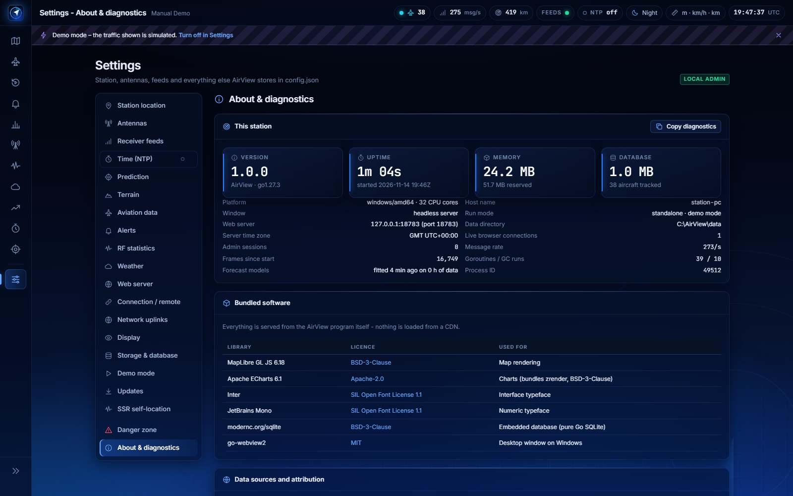

# 4.4 Troubleshooting and FAQ

Start with the three tools that answer most questions:

1. **Settings → About & diagnostics** in the web interface: version, uptime, memory, database size, run mode, web address, data directory, message rate. *Copy diagnostics* copies all of it as text for a support request.
2. **The log**: `airview.log` in the data directory (on a Linux server also `journalctl -u airview`), `journalctl -u airview-feeder` for the feeder on Linux, `<data>\logs\feeder.log` on Windows (`C:\ProgramData\AirView Feeder\logs`). Set `AIRVIEW_DEBUG=1` (or `process.logLevel` = `debug`) for more detail, and turn it off again afterwards.
3. **`airview config check`** (and `airview-feeder config check`): every configuration problem with file, line and column.

*Figure 4.3 – Settings → About & diagnostics on a demo station: version and run-time figures, the bundled software and its licences, and (further down) the data sources.*

---

## 4.4.1 The station (`airview`)

| Symptom | Likely cause and fix |
|---|---|
| Banner "No receiver feed is connected" | The feed's host or port is wrong, the receiver is off, or a firewall blocks it. A fresh installation expects a Radarcape reachable as `radarcape` on port 10003; change it in **Settings → Receiver feeds** (readsb/dump1090: type `beast`, port 30005). The feed's status dot in the top bar turns green when data arrives. |
| Banner "No feeds are enabled" | Every feed is switched off. Enable one, add your receiver, or turn on demo mode. |
| Banner "Demo mode – the traffic shown is simulated" | `demo.enabled` is on, or AirView was started with `-demo`. Turn it off in **Settings → Demo mode** (if the switch is locked, remove `-demo`, `AIRVIEW_DEMO_ENABLED` or the operator-file entry). |
| Banner "Receiver location not set" | `receiver.located` is false. Enter the antenna position in **Settings → Station location**, or let AirView estimate it on the **Locate Me** page from received traffic. Distances, range and antenna analysis need it. |
| The web interface opens on 8080 (or another port) instead of 80 | Port 80 was in use or needs privileges (on Linux, ports below 1024 need root or a capability). AirView fell back to the first free port of 8080 … 8089 and logged a warning. Set `http.port` to a free port to make it permanent. |
| A headless aggregator stops with "HTTP port … cannot be bound" | Deliberate: an aggregator does not fall back. Free the port or change `http.port`. |
| A setting cannot be changed; it shows a padlock and "Set by …" | It is set by the operator file, an `AIRVIEW_*` variable or `-set` (4.1.1). Change it there. `airview config print -sources` shows where every override comes from. |
| Settings cannot be saved from another computer: "admin password required" (401) | An admin password is set: log in. Without a password, only this machine and private-network clients may change settings; a client on another network needs a password (or `http.allowOpenAdmin`). |
| Admin password forgotten (standalone) | Open the web interface on the station itself (`http://127.0.0.1:<port>/`): the machine itself is always admin, and you can set a new password in **Settings → Web server**. Headless: put `"http": {"adminPasswordHash": "plain:<new password>"}` in the operator file and restart (it is hashed when loaded). |
| No map background | The map tiles come from free online services (OpenFreeMap, OpenStreetMap). Check the internet connection; tiles already viewed are served from the tile cache (`http.tileCache`). |
| No weather | `weather.enabled` is off, there is no internet connection, or the station has no location. |
| Terrain analysis never finishes | It downloads elevation tiles (about 30–40 MB for 450 km) once the station is located, unless `terrain.autoPrefetch` is off; then start it on request. |
| The database grows large | Lower `storage.trailRetentionDays`, `storage.minuteRetentionDays` and `storage.flightRetentionDays`; the size is shown in **About & diagnostics**. |
| The configuration file is reported as invalid on start | Run `airview config check`; it prints `file:line:col: setting: problem` and suggests the right name for typos. Remember that the operator file is JSON (quotes around names and strings, no quotes around numbers). |
| `stations.db schema version … is newer than this program` | An older binary was started on data from a newer version. Install the newer version again, or restore the backup taken before the upgrade. |
| `airview restore` refuses to run | AirView is still running (or crashed and left `airview.run` behind). Stop it; use `-force` only when you are sure no AirView uses the data directory. |
| Windows: "Windows protected your PC" when starting the installer | The installers are not code-signed. Compare the file's SHA-256 (`Get-FileHash AirView-Setup-1.0.0.exe`) with the published `SHA256SUMS`, then **More info** → **Run anyway**. |
| Windows: message "AirView could not create its window (WebView2 did not start)" | The desktop window needs the Microsoft Edge WebView2 runtime (part of current Windows 10 and 11). AirView keeps running and opens in your default browser instead; `airview.exe -headless -open` does the same on purpose. |

## 4.4.2 The feeder (`airview-feeder`)

| Symptom | Likely cause and fix |
|---|---|
| `airview-feeder status` says "not running" (exit status 3) | Start the service: `sudo systemctl start airview-feeder` (Linux) or `airview-feeder service start` / the tray icon (Windows). Check the log. |
| Installer or `detect` finds no receiver | Check that your decoder runs and offers Beast on 30005 (`ss -ltn \| grep 30005`), or give the input explicitly (`--input host:port`, `setup -input host:port`). `airview-feeder detect -host <ip>` probes 10003, 30005, 30002 and 30003. |
| "certificate pin mismatch" | The aggregator changed its certificate. Copy the new pin from its `/feeder` page or run the installer again. |
| "enrol token invalid or used" | Tokens are single-use and expire (7 days by default). Ask the operator for a new one. |
| "cloned feeder" | Two machines use the same identity key, usually after copying an SD card. On the copy run `sudo airview-feeder new-identity`, then claim the new station. |
| Station shows `pending` | The network admits stations after approval; the operator has not approved it yet. |
| Station shows `suspect` | The declared position differs from the network's measurement by more than max(100 m, 3σ). Check latitude/longitude, the altitude unit and MSL vs HAE (`altRef`). |
| MLAT never syncs | Timestamps are off (`timestamps: false`), the clock class is `none` (SBS input carries no usable timestamps), or no other synced station shares coverage. See the Timing section of your station page. |
| No MLAT results on your local map | Results go only to stations that contributed to that aircraft and send enough timed frames. Check `results.beastPort` / `results.readsbAddr`, and point your map (readsb, tar1090) at port 30105 or let the feeder push into readsb's 30104. |
| Status page not reachable from another computer | It listens on `127.0.0.1:8099` by default. Use an SSH tunnel (`ssh -L 8099:127.0.0.1:8099 pi@yourpi`) or set `ui.addr` to a LAN address **and** a password (`airview-feeder config set ui.passwordHash=<password>`); a LAN address without a password is refused. |
| Data stops when the internet is down | It does not get lost: the feeder buffers up to 10 minutes in RAM (`uplinkTuning.ringSec`) and more on disk when `spoolMb` allows it, then sends it as backfill. |

## 4.4.3 The aggregator

| Symptom | Likely cause and fix |
|---|---|
| Service exits at once; journal shows a configuration error with file:line:col | Fix `/etc/airview/airview.jsonc`; check with `airview config check`. A missing or invalid operator file that is named explicitly stops the start. |
| Log says aggregator setup is required; feeders cannot connect | No admin yet. Use the browser setup with the token in `<data>/setup-token`, or `airview admin init` on the server. Until then the feeder listeners stay closed. |
| Every feeder fails the TLS handshake | Port 30160 is behind a TLS-terminating proxy (it must not be), or the certificate changed and the feeders still pin the old one. |
| Logins are lost immediately, or every POST fails with 403 | The reverse proxy does not send `X-Forwarded-Proto: https` from an address listed in `aggregator.trustedProxies`. |
| All visitors appear to come from 127.0.0.1 (shared rate limits) | `aggregator.trustedProxies` does not list the proxy. |
| Live map does not update through nginx | `proxy_buffering off` is missing for `/api/events`. |
| A readsb / Ultrafeeder feeder shows as "unidentified" | It sends no UUID; ask the owner to set one. |
| A club relay with many stations is refused | Per-IP limits (`aggregator.limits.*`): add its address to `aggregator.limits.allowCidrs`. |
| `/healthz` answers 503 `failing` | A configured feeder port could not be opened (`listener.*` says why, e.g. "address already in use"), or a database writer is stuck. `degraded` (200) during the first minutes is normal while MLAT synchronises. |

---

## 4.4.4 Frequently asked questions

**Do I need an internet connection?**
No for receiving, decoding, the live map's aircraft and the statistics. Yes for the map background, weather, terrain data and optional aircraft-database imports. All of these are free services without an account or API key.

**Does AirView include readsb, dump1090, rtl_tcp or mlat-client?**
No. AirView has its own decoders, its own MLAT server and its own RTL-SDR demodulator. It reads data from receivers and decoders that you install separately (Beast, AVR, SBS, `aircraft.json`, or `rtl_tcp` for an RTL-SDR dongle), and it accepts readsb and mlat-client feeders on an aggregator. It never ships, links or downloads those programs (see 4.6).

**Is my station's position public?**
No, not by default. A station's map pin is `hidden` unless the owner chooses `region` (0.5° area) or `cell01` (0.1° area); the station name and statistics are private unless the owner turns on `showName` / `publicStats`. The network operator sees the exact position: it is needed for MLAT. If you send timestamps, the operator can measure the position even if you do not declare it (the setup warns about this); choose *No timestamps* if you do not want that.

**Can I feed several networks at the same time?**
Yes. A feeder or station can have several AirView uplinks, and "also feed others" Beast outputs (`uplinks[].type = "beast"`, or `airview-feeder setup -beast-out host:port`) to other aggregators.

**Where are my data and settings?**
In the data directory (4.1.1): `config.json`, the databases (`airview.db`, on an aggregator also `stations.db`), the log and the identity. The About page shows its path. Uninstalling keeps it unless you ask for removal.

**How do I move AirView to another computer?**
`airview backup -o backup.zip` on the old one, install AirView on the new one, stop it, `airview restore backup.zip`, start it.

**How do I update?**
Windows: run the new installer over the old version. Raspberry Pi and Linux: run the installer script again (or `update.sh`); settings and data are kept. With self-update configured, `airview update` / `airview-feeder update` install signed releases and roll back automatically if the new version does not stay healthy.

**Can I run AirView without the web interface being reachable from the network?**
Yes: `http.bindAddr` = `127.0.0.1` makes it local-only.

**What do "msg/s", "range" and "NTP off" in the top bar mean?**
Messages decoded per second, the distance of the farthest aircraft currently tracked, and the state of the optional NTP timing reference (`ntp.enabled`). See the glossary (4.5).

**What do the badges "Local admin", "Logged in" and "Read-only" on the Settings page mean?**
*Local admin*: you are browsing on the station itself, which is always allowed to change settings. *Logged in*: you logged in with the admin password. *Read-only*: an admin password protects the settings and you are not logged in; use *Log in*. Set an admin password before making the web interface reachable from other networks.
